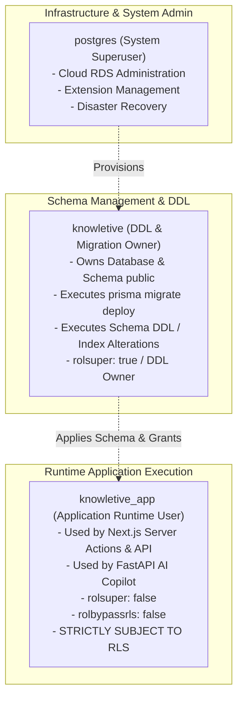

# Knowletive Runtime Database Role Separation & PostgreSQL RLS Security Architecture

**Author:** Agent 2 (Security & RBAC Specialist)  
**Collaborating Agents:** Agent 0 (Chief Architect), Agent 1 (Database & Data Architecture), Agent 3 (Backend & API)  
**Date:** 2026-11-21  
**Milestone:** Phase 2.3.3 Pre-RLS Security Architecture & RBAC Hardening  
**Status:** COMPLETE SECURITY SPECIFICATION (Execution Target: Phase 3)

---

## 1. Executive Summary

This architecture specification establishes the mandatory security foundation for PostgreSQL Row-Level Security (RLS) in Knowletive. It resolves critical architectural attack vectors and privilege escalation risks identified during the Phase 2.3.2 pre-RLS audit:

1. **Role Separation & Superuser Bypass Prevention:** Under PostgreSQL internals, superuser accounts unconditionally bypass RLS policies (`rolsuper: true` disables RLS regardless of `FORCE ROW LEVEL SECURITY`). The application connection must transition from the superuser `knowletive` to the unprivileged runtime role `knowletive_app` (`NOSUPERUSER NOBYPASSRLS`).
2. **Least-Privilege Grant Matrix:** Defines granular permissions across all 78 tables, 3 effective attribution views, sequences, and procedures, enforcing append-only immutability on audit trails and financial ledgers (`AuditLog`, `CreditTransferJournal`, `BatchEnrollmentEvent`, etc.) with zero `UPDATE` or `DELETE` grants.
3. **Tamper-Resistant Authorization Context:** Eliminates vulnerabilities arising from caller-writable GUCs (`set_config(...)`) through transaction-local scoping (`is_local = true`), security-definer validation procedures (`fn_set_tenant_context`), and connection pool reset hygiene.
4. **Platform Admin Authorization:** Defines explicit boundary controls ensuring platform owners/support cannot accidentally query or mutate private tenant data without an authenticated, audited tenant context.
5. **Student & Guardian Portal Scoping:** Establishes restrictive RLS policies confining student and guardian portal users strictly to their own enrolled student records, completely blocking access to internal ledger and administrative tables.
6. **NULL-Branch Security Invariant:** Eliminates cross-branch data leakage in historical records (`branchId IS NULL`) by restricting null-branch visibility exclusively to verified tenant-wide authorities (`is_tenant_wide = true`), forbidding branch-restricted staff from viewing or inserting unallocated records.

---

## 2. Runtime Database Role Separation Design

### 2.1 Role Hierarchy & Responsibilities



### 2.2 PostgreSQL Catalog Role Specifications

| Role Name | `rolsuper` | `rolbypassrls` | `rolcanlogin` | `rolcreatedb` | Purpose |
|---|---|---|---|---|---|
| `postgres` | `true` | `true` | `true` | `true` | Database engine administration, backups, maintenance. |
| `knowletive` | `true` | `false` | `true` | `false` | Schema owner, migration executor (`prisma migrate deploy`). |
| `knowletive_app` | **`false`** | **`false`** | `true` | `false` | **Runtime application connection pool (`DATABASE_URL`).** |

### 2.3 The Superuser RLS Bypass Invariant

In PostgreSQL:
- **`rolsuper = true` unconditionally bypasses all RLS policies**, even if `ENABLE ROW LEVEL SECURITY` and `FORCE ROW LEVEL SECURITY` are enabled on tables.
- PostgreSQL documentation explicitly confirms:
  > *"Superusers and roles with the BYPASSRLS attribute are not subject to row security policies. FORCE ROW LEVEL SECURITY has no effect on superusers."*
- Consequently, if the application server connects using `DATABASE_URL` with user `knowletive` (currently a superuser in PostgreSQL), **RLS is rendered 100% inert**.
- **Mandatory Action:** Application server configurations (`DATABASE_URL`) in Next.js and FastAPI Copilot must connect strictly as `knowletive_app`. Migration pipelines (`prisma migrate deploy`) connect via `ADMIN_DATABASE_URL` / `MIGRATION_DATABASE_URL` using `knowletive`.

### 2.4 Connection Pooling Architecture & Bleed Prevention

Knowletive uses connection pooling (PgBouncer in transaction pooling mode or Prisma connection pool). When database connections are recycled across disparate HTTP requests:
1. **Transaction-Local Scoping (`is_local = true`):**
   All runtime session variables (`app.current_tenant_id`, etc.) MUST be applied using `set_config(..., true)`. PostgreSQL automatically clears transaction-local parameters upon `COMMIT` or `ROLLBACK`.
2. **Connection Checkout / Teardown Sanitization:**
   To guarantee zero session bleed even if an unhandled transaction terminates abruptly, the connection pool wrapper or pooler checkout hook executes:
   ```sql
   DISCARD TEMP;
   RESET ALL;
   ```

---

## 3. Least-Privilege Grant Matrix for `knowletive_app`

### 3.1 Schema Level Grants

```sql
-- Revoke default public creation privileges
REVOKE CREATE ON SCHEMA public FROM PUBLIC;
REVOKE ALL ON SCHEMA public FROM knowletive_app;

-- Grant schema navigation
GRANT USAGE ON SCHEMA public TO knowletive_app;
```

### 3.2 Granular Table Permissions Matrix

| Entity Category | Target Tables | Permitted Operations | Denied Operations | Security Rationale |
|---|---|---|---|---|
| **Operational Business Entities** | `Student`, `Tenant`, `Branch`, `Membership`, `MembershipBranch`, `Role`, `Permission`, `RolePermission`, `FeeInvoice`, `FeePayment`, `PaymentReceipt`, `PaymentReceiptBalance`, `PaymentAllocation`, `Attendance`, `Lead`, `LeadActivity`, `Batch`, `BatchTeacher`, `BatchStudent`, `ExamMark`, `ExamResult`, `CopilotThread`, `CopilotMessage`, `StudentFeePlan`, `StudentFeeInstallment`, `PaymentCollectorRoute`, `PaymentProviderConfig`, etc. | `SELECT`, `INSERT`, `UPDATE`, `DELETE` | `TRUNCATE`, `REFERENCES`, `TRIGGER`, DDL | Routine application transactions subject to RLS policies. Soft-deletes and operational updates permitted. |
| **Append-Only Immutable Event & Audit Ledgers** | `AuditLog`, `BatchEnrollmentEvent`, `ExamMarksRevisionEvent`, `SyllabusProgressEvent`, `CreditTransferApprovalEvent`, `CreditTransferJournal`, `GuardianConsentEvent`, `BranchReconciliationAudit` | `SELECT`, `INSERT` | **`UPDATE`**, **`DELETE`**, **`TRUNCATE`** | **Financial & Legal Immutability.** Audit logs and financial journals cannot be tampered with or retroactively altered by the application layer. |
| **System Reference & Billing** | `Plan`, `Setting`, `RateLimitBucket` | `SELECT` (Tenant runtime) | `INSERT`, `UPDATE`, `DELETE`, `TRUNCATE` | System pricing tiers and global settings cannot be manipulated by tenant users. |
| **Effective Attribution Views** | `v_effective_fee_payment`, `v_effective_payment_receipt`, `v_effective_payment_allocation` | `SELECT` | `INSERT`, `UPDATE`, `DELETE` | Reporting views defined with `WITH (security_invoker = true)` to inherit caller RLS. |
| **Prisma Migration State** | `_prisma_migrations` | **NONE** (`REVOKE ALL`) | `ALL` | Application runtime has no reason to inspect or alter migration state. |
| **Sequences** | All sequences in `public` | `USAGE`, `SELECT` | `UPDATE` | Auto-increment IDs and receipt number sequences. |
| **Procedures & Functions** | `fn_get_effective_branch_id`, `fn_set_tenant_context`, `fn_clear_tenant_context` | `EXECUTE` | DDL | Runtime business functions and context setters. |

### 3.3 Default Privileges for Migration Invariance

To prevent permission drift when future migrations create new tables:
```sql
ALTER DEFAULT PRIVILEGES FOR ROLE knowletive IN SCHEMA public 
  GRANT SELECT, INSERT, UPDATE, DELETE ON TABLES TO knowletive_app;

ALTER DEFAULT PRIVILEGES FOR ROLE knowletive IN SCHEMA public 
  GRANT USAGE, SELECT ON SEQUENCES TO knowletive_app;

ALTER DEFAULT PRIVILEGES FOR ROLE knowletive IN SCHEMA public 
  GRANT EXECUTE ON FUNCTIONS TO knowletive_app;
```

---

## 4. RLS Authorization-Context Security Design

### 4.1 Threat Model: Caller-Writable GUCs & State Poisoning

PostgreSQL permits any connected client to invoke `set_config('custom_var', 'val', false)`. Without structural defenses, the following attack vectors exist:
1. **GUC Injection / Overwrite:** If a malicious user injects SQL, they could attempt `SELECT set_config('app.current_tenant_id', 'victim_tenant', false)`.
2. **Session Bleed in Connection Pools:** If `is_local = false` is used, the tenant context persists into the connection pool and taints the next HTTP request assigned to that physical connection.
3. **Privilege Elevation Claims:** A caller could set `app.is_platform_admin = 'true'` to bypass tenant boundaries.

### 4.2 Architectural Solution: The Security-Definer Context Setter

All authorization variables are set exclusively through an audited, verified PostgreSQL function executing with `SECURITY DEFINER`:

```sql
CREATE OR REPLACE FUNCTION public.fn_set_tenant_context(
  p_tenant_id TEXT,
  p_user_id TEXT,
  p_branch_ids TEXT DEFAULT '',
  p_is_tenant_wide BOOLEAN DEFAULT FALSE,
  p_is_platform_admin BOOLEAN DEFAULT FALSE,
  p_user_role TEXT DEFAULT 'STAFF',
  p_student_ids TEXT DEFAULT ''
) RETURNS VOID
LANGUAGE plpgsql
SECURITY DEFINER
SET search_path = public, pg_temp
AS $$
BEGIN
  -- 1. Validate Active Tenant
  IF p_tenant_id IS NOT NULL AND p_tenant_id <> '' THEN
    IF NOT EXISTS (SELECT 1 FROM public."Tenant" WHERE id = p_tenant_id AND status = 'ACTIVE') THEN
      RAISE EXCEPTION 'Security Violation: Tenant % does not exist or is not active.', p_tenant_id 
        USING ERRCODE = '28000';
    END IF;
  END IF;

  -- 2. Anti-Tamper Elevation Guard for Platform Admin
  -- If platform admin authority is claimed, verify that p_user_id is genuinely a platform user
  IF p_is_platform_admin THEN
    IF p_user_id IS NULL OR p_user_id = '' OR NOT EXISTS (
      SELECT 1 
      FROM public."User" u
      JOIN public."Membership" m ON m."userId" = u.id
      JOIN public."Role" r ON m."roleId" = r.id
      WHERE u.id = p_user_id 
        AND u.status = 'ACTIVE'
        AND (r.key = 'PLATFORM_OWNER' OR r.scope = 'PLATFORM')
    ) THEN
      RAISE EXCEPTION 'Security Violation: User % is not authorized for platform administration.', p_user_id 
        USING ERRCODE = '42501';
    END IF;
  END IF;

  -- 3. Anti-Tamper Elevation Guard for Tenant-Wide Authority
  -- If tenant-wide access is claimed for staff, verify that the user is an owner or has tenant.settings.manage
  IF p_is_tenant_wide AND NOT p_is_platform_admin THEN
    IF NOT EXISTS (
      SELECT 1 
      FROM public."Membership" m
      JOIN public."Role" r ON m."roleId" = r.id
      WHERE m."tenantId" = p_tenant_id 
        AND m."userId" = p_user_id 
        AND m.status = 'ACTIVE'
        AND (m."isOwner" = true OR r.key = 'INSTITUTE_ADMIN' OR EXISTS (
          SELECT 1 FROM public."RolePermission" rp
          JOIN public."Permission" p ON rp."permissionId" = p.id
          WHERE rp."roleId" = r.id AND p.key = 'tenant.settings.manage'
        ))
    ) THEN
      RAISE EXCEPTION 'Security Violation: User % lacks verified tenant-wide authority in tenant %.', p_user_id, p_tenant_id 
        USING ERRCODE = '42501';
    END IF;
  END IF;

  -- 4. Apply Transaction-Local Session Settings (is_local = true)
  PERFORM set_config('app.current_tenant_id', COALESCE(p_tenant_id, ''), true);
  PERFORM set_config('app.current_user_id', COALESCE(p_user_id, ''), true);
  PERFORM set_config('app.current_branch_ids', COALESCE(p_branch_ids, ''), true);
  PERFORM set_config('app.is_tenant_wide', CASE WHEN p_is_tenant_wide THEN 'true' ELSE 'false' END, true);
  PERFORM set_config('app.is_platform_admin', CASE WHEN p_is_platform_admin THEN 'true' ELSE 'false' END, true);
  PERFORM set_config('app.user_role', COALESCE(p_user_role, 'STAFF'), true);
  PERFORM set_config('app.current_student_ids', COALESCE(p_student_ids, ''), true);
  PERFORM set_config('app.context_initialized', 'true', true);
END;
$$;
```

### 4.3 Fail-Closed Policy Invariant

Every RLS policy in Knowletive must verify `app.context_initialized = 'true'`. If an unauthenticated or rogue connection queries a table without invoking `fn_set_tenant_context`, all policies evaluate to `false`, returning zero rows and throwing an RLS check violation on write.

---

## 5. Platform Admin Authorization Model

### 5.1 The Cross-Tenant Boundary Principle

1. **Global Tables (`Tenant`, `Plan`, `Setting`):**
   Platform administrators have read and mutation rights governed by:
   ```sql
   CREATE POLICY rls_platform_admin_global_tables ON "Plan"
     AS RESTRICTIVE
     FOR ALL
     USING (
       current_setting('app.is_platform_admin', true) = 'true'
     )
     WITH CHECK (
       current_setting('app.is_platform_admin', true) = 'true'
     );
   ```
2. **Tenant Business Data (`Student`, `FeePayment`, `Attendance`, etc.):**
   - **No Blind Multi-Tenant Queries:** Platform admins cannot execute un-scoped `SELECT * FROM "Student"` across all tenants.
   - **Audited Tenant-Assisted Sessions:** When platform support needs to inspect an institution's data, the application establishes context with:
     ```typescript
     await db.$executeRaw`
       SELECT fn_set_tenant_context(
         p_tenant_id => ${targetTenantId},
         p_user_id => ${platformUserId},
         p_is_tenant_wide => true,
         p_is_platform_admin => true
       );
     `;
     ```
   - An immutable `AuditLog` entry is written immediately recording the support session.

---

## 6. Student & Guardian Access Architecture

### 6.1 Role Scoping Matrix

| Role | Interface | `app.user_role` | `app.current_student_ids` | Access Boundaries |
|---|---|---|---|---|
| **Student** | Student Portal (`/portal/student`) | `'STUDENT'` | `[student.id]` | Self profile, attendance, enrollments, fee invoices, fee payments, exam marks. |
| **Guardian / Parent** | Parent Portal (`/portal/parent`) | `'GUARDIAN'` | `[child1.id, child2.id]` | Linked students' profiles, attendance, invoices, payments, exam results. |
| **Staff / Cashier** | Staff App (`/app/*`) | `'STAFF'` | `''` (Branch-Scoped) | Governed by branch hierarchy and staff role permissions. |
| **Institute Owner / Admin** | Staff App (`/app/*`) | `'ADMIN'` | `''` (Tenant-Wide) | Full institution operational access. |

### 6.2 Restrictive Policy Implementation

For student-attributed tables (`Student`, `FeeInvoice`, `PaymentReceipt`, `Attendance`, `ExamMark`, `BatchStudent`):

```sql
-- Restrictive Policy: Students & Guardians see ONLY authorized student records
CREATE POLICY rls_student_portal_scoping ON "Student"
  AS RESTRICTIVE
  FOR SELECT
  USING (
    -- Non-portal users (Staff / Admin) bypass this clause to be evaluated by branch policies
    current_setting('app.user_role', true) NOT IN ('STUDENT', 'GUARDIAN')
    OR
    -- Portal users match strictly against current_student_ids
    id = ANY(string_to_array(NULLIF(current_setting('app.current_student_ids', true), ''), ','))
  );

CREATE POLICY rls_student_portal_fee_invoice ON "FeeInvoice"
  AS RESTRICTIVE
  FOR SELECT
  USING (
    current_setting('app.user_role', true) NOT IN ('STUDENT', 'GUARDIAN')
    OR
    "studentId" = ANY(string_to_array(NULLIF(current_setting('app.current_student_ids', true), ''), ','))
  );
```

### 6.3 Absolute Denial on Internal Tables

Portal users are unconditionally denied access to internal accounting, routing, and audit tables:

```sql
CREATE POLICY rls_deny_portal_users_ledger ON "BranchLedgerEntry"
  AS RESTRICTIVE
  FOR ALL
  USING (current_setting('app.user_role', true) NOT IN ('STUDENT', 'GUARDIAN'));

CREATE POLICY rls_deny_portal_users_payout ON "BranchPayout"
  AS RESTRICTIVE
  FOR ALL
  USING (current_setting('app.user_role', true) NOT IN ('STUDENT', 'GUARDIAN'));

CREATE POLICY rls_deny_portal_users_routing ON "PaymentCollectorRoute"
  AS RESTRICTIVE
  FOR ALL
  USING (current_setting('app.user_role', true) NOT IN ('STUDENT', 'GUARDIAN'));
```

---

## 7. NULL-Branch Security Rules

### 7.1 The Historical Data Vulnerability

During Phase 1 and early Phase 2, tables (`Student`, `FeeInvoice`, `FeePayment`, `PaymentReceipt`, `Attendance`, `Lead`) operated without multi-branch partitioning, leaving `branchId = NULL`.

If an RLS branch policy uses naive syntax:
```sql
-- VULNERABLE PATTERN:
USING ("branchId" IS NULL OR "branchId" = ANY(current_branch_ids))
```
**Critical Vulnerability:** Any branch-restricted staff member (e.g., a junior cashier in "North Sub-Branch") would automatically match `"branchId" IS NULL` and read **all historical financial records and central institute transactions**!

### 7.2 Strict Invariant: NULL Means Tenant-Wide / Unallocated

1. **Read Scoping:**
   - `branchId IS NULL` rows are accessible **ONLY** when `current_setting('app.is_tenant_wide', true) = 'true'`.
   - Branch-restricted staff (`is_tenant_wide = false`) can **ONLY** view rows where `"branchId" IS NOT NULL AND "branchId" = ANY(...)`.
2. **Mutation Scoping (`WITH CHECK`):**
   - Branch-restricted staff CANNOT insert or update rows with `branchId = NULL`.
   - This prevents branch staff from creating orphaned or unassigned records that evade branch-level accounting.

### 7.3 Secure Branch Policy Formulation

```sql
CREATE POLICY rls_branch_isolation_strict ON "Student"
  AS RESTRICTIVE
  FOR ALL
  USING (
    -- 1. Tenant-Wide Authority can access all records, including branchId IS NULL
    current_setting('app.is_tenant_wide', true) = 'true'
    OR
    -- 2. Restricted staff can ONLY access records explicitly belonging to their branch set
    (
      "branchId" IS NOT NULL
      AND "branchId" = ANY(string_to_array(NULLIF(current_setting('app.current_branch_ids', true), ''), ','))
    )
  )
  WITH CHECK (
    -- 1. Tenant-Wide Authority can insert NULL or branch-attributed records
    current_setting('app.is_tenant_wide', true) = 'true'
    OR
    -- 2. Restricted staff MUST provide an authorized branchId (NEVER NULL)
    (
      "branchId" IS NOT NULL
      AND "branchId" = ANY(string_to_array(NULLIF(current_setting('app.current_branch_ids', true), ''), ','))
    )
  );
```

---

## 8. Agent 1 Schema & Migration Review Criteria

As mandated by Swarm Governance, Agent 2 will perform security and integrity reviews on Agent 1's work prior to integration:

### 8.1 Checklist for Composite Foreign Keys (`PaymentReceipt` & `FeePayment`)

- [ ] **Exact Constraint Signature:**
  `FOREIGN KEY ("tenantId", "branchId") REFERENCES "Branch"("tenantId", "id") ON DELETE RESTRICT ON UPDATE RESTRICT`
- [ ] **Nullable Column ANSI Semantics:**
  Under PostgreSQL `MATCH SIMPLE` (default), if `branchId` is `NULL`, the foreign key check succeeds automatically. When `branchId` is non-null, both `tenantId` and `branchId` must match the parent `Branch` row.
- [ ] **Data Zero-Defect Audit:**
  Confirmation that `SELECT count(*) FROM "PaymentReceipt" r JOIN "Branch" b ON r."branchId" = b.id WHERE r."tenantId" != b."tenantId"` returns **0**.
- [ ] **Update / Delete Cascade Prohibition:**
  Foreign keys must strictly specify `ON DELETE RESTRICT ON UPDATE RESTRICT` to prevent financial event mutation.

### 8.2 Checklist for `CopilotThread` & `CopilotMessage` Canonical Migration

- [ ] **Tenant Isolation Column:** Both tables must include `tenantId String` with `REFERENCES "Tenant"(id) ON DELETE CASCADE`.
- [ ] **Composite Indices:**
  `@@index([tenantId, userId])` on `CopilotThread`
  `@@index([tenantId, threadId])` on `CopilotMessage`
- [ ] **RLS Preparedness:**
  Both models must include `ENABLE ROW LEVEL SECURITY` and `FORCE ROW LEVEL SECURITY`.

### 8.3 Checklist for `WebhookEvent` Column Alignment

- [ ] **Inbox Columns:** `rawPayload`, `status`, `tenantId`, `branchId`, `updatedAt` present and consistent with `prisma/schema.prisma`.
- [ ] **Pre-Resolution Ingestion Security:**
  Since raw webhooks arrive before `tenantId` resolution, `WebhookEvent.tenantId` is nullable. RLS must allow insert by `knowletive_app` during webhook reception, and restrict query access once `tenantId` is assigned.

---

## 9. Phased Deployment Plan

1. **Step 1 (Pre-RLS):** Apply canonical migrations for composite FKs, Copilot models, and WebhookEvent (Agent 1).
2. **Step 2 (Role Provisioning):** Execute `scripts/phase3-role-separation-and-grant-matrix.sql` to grant `knowletive_app` least-privilege permissions and create `fn_set_tenant_context`.
3. **Step 3 (Dual Connection Pools):** Point Next.js server actions and API routes to `knowletive_app` while retaining `knowletive` for migrations.
4. **Step 4 (Enable RLS Policies):** Execute RLS policy scripts stage-by-stage (peripheral -> core -> financial ledger).
5. **Step 5 (Full Regression Validation):** Run all 324+ Vitest tests to confirm zero regressions and zero data leakage.
