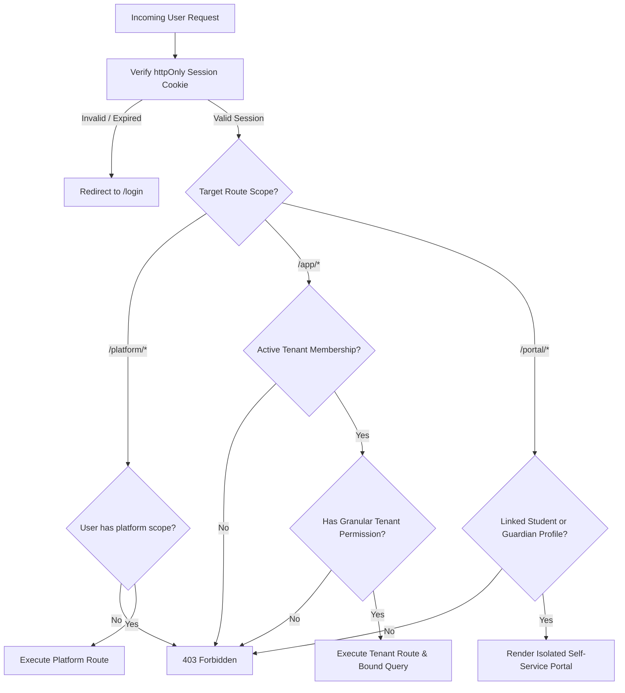
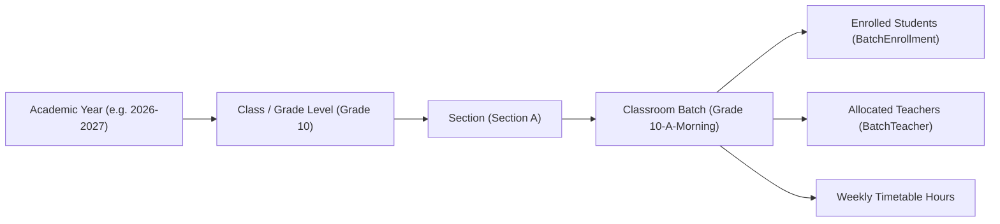
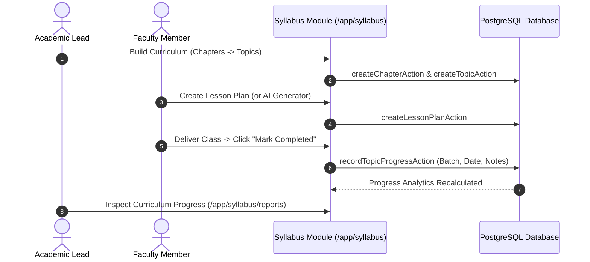
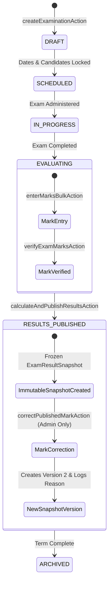
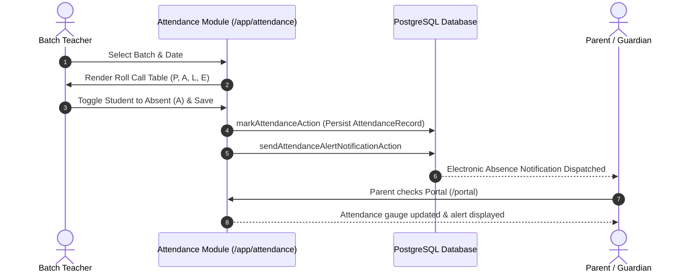
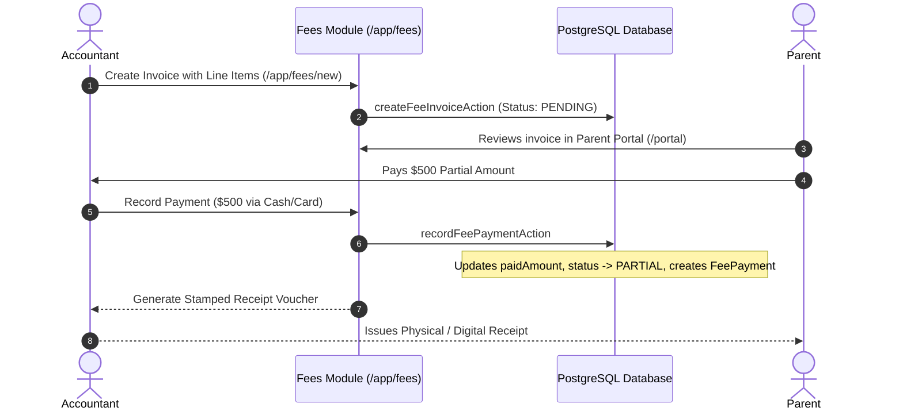
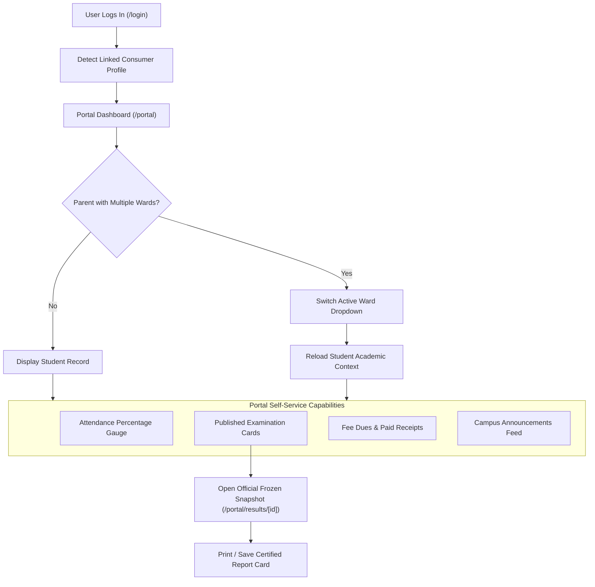

# Knowletive SaaS — System Architecture & Workflow Diagrams

## Document Information
- **Title:** Master System Architecture, Flowcharts & Sequence Diagrams
- **Document ID:** DOC-19-DIAGRAMS
- **Target Audience:** Software Architects, Developers, Technical Project Managers, System Integrators
- **Classification:** Architecture & Visual Specification
- **Repository Location:** `docs/knowletive-functional-handbook/19-SYSTEM-FLOW-DIAGRAMS.md`

---

## Table of Contents
1. [Platform Topography & Multi-Tenancy Architecture](#1-platform-topography--multi-tenancy-architecture)
2. [Dual-Scope RBAC Authorization Flow](#2-dual-scope-rbac-authorization-flow)
3. [Admissions CRM & Student Conversion Lifecycle](#3-admissions-crm--student-conversion-lifecycle)
4. [Academic Structure & Batch Formation Flowchart](#4-academic-structure--batch-formation-flowchart)
5. [SyllabusTrack Curriculum Delivery Sequence](#5-syllabustrack-curriculum-delivery-sequence)
6. [Complete Examination Lifecycle State Machine](#6-complete-examination-lifecycle-state-machine)
7. [Daily Roll Call & Parental Absence Alert Sequence](#7-daily-roll-call--parental-absence-alert-sequence)
8. [Fee Invoicing & Payment Collection Sequence](#8-fee-invoicing--payment-collection-sequence)
9. [Student & Parent Portal Self-Service Flow](#9-student--parent-portal-self-service-flow)

---

## 1. Platform Topography & Multi-Tenancy Architecture

```mermaid
flowchart TD
    Client["User Browser (Desktop / Tablet / Mobile)"] --> AuthGuard["Unified Login (/login)"]
    
    AuthGuard -->|isPlatformOwner = true| PlatformConsole["Platform Admin Console (/platform)"]
    AuthGuard -->|Staff Role (Admin/Teacher/Acc/FrontDesk)| TenantWorkspace["Institute Workspace (/app)"]
    AuthGuard -->|Consumer Role (Student/Parent)| PortalWorkspace["Unified Portal (/portal)"]
    
    subgraph MultiTenantDataLayer ["Isolated Data Partition (PostgreSQL 16)"]
        Tenant1["Tenant A (tenantId = 'sunrise')"]
        Tenant2["Tenant B (tenantId = 'oakridge')"]
        PlatformData["Global SaaS Data (Plans, Subscriptions, AI)"]
    end
    
    PlatformConsole --> PlatformData
    TenantWorkspace -->|where: tenantId = session.tenantId| Tenant1
    PortalWorkspace -->|where: studentId = session.studentId| Tenant1
```

---

## 2. Dual-Scope RBAC Authorization Flow



---

## 3. Admissions CRM & Student Conversion Lifecycle

```mermaid
sequenceDiagram
    autonumber
    actor Parent as Prospective Parent
    actor FrontDesk as Front Desk Officer
    participant CRM as CRM Module (/app/leads)
    participant DB as PostgreSQL Database
    
    Parent->>FrontDesk: Inquires via Phone / Walk-in
    FrontDesk->>CRM: Enter Student & Guardian details (/app/leads/new)
    CRM->>DB: createLeadAction (Status: NEW)
    FrontDesk->>CRM: Log Counseling Call & Tour (/app/leads/[id])
    CRM->>DB: Update Status -> QUALIFIED
    FrontDesk->>CRM: Click "Convert to Admission"
    CRM->>DB: convertLeadAction (Atomic Transaction)
    Note over DB: Creates Student, Guardian, GuardianLink & BatchEnrollment; Updates Lead -> CONVERTED
    DB-->>CRM: Conversion Confirmed
    CRM-->>FrontDesk: Display Admission Number & Printable Receipt
```

---

## 4. Academic Structure & Batch Formation Flowchart



---

## 5. SyllabusTrack Curriculum Delivery Sequence



---

## 6. Complete Examination Lifecycle State Machine



---

## 7. Daily Roll Call & Parental Absence Alert Sequence



---

## 8. Fee Invoicing & Payment Collection Sequence



---

## 9. Student & Parent Portal Self-Service Flow


