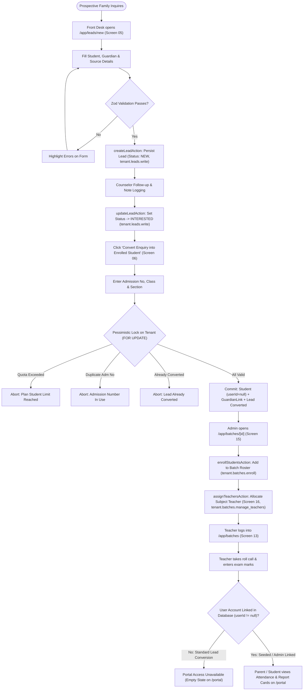
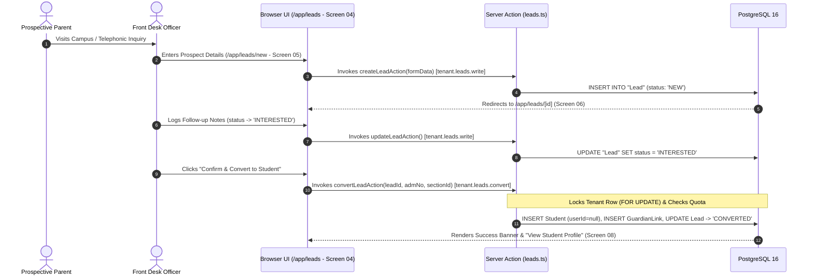
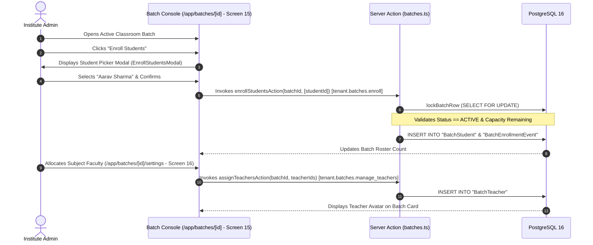
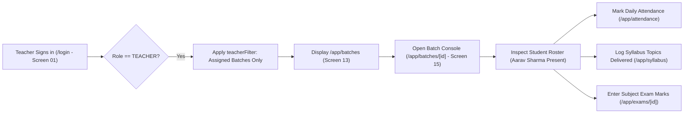
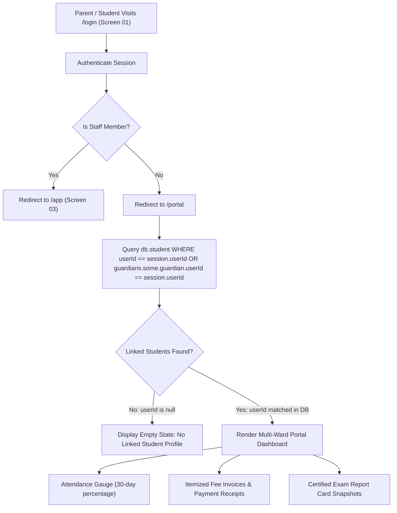
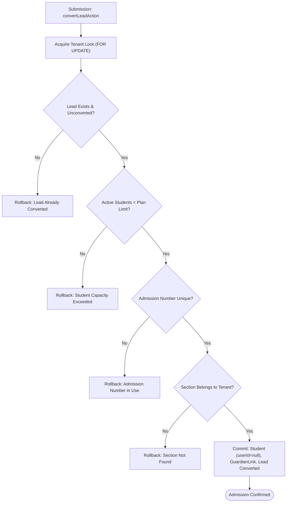

# Knowletive SaaS — Pilot User Journey: Inbound Lead to Classroom & Portal Visibility

## Document Information
- **Title:** Pilot End-to-End User Journey Specification (Final Route, RBAC & Server Action Reconciled Standard)
- **Lifecycle Arc:** Inbound Lead Capture → Follow-Up & Interest Tracking → Admission Conversion → Student & Guardian Registration → Academic Batch Enrollment → Faculty Assignment → Teacher & Conditional Portal Visibility
- **Document ID:** DOC-21-PILOT-ADMISSION-LIFECYCLE
- **Audit Revision:** 4.0 (Gold-Standard Production Baseline)
- **Target Audience:** Product Architects, Lead Business Analysts, Full-Stack Engineers, QA Automation Leads, Systems Integrators, Onboarding Specialists
- **Classification:** Gold-Standard Operational Specification & Architecture Reference
- **Repository Baseline:** `D:\IT\Saas` (Branch: `staging/exam-stage-43`)
- **Document Location:** `docs/knowletive-functional-handbook/21-PILOT-ADMISSION-TO-STUDENT-LIFECYCLE.md`

---

## Executive Summary

This document establishes the **definitive gold standard** for documenting business workflows across the Knowletive platform. It details every human interaction, UI screen, form field, client validation, server action mutation, database transaction, concurrency lock, role-based handoff, failure path, and portal projection across the complete student intake lifecycle.

### Critical Codebase Realities Enforced in this Revision:
1. **Academic Setup Consolidation & Routing:** There are no standalone `/app/academic-years` or `/app/classes` page routes in the application. Academic structures—Class Levels, Sections, Capacity, and Subjects—are managed exclusively on `/app/academics` (`src/app/(app)/app/academics/page.tsx`). Academic Years are configured centrally in Institute Settings (`/app/settings`).
2. **Dedicated Batch Creation & Settings Routes:** Batch creation is handled via the dedicated route `/app/batches/new` (`src/app/(app)/app/batches/new/page.tsx`, executing `createBatchAction`). Teacher allocation and batch capacity modifications are handled via `/app/batches/[id]/settings` (`src/app/(app)/app/batches/[id]/settings/page.tsx`, executing `assignTeachersAction` and `updateBatchAction`).
3. **Exact Tenant RBAC Mapping:** All tenant-scoped operations strictly utilize the unified permission keys defined in `src/lib/catalog.ts` and verified via `authorizeTenantWrite` in `src/lib/rbac.ts`:
   - Lead creation & updates: `tenant.leads.write`
   - Lead conversion to student: `tenant.leads.convert`
   - Direct student registration: `tenant.students.write`
   - Academic setup (classes, sections, subjects): `tenant.academics.write`
   - Batch creation & settings: `tenant.batches.write`
   - Batch student enrollment: `tenant.batches.enroll`
   - Faculty allocation: `tenant.batches.manage_teachers`
   *(Non-existent keys such as `leads.create`, `leads.update`, `students.create`, or `batches.manage` have been completely eliminated).*
4. **Reconciliation of Lead Statuses:** In the database schema and application UI, the `LeadStatus` enum consists strictly of **`NEW`**, **`CONTACTED`**, **`FOLLOW_UP`**, **`INTERESTED`**, **`CONVERTED`**, and **`LOST`**. The legacy/CRM term "QUALIFIED" does not exist in the codebase.
   - **`FOLLOW_UP` (Action Scheduled):** Operational task state indicating an inquiry has been contacted and a specific task (callback, campus tour, entrance exam) is scheduled for a future timestamp (`nextFollowUp`).
   - **`INTERESTED` (High Purchase Intent):** Sentiment state indicating the prospect has evaluated the institute, satisfied questions, and demonstrated strong commercial intent to proceed to admission.
5. **Exact Server Action Function Names:** Action calls strictly reflect their exported function declarations: `createLeadAction`, `updateLeadAction` (not `updateLeadStatusAction`), `convertLeadAction`, `createBatchAction`, `updateBatchAction`, `enrollStudentsAction`, and `assignTeachersAction`.
6. **Separation of Domain Records from User Authentication Accounts:** Converting a lead creates domain records (`Student` and `Guardian`) with `userId: null`. It does **not** create a `User` authentication record or dispatch login credentials. The user account provisioning workflow for students and guardians is **NOT IMPLEMENTED in the current application UI/actions**.

---

## Table of Contents
1. [Core Architectural Concepts & RBAC Mapping](#1-core-architectural-concepts--rbac-mapping)
2. [Prerequisites vs Live Admission Actions](#2-prerequisites-vs-live-admission-actions)
3. [Complete Screen Inventory (16 Verified Routes)](#3-complete-screen-inventory-16-verified-routes)
4. [Screen-by-Screen User Click Journey](#4-screen-by-screen-user-click-journey)
   - [Phase A: Front Desk Authentication & Intake Navigation](#phase-a-front-desk-authentication--intake-navigation)
   - [Phase B: Lead Inception & CRM Status Progression](#phase-b-lead-inception--crm-status-progression)
   - [Phase C: One-Click Admission Conversion & Atomic Transaction](#phase-c-one-click-admission-conversion--atomic-transaction)
   - [Phase D: Student 360° Profile Verification](#phase-d-student-360-profile-verification)
   - [Phase E: Classroom Batch Assembly & Student Enrollment](#phase-e-classroom-batch-assembly--student-enrollment)
   - [Phase F: Faculty Allocation & Teacher Workspace Projection](#phase-f-faculty-allocation--teacher-workspace-projection)
   - [Phase G: Conditional Student & Guardian Portal Visibility](#phase-g-conditional-student--guardian-portal-visibility)
5. [Backend Operations, Relational Schema & Database Mutations](#5-backend-operations-relational-schema--database-mutations)
6. [Cross-Role Operational Handoffs](#6-cross-role-operational-handoffs)
7. [Decision Matrix & Failure Path Catalogue](#7-decision-matrix--failure-path-catalogue)
8. [Visual Process Diagrams (Mermaid)](#8-visual-process-diagrams-mermaid)
   - [Diagram 1: Master Process Flowchart](#diagram-1-master-process-flowchart)
   - [Diagram 2: Front Desk & Admissions Swimlane](#diagram-2-front-desk--admissions-swimlane)
   - [Diagram 3: Institute Admin Batch Allocation Swimlane](#diagram-3-institute-admin-batch-allocation-swimlane)
   - [Diagram 4: Teacher & Classroom Operation Swimlane](#diagram-4-teacher--classroom-operation-swimlane)
   - [Diagram 5: Student & Parent Portal Visibility Projection](#diagram-5-student--parent-portal-visibility-projection)
   - [Diagram 6: Failure & Exception Handling Flowchart](#diagram-6-failure--exception-handling-flowchart)
9. [Master Chronological Step Table](#9-master-chronological-step-table)
10. [Source Code Citations & Verification Classifications](#10-source-code-citations--verification-classifications)
11. [Unimplemented Capabilities & Testing Requirements](#11-unimplemented-capabilities--testing-requirements)

---

## 1. Core Architectural Concepts & RBAC Mapping

### Concept A: Educational Domain Entities vs Identity Authentication Accounts
A fundamental architecture principle in Knowletive SaaS is the strict separation between business entities and user credentials:
1. **Institutional Business Entities (`Student`, `Guardian`, `StudentGuardian`):**
   - Created during admission conversion (`convertLeadAction`).
   - Store institutional attributes: admission number, emergency contacts, date of birth, blood group, class/section enrollment, and parent-child kinship relationships.
   - Contain an optional foreign key `userId` referencing `User.id`. On initial admission conversion, `Student.userId = null` and `Guardian.userId = null`.
2. **Identity Authentication Accounts (`User`, `Session`, `Membership`):**
   - Represent authenticated individuals capable of logging in via `/login`.
   - Store hashed credentials, session cookies, multi-institute memberships, and platform roles.
   - For staff, `Membership.roleId` links to institute roles. For consumers (parents/students), login authorization and data scoping are derived by matching `User.id` against `Student.userId` or `Guardian.userId`.

### Concept B: RBAC Permission Architecture (`catalog.ts` to `rbac.ts`)
Knowletive enforces tenant-scoped role-based access control through a single source of truth:
1. **Catalog Definition (`src/lib/catalog.ts`):**
   - Master permissions are declared in groups using helper functions:
     ```typescript
     const tenant = (group: string, rows: [string, string][]): PermissionDef[] =>
       rows.map(([key, label]) => ({ key: `tenant.${key}`, group, label, scope: "TENANT" }));
     ```
   - Every tenant permission is strictly prefixed with `tenant.` (e.g., `tenant.leads.write`, `tenant.batches.enroll`, `tenant.batches.manage_teachers`).
2. **Context Hydration (`src/lib/auth.ts`):**
   - Upon authentication, `getTenantContext()` loads the active institute `Membership` and its linked `RolePermission` records into an in-memory set: `ctx.permissions = new Set(role.permissions.map(p => p.permissionKey))`.
3. **Execution Guards (`src/lib/rbac.ts`):**
   - **Page Components (RSC):** Guarded by `requireTenantPermission(permissionKey: string)`. If `ctx.permissions.has(permissionKey)` is false, redirects to `/app/forbidden?p=${permissionKey}&denied=page`.
   - **Server Actions:** Guarded by `authorizeTenantWrite(permissionKey: string, actionType: ActionType)`. Validates that `hasTenantPermission(ctx, permissionKey)` is true AND confirms that `!ctx.subscriptionBlocked`.

---

## 2. Prerequisites vs Live Admission Actions

To prevent operational confusion, the platform lifecycle clearly distinguishes pre-admission institutional setup from live admission actions:

### Part I: Institutional Prerequisites (Must Exist Prior to Admission)
These administrative structures are configured once per academic cycle:
1. **Academic Year Setup (`/app/settings`):** An active `AcademicYear` record must exist with `isActive: true` (configured under Institute Settings, not `/app/academics`).
2. **Class Level Setup (`/app/academics`):** The grade level (e.g., "Grade 10" in `ClassLevel`) must be created via the "Add a class" form (`createClassAction`, guarded by `tenant.academics.write`).
3. **Section Setup (`/app/academics`):** Division standards (e.g., "Section A" under Grade 10 with designated capacity in `Section`) must be created via the "Add a section" form (`createSectionAction`, guarded by `tenant.academics.write`).
4. **Subject Allocation (`/app/academics`):** Curricular subjects linked to classes and assigned teachers must be created via the "Add a subject" form (`createSubjectAction`, guarded by `tenant.academics.write`).
5. **Classroom Batch Assembly (`/app/batches/new`):** Active teaching batch containers (e.g., "Grade 10 - Morning Cohort" in `Batch`) must be created via the batch wizard (`createBatchAction`, guarded by `tenant.batches.write`).
6. **Faculty Allocation (`/app/batches/[id]/settings`):** Teachers must be assigned to batches via the batch settings console (`assignTeachersAction`, guarded by `tenant.batches.manage_teachers`).

### Part II: Live Admission & Enrollment Actions (This Pilot Arc)
The operational actions executed dynamically for every incoming applicant:
1. **Inbound Lead Capture (`/app/leads/new`):** Capture prospect details (`createLeadAction`, status: `NEW`).
2. **Counselor Follow-up & Progression (`/app/leads/[id]`):** Conduct intake interviews, record call notes, and update status to `INTERESTED` (`updateLeadAction`).
3. **Admission Conversion (`/app/leads/[id]`):** Execute atomic conversion transaction (`convertLeadAction`) generating `Student` and `Guardian` domain entities.
4. **Student 360° Verification (`/app/students/[id]`):** Inspect student profile and statutory division allocation.
5. **Classroom Batch Enrollment (`/app/batches/[id]`):** Enroll the admitted student into the live teaching batch (`enrollStudentsAction`).
6. **Teacher Roster Projection (`/app/batches` & `/app/batches/[id]`):** Scoped batch visibility for faculty members linked via `BatchTeacher`.
7. **Consumer Portal Projection (`/portal`):** Multi-ward academic and fee visibility (conditional upon user account binding).

---

## 3. Complete Screen Inventory (16 Verified Routes)

The following 16 verified page routes represent every screen genuinely involved in the pilot workflow:

| Screen # | Screen Title | Exact Route | Source File Path | Access Guard & Required Permissions | Key UI Components & Controls |
|:---:|:---|:---|:---|:---|:---|
| **01** | Single Sign-On Portal | `/login` | `src/app/login/page.tsx` | Public | `LoginFormClient`, email input, password input, "Sign in" submit button, responsive demo account quick-fill switcher. |
| **02** | Multi-Institute Selector | `/select-institute` | `src/app/(auth)/select-institute/page.tsx` | Authenticated multi-tenant user | Institute cards grid, tenant switcher button. Displayed when user holds memberships in >1 institute. |
| **03** | Institute Operational Dashboard | `/app` | `src/app/(app)/app/page.tsx` | Active Staff Membership | Metric cards (Students, Staff, Attendance %, Fees Collected), quick-action links, pending follow-ups widget. |
| **04** | Admissions CRM Pipeline | `/app/leads` | `src/app/(app)/app/leads/page.tsx` | `tenant.leads.read` | KPI stat cards (`Total`, `NEW`, `CONTACTED`, `FOLLOW_UP`, `INTERESTED`, `CONVERTED`, `LOST`), search bar, status query filter, "+ New enquiry" button, CSV Import/Export. |
| **05** | Inbound Enquiry Intake Form | `/app/leads/new` | `src/app/(app)/app/leads/new/page.tsx` | `tenant.leads.write` | FormGrid: Student name (`*`), DOB, Class interested dropdown (`ClassLevel`), Academic year, Guardian name (`*`), Phone (`*`), Email, Source select, "Save enquiry" button. |
| **06** | Lead Detail & Conversion Console | `/app/leads/[id]` | `src/app/(app)/app/leads/[id]/page.tsx` | `tenant.leads.read` | Timeline activity feed, status update select (`NEW`, `CONTACTED`, `FOLLOW_UP`, `INTERESTED`, `LOST`), follow-up date picker, "Convert Enquiry into Enrolled Student" card (Admission No, Name, Section, "Confirm & Convert"). |
| **07** | Student Master Directory | `/app/students` | `src/app/(app)/app/students/page.tsx` | `tenant.students.read` | Status tabs (`ACTIVE`, `INACTIVE`, `ALUMNI`), class filter, search input, "+ New student" button, CSV Import/Export, student DataTable. |
| **08** | Student 360° Profile | `/app/students/[id]` | `src/app/(app)/app/students/[id]/page.tsx` | `tenant.students.read` | Profile header, attendance gauge, fee balances, GPA, Academic tab, Family tab, document uploader (`uploadStudentDocumentAction`), "Edit Profile" link. |
| **09** | Student Profile Editor | `/app/students/[id]/edit` | `src/app/(app)/app/students/[id]/edit/page.tsx` | `tenant.students.write` | Form inputs for emergency contacts, address updates, blood group, medical notes, "Save changes" submit button. |
| **10** | Guardian Directory | `/app/parents` | `src/app/(app)/app/parents/page.tsx` | `tenant.parents.read` | Searchable list of guardians, linked wards count, phone numbers, email addresses. |
| **11** | Guardian Detail Profile | `/app/parents/[id]` | `src/app/(app)/app/parents/[id]/page.tsx` | `tenant.parents.read` | Linked student profiles (`StudentGuardian`), emergency contact status, user account link indicator. |
| **12** | Academic Master Setup | `/app/academics` | `src/app/(app)/app/academics/page.tsx` | `tenant.academics.read` | Sections for Class Levels, "Add a class" form (`createClassAction`), "Add a section" form (`createSectionAction`), Subjects table, "Add a subject" form (`createSubjectAction`), and Section Capacity gauges. *(Prerequisite Screen)* |
| **13** | Classroom Batches Directory | `/app/batches` | `src/app/(app)/app/batches/page.tsx` | `tenant.batches.read` | Status tabs (`ACTIVE`, `DRAFT`, `COMPLETED`), batch cards, capacity progress bar, teacher avatars, "+ Create batch" button. Scoped by `teacherFilter` for faculty. |
| **14** | Batch Creation Wizard | `/app/batches/new` | `src/app/(app)/app/batches/new/page.tsx` | `tenant.batches.write` | Form inputs: Batch name (`*`), Batch code (`*`), Academic year select, Subject select, Capacity input, "Create batch" button. *(Prerequisite Screen)* |
| **15** | Batch Classroom Console | `/app/batches/[id]` | `src/app/(app)/app/batches/[id]/page.tsx` | `tenant.batches.read` | Student roster table, capacity gauge, "Enroll Students" modal button (`EnrollStudentsModal`), "Transfer Student" modal, "Drop Student" button, Settings link. |
| **16** | Batch Settings & Allocations | `/app/batches/[id]/settings` | `src/app/(app)/app/batches/[id]/settings/page.tsx` | `tenant.batches.write` | Edit batch details form (`updateBatchAction`), faculty allocation checklist (`assignTeachersAction`, guarded by `tenant.batches.manage_teachers`), status transitions. *(Prerequisite Screen)* |

*(Note: The consumer portal `/portal` (`src/app/(portal)/portal/page.tsx`) serves as the secondary visibility endpoint for non-staff sessions, conditional upon `Student.userId` or `Guardian.userId` linkage).*

---

## 4. Screen-by-Screen User Click Journey

### Phase A: Front Desk Authentication & Intake Navigation
1. **User:** Admissions Officer / Front Desk (e.g., `frontdesk@sunrise.test`).
2. **Screen:** `/login` (Screen 01).
3. **Action:** Enters work credentials or clicks a demo account shortcut.
4. **Submission:** Clicks **Sign in**.
5. **System Response:** `loginAction` validates credentials against `User` and `Membership`, issues signed `httpOnly` session cookies, identifies active staff membership, and redirects to `/app` (Screen 03).
6. **Navigation:** Officer clicks **Leads** in the primary navigation sidebar.
7. **Screen Opens:** Admissions CRM Pipeline (`/app/leads`, Screen 04).
8. **Action:** Officer clicks the **"+ New enquiry"** button.
9. **Screen Opens:** Inbound Enquiry Intake Form (`/app/leads/new`, Screen 05).

---

### Phase B: Lead Inception & CRM Status Progression
1. **Screen:** `/app/leads/new` (Screen 05).
2. **Form Entry:**
   - **Student full name * (Required):** `"Aarav Sharma"`.
   - **Date of Birth:** `2010-05-14`.
   - **Class Interested:** Selects `"Grade 10"` (derived from `ClassLevel` master).
   - **Academic Year:** Selects `"2026-2027"`.
   - **Guardian name * (Required):** `"Rajesh Sharma"`.
   - **Guardian phone * (Required):** `"+91 98765 43210"`.
   - **Guardian email:** `"rajesh.sharma@example.test"`.
   - **Enquiry source:** Selects `"WALK_IN"` (or `WEBSITE`, `REFERRAL`, `SOCIAL_MEDIA`).
3. **Submission:** Clicks **"Save enquiry"**.
4. **Backend Processing:** `createLeadAction` validates inputs via Zod, verifies `tenant.leads.write`, inserts a row into `Lead` (`status: "NEW"`), inserts `LeadActivity` (`action: "CREATED"`), and redirects to `/app/leads/[leadId]` (Screen 06).
5. **Screen Opens:** Lead Detail Console (`/app/leads/[id]`, Screen 06).
6. **Counselor Interaction (Status Progression):**
   - Counselor calls the parent to discuss curriculum and fees.
   - Counselor updates status from `NEW` to `CONTACTED` via `updateLeadAction` (Screen 06).
   - If an evaluation or campus visit is scheduled, counselor selects `FOLLOW_UP` and enters `nextFollowUp` date (`2026-11-15`).
   - Once the parent confirms satisfaction and commits to admission, counselor sets status to `INTERESTED`.
   - Counselor logs an activity note: *"Parent visited campus, verified Grade 10 curriculum, and agreed to admission."*

---

### Phase C: One-Click Admission Conversion & Atomic Transaction
1. **Screen:** `/app/leads/[id]` (Screen 06).
2. **Prerequisite:** Lead status is not `CONVERTED`; officer holds `tenant.leads.convert` permission.
3. **Conversion Card:** Officer scrolls to the **"Convert Enquiry into Enrolled Student"** card.
4. **Data Pre-fill:** The system automatically pre-populates:
   - Student Name: `"Aarav Sharma"`.
   - Guardian Name: `"Rajesh Sharma"`.
   - Guardian Phone: `"+91 98765 43210"`.
5. **Admission Input Entry:**
   - **Admission Number * (Required):** Enters unique identifier `"ADM-2026-089"`.
   - **Class & Section Standard * (Required):** Selects `"Grade 10 - Section A"` (from `Section` master).
6. **Execution:** Clicks **"Confirm & Convert to Student"**.
7. **Atomic PostgreSQL Transaction (`convertLeadAction`):**
   - Step 1: `SELECT id FROM "Tenant" WHERE id = $tenantId FOR UPDATE` (Pessimistic concurrency row lock).
   - Step 2: Checks that lead is unconverted (`status !== "CONVERTED"`).
   - Step 3: Asserts subscription student quota: `currentActiveStudents + 1 <= plan.maxStudents`.
   - Step 4: Checks `admissionNo` uniqueness within tenant.
   - Step 5: Upserts `Guardian` record (`userId: null`, phone: `+91 98765 43210`).
   - Step 6: Creates `Student` record (`status: "ACTIVE"`, `userId: null`, sectionId, admissionNo).
   - Step 7: Creates `StudentGuardian` join row (`isPrimary: true`, `canPickup: true`).
   - Step 8: Updates `Lead` record (`status: "CONVERTED"`, `convertedStudentId: student.id`).
   - Step 9: Writes structured audit log to `AuditLog`.
8. **UI Response:** Form submits, locks inputs, and displays a success banner: *"Lead successfully converted to Student ADM-2026-089"*, with a direct link to **"View Student Profile"**.

---

### Phase D: Student 360° Profile Verification
1. **Navigation:** Officer clicks **"View Student Profile"** or navigates to `/app/students` (Screen 07).
2. **Screen Opens:** Student 360° Profile (`/app/students/[id]`, Screen 08).
3. **Profile Inspection:**
   - **Header:** Displays Aarav Sharma, Admission #ADM-2026-089, Class: Grade 10 - Section A, Status: ACTIVE.
   - **Family Tab:** Displays primary guardian Rajesh Sharma, phone `+91 98765 43210`.
   - **User Account Indicator:** Explicitly displays *"No portal login credentials provisioned"*, reflecting `userId = null`.
   - **Academic Notice:** Indicates student is assigned to statutory Class/Section, but **not yet enrolled in an active teaching Batch**.

---

### Phase E: Classroom Batch Assembly & Student Enrollment
1. **User:** Institute Administrator / Academic Coordinator.
2. **Screen:** Batches Directory (`/app/batches`, Screen 13).
3. **Batch Selection:** Administrator selects the active batch: `"Grade 10 - Morning Cohort (MAT-101)"`.
4. **Screen Opens:** Batch Classroom Console (`/app/batches/[id]`, Screen 15).
5. **Enrollment Action:** Administrator clicks the **"Enroll Students"** button.
6. **Modal Component (`EnrollStudentsModal`):**
   - Queries students in Grade 10 who are not currently enrolled in this batch.
   - Administrator checks the box next to **"Aarav Sharma (ADM-2026-089)"**.
   - Clicks **"Enroll Selected Students"**.
7. **Backend Mutation (`enrollStudentsAction`):**
   - Calls `authorizeTenantWrite("tenant.batches.enroll", "create")`.
   - Executes atomic transaction with `lockBatchRow` (`SELECT FOR UPDATE`).
   - Verifies batch is `ACTIVE` and has remaining capacity (`currentEnrolled + 1 <= capacity`).
   - Inserts row into `BatchStudent` (`studentId`, `batchId`, `status: "ACTIVE"`).
   - Inserts audit record into `BatchEnrollmentEvent` (`eventType: "ENROLLED"`).
8. **UI Update:** Modal dismisses, roster table instantly revalidates, and capacity counter updates (e.g., 29/35).

---

### Phase F: Faculty Allocation & Teacher Workspace Projection
1. **Prerequisite Setup (`/app/batches/[id]/settings`, Screen 16):**
   - Administrator navigates to Batch Settings.
   - Under "Assigned Teachers", selects Mathematics Faculty member (e.g., John Doe, `teacher@sunrise.test`).
   - Clicks **"Save assignments"** (`assignTeachersAction`, guarded by `tenant.batches.manage_teachers`).
   - Database creates `BatchTeacher` link (`teacherId: membership.id`, `batchId`).
2. **Teacher Authentication:**
   - Teacher visits `/login` (Screen 01) and signs in.
   - Session verifies membership with `roleKey == "TEACHER"`.
   - System redirects teacher to `/app/batches` (Screen 13).
3. **Teacher Filtering Logic:**
   - In `src/app/(app)/app/batches/page.tsx`, the query evaluates:
     ```typescript
     const teacherFilter = roleKey === "TEACHER"
       ? { teachers: { some: { teacher: { userId: ctx.user.id } } } }
       : {};
     ```
   - Teacher strictly sees batches where their membership is assigned.
4. **Classroom Execution:**
   - Teacher clicks on `"Grade 10 - Morning Cohort"` (`/app/batches/[id]`, Screen 15).
   - Aarav Sharma appears on the roster.
   - Teacher can now mark Aarav present in daily attendance registers (`/app/attendance`) and enter marks during exam grading cycles (`/app/exams/grading`).

---

### Phase G: Conditional Student & Guardian Portal Visibility
1. **Consumer Portal Security Barrier:**
   - In `src/app/(portal)/portal/page.tsx`, portal dashboards are queried exclusively by the authenticated user's ID:
     ```typescript
     const linkedStudents = await db.student.findMany({
       where: {
         tenantId: ctx.tenant.id,
         OR: [
           { guardians: { some: { guardian: { userId: ctx.user.id } } } },
           { userId: ctx.user.id }
         ]
       }
     });
     ```
2. **Immediate Post-Conversion State:**
   - Converting a lead leaves `Guardian.userId = null` and `Student.userId = null`.
   - Therefore, a newly converted student is **not visible to any consumer login** out-of-the-box.
3. **Condition for Portal Access:**
   - If an identity provisioning script or database binding links a `User` account to `Guardian.userId` (as demonstrated by seeded demo account `parent@sunrise.test`), logging into `/portal` displays:
     - Multi-ward student switcher.
     - 30-day attendance percentage gauge.
     - Real-time fee invoice balances with dynamic QR code payment links.
     - Published exam report cards and GPA summaries.

---

## 5. Backend Operations, Relational Schema & Database Mutations

### Master Relational Data Flow
```
[Lead] (status: NEW -> CONTACTED -> FOLLOW_UP -> INTERESTED)
  │
  │ (convertLeadAction - tenant.leads.convert)
  ├──> [Student] (status: ACTIVE, userId: null, sectionId: Section.id)
  ├──> [Guardian] (userId: null, phone: "+91 98765 43210")
  ├──> [StudentGuardian] (studentId, guardianId, isPrimary: true)
  └──> [Lead] (status: CONVERTED, convertedStudentId: Student.id)
          │
          │ (enrollStudentsAction - tenant.batches.enroll)
          ├──> [BatchStudent] (batchId, studentId, status: ACTIVE)
          └──> [BatchEnrollmentEvent] (batchId, studentId, eventType: ENROLLED)
                  │
                  │ (assignTeachersAction - tenant.batches.manage_teachers)
                  └──> [BatchTeacher] (batchId, teacherId: Membership.id)
```

### Comprehensive Backend Actions Table

| Action # | Exported Server Action | Source File | Input Schema / Arguments | Authorization Key Checked | Concurrency & Validation Mechanism | Entities Mutated | Outcome & Return Signature |
|:---:|:---|:---|:---|:---|:---|:---|:---|
| **1** | `createLeadAction` | `src/actions/leads.ts` | `createLeadSchema` (Zod) | `tenant.leads.write` | Validates phone/email; checks academic year belongs to tenant. | `Lead`, `LeadActivity`, `AuditLog` | **Success:** Redirects to `/app/leads/[id]`.<br>**Error:** Field errors or generic failure string. |
| **2** | `updateLeadAction` | `src/actions/leads.ts` | `updateLeadSchema` (Zod) | `tenant.leads.write` | Tenant-bounded ID update; updates status (`NEW`/`CONTACTED`/`FOLLOW_UP`/`INTERESTED`/`LOST`). | `Lead`, `LeadActivity` | **Success:** Returns `{ success: true }`.<br>**Error:** Error string. |
| **3** | `convertLeadAction` | `src/actions/leads.ts` | `convertSchema` (Zod) | `tenant.leads.convert` | **Atomic `$transaction`** with `SELECT ... FOR UPDATE` pessimistic row lock on `Tenant`. | `Student`, `Guardian`, `StudentGuardian`, `Lead`, `LeadActivity`, `AuditLog` | **Success:** Returns `{ success: true }`, revalidates paths.<br>**Error:** Quota reached, duplicate admNo, already converted. |
| **4** | `createClassAction` | `src/actions/students.ts` | `classSchema` (Zod) | `tenant.academics.write` | Validates unique class name within tenant. | `ClassLevel`, `AuditLog` | **Success:** Revalidates `/app/academics`.<br>**Error:** Duplicate name or validation error. |
| **5** | `createSectionAction` | `src/actions/students.ts` | `sectionSchema` (Zod) | `tenant.academics.write` | Validates class level exists in tenant; sets capacity. | `Section`, `AuditLog` | **Success:** Revalidates `/app/academics`.<br>**Error:** Invalid class ID or capacity error. |
| **6** | `createSubjectAction` | `src/actions/students.ts` | `subjectSchema` (Zod) | `tenant.academics.write` | Validates subject code and optional teacher assignment. | `Subject`, `AuditLog` | **Success:** Revalidates `/app/academics`.<br>**Error:** Validation failure. |
| **7** | `createBatchAction` | `src/actions/batches.ts` | `createBatchSchema` (Zod) | `tenant.batches.write` | Validates academic year and subject ownership. | `Batch`, `AuditLog` | **Success:** Redirects to `/app/batches/[id]`.<br>**Error:** Duplicate code or capacity errors. |
| **8** | `updateBatchAction` | `src/actions/batches.ts` | `updateBatchSchema` (Zod) | `tenant.batches.write` | Executes `lockBatchRow` (`FOR UPDATE`); updates room/code. | `Batch`, `AuditLog` | **Success:** Revalidates `/app/batches/[id]`.<br>**Error:** Concurrency error. |
| **9** | `enrollStudentsAction` | `src/actions/batches.ts` | `enrollStudentsSchema` (Zod) | `tenant.batches.enroll` | **Atomic `$transaction`** with `lockBatchRow` (`SELECT FOR UPDATE`) and capacity assertion. | `BatchStudent`, `BatchEnrollmentEvent`, `AuditLog` | **Success:** Returns `{ enrolledCount }`.<br>**Error:** Capacity exceeded, inactive student. |
| **10** | `assignTeachersAction` | `src/actions/batches.ts` | `teacherIds` (Array) | `tenant.batches.manage_teachers` | Locks batch row; validates active teacher memberships in tenant. | `BatchTeacher`, `AuditLog` | **Success:** Returns `{ success: true }`.<br>**Error:** Invalid teacher ID. |

---

## 6. Cross-Role Operational Handoffs

### Complete Handoff Sequence
```
[1. Prospective Family] ──(Inquiry)──> [2. Front Desk / Admissions]
                                             │
                                     (convertLeadAction)
                                             ▼
                                  [3. Institute Administrator]
                                             │
                                  (enrollStudentsAction & assignTeachersAction)
                                             ▼
                                  [4. Assigned Class Teacher]
                                             │
                                  (Attendance, Syllabus & Grading)
                                             ▼
                                  [5. Enrolled Student & Parent]
```

### Role-by-Role Detail Table

| From Role | To Role | Operational Asset Handed Off | Entity State Transferred | Permissions Required | Target Operational Action | Failure Boundary / Non-Permitted Actions |
|:---|:---|:---|:---|:---|:---|:---|
| **Prospective Family** | **Front Desk Officer** | Inbound prospect details, parent phone, grade requested | Raw inquiry data | None (Public) | Officer opens `/app/leads/new` (Screen 05) and logs enquiry. | Front desk cannot log inquiries without `tenant.leads.write`. |
| **Front Desk** | **Admissions Counselor** | Inbound prospect details, contact record | `Lead` (Status: `NEW`) | `tenant.leads.read`, `tenant.leads.write` | Counselor reviews enquiry, logs follow-up calls, updates status to `INTERESTED`. | Cannot convert to student without `tenant.leads.convert`. |
| **Counselor / Front Desk** | **Institute Admin** | Interested candidate, verified parent contact, intended grade | `Student` (Active), `Guardian`, `StudentGuardian`, `Lead` (`CONVERTED`) | `tenant.students.read`, `tenant.batches.write` | Admin inspects student profile, confirms tuition structures, and assigns student to a classroom batch. | Cannot assign student to batch without verifying room capacity. |
| **Institute Admin** | **Batch Faculty / Teacher** | Scheduled class, student roster, room timetable | `BatchStudent` (Active), `BatchTeacher` | `tenant.batches.read`, `tenant.attendance.write`, `tenant.exams.enter_marks` | Teacher sees batch on `/app/batches`, takes roll call, logs syllabus delivery, enters exam scores. | Teacher **cannot** see unassigned batches or alter student enrollment status. |
| **Admin / Identity System** | **Student & Parent** | Certified term report cards, attendance gauge, fee invoices | `ExamResultSnapshot`, `AttendanceRecord`, `FeeInvoice` | `tenant.portal.read`, `tenant.announcements.read` | Family views attendance percentage, inspects certified report cards, pays invoices via QR code. | Family **cannot** view any other student's records, cannot access `/app`, and **cannot log in unless `userId` is linked**. |

---

## 7. Decision Matrix & Failure Path Catalogue

| Failure Scenario | Interception Level | Verification Logic in Codebase | Error Message Displayed to User | Rollback & System Recovery Behavior |
|:---|:---|:---|:---|:---|
| **Subscription Student Quota Exceeded** | `convertLeadAction` | `assertStudentCapacityTx` checks active count against `Plan.maxStudents`. | *"Student limit reached for this plan. Please upgrade to admit more students."* | Transaction rolls back immediately; lead remains in `INTERESTED` status; no student row inserted. |
| **Repeated Conversion Attempt on Same Lead** | `convertLeadAction` | Checks lead status inside transaction under lock (`lead.status === "CONVERTED"`). | *"This lead has already been converted to an active student."* | Transaction aborts; no duplicate student created. |
| **Missing Required Lead Fields** | Client & Zod | Client HTML5 validation + Zod schema validation in action. | *"Student name and guardian phone number are required."* | Form highlights invalid fields; no database query executed. |
| **Duplicate Admission Number** | `convertLeadAction` | Checks `admissionNo` uniqueness under tenant (`tx.student.findFirst`). | *"Admission number 'ADM-2026-089' is already in use."* | Transaction rolls back; user prompted to input unique admission number. |
| **Invalid Section Selection** | `convertLeadAction` | Verifies `section.tenantId === ctx.tenant.id`. | *"Selected academic section does not belong to this institute."* | Transaction rolls back. |
| **Batch Room Capacity Exceeded** | `enrollStudentsAction` | Checks `batch.currentEnrolled + newCount <= batch.capacity` under lock. | *"Enrollment exceeds maximum batch capacity of 35."* | Transaction rolls back; student not added to batch. |
| **Batch is Inactive or Archived** | `enrollStudentsAction` | Validates that only `ACTIVE` batches accept new student enrollments. | *"Enrollment is rejected. Batch is currently 'COMPLETED'."* | Transaction rolls back. |
| **Student Already Enrolled in Batch** | `enrollStudentsAction` | Checks for existing active `BatchStudent` row. | Filtered out during candidate evaluation; returns `enrolledCount: 0`. | No duplicate row created. |
| **Unauthorized Role Attempting Conversion** | Server Action | Checks `authorizeTenantWrite("tenant.leads.convert")`. | *"Access denied. You do not have permission to convert leads."* | Action returns error state; security audit event logged. |

---

## 8. Visual Process Diagrams (Mermaid)

### Diagram 1: Master Process Flowchart



---

### Diagram 2: Front Desk & Admissions Swimlane



---

### Diagram 3: Institute Admin Batch Allocation Swimlane



---

### Diagram 4: Teacher & Classroom Operation Swimlane



---

### Diagram 5: Student & Parent Portal Visibility Projection



---

### Diagram 6: Failure & Exception Handling Flowchart



---

## 9. Master Chronological Step Table

| Step # | Role | Screen / Route | User Action | System Action & Permission Checked | Database Effect | Next Operational Step |
|:---:|:---|:---|:---|:---|:---|:---|
| **01** | Front Desk | `/login` (Screen 01) | Enters email & password; clicks "Sign in". | Validates credentials; sets httpOnly session cookie. | Reads `User` & `Membership`. | Redirects to `/app` (Screen 03). |
| **02** | Front Desk | `/app` (Screen 03) | Clicks "Leads" in sidebar. | Queries tenant leads; verifies `tenant.leads.read`. | Reads `Lead` table. | Opens `/app/leads` (Screen 04). |
| **03** | Front Desk | `/app/leads` (Screen 04) | Clicks "+ New enquiry" button. | Loads classes, academic years, and staff lists. | Reads `ClassLevel`, `AcademicYear`. | Opens `/app/leads/new` (Screen 05). |
| **04** | Front Desk | `/app/leads/new` (Screen 05) | Fills student name, guardian phone, grade; clicks "Save enquiry". | Executes `createLeadAction`; authorizes `tenant.leads.write`. | **INSERT** `Lead`, `LeadActivity`, `AuditLog`. | Redirects to `/app/leads/[id]` (Screen 06). |
| **05** | Front Desk | `/app/leads/[id]` (Screen 06) | Logs counseling calls; updates status to "INTERESTED". | Executes `updateLeadAction`; authorizes `tenant.leads.write`. | **UPDATE** `Lead.status = 'INTERESTED'`, **INSERT** `LeadActivity`. | Scrolls to conversion card. |
| **06** | Front Desk | `/app/leads/[id]` (Screen 06) | Fills admission number, selects Section; clicks "Confirm & Convert". | Executes `convertLeadAction` under tenant row lock; authorizes `tenant.leads.convert`. | **INSERT** `Student` (userId=null), `Guardian` (userId=null), `StudentGuardian`; **UPDATE** `Lead` to CONVERTED. | Displays green success banner. |
| **07** | Admin | `/app/students` (Screen 07) | Clicks student name "Aarav Sharma". | Queries student 360° profile; verifies `tenant.students.read`. | Reads `Student`, `Section`, `GuardianLink`. | Opens `/app/students/[id]` (Screen 08). |
| **08** | Admin | `/app/batches` (Screen 13) | Locates active grade 10 batch; clicks batch card. | Verifies `tenant.batches.read`. | Reads `Batch`, `BatchTeacher`. | Opens `/app/batches/[id]` (Screen 15). |
| **09** | Admin | `/app/batches/[id]` (Screen 15) | Clicks "Enroll Students"; selects Aarav Sharma; confirms. | Executes `enrollStudentsAction` with row lock; authorizes `tenant.batches.enroll`. | **INSERT** `BatchStudent` (ACTIVE), `BatchEnrollmentEvent` (ENROLLED). | Roster updates; seat count increments. |
| **10** | Admin | `/app/batches/[id]/settings` (Screen 16) | Selects John Doe as Mathematics teacher; clicks Save. | Executes `assignTeachersAction`; authorizes `tenant.batches.manage_teachers`. | **INSERT** `BatchTeacher`. | Teacher assigned to batch. |
| **11** | Teacher | `/login` (Screen 01) | Signs in as `teacher@sunrise.test`. | Validates credentials; checks `roleKey == "TEACHER"`. | Reads `Membership`. | Lands on `/app/batches` (Screen 13). |
| **12** | Teacher | `/app/batches` (Screen 13) | Clicks on assigned classroom batch. | Applies `teacherFilter` ensuring only assigned batches are returned. | Reads `Batch` where `teachers.some.teacher.userId == user.id`. | Opens `/app/batches/[id]` (Screen 15). |
| **13** | Teacher | `/app/batches/[id]` (Screen 15) | Views student roster; sees Aarav Sharma. | Renders student table with roll numbers. | Reads `BatchStudent` joined with `Student`. | Can now mark attendance and enter marks. |
| **14** | Parent | `/login` (Screen 01) | Signs in as `parent@sunrise.test` (Seeded account). | Non-staff detected; checks linked guardian profiles. | Reads `Student` where `guardians.some.guardian.userId == user.id`. | Redirects to `/portal`. |
| **15** | Parent | `/portal` | Views child's academic dashboard. | Renders attendance gauge, fee balances, published exam cards **only if linked in DB**. | Reads `Attendance`, `FeeInvoice`, `ExamResultSnapshot`. | Full self-service transparency achieved if linked. |

---

## 10. Source Code Citations & Verification Classifications

| Step / Capability | Repository File Path | Exported Identifier / Symbol | Model / Constraint | Verification Classification |
|:---|:---|:---|:---|:---:|
| **Authentication & Cookie Issuance** | `src/actions/auth.ts` | `loginAction` | `User`, `Session`, `Membership` | **RUNTIME VERIFIED** (Playwright Suite) |
| **Lead Creation** | `src/actions/leads.ts` | `createLeadAction` (`tenant.leads.write`) | `Lead`, `LeadActivity` | **RUNTIME VERIFIED** (Playwright Suite) |
| **Lead Status Enum & Filter** | `src/app/(app)/app/leads/page.tsx` | `validStatuses` | `LeadStatus` (NEW, CONTACTED, FOLLOW_UP, INTERESTED, CONVERTED, LOST) | **SOURCE VERIFIED** |
| **Pessimistic Concurrency Lock** | `src/actions/leads.ts` | `SELECT ... FOR UPDATE` | `Tenant` table lock | **SOURCE VERIFIED** (Integration Suite) |
| **Subscription Quota Check** | `src/lib/entitlements.ts` | `assertStudentCapacityTx` | `Subscription`, `Plan.maxStudents` | **SOURCE VERIFIED** |
| **Admission Conversion** | `src/actions/leads.ts` | `convertLeadAction` (`tenant.leads.convert`) | `Student`, `Guardian`, `StudentGuardian` | **RUNTIME VERIFIED** (Playwright Suite) |
| **Student / Parent User Creation** | `src/actions/*` | None (UI creation flow not present) | `Student.userId`, `Guardian.userId` | **NOT IMPLEMENTED IN UI** |
| **Academic Master Setup** | `src/app/(app)/app/academics/page.tsx` | `createClassAction`, `createSectionAction`, `createSubjectAction` | `ClassLevel`, `Section`, `Subject` | **SOURCE VERIFIED** |
| **Batch Creation Wizard** | `src/app/(app)/app/batches/new/page.tsx` | `createBatchAction` (`tenant.batches.write`) | `Batch` | **SOURCE VERIFIED** |
| **Batch Row Lock & Capacity Check** | `src/actions/batches.ts` | `lockBatchRow` | `Batch` table lock (`FOR UPDATE`) | **SOURCE VERIFIED** (Concurrency Tests) |
| **Batch Enrollment** | `src/actions/batches.ts` | `enrollStudentsAction` (`tenant.batches.enroll`) | `BatchStudent`, `BatchEnrollmentEvent` | **RUNTIME VERIFIED** (Playwright Suite) |
| **Teacher Allocation** | `src/actions/batches.ts` | `assignTeachersAction` (`tenant.batches.manage_teachers`) | `BatchTeacher` | **SOURCE VERIFIED** |
| **Teacher Query Scoping** | `src/app/(app)/app/batches/page.tsx` | `teacherFilter` | `BatchTeacher.teacher.userId` | **SOURCE VERIFIED** |
| **Portal Multi-Ward Query** | `src/app/(portal)/portal/page.tsx` | `linkedStudents` | `StudentGuardian.guardian.userId` | **RUNTIME VERIFIED** (Playwright Suite) |
| **Newly Converted Student Portal Visibility** | `src/app/(portal)/portal/page.tsx` | `linkedStudents` | `userId: null` on conversion | **NOT VERIFIED / CONDITIONAL** (Empty state unless script-linked) |

---

## 11. Unimplemented Capabilities & Testing Requirements

To ensure complete documentation integrity, the following architectural nuances and roadmap items are explicitly documented:

### 1. Student and Guardian User Account Provisioning Workflow (NOT IMPLEMENTED)
- **Code Reality:** In `src/actions/students.ts`, `inviteStaffAction` exists for staff, and in `src/actions/platform.ts`, `invitePlatformUserAction` exists for platform engineers. However, **no `inviteStudentAction` or `inviteGuardianAction` exists**.
- **Impact:** Converting a lead creates the institutional business records (`Student` and `Guardian`), but leaves `userId: null`. A newly converted student or their guardian **cannot log in to the portal** out-of-the-box.
- **Current Workaround:** Staging and automated testing utilize administrative database provisioning scripts (`scripts/check-users.mjs`) to insert `User` rows and bind `Student.userId` and `Guardian.userId`.
- **Roadmap Requirement:** Build a dedicated parent/student portal invitation modal on `/app/students/[id]` and `/app/parents/[id]` that generates a `User` record, dispatches a secure password creation link, and populates `userId`.

### 2. Runtime Verification Boundary of Portal Access (NOT VERIFIED FOR CONVERTED LEADS)
- **Code Reality:** While the `/portal` dashboard was verified to load cleanly for seeded demonstration credentials (`parent@sunrise.test`), **runtime testing does NOT prove that a newly converted student is visible to their guardian**.
- **Reason:** In real runtime usage, converting a lead leaves `Guardian.userId = null`. The parent has no credentials and no foreign key linkage. Portal visibility is strictly **CONDITIONAL** upon manual database linkage until an account invitation feature is implemented.

### 3. Automated SMS Gateway Delivery (PARTIALLY IMPLEMENTED / STUBBED)
- **Code Reality:** Attendance absence alerts and fee reminders execute and write records to `NotificationLog`.
- **Roadmap Requirement:** Attach live Twilio or AWS SNS credentials to the notification transport to dispatch actual SMS messages to physical mobile devices.

### 4. Payment Gateway Webhook Reconciliation (SOURCE VERIFIED, RUNTIME UNVERIFIED)
- **Code Reality:** Fee invoices generate public tokenized payment URLs (`/pay/[token]`) with dynamic QR codes. Parents can upload payment proof via `submitPaymentProofAction`.
- **Roadmap Requirement:** Connect live Stripe or Razorpay webhooks in staging to test automated payment settlement without cashier approval.
