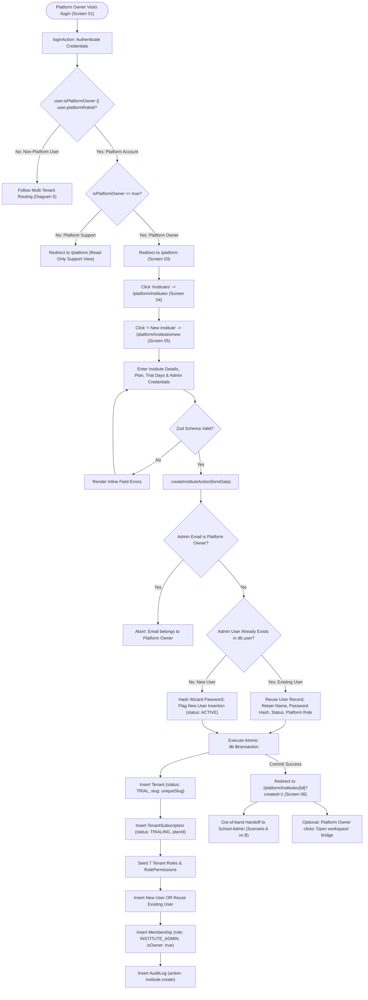
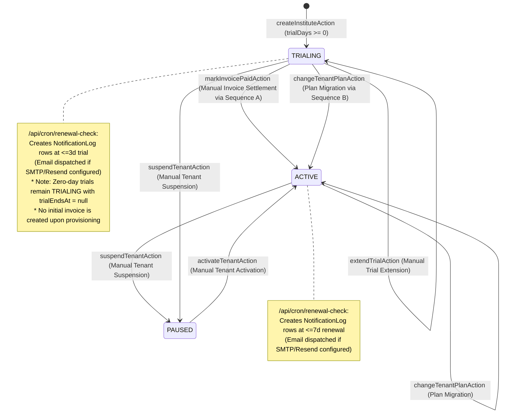
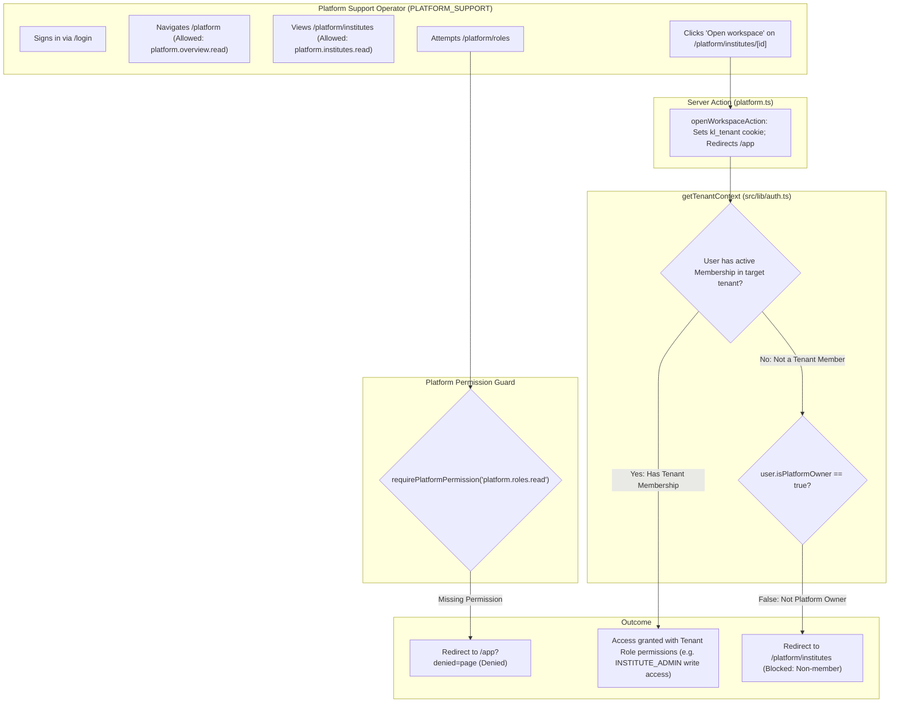
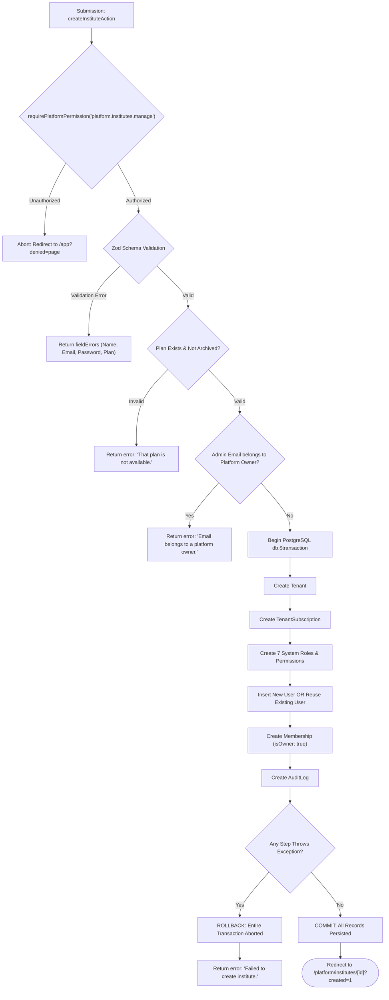

# Knowletive SaaS — Complete Journey 2: Platform Owner to Institute Provisioning and Admin Handoff

## Document Information
- **Title:** Platform Owner Institute Provisioning & Administrator Handoff Specification
- **Lifecycle Arc:** Platform Owner Authentication → Platform Metrics & Management → Institute Provisioning & Subscription Assignment → Role Seeding & Admin Account Generation → Out-of-Band Handoff → Institute Admin First Login & Workspace Activation
- **Document ID:** DOC-22-PLATFORM-OWNER-PROVISIONING-JOURNEY
- **Audit Revision:** 2.13 (Final Matrix Preconditions & Post-Lockout Clarification Baseline)
- **Target Audience:** Platform Owners, SaaS Operations Leads, Enterprise Systems Architects, Cloud Infrastructure Engineers, Customer Success Directors, Support Engineers
- **Classification:** Operational Specification & Architecture Reference
- **Repository Baseline:** `D:\IT\Saas` (Branch: `staging/exam-stage-43`)
- **Document Location:** `docs/knowletive-functional-handbook/22-PLATFORM-OWNER-INSTITUTE-PROVISIONING-JOURNEY.md`

---

## Executive Summary

This document establishes the **authoritative functional specification** for the multi-tenant onboarding, provisioning, and subscription lifecycle in the Knowletive SaaS platform. It tracks the complete operational arc through which a **Platform Owner** provisions an isolated educational tenant, binds a commercial subscription plan, seeds institutional role templates, creates or binds the primary **Institute Administrator** account, and transfers operational governance to school or college leadership.

### Critical Codebase Realities Enforced in Revision 2.13:
0. **Canonical Exported Action Inventory & Permission Matrix (`src/actions/platform.ts`):**
   Repository source inspection establishes exactly **14 exported server actions** in `src/actions/platform.ts`. Every platform operation maps to an authoritative exported server action and an exact permission string from `src/lib/catalog.ts`:
   - `createInstituteAction` (`platform.institutes.manage`)
   - `suspendTenantAction` (`platform.institutes.manage` via `setTenantStatus`)
   - `activateTenantAction` (`platform.institutes.manage` via `setTenantStatus`)
   - `openWorkspaceAction` (`platform.institutes.read`)
   - `extendTrialAction` (`platform.subscriptions.manage`)
   - `changeTenantPlanAction` (`platform.subscriptions.manage`)
   - `markInvoicePaidAction` (`platform.subscriptions.manage`)
   - `createTenantInvoiceAction` (`platform.subscriptions.manage`)
   - `createPlanAction` (`platform.plans.manage`)
   - `savePlanAction` (`platform.plans.manage`)
   - `savePlatformRoleAction` (`platform.roles.manage`)
   - `invitePlatformUserAction` (`platform.users.manage`)
   - `updatePlatformUserStatusAction` (`platform.users.manage`)
   - `savePlatformSettingsAction` (`platform.settings.manage`)
   All permissions match the exact 14 `PLATFORM` scope keys defined in `src/lib/catalog.ts` (the authoritative institute mutation permission is `platform.institutes.manage` and the authoritative subscription/invoice mutation permission is `platform.subscriptions.manage`).

1. **Transactional Provisioning & Zero-Day Trial Mechanics (`createInstituteAction`):**
   In `src/actions/platform.ts`, `createInstituteAction` executes an all-or-nothing PostgreSQL transaction (`db.$transaction`). Regardless of whether `trialDays > 0` or `trialDays === 0`:
   - `Tenant.status` is unconditionally initialized to `"TRIAL"`.
   - `TenantSubscription.status` is unconditionally initialized to `"TRIALING"`.
   - If `trialDays > 0`: `trialEndsAt = now + trialDays`, and `currentPeriodEnd = trialEndsAt`.
   - If `trialDays === 0`: `trialEndsAt = null`, and `currentPeriodEnd = now + 14 days` (fallback default).
   - **No Initial Invoice Generated:** `createInstituteAction` does **not** generate an initial invoice.
   > [!WARNING] **Operational Reality & Activation of Zero-Day Trials:**
   > While the wizard UI at `/platform/institutes/new` displays the hint *"Set 0 to start as active (no trial)"*, the backend code does **not** create an `ACTIVE` subscription. A zero-day trial:
   > 1. Does **not** set `TenantSubscription.status = "ACTIVE"` or `Tenant.status = "ACTIVE"`.
   > 2. Sets `trialEndsAt = null` on both `Tenant` and `TenantSubscription`.
   > 3. Leaves `TenantSubscription.status = "TRIALING"`.
   > 4. Sets `currentPeriodEnd = now + 14 days` as a fallback timestamp that does **not** dynamically block writes at request time.
   > 5. Remains completely **excluded from MRR** (contributing ₹0) while in `"TRIALING"` status.
   > 6. Will never automatically transition to active or expired because no automated degradation cron exists.
   > 
   > **Supported Activation Sequences for Zero-Day Trials:**
   > Because `markInvoicePaidAction` requires an existing `invoiceId` (and throws `Error("Invoice not found")` if invoked without one), operators must follow one of two supported application sequences to move a zero-day trial into `ACTIVE` status:
   > - **Sequence A (Invoice Generation & Manual Settlement):**
   >   1. Platform Owner navigates to `/platform/institutes/[id]`.
   >   2. Invokes `createTenantInvoiceAction` via the "Generate invoice" form to create a pending `Invoice`.
   >   3. Invokes `markInvoicePaidAction` on that invoice. In `src/lib/billing.ts`, `markInvoicePaid` transitions `TenantSubscription.status = "ACTIVE"`, `Tenant.status = "ACTIVE"`, and advances `currentPeriodEnd`.
   > - **Sequence B (Plan Migration / Change):**
   >   1. Platform Owner navigates to `/platform/institutes/[id]`.
   >   2. Submits `changeTenantPlanAction` with a commercial plan and billing cycle.
   >   3. `changeTenantPlanAction` immediately updates `TenantSubscription.status = "ACTIVE"` and `Tenant.status = "ACTIVE"`, advances period dates, and generates a pending invoice for the new cycle (which can subsequently be settled via `markInvoicePaidAction`).
2. **Administrator Account Handling & Inactive Account Gate:**
   - **Scenario A (New Administrator Email):** A fresh `User` record is created with `status: "ACTIVE"`, the supplied temporary password is encrypted with bcrypt (`hashPassword`), and an active `Membership` (`INSTITUTE_ADMIN`, `isOwner: true`) is linked.
   - **Scenario B (Existing User Reuse & Inactive Account Gate):** If the email already exists in `db.user`, the existing user record is **reused without modification**. The user's existing `name`, `email`, `status`, and `passwordHash` are **strictly retained**. The wizard's `adminName` and `adminPassword` form inputs are **silently ignored**.
   > [!IMPORTANT] **Existing User Account Status Gate & Activation Capability:**
   > In `loginAction` (`src/actions/auth.ts`), authentication evaluates account status:
   > ```typescript
   > if (user.status !== "ACTIVE") {
   >   return { error: "This account is not active. Contact your platform administrator." };
   > }
   > ```
   > If the reused account has `status: "INVITED"` or `status: "SUSPENDED"`, creating an active `Membership` is **insufficient** for authentication. The newly assigned administrator will be blocked at `/login` with *"This account is not active. Contact your platform administrator."*
   > 
   > **Actual Activation Capabilities in the Codebase:**
   > - **For Platform Users (`platformRoleId !== null`):** A Platform Owner can navigate to `/platform/team` and click "Reactivate", which executes `updatePlatformUserStatusAction` (`platform.users.manage`), updating `User.status = "ACTIVE"` and writing an audit event.
   > - **For Ordinary Non-Platform Users (`platformRoleId === null`):** There is **no supported application-level screen or server action** to change `User.status` to `ACTIVE`. `/platform/team` exclusively queries platform team members (`where: { OR: [{ isPlatformOwner: true }, { platformRoleId: { not: null } }] }`). Reactivating an ordinary user who is in `INVITED` or `SUSPENDED` status requires **direct database intervention** (`UPDATE "User" SET status = 'ACTIVE' WHERE email = ...`).
   - **Scenario C (Retained Dual-Role Platform Support User):** If the email belongs to an existing user with `platformRoleId` (`PLATFORM_SUPPORT`), the user record is reused. The user retains their platform role while gaining a new `Membership` as `INSTITUTE_ADMIN`.
   - **Platform Owner Protection:** If the entered admin email belongs to an existing user with `isPlatformOwner: true`, the transaction aborts immediately: *"That email belongs to a platform owner. Use a different admin email."*
3. **Generic UI Success Banner Limitation:**
   Upon successful creation, the redirect to `/platform/institutes/[id]?created=1` displays a static banner:
   > *"The workspace, subscription and admin account are ready. Share the admin's email and temporary password securely."*
   This banner does not detect whether the user was newly created or reused. For existing users, this message is inaccurate. Platform operators must recognize this UI limitation and instruct existing users to sign in with their existing passwords.
4. **Platform Support vs. Tenant Authorization Boundaries:**
   - **Platform Layer:** Users assigned the `PLATFORM_SUPPORT` role are strictly restricted to the 7 read-only platform permissions in their catalog template (`platform.overview.read`, `platform.institutes.read`, `platform.plans.read`, `platform.subscriptions.read`, `platform.users.read`, `platform.audit.read`, `platform.ai.read`). They cannot create institutes, edit plans, manage platform roles, or execute subscription mutations.
   - **Tenant Layer:** If a Platform Support user holds an explicit active `Membership` in a tenant, their access inside that specific workspace is governed by the tenant `Role` bound to that membership. If assigned `INSTITUTE_ADMIN`, they hold full tenant write privileges within that institute workspace.
   - **Workspace Access without Membership:** A Platform Support user with no membership in a given institute cannot enter that workspace. Although `openWorkspaceAction` sets the `kl_tenant` cookie (permitted by `platform.institutes.read`), `getTenantContext()` checks for an explicit membership and only synthesizes bypass access for `user.isPlatformOwner === true`. For non-member Platform Support users, `getTenantContext()` returns `null`, and `AppLayout` redirects them to `/platform/institutes`.
5. **Platform Owner Workspace Bridge (Privilege Level & Audit Realities):**
   - When a Platform Owner clicks **"Open workspace"** on `/platform/institutes/[id]`, `openWorkspaceAction` sets the `kl_tenant` cookie and redirects to `/app`.
   - **No Audit Event on Entry:** `openWorkspaceAction` does **not** call `writeAudit` or create an `AuditLog` row when bridging into a workspace.
   - **Privilege Level:** The system dynamically synthesizes `TenantAccess` with `roleName: "Platform Owner"`, `roleKey: "PLATFORM_OWNER"`, `isOwner: true`, and all 52 `TENANT_PERMISSION_KEYS`. The Platform Owner possesses **full tenant write privileges** inside the workspace.
   - **Identity Retention:** The authenticated session identity remains the Platform Owner (`session.userId`). All tenant mutations executed inside the workspace record the Platform Owner's authentic identity as the actor. This is an administrative bridge utilizing synthesized tenant context.
6. **Strict Subscription Status Assignment Paths & Write-Lock Realities:**
   - **Status Values Checked by Write-Lock Engine:** `subscriptionBlocked` in `src/lib/auth.ts` checks `["PAST_DUE", "PAUSED", "EXPIRED", "CANCELED"].includes(tenant.subscription.status)`. Wall-clock dates (`trialEndsAt < now`) do not block writes at request time.
   - **Status Values Assignable through UI & Backend Actions:**
     - `TRIALING`: Set by `createInstituteAction` and `extendTrialAction`.
     - `ACTIVE`: Set by `changeTenantPlanAction`, `markInvoicePaidAction`, and `activateTenantAction` (if currently `PAUSED`).
     - `PAUSED`: Set by `suspendTenantAction`.
   - **Status Values with NO Implemented Assignment Path in Code:**
     - `PAST_DUE`: **No action or cron assigns this**.
     - `EXPIRED`: **No action or cron assigns this**.
     - `CANCELED`: **No action or cron assigns this**.
     These three statuses exist in the Prisma schema and the `subscriptionBlocked` guard, but can only be introduced into `TenantSubscription.status` via direct database intervention (e.g. `psql` or Prisma Studio).
   - **No Automated Degradation Worker:** No background cron exists in the codebase to degrade subscriptions from `TRIALING` to `EXPIRED` or `ACTIVE` to `PAST_DUE`.
7. **MRR as a Catalog Run-Rate Estimate vs. Paid Cash Collection:**
   The Monthly Recurring Revenue metric displayed on `/platform` is calculated by `subscriptionMrr()` in `src/lib/billing.ts`. It sums the catalog list prices of `ACTIVE` subscriptions only (yearly plans divided by 12). `TRIALING` subscriptions contribute ₹0. When an operator runs `changeTenantPlanAction`, the subscription is immediately updated to `status: "ACTIVE"` before its generated invoice is settled. Therefore, the metric is a **catalog-price subscription run-rate estimate**, not cash collected or realized recurring revenue.
8. **Unified Login Execution Pipeline (All 8 Account States):**
   In `src/actions/auth.ts`, the conditional sequence evaluates `if (user.isPlatformOwner || user.platformRoleId)` first. Therefore:
   - **Platform Owners and Platform Support users** are routed unconditionally to `/platform`, regardless of whether a tenant cookie is present.
   - **Ordinary users (no platform role)** evaluate matching tenant cookies first (routing to `/app` or `/portal`), then single membership (routing to `/app` or `/portal`), then multiple memberships without a matching cookie (routing to `/select-institute`), and finally **zero memberships** (falling back to default `/app`, which renders the *"No institute assigned yet"* empty state).
9. **Complete 14-Action Platform Operations Matrix:**
   `src/actions/platform.ts` exports exactly 14 server actions covering institute onboarding, workspace access, subscription management, invoicing, plan management, platform team governance, platform role permissions, and platform settings.

---

## Table of Contents
1. [Core Architectural Concepts & Security Topology](#1-core-architectural-concepts--security-topology)
2. [Complete Route Inventories](#2-complete-route-inventories)
   - [2.1 Platform & Authentication Screen Inventory (17 Primary Routes)](#21-platform--authentication-screen-inventory-17-primary-routes)
   - [2.2 Follow-On Institute Setup Screen Inventory (4 Tenant Routes)](#22-follow-on-institute-setup-screen-inventory-4-tenant-routes)
3. [Phase-by-Phase Platform Owner Journey](#3-phase-by-phase-platform-owner-journey)
   - [Phase A: Platform Owner Login & Context Redirection](#phase-a-platform-owner-login--context-redirection)
   - [Phase B: Platform Dashboard Telemetry & Navigation](#phase-b-platform-dashboard-telemetry--navigation)
   - [Phase C: Inception of New Institute & Plan Selection](#phase-c-inception-of-new-institute--plan-selection)
   - [Phase D: Transactional Execution & Database Provisioning](#phase-d-transactional-execution--database-provisioning)
   - [Phase E: Post-Creation Inspection & Workspace Bridge](#phase-e-post-creation-inspection--workspace-bridge)
4. [Commercial Plans, Subscription States & Entitlement Engine](#4-commercial-plans-subscription-states--entitlement-engine)
   - [Master Commercial Plan Catalogue](#master-commercial-plan-catalogue)
   - [Dashboard Revenue Calculation (MRR as Run-Rate Estimate)](#dashboard-revenue-calculation-mrr-as-run-rate-estimate)
   - [Subscription Status Assignment Paths & State Realities](#subscription-status-assignment-paths--state-realities)
5. [Platform Support vs. Platform Owner Authorization Matrix](#5-platform-support-vs-platform-owner-authorization-matrix)
   - [Platform vs. Tenant Layer Scoping](#platform-vs-tenant-layer-scoping)
   - [Retained Dual-Role Scenario (Platform Support Reused as Institute Administrator)](#retained-dual-role-scenario-platform-support-reused-as-institute-administrator)
6. [Institute Administrator Handoff & First-Login Lifecycle](#6-institute-administrator-handoff--first-login-lifecycle)
   - [Comprehensive Login Routing Execution Pipeline (8 Account States)](#comprehensive-login-routing-execution-pipeline-8-account-states)
   - [Existing User Account Status Gate & Activation Capability](#existing-user-account-status-gate--activation-capability)
   - [Scenario A: New Administrator Account Provisioning](#scenario-a-new-administrator-account-provisioning)
   - [Scenario B: Existing User Account Reuse & Multi-Institute Routing](#scenario-b-existing-user-account-reuse--multi-institute-routing)
   - [Generic UI Success Banner Limitation & Handoff Instructions](#generic-ui-success-banner-limitation--handoff-instructions)
   - [Credential Security Realities](#credential-security-realities)
7. [Backend Operations, Relational Schema & Transaction Boundaries](#7-backend-operations-relational-schema--transaction-boundaries)
   - [Complete 14-Action Platform Actions Matrix](#complete-14-action-platform-actions-matrix)
8. [Decision Matrix & Failure Path Catalogue](#8-decision-matrix--failure-path-catalogue)
9. [Visual Process Diagrams (Mermaid)](#9-visual-process-diagrams-mermaid)
   - [Diagram 1: Master Platform Owner Provisioning Flowchart](#diagram-1-master-platform-owner-provisioning-flowchart)
   - [Diagram 2: Transactional Provisioning Sequence Diagram](#diagram-2-transactional-provisioning-sequence-diagram)
   - [Diagram 3: Subscription Lifecycle & State Machine](#diagram-3-subscription-lifecycle--state-machine)
   - [Diagram 4: Platform Support Permission & Workspace Boundary](#diagram-4-platform-support-permission--workspace-boundary)
   - [Diagram 5: Post-Provisioning Login Routing Decision Pipeline](#diagram-5-post-provisioning-login-routing-decision-pipeline)
   - [Diagram 6: Failure & Rollback Flowchart](#diagram-6-failure--rollback-flowchart)
10. [Master Chronological Step Table](#10-master-chronological-step-table)
11. [Source Code Citations & Verification Classifications](#11-source-code-citations--verification-classifications)
12. [Unimplemented Capabilities & Testing Requirements](#12-unimplemented-capabilities--testing-requirements)

---

## 1. Core Architectural Concepts & Security Topology

### Concept A: The Three-Tier Security Boundary
Knowletive enforces an operational boundary divided into three tiers:
1. **Platform Layer (`/platform/*`):** Global administrative console for SaaS infrastructure, licensing, multi-tenant billing, and platform telemetry. Accessible only to authenticated users with `isPlatformOwner: true` or non-empty `platformPermissions`.
2. **Tenant Layer (`/app/*`):** Isolated operational workspace for an individual educational institute. Access is governed by `TenantContext`, strictly scoped by `tenantId`, and requires an active `Membership` in that institute (or synthesized Platform Owner bypass).
3. **Consumer Layer (`/portal/*`):** Self-service portal for students and parents. Scoped exclusively by matching the authenticated `User.id` to `Student.userId` or `Guardian.userId`.

```
┌────────────────────────────────────────────────────────────────────────┐
│                   KNOWLETIVE THREE-TIER TOPOLOGY                       │
├────────────────────────────────────────────────────────────────────────┤
│  1. PLATFORM CONSOLE (/platform)                                       │
│     Guarded by: requirePlatformPermission("platform.*")               │
│     Scope: Cross-institute management, plans, subscriptions, audit     │
├────────────────────────────────────────────────────────────────────────┤
│  2. TENANT WORKSPACE (/app)                                            │
│     Guarded by: requireTenantPermission("tenant.*")                    │
│     Scope: Per-tenant CRM, students, academics, batches, billing       │
├────────────────────────────────────────────────────────────────────────┤
│  3. CONSUMER PORTAL (/portal)                                          │
│     Guarded by: User.id == Student.userId || Guardian.userId           │
│     Scope: Read-only attendance, fee invoices, report cards            │
└────────────────────────────────────────────────────────────────────────┘
```

### Concept B: Platform Owner Workspace Bridge (`openWorkspaceAction`)
When a Platform Owner clicks **"Open workspace"** on `/platform/institutes/[id]`, the server action `openWorkspaceAction` sets the `kl_tenant` cookie to the target `tenantId` and redirects to `/app`.
- **No Audit Log on Entry:** The execution of `openWorkspaceAction` does **not** call `writeAudit` or create an `AuditLog` row.
- **Context Synthesis (`src/lib/auth.ts`):** In `getTenantContext()`, the resolver evaluates:
  ```typescript
  else if (selectedId && user.isPlatformOwner) {
    tenant = await db.tenant.findUnique({
      where: { id: selectedId },
      include: { subscription: { include: { plan: true } } },
    });
    if (tenant && tenant.status !== "CHURNED") {
      access = {
        tenantId: tenant.id,
        tenantName: tenant.name,
        tenantSlug: tenant.slug,
        tenantStatus: tenant.status,
        tenantType: tenant.type,
        roleId: null,
        roleName: "Platform Owner",
        roleKey: "PLATFORM_OWNER",
        isOwner: true,
        permissions: TENANT_PERMISSION_KEYS,
      };
    }
  }
  ```
- **Privilege Level:** The Platform Owner receives `isOwner: true` and all 52 permissions in `TENANT_PERMISSION_KEYS`. Inside the workspace, `hasTenantPermission()` returns `true` for all checks because `ctx.isOwnerView === true`. This grants **full tenant write access**, enabling the Platform Owner to configure classes, assign staff, and update settings.
- **Identity Retention:** The operator remains logged in under their own identity (`user.id`, `user.name`, `isPlatformOwner: true`). All mutations executed inside the workspace record the Platform Owner as the actor. This is an administrative bridge utilizing synthesized tenant context.
- **Platform Support Boundary:** If a user holding `PLATFORM_SUPPORT` runs `openWorkspaceAction`, the cookie is set. However, because `user.isPlatformOwner` is `false`, `getTenantContext()` does not synthesize access. Unless that user has an explicit row in `db.membership` for that tenant, `access` evaluates to `null`, and `AppLayout` redirects them to `/platform/institutes`.

---

## 2. Complete Route Inventories

### 2.1 Platform & Authentication Screen Inventory (17 Primary Routes)
The following 17 verified routes represent the primary screens for platform operations, authentication, tenant switching, and core workspace management:

| Screen # | Screen Title | Exact Route | Source File Path | Access Guard & Required Permissions | Key UI Components & Functional Purpose |
|:---:|:---|:---|:---|:---|:---|
| **01** | Unified Sign-In Portal | `/login` | `src/app/login/page.tsx` | Public | `LoginFormClient`, email/password inputs, demo account shortcuts, direct submit to `loginAction`. |
| **02** | Multi-Institute Selector | `/select-institute` | `src/app/select-institute/page.tsx` | Authenticated Multi-Tenant User | Grid of institute cards, role badges, tenant activation trigger. Displayed when user holds >1 active membership without a matching tenant cookie. (Users with platform roles are redirected to `/platform`). |
| **03** | Platform Executive Overview | `/platform` | `src/app/(platform)/platform/page.tsx` | `platform.overview.read` | Metric cards (Active Institutes, Total Enrolled Students, Monthly Recurring Revenue, Outstanding Invoices), Revenue AreaChart, Recent Audit feed. |
| **04** | Institutes Directory | `/platform/institutes` | `src/app/(platform)/platform/institutes/page.tsx` | `platform.institutes.read` | Searchable `DataTable`, status filter tabs (`ALL`, `TRIAL`, `ACTIVE`, `SUSPENDED`), "+ New institute" CTA button, direct links to institute consoles. |
| **05** | Institute Creation Wizard | `/platform/institutes/new` | `src/app/(platform)/platform/institutes/new/page.tsx` | `platform.institutes.manage` | `ActionForm` invoking `createInstituteAction`. FormGrids for Institute Name, Type, City, Email, Phone, Plan select, Trial days, Admin Name, Admin Email, Admin Password. |
| **06** | Institute Control Console | `/platform/institutes/[id]` | `src/app/(platform)/platform/institutes/[id]/page.tsx` | `platform.institutes.read` | Tenant status badge, "Open workspace" bridge button (`openWorkspaceAction`), Suspend/Activate buttons, Plan & Trial editor, Memberships roster, Invoices table (`markInvoicePaidAction`), "Generate invoice" form (`createTenantInvoiceAction`), AI Usage gauge. |
| **07** | Commercial Plans Directory | `/platform/plans` | `src/app/(platform)/platform/plans/page.tsx` | `platform.plans.read` | Grid of published and custom plans (Starter, Growth, Scale, Enterprise), price cards, entitlement checklists, "+ New plan" button. |
| **08** | Commercial Plan Creator | `/platform/plans/new` | `src/app/(platform)/platform/plans/new/page.tsx` | `platform.plans.manage` | Plan key, name, description, monthly/yearly pricing, max students, max staff, storage quota, AI credits, feature checkboxes, trial length (`createPlanAction`). |
| **09** | Commercial Plan Editor | `/platform/plans/[id]` | `src/app/(platform)/platform/plans/[id]/page.tsx` | `platform.plans.read` (Save: `platform.plans.manage`) | Plan modification form (`savePlanAction`), archive toggle, active subscriber count indicator. |
| **10** | Subscriptions & Invoicing | `/platform/subscriptions` | `src/app/(platform)/platform/subscriptions/page.tsx` | `platform.subscriptions.read` | Master billing ledger, subscription health tabs (`ALL`, `TRIALING`, `ACTIVE`, `PAST_DUE`, `SUSPENDED`), payment invoice collection summary. |
| **11** | Platform Team & Personnel | `/platform/team` | `src/app/(platform)/platform/team/page.tsx` | `platform.users.read` | Platform operators list, role assignments (`PLATFORM_OWNER` vs `PLATFORM_SUPPORT`), user invitation modal (`invitePlatformUserAction`), status reactivation/suspension button (`updatePlatformUserStatusAction`). |
| **12** | Platform Roles & RBAC | `/platform/roles` | `src/app/(platform)/platform/roles/page.tsx` | `platform.roles.read` | Master catalog of system platform roles and granular platform permission assignments (`savePlatformRoleAction`). (Denied to `PLATFORM_SUPPORT`). |
| **13** | Platform Global Settings | `/platform/settings` | `src/app/(platform)/platform/settings/page.tsx` | `platform.settings.manage` | Vendor branding, support contact routing, default trial period configuration, billing provider status (`savePlatformSettingsAction`). |
| **14** | Global Security Audit Log | `/platform/audit` | `src/app/(platform)/platform/audit/page.tsx` | `platform.audit.read` | Immutable platform-wide audit log table, actor IDs, IP metadata, JSON metadata viewer, entity mutation timeline. |
| **15** | Cross-Institute AI Studio Telemetry | `/platform/ai` | `src/app/(platform)/platform/ai/page.tsx` | `platform.ai.read` | Aggregate AI token and credit consumption metrics, per-institute model breakdown (Remarks, Lesson Plans, Quizzes). |
| **16** | Institute Operational Dashboard | `/app` | `src/app/(app)/app/page.tsx` | Active Staff Membership | Landing screen for the Institute Administrator. Operational metric cards, quick actions, setup checklists. |
| **17** | Institute Workspace Settings | `/app/settings` | `src/app/(app)/app/settings/page.tsx` | `tenant.settings.manage` | Institute brand customizer, Academic Year selector, institution address, phone, and locale controls. |

### 2.2 Follow-On Institute Setup Screen Inventory (4 Tenant Routes)
Once the Institute Administrator assumes governance of the workspace, initial configuration proceeds through four dedicated tenant setup routes:

| Setup Step | Screen Title | Exact Route | Source File Path | Access Guard & Required Permissions | Key UI Components & Functional Purpose |
|:---:|:---|:---|:---|:---|:---|
| **S-01** | Academic Master Setup | `/app/academics` | `src/app/(app)/app/academics/page.tsx` | `tenant.academics.read` (Write: `tenant.academics.write`) | Stacked card sections: "Class levels" list, "Add a class" form (`createClassAction`), "Add a section" form (`createSectionAction`), "Subjects" table & "Add a subject" form (`createSubjectAction`), and Section capacity progress bars. |
| **S-02** | Staff Member Invitation | `/app/staff/new` | `src/app/(app)/app/staff/new/page.tsx` | `tenant.staff.write` | Staff onboarding formGrid: Full Name, Work Email, Role selector (Principal, Teacher, Accountant, Front Desk, Counselor, Staff), Designation input, "Send invite" button (`inviteStaffAction`). |
| **S-03** | Classroom Batch Assembly | `/app/batches/new` | `src/app/(app)/app/batches/new/page.tsx` | `tenant.batches.write` | Batch creation form: Batch Name, Batch Code, Academic Year selector, Subject selector, Maximum Capacity input, "Create batch" button (`createBatchAction`). |
| **S-04** | Inbound Student Intake | `/app/leads/new` | `src/app/(app)/app/leads/new/page.tsx` | `tenant.leads.write` | Admissions inquiry intake form: Student Name, Date of Birth, Class Interested, Academic Year, Guardian Name, Guardian Phone, Guardian Email, Source dropdown, "Save enquiry" button (`createLeadAction`). |

---

## 3. Phase-by-Phase Platform Owner Journey

### Phase A: Platform Owner Login & Context Redirection
1. **Operator:** Platform Owner (e.g., `owner@knowletive.com`).
2. **Screen:** `/login` (Screen 01).
3. **Action:** Enters registered email and master password (`Admin@123` in demo/staging).
4. **Execution:** Clicks **"Sign in"**.
5. **Session Resolution (`loginAction` in `src/actions/auth.ts` Lines 58–185):**
   - Evaluates format and enforces IP rate limit (8 attempts per 10m).
   - Looks up User in `db.user` by email (`owner@knowletive.com`).
   - Evaluates existing lockout: none active (`lockedUntil = null`).
   - Verifies password against `user.passwordHash` via `bcrypt.compare` (Line 102).
   - Validates active status: `user.status === "ACTIVE"` (Line 137).
   - Resets failed login counters: `failedLoginAttempts: 0, lockedUntil: null` (Line 142).
   - **Calculates Workspace Destination (Lines 155–156):** Evaluates `if (user.isPlatformOwner || user.platformRoleId)`. Because `user.isPlatformOwner === true`, sets `targetNext = "/platform"` (tenant cookie and membership branches bypassed).
   - Evaluates 2FA (Lines 169–172): disabled for seed account.
   - **Session & Cookie Issuance (Lines 174–185):** Writes session to `db.session`, sets signed `kl_session` HTTP-only cookie, updates `lastLoginAt`, logs `auth.login`, and redirects to `/platform` (Screen 03).

---

### Phase B: Platform Dashboard Telemetry & Navigation
1. **Screen Opens:** Platform Executive Overview (`/platform`, Screen 03).
2. **Dashboard Review:**
   - Platform Owner inspects the multi-tenant pulse:
     - **Active Institutes:** Count of institutions with status `ACTIVE`.
     - **Students Under Management:** Sum of all active student records across every tenant.
     - **Monthly Recurring Revenue (MRR):** Sum of normalized monthly prices of `ACTIVE` subscriptions (contracted run-rate estimate via `subscriptionMrr()`).
     - **Outstanding Invoices:** Total open balance across all institutes.
   - Reviews recent security and audit events in the timeline feed.
3. **Navigation:** Platform Owner clicks **"Institutes"** in the left sidebar.
4. **Screen Opens:** Institutes Directory (`/platform/institutes`, Screen 04).
5. **Action:** Clicks the **"+ New institute"** primary button.
6. **Screen Opens:** Institute Creation Wizard (`/platform/institutes/new`, Screen 05).

---

### Phase C: Inception of New Institute & Plan Selection
1. **Screen:** `/platform/institutes/new` (Screen 05).
2. **Callout Banner:** The wizard displays an advisory notice:
   > *"The institute starts on a trial with seven seeded roles. The admin you create can sign in immediately and invite staff. You can change the plan or extend the trial at any time."*
3. **Form Entry — Section 1: Institute Details:**
   - **Institute name * (Required):** Enters full legal name (e.g., `"Delhi Cambridge Academy"`).
   - **Type * (Required):** Selects from dropdown:
     - `SCHOOL` — School (K–12) *(Selected)*
     - `COLLEGE` — College / Junior College
     - `COACHING` — Coaching Institute / Academy
   - **City (Optional):** Enters `"New Delhi"`.
   - **Institute email * (Required):** Enters institutional contact address (e.g., `"admissions@delhicambridge.edu"`).
   - **Phone (Optional):** Enters public desk phone (e.g., `"+91 11 2345 6789"`).
4. **Form Entry — Section 2: Subscription & Administrator:**
   - **Plan * (Required):** Selects from non-archived commercial plans:
     - `Growth — ₹9,999/mo · 1000 students` *(Default Highlighted Plan)*
   - **Trial length (days) * (Required):** Enters number of days (default 14, min 0, max 90).
     > [!WARNING] **Zero-Day Trial Caution:**
     > Setting 0 days will **not** activate the institute. The backend will initialize `Tenant.status = "TRIAL"`, `TenantSubscription.status = "TRIALING"`, `trialEndsAt = null`, and `currentPeriodEnd = now + 14 days`. No initial invoice is created. To make the institute active, follow Sequence A (create invoice via `createTenantInvoiceAction` and settle via `markInvoicePaidAction`) or Sequence B (execute `changeTenantPlanAction`).
   - **Admin name * (Required):** Enters full name of administrator (e.g., `"Dr. Vikram Malhotra"`).
   - **Admin email * (Required):** Enters administrator's login email (e.g., `"vikram.admin@delhicambridge.edu"`).
   - **Temporary password * (Required):** Enters temporary secret (pre-filled with `Admin@123` in staging). Form note: *"At least 8 characters with a letter and a number. Share it securely."*

---

### Phase D: Transactional Execution & Database Provisioning
1. **Submission:** Platform Owner clicks **"Create institute"**.
2. **Server Action Mutation (`createInstituteAction` in `src/actions/platform.ts`):**
   - Step 1: Validates authorization via `requirePlatformPermission("platform.institutes.manage")`.
   - Step 2: Executes Zod validation against `instituteSchema`.
   - Step 3: Verifies that `planKey` exists and is not archived.
   - Step 4: Checks `db.user.findUnique({ where: { email: data.adminEmail } })`.
     - **If user belongs to a platform owner:** Aborts immediately with error: *"That email belongs to a platform owner. Use a different admin email."*
     - **If user exists (non-platform or platform support):** Flags existing record for reuse.
     - **If user does not exist:** Flags new record for insertion.
   - Step 5: Computes a collision-free URL slug via `uniqueSlug(data.name)` (e.g., `"delhi-cambridge-academy"`).
3. **Atomic Transaction Execution (`db.$transaction`):**
   - **Tenant Record:** Inserts row into `Tenant` table:
     - `status`: `"TRIAL"` (unconditionally).
     - `trialEndsAt`: `data.trialDays > 0 ? addDays(now, data.trialDays) : null`.
     - `logoInitials`: Derived initials (e.g., `"DC"`).
     - `settings`: `{ academicYear: "2026-27" }`.
   - **Subscription Record:** Inserts row into `TenantSubscription`:
     - `status`: `"TRIALING"` (unconditionally).
     - `billingCycle`: `"MONTHLY"`.
     - `currentPeriodStart`: `now`.
     - `trialEndsAt`: Same as `tenant.trialEndsAt`.
     - `currentPeriodEnd`: `trialEndsAt ?? addDays(now, 14)` (defaults to 14 days if trialDays is 0).
     - `seats`: `plan.maxStaff`.
     - `provider`: `"manual"`.
   - **Role Seeding:** Iterates through `TENANT_ROLE_TEMPLATES` (from `src/lib/catalog.ts`), inserting seven system roles:
     1. `INSTITUTE_ADMIN` (Full 52 tenant permissions)
     2. `PRINCIPAL` (Academic leadership, staff & reporting)
     3. `TEACHER` (Classroom, attendance, syllabus, marks entry)
     4. `ACCOUNTANT` (Fees, payments, invoices, billing)
     5. `FRONT_DESK` (Leads, visitor log, student inquiries)
     6. `COUNSELOR` (Lead tracking, follow-ups, interest qualification)
     7. `STAFF` (Base institutional access)
   - **Role Permissions:** Inserts matching `RolePermission` rows linking each role to its statutory permission keys.
   - **User Record Handling:**
     - **Case A (New User):** Inserts into `User` with `passwordHash: await hashPassword(data.adminPassword)` and `status: "ACTIVE"`.
     - **Case B (Existing User):** Reuses existing `User` row. **Does NOT update `passwordHash`, `name`, `status`, or `platformRoleId`**. The password and name typed into the wizard are ignored.
   - **Membership Binding:** Inserts row into `Membership` (`tenantId`, `userId: admin.id`, `roleId: roleMap.get("INSTITUTE_ADMIN")`, `designation: "Institute Administrator"`, `isOwner: true`, `status: "ACTIVE"`).
   - **Audit Trail:** Inserts row into `AuditLog` (`action: "institute.create"`, `actorType: "PLATFORM"`, `actorId: owner.id`, `entity: "Tenant"`).
   - **No Initial Invoice:** No `Invoice` row is created during initial provisioning.
4. **Revalidation & Redirection:**
   - Server revalidates `/platform` and `/platform/institutes`.
   - Issues 303 Redirect to `/platform/institutes/[tenantId]?created=1` (Screen 06).

---

### Phase E: Post-Creation Inspection & Workspace Bridge
1. **Screen Opens:** Institute Control Console (`/platform/institutes/[id]`, Screen 06).
2. **Success Callout Banner:**
   > *"Institute created — The workspace, subscription and admin account are ready. Share the admin's email and temporary password securely."*
   *(Operator Note: If an existing user email was used, disregard the password instruction in this banner; see Section 6).*
3. **Workspace Verification Bridge:**
   - Platform Owner clicks **"Open workspace"** button.
   - Submits to `openWorkspaceAction` with hidden `tenantId`.
   - Action validates `platform.institutes.read`, calls `setActiveTenant(tenantId)` to write the `kl_tenant` cookie, and redirects to `/app` (Screen 16).
   - No audit log is recorded on bridge entry.
4. **Platform Owner Administrative Workspace Access:**
   - Platform Owner lands in the live institute dashboard ([`/app`](file:///d:/IT/Saas/src/app/(app)/app/page.tsx)).
   - `getTenantContext()` detects `isPlatformOwner: true`, synthesizing `isOwnerView: true` and all 52 permissions in `TENANT_PERMISSION_KEYS`.
   - The Platform Owner operates with full tenant write access under their own authenticated identity to configure classes, verify rosters, or assist leadership.

---

## 4. Commercial Plans, Subscription States & Entitlement Engine

### Master Commercial Plan Catalogue
The platform provides four canonical tiers seeded from `prisma/seed.ts` and `src/lib/catalog.ts` into the `Plan` database model:

| Tier Key | Plan Name | Default Monthly Price | Default Yearly Price | Default Student Cap | Default Staff Cap | Default Storage Cap | Monthly AI Credits | Default Included Feature Bundles |
|:---|:---|:---:|:---:|:---:|:---:|:---:|:---:|:---|
| `starter` | **Starter** | ₹4,999 | ₹49,990 | 250 | 25 | 2 GB | 100 | Core records, Attendance, Fees, Announcements, Reports, Parent Portal. |
| `growth` | **Growth** *(Default)* | ₹9,999 | ₹99,990 | 1,000 | 100 | 10 GB | 500 | All Starter + Academics (classes/sections/subjects), Staff Management, AI Studio, SMS Notifications. |
| `scale` | **Scale** | ₹19,999 | ₹199,990 | 5,000 | 500 | 50 GB | 2,500 | All Growth + WhatsApp Alerts, API & Webhooks, White-Label, Custom Domain, Priority SLA, Multi-Campus. |
| `enterprise` | **Enterprise** | Custom | Custom | 25,000 | 2,500 | 250 GB | 20,000 | Bespoke limits, custom SLAs, dedicated database clusters. |

#### Catalogue Flexibility & Dynamic Management
- **Seed Catalogue vs. Dynamic Entities:** The tiers listed above represent default seed configurations. They are not hardcoded limits.
- **Dynamic Plan Creation:** Platform operators with `platform.plans.manage` can define entirely new commercial packages at `/platform/plans/new` via `createPlanAction`.
- **Dynamic Plan Modification:** Existing tiers can be reconfigured at `/platform/plans/[id]` via `savePlanAction`, updating pricing, student capacities, staff seat quotas, storage allowances, and feature flags. All quotas are evaluated dynamically from `db.plan` rows.

---

### Dashboard Revenue Calculation (MRR as Run-Rate Estimate)
The Monthly Recurring Revenue metric displayed on `/platform` is calculated by `subscriptionMrr()` in `src/lib/billing.ts`:
```typescript
export async function subscriptionMrr() {
  const subs = await db.tenantSubscription.findMany({
    where: { status: { in: ["ACTIVE", "TRIALING"] } },
    include: { plan: true },
  });
  return subs.reduce((total, s) => {
    if (s.status === "TRIALING") return total;
    const monthly =
      s.billingCycle === "YEARLY" ? Math.round(s.plan.priceYearly / 12) : s.plan.priceMonthly;
    return total + monthly;
  }, 0);
}
```
- **Catalog-Price Run-Rate Metric:** The formula aggregates the catalog list prices of `ACTIVE` subscriptions. It does not check whether any invoice is settled, paid, or overdue. For example, when `changeTenantPlanAction` runs, it immediately sets `status: "ACTIVE"` and creates a pending invoice; this subscription is counted in MRR immediately. Thus, MRR is a **contracted run-rate estimate**, not cash collected or realized payment revenue.
- **Active Subscriptions Only:** Subscriptions with status `"TRIALING"` return `total` without incrementing. **Trial institutes contribute zero (₹0) to MRR**.
- **Yearly Plan Normalization:** Yearly subscriptions are normalized to monthly revenue via `Math.round(s.plan.priceYearly / 12)`.
- **Zero-Sum Statuses:** Subscriptions in `PAST_DUE`, `PAUSED`, `EXPIRED`, or `CANCELED` contribute ₹0.

---

### Subscription Status Assignment Paths & State Realities

To maintain complete architectural rigor, subscription statuses are categorized by their implementation reality in the codebase:

```
┌────────────────────────────────────────────────────────────────────────┐
│             SUBSCRIPTION STATUS ASSIGNMENT PATH CLASSIFICATION         │
├────────────────────────────────────────────────────────────────────────┤
│ 1. ASSIGNABLE IN CODEBASE (UI & Server Actions)                        │
│    • TRIALING: Set by createInstituteAction, extendTrialAction         │
│    • ACTIVE: Set by changeTenantPlanAction, markInvoicePaidAction,     │
│              activateTenantAction (if paused)                          │
│    • PAUSED: Set by suspendTenantAction                                │
├────────────────────────────────────────────────────────────────────────┤
│ 2. CHECKED BY WRITE-LOCK ENGINE (subscriptionBlocked)                  │
│    • PAST_DUE, PAUSED, EXPIRED, CANCELED                               │
├────────────────────────────────────────────────────────────────────────┤
│ 3. UNIMPLEMENTED ASSIGNMENT PATHS (No Server Action, API, or Cron)     │
│    • PAST_DUE: No code path sets this enum value                       │
│    • EXPIRED: No code path sets this enum value                        │
│    • CANCELED: No code path sets this enum value                       │
│    (Can only be introduced via direct database modification)           │
└────────────────────────────────────────────────────────────────────────┘
```

| Action / Handler | Changes subscription status? | Changes plan? | Changes trial / current-period dates? | Other Database Effects & Audit Trail |
|:---|:---:|:---:|:---:|:---|
| **`createInstituteAction`** | **YES**<br>Initializes `status = "TRIALING"` (and `Tenant.status = "TRIAL"`) | **YES**<br>Sets initial `planId = plan.id` | **YES**<br>Sets `trialEndsAt` (`now + trialDays` or `null`) and `currentPeriodEnd` (`trialEndsAt` or `now + 14d`) | Creates `Tenant`, 7 `Role` rows with `RolePermission`s, `User` (if new), `Membership` (`INSTITUTE_ADMIN`, `isOwner: true`), and `AuditLog` (`institute.create`). (No initial invoice created). |
| **`suspendTenantAction`** | **YES**<br>Transitions `status = "PAUSED"` (and `Tenant.status = "SUSPENDED"`) | **NO**<br>`planId` untouched | **NO**<br>Period and trial dates untouched | Updates `Tenant.status = "SUSPENDED"`, creates `AuditLog` (`institute.suspend`). |
| **`activateTenantAction`** | **CONDITIONAL**<br>Transitions `status = "ACTIVE"` **only if** current status is `"PAUSED"` (otherwise leaves subscription status unchanged) | **NO**<br>`planId` untouched | **NO**<br>Period and trial dates untouched | Updates `Tenant.status = "ACTIVE"`, creates `AuditLog` (`institute.activate`). |
| **`extendTrialAction`** | **YES**<br>Explicitly sets `status = "TRIALING"` (and `Tenant.status = "TRIAL"`) | **NO**<br>`planId` untouched | **YES**<br>Advances `trialEndsAt = addDays(base, days)` and `currentPeriodEnd = trialEndsAt` | Updates `Tenant.trialEndsAt = trialEndsAt`, creates `AuditLog` (`subscription.extend_trial`). |
| **`changeTenantPlanAction`** | **YES**<br>Explicitly sets `status = "ACTIVE"` (and `Tenant.status = "ACTIVE"`) | **YES**<br>Updates `planId`, `billingCycle`, `seats = plan.maxStaff` | **YES**<br>Clears `trialEndsAt = null`, sets `currentPeriodStart = now`, `currentPeriodEnd = 1 or 12 mos` | Updates `Tenant.status = "ACTIVE"`, `Tenant.trialEndsAt = null`, calls `createSubscriptionInvoice` generating pending `Invoice`, creates `AuditLog` (`subscription.plan_change`, `invoice.create`). |
| **`createTenantInvoiceAction`** | **NO**<br>Subscription status untouched | **NO**<br>`planId` untouched | **NO**<br>Period dates untouched | Calls `createSubscriptionInvoice` generating pending `Invoice`, creates `AuditLog` (`invoice.create`). |
| **`markInvoicePaidAction`**<br>(`src/lib/billing.ts`) | **YES**<br>Transitions `status = "ACTIVE"` (and `Tenant.status = "ACTIVE"`) | **NO**<br>`planId` untouched | **YES**<br>Clears `trialEndsAt = null`, advances `currentPeriodEnd = base + 1 or 12 mos` | Requires existing invoice; updates `Invoice.status = "PAID"`, `Invoice.paidAt = now`, creates `Payment` record (`status: "SUCCEEDED"`), updates `Tenant.status = "ACTIVE"`, creates `AuditLog` (`invoice.mark_paid`). |

#### Additional Billing Engine Realities:
1. **Automated Notification Monitoring (`/api/cron/renewal-check`):**
   - Scans for subscriptions where `currentPeriodEnd` is within 7 days, or `trialEndsAt` is within 3 days.
   - Creates `NotificationLog` entries (outbox pattern with `channel: "EMAIL"` and `"IN_APP"`).
   - Actual email dispatch occurs only if SMTP or Resend credentials are configured in environment variables (see `src/lib/notifications.ts` lines 1–130); otherwise rows are marked `SKIPPED` (production) or logged to console (development). No SMS or WhatsApp messages are dispatched.
2. **Request-Time Dynamic Write-Locking (`subscriptionBlocked`):**
   - In `src/lib/auth.ts`, `getTenantContext()` evaluates:
     ```typescript
     const subscriptionBlocked =
       !!tenant.subscription &&
       ["PAST_DUE", "PAUSED", "EXPIRED", "CANCELED"].includes(tenant.subscription.status);
     ```
   - When `subscriptionBlocked === true`, tenant reads remain available, but mutating tenant actions reject with:
     > *"Your subscription writes are paused. Please restore billing to continue."*
3. **Wall-Clock Expiry Reality & Lack of Automated Degradation Worker:**
   - **No Automated Degradation Worker:** There is no cron job or background process in the codebase that mutates `TenantSubscription.status` to `EXPIRED` or `PAST_DUE` when timestamps pass without payment.
   - **Expired Trials Remain Writable:** Because `subscriptionBlocked` exclusively evaluates the status enum and does not compare `trialEndsAt < new Date()`, an institute whose trial date has passed remains writable as long as its status enum remains `"TRIALING"`.
   - **Provider Webhooks:** Inbound webhook handlers (Stripe/Razorpay) to automatically advance billing periods upon payment are **NOT IMPLEMENTED IN CODEBASE** (no `/api/webhooks/*` exists; provider defaults to `"manual"`).

---

## 5. Platform Support vs. Platform Owner Authorization Matrix

### Platform vs. Tenant Layer Scoping
To maintain security boundaries, Knowletive enforces strict layer separation:
- **Platform Layer:** Users holding the `PLATFORM_SUPPORT` role are restricted to their catalog-assigned platform permissions, which are strictly read-only. They have zero platform write permissions.
- **Tenant Layer:** If a Platform Support user holds an explicit active `Membership` in an institute, their authority inside that workspace is governed solely by their assigned tenant role. Those permissions may include full write access (e.g., if assigned `INSTITUTE_ADMIN`).
- **Platform Owner Bridge:** The Platform Owner receives synthesized full tenant write access dynamically via `getTenantContext()`, independent of any ordinary tenant membership.

| Platform Capability / Screen Route | Platform Owner (`PLATFORM_OWNER`) | Platform Support (`PLATFORM_SUPPORT`) | Codebase Authorization Check | Unauthorized Access Outcome |
|:---|:---:|:---:|:---|:---|
| **View Platform Overview** (`/platform`) | **ALLOWED** | **ALLOWED** | `platform.overview.read` | Blocked if session lacks platform role. |
| **View Institutes Roster** (`/platform/institutes`) | **ALLOWED** | **ALLOWED** | `platform.institutes.read` | Blocked if session lacks platform role. |
| **Create New Institute** (`/platform/institutes/new`) | **ALLOWED** | **DENIED** | `platform.institutes.manage` | RSC redirects to `/app?denied=page` or `/login`. |
| **Execute `createInstituteAction`** | **ALLOWED** | **DENIED** | `platform.institutes.manage` | Action aborts; returns permission denied error. |
| **Suspend / Activate Institute** | **ALLOWED** | **DENIED** | `platform.institutes.manage` | Action aborts; returns permission denied error. |
| **Open Workspace Bridge (without membership)** | **ALLOWED** (Full write access) | **BLOCKED AT WORKSPACE BOUNDARY** | `selectedId && user.isPlatformOwner` | `openWorkspaceAction` sets cookie, but `getTenantContext()` returns `null` because `isPlatformOwner == false`; redirects to `/platform/institutes`. |
| **Open Workspace (with explicit membership)** | **ALLOWED** (Full write access) | **ALLOWED VIA MEMBERSHIP** | Normal membership resolution in `getTenantContext()` | Resolves access using Platform Support user's tenant role permissions in that specific institute. |
| **View Subscriptions Ledger** (`/platform/subscriptions`) | **ALLOWED** | **ALLOWED** | `platform.subscriptions.read` | Allowed. |
| **Extend Trial Period** (`extendTrialAction`) | **ALLOWED** | **DENIED** | `platform.subscriptions.manage` | Action aborts; returns permission denied error. |
| **Change Commercial Plan** (`changeTenantPlanAction`) | **ALLOWED** | **DENIED** | `platform.subscriptions.manage` | Action aborts; returns permission denied error. |
| **Generate Tenant Invoice** (`createTenantInvoiceAction`) | **ALLOWED** | **DENIED** | `platform.subscriptions.manage` | Action aborts; returns permission denied error. |
| **Mark Invoice Paid** (`markInvoicePaidAction`) | **ALLOWED** | **DENIED** | `platform.subscriptions.manage` | Action aborts; returns permission denied error. |
| **View Commercial Plans** (`/platform/plans`) | **ALLOWED** | **ALLOWED** | `platform.plans.read` | Allowed. |
| **Create / Edit Plans** (`/platform/plans/new`, `/platform/plans/[id]`) | **ALLOWED** | **DENIED** | `platform.plans.manage` | RSC redirects to `/app?denied=page` or `/login`. |
| **View Platform Team Roster** (`/platform/team`) | **ALLOWED** | **ALLOWED** | `platform.users.read` | Allowed. |
| **Invite Platform Team Members** (`invitePlatformUserAction`) | **ALLOWED** | **DENIED** | `platform.users.manage` | Action aborts; returns permission denied error. |
| **Update Teammate Status** (`updatePlatformUserStatusAction`) | **ALLOWED** | **DENIED** | `platform.users.manage` | Action aborts; returns permission denied error. |
| **View Platform Roles** (`/platform/roles`) | **ALLOWED** | **DENIED** | `platform.roles.read` | `PLATFORM_SUPPORT` lacks `platform.roles.read`; RSC redirects to `/app?denied=page` or `/login`. |
| **Manage Platform Roles & Permissions** (`savePlatformRoleAction`) | **ALLOWED** | **DENIED** | `platform.roles.manage` | Action aborts; returns permission denied error. |
| **Configure Global Settings** (`/platform/settings`) | **ALLOWED** | **DENIED** | `platform.settings.manage` | RSC redirects to `/app?denied=page` or `/login`. |
| **Inspect System Audit Logs** (`/platform/audit`) | **ALLOWED** | **ALLOWED** | `platform.audit.read` | Allowed. |
| **Inspect AI Usage Telemetry** (`/platform/ai`) | **ALLOWED** | **ALLOWED** | `platform.ai.read` | Allowed. |

---

### Retained Dual-Role Scenario (Platform Support Reused as Institute Administrator)
When `createInstituteAction` reuses an existing `User` record that holds a `platformRoleId` (e.g., `PLATFORM_SUPPORT`):
1. **Database Representation:**
   - `User.platformRoleId`: Remains untouched (pointing to the `PLATFORM_SUPPORT` platform role).
   - `Membership`: A new active row is inserted linking `User.id` to the new `Tenant.id` with `roleKey: "INSTITUTE_ADMIN"` and `isOwner: true`.
2. **Actual Login Routing Execution Order:**
   - When this user signs in at `/login`, `loginAction` evaluates:
     ```typescript
     if (user.isPlatformOwner || user.platformRoleId) {
       targetNext = "/platform";
     }
     ```
   - Because `user.platformRoleId` is non-null, this condition evaluates to **true** immediately.
   - The cookie resolution check is bypassed. `targetTenantId` remains `null`.
   - The user is redirected unconditionally to **`/platform`**.
3. **Entering the Target Institute Workspace:**
   - If the user attempts to browse to `/select-institute`, `SelectInstitutePage` checks `if (user.isPlatformOwner || user.platformPermissions.length > 0) redirect("/platform")`, blocking the multi-institute picker.
   - To enter their institute workspace, the operator navigates within `/platform/institutes` and clicks **"Open workspace"** on the target institute card:
     1. `openWorkspaceAction` verifies `platform.institutes.read` (which `PLATFORM_SUPPORT` possesses).
     2. Sets the `kl_tenant` cookie to the target `tenantId`.
     3. Redirects the browser to `/app`.
     4. In `/app`, `getTenantContext()` matches the `kl_tenant` cookie to the user's explicit `INSTITUTE_ADMIN` membership.
     5. Access is granted with **all 52 tenant write permissions**.
4. **Operational & Security Implications:**
   - **Dual Role Asymmetry:** In the platform console, the operator is restricted to read-only views; inside the institute workspace, the same user possesses full administrative authority over student data, faculty rosters, fees, and academic structures.
   - **Governance Risk:** Combining platform support oversight with customer data administration blurs segregation of duties. The creation wizard does not display a warning when a support operator's email is assigned as a tenant administrator.

---

## 6. Institute Administrator Handoff & First-Login Lifecycle

### Physical Authentication Execution Sequence (`src/actions/auth.ts` Lines 58–185)
When any user submits credentials at `/login`, `loginAction` in `src/actions/auth.ts` executes in strict physical sequence across two tightly integrated phases: **Phase 1: Identity, Credential & Status Verification**, immediately followed by **Phase 2: Post-Authentication Workspace Routing & Challenge Resolution**.

#### Phase 1: Physical Authentication Sequence (Source Lines 58–146)
1. **Input Parsing & Schema Validation (Lines 59–64):**
   Extracts `email` and `password` from `formData` and validates against `loginSchema` (zod: valid email, min 8 char password). If validation fails, returns `fieldErrors(parsed.error)` immediately without database interaction.
2. **Client Metadata & IP Rate Limiting (Lines 67–73):**
   Resolves client IP via `clientMeta()`. Evaluates IP-and-email-scoped rate limit key `login:${ip}:${email}` configured for **8 attempts per 10 minutes** (`10 * 60 * 1000` ms). If threshold is exceeded, returns:
   > *"Too many sign-in attempts. Try again in ${Math.ceil(limit.retryAfterMs / 60000)} minutes."*
3. **Database User Lookup & Membership Eager Loading (Lines 75–83):**
   Queries `db.user.findUnique({ where: { email } })`, eagerly loading non-churned active tenant memberships:
   ```typescript
   include: {
     memberships: {
       where: { status: "ACTIVE", tenant: { status: { not: "CHURNED" } } },
       select: { tenantId: true, role: { select: { key: true } } },
     },
   }
   ```
4. **Existing Account Lockout Interception (Lines 85–99):**
   Evaluates `if (user?.lockedUntil && user.lockedUntil > new Date())`. If currently locked:
   - Calculates remaining lockout time: `minutesLeft = Math.max(1, Math.ceil((user.lockedUntil.getTime() - Date.now()) / 60000))`.
   - Dispatches audit log: `action: "auth.login_locked"`, `actorId: user.id`, `entity: "User"`.
   - Returns error template: *"This account is temporarily locked due to too many failed sign-in attempts. Try again in ${minutesLeft} minute${minutesLeft > 1 ? "s" : ""}."* (runtime interpolated with computed `minutesLeft` and conditional pluralization)
   - **Control flow terminates immediately.** Bcrypt verification, hash generation, counter changes, and account status checks are **not** executed.
5. **Hash Selection & Caching Behavior (Lines 101–102):**
   - If `user` exists: selects real password hash (`hash = user.passwordHash`).
   - If `user` is missing: calls `getDummyHash()`. In `src/actions/auth.ts`, `dummyHash` is a module-level cached variable (`let dummyHash: string | null = null;`):
     - The helper generates a bcrypt hash using cost factor 10 on its first cold invocation (`bcrypt.hash("invalid-password-placeholder", 10)`).
     - The module-level variable caches the generated hash.
     - Subsequent missing-user attempts within that server instance reuse the cached hash for bcrypt comparison (`verifyPassword(password, hash)`).
     - While this ensures missing-user checks execute real cryptographic comparison work to mitigate trivial timing enumeration, this does not prove identical response timing in all runtime conditions or deployment topologies.
6. **Credential Evaluation & Failure Tracking (Lines 104–136):**
   Evaluates `if (!user || !valid)`. If user is missing OR password hash does not match:
   - If `user` is missing: returns generic authentication error: *"Incorrect email or password."* (No record exists in `db.user`; `failedLoginAttempts` is not mutated, and no audit log is written).
   - If `user` exists (applies **regardless of whether account status is `ACTIVE`, `INVITED`, or `SUSPENDED`**):
     - Reads `user.failedLoginAttempts` from memory and calculates the next counter value: `failedAttempts = (user.failedLoginAttempts ?? 0) + 1`.
     - Checks lockout threshold: `isNowLocked = failedAttempts >= 5` (lockout occurs when the calculated value is `>= 5`, not assumed to be strictly 5).
     - Computes lockout window: if `isNowLocked`, `lockedUntil = new Date(Date.now() + 15 * 60 * 1000)` (**15 minutes**); otherwise `lockedUntil = null`.
     - Updates database via application-side write: `await db.user.update({ where: { id: user.id }, data: { failedLoginAttempts: failedAttempts, lockedUntil } })`. *(Note: This is an application-side read, calculate, and explicit update sequence, not a database-atomic increment).*
     - Writes audit record: `action: isNowLocked ? "auth.account_locked" : "auth.login_failed"`, `meta: { failedAttempts }`.
     - If newly locked (`isNowLocked` is true), returns: *"Too many failed sign-in attempts. Your account has been temporarily locked for 15 minutes for security."* *(Note on repeated failed attempts: A subsequent bcrypt-eligible failed attempt can occur after a previous 15-minute lockout has expired, provided the failed-attempt counter remains at or above threshold. Bcrypt never executes during an active lockout).*
     - If below threshold (`failedAttempts < 5`), returns: *"Incorrect email or password."*
   - **Control flow terminates immediately.** The active account status gate (Line 137) is **not** reached because credential failure terminates the action first.
7. **Active Account Status Verification Gate (Lines 137–139):**
   Evaluates `if (user.status !== "ACTIVE")`.
   - Reached **only** if the user exists **and** the submitted password was valid.
   - If `user.status === "INVITED"` or `user.status === "SUSPENDED"`:
     - Returns: *"This account is not active. Contact your platform administrator."*
     - **Control flow terminates immediately.**
     - **Counter Behavior:** Failed attempts do **not** increment (password was valid). However, lines 141–146 are **not** reached, so existing failed login counters are **not** reset.
     - **Session Behavior:** No session is created, and no cookies are issued.
8. **Successful-Login Counter Reset (Lines 141–146):**
   If `user.failedLoginAttempts > 0 || user.lockedUntil`, executes database update:
   ```typescript
   await db.user.update({
     where: { id: user.id },
     data: { failedLoginAttempts: 0, lockedUntil: null },
   });
   ```

#### Phase 2: Post-Authentication Workspace Routing & Challenge Resolution (Lines 148–185)
9. **Workspace Destination Calculation (`targetTenantId` & `targetNext`) (Lines 148–167):**
   Before evaluating two-factor challenges or issuing sessions, `loginAction` resolves the destination workspace by evaluating role hierarchy and active memberships:
   ```typescript
   // src/actions/auth.ts (Lines 148-167)
   const jar = await cookies();
   const currentTenantId = jar.get(TENANT_COOKIE)?.value;
   const validTenantCookie = user.memberships.find((m) => m.tenantId === currentTenantId);

   let targetTenantId: string | null = null;
   let targetNext = "/app";

   if (user.isPlatformOwner || user.platformRoleId) {
     targetNext = "/platform";
   } else if (validTenantCookie) {
     targetTenantId = validTenantCookie.tenantId;
     const isStaff = STAFF_ROLES.has(validTenantCookie.role.key);
     targetNext = isStaff ? "/app" : "/portal";
   } else if (user.memberships.length === 1) {
     targetTenantId = user.memberships[0].tenantId;
     const isStaff = STAFF_ROLES.has(user.memberships[0].role.key);
     targetNext = isStaff ? "/app" : "/portal";
   } else if (user.memberships.length > 1) {
     targetNext = "/select-institute";
   }
   ```
10. **Two-Factor Authentication Check & Pending Challenge Issuance (Lines 169–172):**
    Evaluates `if (user.twoFactorEnabled && user.twoFactorSecret)`:
    - **If 2FA is Enabled:**
      1. Calls `await createPendingLogin(user.id, targetNext)` in `src/lib/auth.ts`.
      2. Generates a signed HS256 JWT containing `{ userId, next: targetNext }` signed with `pendingSecret`.
      3. Sets the signed HTTP-only cookie `kl_pending` (`PENDING_COOKIE`, maxAge 10 minutes / `10 * 60` seconds, sameSite `lax`, path `/`).
      4. Dispatches an immediate HTTP 303 redirect to `/login/2fa?next=${encodeURIComponent(targetNext)}`.
      5. **Session creation is deferred.** `db.session` is not written, and no session cookie is issued at this stage.
    - **If 2FA is Disabled:** Continues directly to Step 11.
11. **Session Issuance & Audit Dispatch (Lines 174–185):**
    - Creates database session: `await createSession(user.id, meta)`, writing a new record to `db.session` and setting the signed HTTP-only `kl_session` cookie.
    - If `targetTenantId` was resolved, invokes `await setActiveTenant(targetTenantId)` to write the signed HTTP-only `kl_tenant` cookie.
    - Updates user timestamp: `await db.user.update({ where: { id: user.id }, data: { lastLoginAt: new Date() } })`.
    - Writes audit record: `action: "auth.login"`, `actorType: user.isPlatformOwner ? "PLATFORM" : "TENANT"`.
    - Dispatches HTTP 303 redirect to `targetNext`.

---

### Two-Factor Authentication Continuation Lifecycle
For accounts with two-factor authentication enabled, the follow-on challenge workflow proceeds through the following verified mechanics:

1. **Pending Token Structure (`src/lib/auth.ts`):**
   - Cookie: `kl_pending` (`PENDING_COOKIE`).
   - Payload: `{ userId: string, next: string }`.
   - Lifespan: **10 minutes** (`PENDING_TTL_MINUTES = 10`).
2. **Follow-on Verification Server Action (`verifyTwoFactorLoginAction` in `src/actions/auth.ts` Lines 188–236):**
   - **Token Retrieval:** Calls `await readPendingLogin()`. If the `kl_pending` cookie is missing, tampered, or expired, returns:
     > *"Your sign-in session expired. Start again from the sign-in page."*
   - **Input Validation:** Validates submitted 6-digit OTP code against `twoFactorCodeSchema` (zod: 6 numeric digits).
   - **Rate Limiting:** Enforces `rateLimit("2fa:" + pending.userId, 6, 10 * 60 * 1000)` (**6 attempts per 10 minutes**). If exceeded, returns:
     > *"Too many attempts. Wait a few minutes and try again."*
   - **Account Status Guard:** Re-reads user from `db.user`. If `!user || user.status !== "ACTIVE" || !user.twoFactorSecret`, clears the pending cookie via `clearPendingLogin()` and returns:
     > *"This account cannot complete two-factor sign-in. Contact support."*
   - **TOTP Verification:** Calls `verifyTotp(user.twoFactorSecret, parsed.data.code)` in `src/lib/two-factor.ts` (evaluates 30-second window with ±1 period drift). If invalid, returns:
     > *"That code is not valid. Codes change every 30 seconds."*
   - **Session Creation & Completion:**
     - Creates session: `await createSession(user.id, meta)` (writes `db.session`, sets `kl_session` cookie).
     - Clears pending challenge: `await clearPendingLogin()` (deletes `kl_pending` cookie).
     - Updates metadata: `await db.user.update({ where: { id: user.id }, data: { lastLoginAt: new Date() } })`.
     - Logs audit: `action: "auth.login_2fa"`.
     - Redirects to `safeNext(pending.next)` (ensures destination starts with `/` and not `//`, defaulting to `/app`).
3. **Frontend Screen Limitation (Codebase Reality):**
   > [!WARNING] **Frontend Two-Factor Route Limitation (SOURCE VERIFIED / NOT IMPLEMENTED):**
   > Repository inspection confirms that while the backend server action `verifyTwoFactorLoginAction` and challenge helpers (`createPendingLogin`, `readPendingLogin`, `clearPendingLogin`) are fully functional in source, **no frontend page component exists at `src/app/login/2fa/page.tsx`**.
   > Because no user-facing UI route or form exists, if an operator has 2FA enabled, `loginAction` redirects to `/login/2fa?next=...`, resulting in a **Next.js 404 (Route Not Found)** in the client browser. Standard end users cannot complete two-factor authentication until the frontend `/login/2fa` page route is authored.

4. **Tenant Context Resolution Post-2FA Verification:**
   - **Token Payload:** The `kl_pending` token payload contains `{ userId, next }`, but does **not** store a `tenantId`.
   - **Verification Execution:** `verifyTwoFactorLoginAction` invokes `createSession(user.id, meta)` and redirects to `safeNext(pending.next)`, but does **not** call `setActiveTenant()`. Thus, it preserves any existing `kl_tenant` cookie but does not set a new one.
   - **Post-2FA Workspace Context Handling in `getTenantContext()`:**
     - **Platform Accounts:** Redirect to `/platform`. No tenant cookie is set or needed; workspace bridge is invoked later via `openWorkspaceAction`.
     - **Ordinary User (1 Active Membership, No Cookie):** When landing on `/app`, `getTenantContext()` detects that `!selectedId` and `user.memberships.length === 1`, automatically resolving `access = user.memberships[0]` independently without requiring a tenant cookie.
     - **Ordinary User (Multiple Memberships, Valid Cookie):** `getTenantContext()` matches `selectedId` against `user.memberships` and loads the active workspace.
     - **Ordinary User (Multiple Memberships, No Cookie):** `pending.next` was calculated as `"/select-institute"`. The user lands on `/select-institute`, where selecting an institute card executes the selection action that calls `setActiveTenant(targetTenantId)`.

---

### Authoritative Login Behavior Matrix
> [!NOTE]
> All login matrix scenarios assume that the IP-and-email-scoped rate limiter has not rejected the request. The rate limiter executes before user lookup and before the active-lockout check. All scenarios except Row 4 additionally assume that the account does not have an active `lockedUntil` value at the start of authentication. Row 4 specifically assumes an active `lockedUntil` value, which is evaluated after the rate limiter and user lookup but before bcrypt verification.

| # | Login Scenario | Bcrypt Executed? | Hash Used | Status Checked? (`user.status`) | Failed Counter Changed? (`failedLoginAttempts`) | Lockout Created / Enforced? | Successful Reset Occurs? | Session Created & Cookie Issued? | Exact Returned Error / Redirect |
|:---:|:---|:---:|:---:|:---:|:---:|:---:|:---:|:---:|:---|
| **1** | **Non-existent user** | **YES** | Cached `dummyHash` (Line 101) | **NO** (Bypassed at Line 104) | **NO** (No user record exists in `db.user`) | **NO** | **NO** | **NO** | Error: *"Incorrect email or password."* |
| **2** | **Existing user, incorrect password**<br/>*(Applies regardless of status: `ACTIVE`, `INVITED`, or `SUSPENDED`)* | **YES** | `user.passwordHash` | **NO** (Terminates at Line 104; status gate at Line 137 is never reached) | **YES** (Application calculates `failedAttempts = (user.failedLoginAttempts ?? 0) + 1` and updates `db.user`) | **YES** (Below threshold `< 5`: None.<br/>On threshold `>= 5`: `lockedUntil = now + 15m` created) | **NO** | **NO** | Below 5 attempts: *"Incorrect email or password."*<br/>On 5th or subsequent attempt (`>= 5`): *"Too many failed sign-in attempts. Your account has been temporarily locked for 15 minutes for security."*<br/>*(Note: A subsequent bcrypt-eligible failed attempt can occur after a previous lockout has expired, provided the counter remains >= 5; bcrypt does not execute during an active lockout)* |
| **3A** | **Active user, correct password (2FA Disabled)** | **YES** | `user.passwordHash` | **YES** (Line 137: Passes `user.status === "ACTIVE"`) | **YES** (Reset to 0 if previously > 0) | **NO** | **YES** (`failedLoginAttempts = 0, lockedUntil = null`) | **YES** (`kl_session` issued on successful login; `kl_tenant` issued **only** when `targetTenantId` is resolved; no tenant cookie for Platform accounts or zero memberships) | **REDIRECT (HTTP 303):** To calculated `targetNext` (`/platform`, `/app`, `/portal`, or `/select-institute`) |
| **3B** | **Active user, correct password (2FA Enabled)** | **YES** | `user.passwordHash` | **YES** (Line 137: Passes `user.status === "ACTIVE"`) | **YES** (Reset to 0 if previously > 0) | **NO** | **YES** (`failedLoginAttempts = 0, lockedUntil = null`) | **DEFERRED** (`kl_pending` issued; session creation deferred; `loginAction` does not issue a new `kl_tenant` cookie; existing tenant cookie is preserved; post-OTP tenant context follows `getTenantContext()` resolution) | **REDIRECT (HTTP 303):** `/login/2fa?next=${encodeURIComponent(targetNext)}`<br/>*(Note: Frontend page `/login/2fa` returns 404 in current codebase)* |
| **4** | **Existing user with active lockout, regardless of submitted password** | **NO** (Aborts at Lines 85–99; lockout gate executes before bcrypt, so submitted password is not evaluated) | None (Bypassed) | **NO** (Bypassed) | **NO** (Counters unchanged) | **ENFORCED** (`lockedUntil > now` blocks entry; dispatches audit `auth.login_locked`) | **NO** | **NO** (No session created; no cookies issued) | Exact source template: Error: *"This account is temporarily locked due to too many failed sign-in attempts. Try again in ${minutesLeft} minute${minutesLeft > 1 ? "s" : ""}."* where `minutesLeft = Math.max(1, Math.ceil((user.lockedUntil.getTime() - Date.now()) / 60000))` |
| **5** | **Inactive user (`INVITED` or `SUSPENDED`), correct password** | **YES** | `user.passwordHash` | **YES** (Line 137: Fails `user.status !== "ACTIVE"`) | **NO** (Does not increment; does not reset) | **NO** | **NO** (Lines 141–146 unreachable) | **NO** | Error: *"This account is not active. Contact your platform administrator."* |

---

### Canonical Post-Authentication Routing Decision Table (8 Account States)
Destination resolution is computed by `loginAction` at Lines 148–167 based on user role and active memberships. When 2FA is disabled, `loginAction` completes session issuance and issues the redirect. When 2FA is enabled, `loginAction` stores `targetNext` in the pending token, and `verifyTwoFactorLoginAction` executes the final post-OTP redirect upon successful TOTP verification. The 8 canonical account states resolve as follows:

| State # | Account Profile / Session State | Active Memberships | Platform Role Assigned | Tenant Cookie State | Evaluated Branch in `loginAction` | Actual Login Redirect | Next User Action / Workspace State |
|:---:|:---|:---:|:---:|:---:|:---|:---:|:---|
| **1** | **Platform Owner** | Any (0, 1, or more) | `isPlatformOwner: true` | Irrelevant (With or without cookie) | `user.isPlatformOwner \|\| user.platformRoleId` | **`/platform`** | Lands in Platform Console. Enters workspace via "Open workspace" bridge. |
| **2** | **Platform Support (No Cookie)** | Any (0, 1, or more) | `PLATFORM_SUPPORT` | None | `user.isPlatformOwner \|\| user.platformRoleId` | **`/platform`** | Lands in Platform Console with 7 read-only permissions. |
| **3** | **Platform Support (Valid Cookie Matching Membership)** | >= 1 | `PLATFORM_SUPPORT` | Matching active tenant membership | `user.isPlatformOwner \|\| user.platformRoleId` *(Cookie check bypassed)* | **`/platform`** | Lands in Platform Console. Must click "Open workspace" on institute to enter `/app`. |
| **4** | **Platform Support (Invalid or Stale Cookie)** | Any | `PLATFORM_SUPPORT` | Non-matching or stale cookie | `user.isPlatformOwner \|\| user.platformRoleId` | **`/platform`** | Lands in Platform Console. |
| **5** | **Ordinary Staff User (1 Active Membership)** | Exactly 1 | None (`null`) | No matching cookie (or matches) | `else if (validTenantCookie)` or `else if (user.memberships.length === 1)` | **`/app`** | Sets cookie; lands directly in Institute Operational Dashboard. |
| **6** | **Ordinary Staff User (Multiple Memberships, Valid Cookie)** | >= 2 | None (`null`) | Valid cookie matching one membership | `else if (validTenantCookie)` | **`/app`** *(Matching Tenant)* | Refreshes cookie; lands in active workspace. Can switch via `/select-institute`. |
| **7** | **Ordinary Staff User (Multiple Memberships, No Valid Cookie)** | >= 2 | None (`null`) | Missing, expired, or tampered cookie | `else if (user.memberships.length > 1)` | **`/select-institute`** | Lands on institute selection grid; clicks target card to set cookie and enter `/app`. |
| **8** | **Ordinary User (Zero Active Memberships)** | Exactly 0 | None (`null`) | None | Fallthrough default (`targetNext = "/app"`) | **`/app`** | `AppLayout` detects `!ctx` and renders *"No institute assigned yet"* card. |

---

### Existing User Account Status Gate & Activation Capability
Authentication in `loginAction` contains an explicit status verification:
```typescript
if (user.status !== "ACTIVE") {
  return { error: "This account is not active. Contact your platform administrator." };
}
```
In the Prisma schema, `UserStatus` is defined as `enum UserStatus { ACTIVE, INVITED, SUSPENDED }`.
- **New Users:** Initialized with `status: "ACTIVE"` in `createInstituteAction`, allowing immediate login.
- **Existing Reused Users:** Reused accounts retain their existing `User.status` value untouched.
- **The Failure Path:** If an existing user was previously in `INVITED` or `SUSPENDED` status, assigning them as an Institute Administrator inserts an active `Membership`, but does **not** update `User.status`. When the user attempts to log in, `loginAction` aborts before setting session cookies or evaluating memberships, returning:
  > *"This account is not active. Contact your platform administrator."*
- **Application Activation Capability:**
  - **Platform Users:** If the reused account holds a platform role, a Platform Owner can navigate to `/platform/team` and click "Reactivate", invoking `updatePlatformUserStatusAction` (`platform.users.manage`) to set `status = "ACTIVE"`.
  - **Ordinary Non-Platform Users:** There is **no screen or server action** in the application to activate or reactivate an ordinary user. `/platform/team` exclusively queries platform team members. Reactivating an ordinary user who is in `INVITED` or `SUSPENDED` status requires **direct database intervention** (`UPDATE "User" SET status = 'ACTIVE' WHERE email = ...` via SQL or Prisma Studio).

---

### Scenario A: New Administrator Account Provisioning
When `adminEmail` does not exist in `db.user`:
1. **Creation:** `createInstituteAction` generates a new `User` record with the supplied `adminName`, `adminEmail`, `hashPassword(adminPassword)`, and `status: "ACTIVE"`.
2. **Membership:** Links user to the new tenant with role `INSTITUTE_ADMIN` and `isOwner: true`.
3. **Handoff:** Platform Owner communicates `adminEmail` and the temporary password to the administrator out-of-band.
4. **First Login:**
   - Administrator visits `/login` and enters credentials.
   - `loginAction` checks rate limit & lock, verifies bcrypt hash (Lines 101–102), and validates `user.status === "ACTIVE"` (Line 137).
   - Resets failed attempts: `failedLoginAttempts: 0, lockedUntil: null` (Line 142).
   - Evaluates memberships: detects exactly 1 membership with `roleKey === "INSTITUTE_ADMIN"` (Staff role), calculating `targetTenantId = tenant.id` and `targetNext = "/app"` (Lines 161–164).
   - Checks 2FA (Lines 169–172): disabled by default for newly provisioned accounts.
   - Creates session in `db.session`, sets `kl_session` and `kl_tenant` cookies (Lines 174–176), logs `auth.login`, and redirects directly to **`/app`** (Screen 16).

---

### Scenario B: Existing User Account Reuse & Multi-Institute Routing
When `adminEmail` already exists in `db.user` (and `isPlatformOwner === false`):
1. **Creation & Reuse:** `createInstituteAction` finds the existing user and **reuses the record**.
2. **Field Retention:**
   - `User.name`: Existing name is **retained**. The wizard's `adminName` is **ignored**.
   - `User.email`: Existing email is **retained**.
   - `User.passwordHash`: Existing password hash is **retained**. The wizard's `adminPassword` is **ignored**.
   - `User.status`: Existing status is **retained** (must be `ACTIVE` to log in).
   - `User.platformRoleId`: Existing platform role assignment is **retained**.
3. **Membership Addition:** A new `Membership` row is inserted linking the user to the new institute as `INSTITUTE_ADMIN`. Pre-existing memberships remain intact.
4. **Critical Handoff Instruction:** The Platform Owner must **NOT** share the password typed into the creation wizard. The administrator must sign in using their **pre-existing, original password**.
5. **First Login Routing Behavior:**
   - If the user had 0 prior active memberships, their count is now 1, routing directly to **`/app`** (State 5).
   - If the user had >=1 prior active memberships and holds a valid cookie for a prior institute, they land in the prior institute's workspace (State 6) and switch via `/select-institute`.
   - If the user had >=1 prior active memberships without a valid cookie, they land on **`/select-institute`** (State 7) and select the new institute card.
   - If the user holds a `PLATFORM_SUPPORT` role, they land on **`/platform`** (State 3) and pivot into the workspace via the institute directory.

---

### Generic UI Success Banner Limitation & Handoff Instructions
Upon completing `createInstituteAction`, the console at `/platform/institutes/[id]?created=1` renders:
```tsx
<Callout tone="success" title="Institute created">
  The workspace, subscription and admin account are ready. Share the admin's email and
  temporary password securely.
</Callout>
```
- **UI Limitation:** The component does not branch its message based on whether `existingUser` was reused.
- **Operator Protocol:**
  - **For New Administrators:** Transmit `adminEmail` and the temporary password securely out-of-band.
  - **For Existing Administrators:** Notify the user that administrative access to the new institute has been granted on their existing account. Explicitly inform them to sign in using their **existing password**.

---

### Credential Security Realities
- **Staging vs. Production Credentials:** The default pre-fill `Admin@123` in `src/app/(platform)/platform/institutes/new/page.tsx` is exclusively a staging/demo convenience. In production, Platform Owners must supply a unique, high-entropy password.
- **Manual Out-of-Band Delivery:** The codebase contains no background mailer queue or SMTP dispatcher in `createInstituteAction`. Credential packages must be transmitted out-of-band via secure channels.
- **No Forced Password Reset:** The codebase does not implement a mandatory password-reset gate on first login. Once logged in, administrators may optionally update their password via `/app/settings`.

---

## 7. Backend Operations, Relational Schema & Transaction Boundaries

### Complete 14-Action Platform Actions Matrix
`src/actions/platform.ts` exports exactly 14 server actions covering all platform console operations:

| Action # | Exported Server Action | Source File | Input Arguments / Zod Schema | Required Permission | Transaction Boundary | Models Mutated | Audit Event Action |
|:---:|:---|:---|:---|:---|:---|:---|:---|
| **1** | `createInstituteAction` | `src/actions/platform.ts` | `instituteSchema` (Zod) | `platform.institutes.manage` | **Single Atomic `$transaction`** | `Tenant`, `TenantSubscription`, `Role`, `RolePermission`, `User` (if new), `Membership`, `AuditLog` | `institute.create` |
| **2** | `suspendTenantAction` | `src/actions/platform.ts` | `formData` (`tenantId`) | `platform.institutes.manage` | **Atomic `$transaction`** | `Tenant` (`status: SUSPENDED`), `TenantSubscription` (`status: PAUSED`), `AuditLog` | `institute.suspend` |
| **3** | `activateTenantAction` | `src/actions/platform.ts` | `formData` (`tenantId`) | `platform.institutes.manage` | **Atomic `$transaction`** | `Tenant` (`status: ACTIVE`), `TenantSubscription` (`status: ACTIVE` if PAUSED), `AuditLog` | `institute.activate` |
| **4** | `openWorkspaceAction` | `src/actions/platform.ts` | `formData` (`tenantId`) | `platform.institutes.read` | Non-transactional cookie update | Sets `kl_tenant` cookie via `setActiveTenant`; redirects to `/app` | **None** (Bridge sets cookie only; no AuditLog row) |
| **5** | `extendTrialAction` | `src/actions/platform.ts` | `formData` (`tenantId`, `days`) | `platform.subscriptions.manage` | **Atomic `$transaction`** | `TenantSubscription` (`status: TRIALING`, dates), `Tenant` (`status: TRIAL`, `trialEndsAt`), `AuditLog` | `subscription.extend_trial` |
| **6** | `changeTenantPlanAction` | `src/actions/platform.ts` | `formData` (`tenantId`, `planId`, `cycle`) | `platform.subscriptions.manage` | **Sequential Async Queries** | `TenantSubscription` (`status: ACTIVE`, `planId`, `seats`, dates), `Tenant` (`status: ACTIVE`), `Invoice` (pending), `AuditLog` | `subscription.plan_change`, `invoice.create` |
| **7** | `markInvoicePaidAction` | `src/actions/platform.ts` | `formData` (`invoiceId`, `reference`, `bankName`, `notes`) | `platform.subscriptions.manage` | **Atomic `$transaction`** in `markInvoicePaid` | `Invoice` (`status: PAID`), `Payment` (`SUCCEEDED`), `TenantSubscription` (`status: ACTIVE`, dates), `Tenant` (`status: ACTIVE`), `AuditLog` | `invoice.mark_paid` |
| **8** | `createTenantInvoiceAction` | `src/actions/platform.ts` | `formData` (`tenantId`) | `platform.subscriptions.manage` | **Single Mutation** | `Invoice` (`status: OPEN` / `PENDING`), `AuditLog` | `invoice.create` |
| **9** | `createPlanAction` | `src/actions/platform.ts` | `planSchema` (Zod) | `platform.plans.manage` | **Single Query Mutation** | `Plan`, `AuditLog` | `plan.create` |
| **10** | `savePlanAction` | `src/actions/platform.ts` | `planSchema` (Zod) | `platform.plans.manage` | **Single Query Mutation** | `Plan`, `AuditLog` | `plan.update` |
| **11** | `savePlatformRoleAction` | `src/actions/platform.ts` | `formData` (`roleId`, `permissions[]`) | `platform.roles.manage` | **Atomic `$transaction`** | `RolePermission`, `AuditLog` | `role.update` |
| **12** | `invitePlatformUserAction` | `src/actions/platform.ts` | `email`, `name`, `roleId` | `platform.users.manage` | **Sequential Async Queries** | `User`, `AuditLog` | `platform_user.invite` |
| **13** | `updatePlatformUserStatusAction` | `src/actions/platform.ts` | `formData` (`userId`, `status: "ACTIVE" \| "SUSPENDED"`) | `platform.users.manage` | **Single Query Mutation** | `User` (`status`), `Session` (if suspended), `AuditLog` | `platform_user.status` |
| **14** | `savePlatformSettingsAction` | `src/actions/platform.ts` | `platformSettingsSchema` | `platform.settings.manage` | **Single Query Mutation** | `Setting` (`key: "platform"`), `AuditLog` | `platform.settings.update` |

---

## 8. Decision Matrix & Failure Path Catalogue

| Failure Scenario | Interception Point | Codebase Verification Logic | User-Facing Error Message | Recovery & System State Behavior |
|:---|:---|:---|:---|:---|
| **Admin Email Belongs to Platform Owner** | `createInstituteAction` | `existingUser?.isPlatformOwner === true` | *"That email belongs to a platform owner. Use a different admin email."* | Transaction aborts before inserting any records. No tenant or subscription created. |
| **Non-Existent User Email Submission** | `loginAction` at sign-in (Line 104) | `!user` after comparison against cached `dummyHash`. | *"Incorrect email or password."* | Generic error returned. No record exists in `db.user`, so `failedLoginAttempts` is not incremented and no audit log is written. |
| **Existing User Invalid Password (< 5 Failed Attempts)** | `loginAction` at sign-in (Lines 104–136) | `user` exists but `!valid`. Calculated `failedAttempts = (user.failedLoginAttempts ?? 0) + 1 < 5`. Applies regardless of whether `user.status` is `ACTIVE`, `INVITED`, or `SUSPENDED`. | *"Incorrect email or password."* | Application calculates `failedAttempts` and updates `db.user` with `failedLoginAttempts` (application-side read/calculate/update). Dispatches audit log `auth.login_failed`. Form highlights error. |
| **Existing User 5th or Subsequent Failed Attempt (Lockout Creation)** | `loginAction` at sign-in (Lines 107–133) | `user` exists, `!valid`, and calculated `failedAttempts >= 5`. Applies on the 5th failed attempt or on a subsequent bcrypt-eligible failed attempt after a previous lockout has expired, provided the counter remains at or above threshold. (Applies regardless of whether `user.status` is `ACTIVE`, `INVITED`, or `SUSPENDED`; bcrypt never executes during an active lockout). | *"Too many failed sign-in attempts. Your account has been temporarily locked for 15 minutes for security."* | Application calculates `failedAttempts` and updates `db.user` with `failedLoginAttempts: failedAttempts` and `lockedUntil = now + 15m` (application-side read/calculate/update). Dispatches audit log `auth.account_locked`. Account is locked for 15 minutes. |
| **Existing User with Active Lockout (Regardless of Password)** | `loginAction` at sign-in (Lines 85–99) | Intercepted before bcrypt: `user.lockedUntil && user.lockedUntil > new Date()`. The lockout gate executes before bcrypt, so submitted password is not evaluated. | Exact source template: *"This account is temporarily locked due to too many failed sign-in attempts. Try again in ${minutesLeft} minute${minutesLeft > 1 ? "s" : ""}."* where `minutesLeft = Math.max(1, Math.ceil((user.lockedUntil.getTime() - Date.now()) / 60000))`. | Immediate rejection before password verification. No bcrypt comparison, no counter changes, and no status check. Dispatches audit log `auth.login_locked`. |
| **Reused User Account Has Inactive/Suspended Status (Correct Password)** | `loginAction` at sign-in (Line 137) | Evaluates `user.status !== "ACTIVE"` after password verification passes. Reached only when submitted password is valid. | *"This account is not active. Contact your platform administrator."* | User cannot log in despite active membership. Counters neither increment nor reset. If platform user, reactivate via `/platform/team`. If ordinary user, requires direct database intervention (`UPDATE "User" SET status = 'ACTIVE'`). |
| **Invalid or Archived Plan Key** | `createInstituteAction` | `!plan \|\| plan.isArchived === true` | *"That plan is not available. Pick another."* | Transaction aborts immediately. User prompted to select valid commercial tier. |
| **Weak Temporary Password** | Client & Zod | `passwordRules` regex checks min 8 chars, 1 letter, 1 number. | *"Use at least 8 characters"*, *"Include a number"*, *"Include a letter"* | Client and Zod highlight field; zero database queries dispatched. |
| **Institute Name Too Short (< 2 chars)** | Client & Zod | `instituteSchema.shape.name.min(2)` | *"Institute name is required"* | Form displays field validation error. |
| **Slug Collision in Database** | `uniqueSlug()` helper | Queries `db.tenant.count({ where: { slug } })` in while-loop. | *Automatic Resolution (No Error)* | System automatically appends incrementing integer (e.g., `delhi-cambridge-2`). |
| **Platform Support Attempts Institute Creation** | `requirePlatformPermission` | Checks `hasPlatformPermission(user, "platform.institutes.manage")`. | *"Access denied. You do not have permission to view this page."* | RSC redirects operator to `/app?denied=page` or `/login`. Mutation aborts. |
| **Platform Support (No Membership) Attempts Workspace Bridge** | `getTenantContext` in `/app` | Evaluates `selectedId && user.isPlatformOwner`. Fails because `isPlatformOwner == false`. | *Redirect to `/platform/institutes`* | Cookie is written, but workspace RSC finds no valid context and redirects to `/platform/institutes`. |
| **Platform Support Attempts Viewing Platform Roles** | `requirePlatformPermission` | Checks `hasPlatformPermission(user, "platform.roles.read")`. | *"Access denied. You do not have permission to view this page."* | RSC redirects operator to `/app?denied=page` or `/login`. |
| **Operator Shares Wizard Password with Existing User** | Human Handoff Error | Existing user's password was retained; wizard password was ignored. | *"Incorrect email or password."* (at `/login`) | Existing user must authenticate using their original, pre-existing password. |
| **Unpaid / Suspended Subscription Writes** | Tenant Actions | Evaluates `ctx.subscriptionBlocked === true`. | *"Your subscription writes are paused. Please restore billing to continue."* | All tenant write actions abort closed. Tenant data remains read-only. |
| **Attempting to Mark Non-Existent Invoice Paid** | `markInvoicePaidAction` | `db.invoice.findUnique({ where: { id: invoiceId } })` returns `null`. | Throws `Error: "Invoice not found"` | Mutation fails. Invoice must be created via `createTenantInvoiceAction` or `changeTenantPlanAction` first. |
| **Student Capacity Cap Exceeded** | Admission Actions | `assertStudentCapacityTx` checks count against `Plan.maxStudents`. | *"Student limit reached (1000 on the Growth plan). Upgrade to add more students."* | Conversion or direct admission aborts; transaction rolls back. |
| **Database Transaction Failure** | PostgreSQL Engine | Unhandled runtime exception or connection dropped during `$transaction`. | *"Failed to create institute. Please try again."* | Entire transaction rolls back; no orphan tenant, user, or subscription left behind. |

---

## 9. Visual Process Diagrams (Mermaid)

### Diagram 1: Master Platform Owner Provisioning Flowchart



---

### Diagram 2: Transactional Provisioning Sequence Diagram

```mermaid
sequenceDiagram
    autonumber
    actor Owner as Platform Owner
    participant Browser as Browser UI (/platform/institutes/new)
    participant Action as Server Action (platform.ts)
    participant AuthLib as Auth & RBAC Lib
    participant DB as PostgreSQL 16 (Prisma)
    
    Owner->>Browser: Enters Institute, Plan & Admin Details
    Owner->>Browser: Clicks "Create institute"
    Browser->>Action: Invokes createInstituteAction(formData)
    Action->>AuthLib: requirePlatformPermission("platform.institutes.manage")
    AuthLib-->>Action: Authorized (user.isPlatformOwner == true)
    
    Action->>DB: Query Plan (isArchived == false)
    DB-->>Action: Plan Found (Growth Tier)
    Action->>DB: Query User (by adminEmail)
    DB-->>Action: Evaluates User Existence (New vs Existing non-platform)
    
    rect rgb(240, 248, 255)
        Note over Action,DB: Atomic db.$transaction Boundary
        Action->>DB: INSERT INTO "Tenant" (status: 'TRIAL', slug)
        Action->>DB: INSERT INTO "TenantSubscription" (status: 'TRIALING', planId)
        Action->>DB: INSERT 7 System Roles & Bulk RolePermissions
        alt New User
            Action->>DB: INSERT INTO "User" (email, name, passwordHash: hashedNew, status: 'ACTIVE')
        else Existing User
            Note over Action,DB: User reused; name, passwordHash, status, platformRoleId UNTOUCHED
        end
        Action->>DB: INSERT INTO "Membership" (tenantId, userId, role: INSTITUTE_ADMIN, isOwner: true)
        Action->>DB: INSERT INTO "AuditLog" (action: 'institute.create')
    end
    
    DB-->>Action: Transaction Committed Successfully
    Action-->>Browser: Revalidate Paths & Redirect to /platform/institutes/[id]?created=1
    Browser-->>Owner: Renders Control Console with Generic Success Banner
```

---

### Diagram 3: Subscription Lifecycle & State Machine



---

### Diagram 4: Platform Support Permission & Workspace Boundary



---

### Diagram 5: Post-Provisioning Login Routing Decision Pipeline

```mermaid
flowchart TD
    Login["User visits /login & submits credentials"] --> Parse["1. Validate loginSchema format"]
    Parse --> RateLimit["2. Check IP-and-email-scoped rate limiter (key: login:ip:email, 8 per 10m)"]
    
    RateLimit -->|Exceeded| RateLimitExit["Return: 'Too many sign-in attempts. Try again in ${Math.ceil(limit.retryAfterMs / 60000)} minutes.'"]
    RateLimit -->|Within Limit| Lookup["3. Look up User in db.user & eager load active memberships"]
    
    Lookup --> LockCheck{"4. Existing active lockout?<br/>(user?.lockedUntil > now)"}
    LockCheck -->|Yes: Locked (Any Password)| ActiveLockExit["Return template: 'This account is temporarily locked due to too many failed sign-in attempts. Try again in ${minutesLeft} minute${minutesLeft > 1 ? \'s\' : \'\'}.'<br/>(Audit: auth.login_locked; pre-bcrypt; password not evaluated)"]
    
    LockCheck -->|No: Not Locked| HashPick["5. Select hash: user.passwordHash or cached dummyHash"]
    HashPick --> BcryptRun["6. verifyPassword(password, hash) via bcrypt.compare"]
    
    BcryptRun --> CredCheck{"7. Credential check: !user || !valid?"}
    
    CredCheck -->|Yes: Failure| UserExists{"Does User exist in db.user?"}
    UserExists -->|No: Missing Email| MissingUserExit["Return: 'Incorrect email or password.'<br/>(No User record; no counter mutation)"]
    
    UserExists -->|Yes: Existing User| IncFailed["8. Existing user (any status):<br/>failedAttempts = (user.failedLoginAttempts ?? 0) + 1"]
    IncFailed --> ThresholdCheck{"failedAttempts >= 5?"}
    
    ThresholdCheck -->|No: Attempts < 5| FailBelow["Update db.user (failedLoginAttempts).<br/>Audit: auth.login_failed.<br/>Return: 'Incorrect email or password.'"]
    ThresholdCheck -->|Yes: 5th or later (>= 5)| FailLock["Update db.user (failedLoginAttempts, lockedUntil = now + 15m).<br/>Audit: auth.account_locked.<br/>Return: 'Too many failed sign-in attempts. Your account has been temporarily locked for 15 minutes for security.'"]
    
    CredCheck -->|No: Valid Credentials| StatusCheck{"11. Active account status gate:<br/>user.status === 'ACTIVE'?"}
    StatusCheck -->|No: INVITED or SUSPENDED| InactiveExit["Return: 'This account is not active. Contact your platform administrator.'<br/>(Counters unchanged; session creation blocked)"]
    
    StatusCheck -->|Yes: ACTIVE| ResetCounters["12. Reset successful-login counters in db.user:<br/>failedLoginAttempts: 0, lockedUntil: null"]
    
    ResetCounters --> CalcRoute["13. Calculate Workspace Destination (Lines 148-167)"]
    
    CalcRoute --> RoleCheck{"user.isPlatformOwner || user.platformRoleId?"}
    RoleCheck -->|Yes: Platform Account| SetPlat["targetNext = '/platform' (targetTenantId = null)"]
    
    RoleCheck -->|No: Ordinary User| CookieCheck{"Has valid kl_tenant cookie matching active membership?"}
    CookieCheck -->|Yes: State 6| StaffCheck1{"Role in STAFF_ROLES?"}
    StaffCheck1 -->|Yes| SetApp1["targetNext = '/app' (targetTenantId = cookieTenantId)"]
    StaffCheck1 -->|No| SetPortal1["targetNext = '/portal' (targetTenantId = cookieTenantId)"]
    
    CookieCheck -->|No| MemberCount{"Evaluate user.memberships.length"}
    MemberCount -->|Exactly 1: State 5| StaffCheck2{"Role in STAFF_ROLES?"}
    StaffCheck2 -->|Yes| SetApp2["targetNext = '/app' (targetTenantId = membership.tenantId)"]
    StaffCheck2 -->|No| SetPortal2["targetNext = '/portal' (targetTenantId = membership.tenantId)"]
    
    MemberCount -->|Greater than 1: State 7| SetSelect["targetNext = '/select-institute' (targetTenantId = null)"]
    MemberCount -->|Zero: State 8| SetZero["targetNext = '/app' (targetTenantId = null)"]
    
    SetPlat --> Check2FA{"14. Two-factor enabled?<br/>user.twoFactorEnabled && user.twoFactorSecret"}
    SetApp1 --> Check2FA
    SetPortal1 --> Check2FA
    SetApp2 --> Check2FA
    SetPortal2 --> Check2FA
    SetSelect --> Check2FA
    SetZero --> Check2FA
    
    Check2FA -->|Yes: 2FA Enabled| IssuePending["Issue signed kl_pending JWT cookie (10m TTL)<br/>via createPendingLogin(user.id, targetNext)"]
    IssuePending --> Redirect2FA["Redirect (HTTP 303) to /login/2fa?next=...<br/>(Frontend page 404 in current codebase)"]
    
    Redirect2FA -.-> Action2FA["Follow-on: verifyTwoFactorLoginAction (TOTP verification)"]
    Action2FA -.-> ClearPending["Clear kl_pending, createSession in db.session, log auth.login_2fa"]
    ClearPending -.-> Final2FARoute["Redirect (HTTP 303) to safeNext(pending.next)"]
    
    Check2FA -->|No: 2FA Disabled| CreateSess["15. createSession(user.id) in db.session & issue kl_session cookie"]
    CreateSess --> SetTenantCookie{"16. targetTenantId resolved?"}
    SetTenantCookie -->|Yes| WriteTenantCookie["setActiveTenant(targetTenantId) -> issue kl_tenant cookie"]
    SetTenantCookie -->|No| SkipTenantCookie["Skip tenant cookie issuance"]
    WriteTenantCookie --> UpdateMeta["17. Update lastLoginAt & log auth.login"]
    SkipTenantCookie --> UpdateMeta
    UpdateMeta --> FinalRedirect["Redirect (HTTP 303) to targetNext (/platform, /app, /portal, /select-institute)"]
```

---

### Diagram 6: Failure & Rollback Flowchart



---

## 10. Master Chronological Step Table

The following chronological sequence outlines the operational handoff from Platform Owner inception to institutional operations, highlighting the primary path and referencing alternative login routing branches:

| Step # | Role / Actor | Screen / Route | User Action | System Action & Permission Check | Database Mutation / Effect | Next Operational Step |
|:---:|:---|:---|:---|:---|:---|:---|
| **01** | Platform Owner | `/login` (Screen 01) | Enters `owner@knowletive.com` and `Admin@123`; clicks Sign in. | `loginAction` checks rate limit & lock, verifies bcrypt hash (Line 102), validates `status: ACTIVE` (Line 137), resets failed attempts, calculates `targetNext = "/platform"` (Line 156), checks 2FA (disabled), creates `Session`, writes `kl_session` cookie. | **INSERT** `Session`; reads `User`. | Redirects to `/platform` (Screen 03). |
| **02** | Platform Owner | `/platform` (Screen 03) | Inspects executive metrics (institutes, MRR run-rate); clicks "Institutes" in sidebar. | RSC verifies `platform.overview.read`. | Reads `Tenant`, `TenantSubscription`, `Student`. | Opens `/platform/institutes` (Screen 04). |
| **03** | Platform Owner | `/platform/institutes` (Screen 04) | Clicks "+ New institute" CTA button. | RSC verifies `platform.institutes.read`. | Reads `Tenant` table. | Opens `/platform/institutes/new` (Screen 05). |
| **04** | Platform Owner | `/platform/institutes/new` (Screen 05) | Fills Name, Type, City, Email, Plan, Admin Name, Admin Email, Admin Password. | RSC loads non-archived plans; verifies `platform.institutes.manage`. | Reads `Plan` table. | Operator clicks "Create institute". |
| **05** | Platform Owner | `/platform/institutes/new` (Screen 05) | Submits form. | Executes `createInstituteAction`; validates Zod schema; asserts plan validity. | Executes **Atomic `$transaction`**: **INSERT** `Tenant`, `TenantSubscription`, 7 `Role`s, `RolePermission`s, `User` (if new), `Membership`, `AuditLog`. | Redirects to `/platform/institutes/[id]?created=1` (Screen 06). |
| **06** | Platform Owner | `/platform/institutes/[id]` (Screen 06) | Reviews green callout banner; evaluates whether admin was new or existing. | RSC verifies `platform.institutes.read`; renders control console. | Reads `Tenant`, `Membership`, `Invoice`, `AuditLog`. | Conveys credentials out-of-band: wizard password for new user, original password for existing user (verifying user is `ACTIVE`). |
| **07** | Platform Owner | `/platform/institutes/[id]` (Screen 06) | (Optional) Clicks "Open workspace" button. | Executes `openWorkspaceAction`; sets `kl_tenant` cookie; records no audit event. | Writes `httpOnly` cookie. | Redirects to live institute dashboard `/app` (Screen 16). |
| **08** | Platform Owner | `/app` (Screen 16) | Inspects live tenant workspace via synthesized Platform Owner view. | `getTenantContext()` detects `isPlatformOwner: true`; grants full tenant write access. | Reads `Tenant` and student counts. | Confirms workspace readiness. |
| **09** | School Admin | `/login` (Screen 01) | Visits login page; enters `adminEmail` and password. | `loginAction` checks rate limit & lock, verifies bcrypt hash (Line 102), validates `user.status === "ACTIVE"` (Line 137), resets failed attempts, calculates `targetTenantId` & `targetNext = "/app"` (Lines 161–164), checks 2FA (disabled), creates `Session` & cookies. | **INSERT** `Session`; reads `User` and `Membership`. | Evaluates `loginAction` decision pipeline and lands on `/app`. |
| **10A** | School Admin *(Primary - Single Membership)* | `/login` (Screen 01) | State 5: New admin or existing user with 0 prior memberships. | Evaluates single membership; sets `kl_tenant` cookie. | Writes `httpOnly` cookie. | Redirects directly to `/app` (Screen 16). |
| **10B** | School Admin *(Alternate - Multi-Tenant, No Cookie)* | `/login` (Screen 01) | State 7: Existing user with >=1 prior memberships and no cookie. | Detects multiple memberships without cookie. | Reads `Membership`. | Redirects to `/select-institute` (Screen 02); admin clicks new institute card to reach `/app`. |
| **10C** | School Admin *(Alternate - Multi-Tenant, Prior Cookie)* | `/login` (Screen 01) | State 6: Existing user with >=1 prior memberships and matching cookie for prior institute. | Resolves prior institute from cookie. | Updates `httpOnly` cookie. | Redirects to prior institute's `/app`; admin navigates to `/select-institute` to switch. |
| **10D** | School Admin *(Alternate - Platform Support Account)* | `/login` (Screen 01) | State 3: User holding `PLATFORM_SUPPORT` assigned as administrator. | `user.platformRoleId` prioritizes `/platform`. | Reads `User`. | Redirects to `/platform`; admin enters workspace via "Open workspace" on `/platform/institutes/[id]`. |
| **10E** | Unassigned User *(Alternate - Zero Memberships)* | `/login` (Screen 01) | State 8: Ordinary user with 0 active memberships. | Fallthrough default redirects to `/app`. | Reads `User`. | `AppLayout` detects `!ctx` and renders *"No institute assigned yet"* card. |
| **11** | School Admin | `/app` (Screen 16) | Lands on Institute Operational Dashboard. | `getTenantContext()` loads institute membership and active subscription. | Reads `Tenant`, `Subscription`, `Membership`. | Renders operational dashboard. |
| **12** | School Admin | `/app/settings` (Screen 17) | Navigates to Settings; verifies Academic Year (`2026-27`) and address. | RSC verifies `tenant.settings.manage`. | Reads `Tenant.settings`. | Proceeds to setup classes on `/app/academics`. |
| **13** | School Admin | `/app/academics` (Screen S-01) | Creates Class Levels, Sections, and Curricular Subjects. | Executes `createClassAction`, `createSectionAction`, `createSubjectAction` (`tenant.academics.write`). | **INSERT** `ClassLevel`, `Section`, `Subject`. | Renders updated academic structure. |
| **14** | School Admin | `/app/staff/new` (Screen S-02) | Invites Faculty and Front Desk officers. | Executes `inviteStaffAction` (`tenant.staff.write`). | **INSERT** `User`, `Membership`. | Staff onboarded into workspace. |
| **15** | School Admin | `/app/batches/new` (Screen S-03) | Assembles classroom teaching batches and allocates teachers. | Executes `createBatchAction` (`tenant.batches.write`). | **INSERT** `Batch`. | Batches ready for student enrollment. |
| **16** | Front Desk | `/app/leads/new` (Screen S-04) | Begins intake of new student applications. | Executes `createLeadAction` (`tenant.leads.write`). | **INSERT** `Lead` (`status: NEW`). | Admission pipeline operational. |

---

## 11. Source Code Citations & Verification Classifications

### Git Integrity & Working Tree Verification Boundary
- **22 Companion Functional Handbook Documents:** All 22 companion documents (`00-COMPLETE-PLATFORM-OVERVIEW.md` through `21-PILOT-ADMISSION-TO-STUDENT-LIFECYCLE.md`) within `docs/knowletive-functional-handbook/` were SHA-256 verified byte-for-byte unchanged.
- **Other Untracked Files:** Other untracked files in the workspace (such as QA reports, test scripts, and scratch files) were presence-verified only; their contents were not independently verified using before-and-after hashes, and therefore no byte-for-byte immutability claim is made for them.
- **Tracked Files:** No tracked application source files, database schemas, migrations, or configurations were modified, staged, or committed during the revision pass.

All documented platform behaviors are classified by their verified technical backing:
- **`RUNTIME VERIFIED`**: Backed by a specific automated test or script in the repository.
- **`SOURCE VERIFIED`**: Backed by AST and line-by-line manual code inspection (no dedicated automated runtime test).
- **`NOT IMPLEMENTED IN CODEBASE`**: Confirmed absent through repository-wide code search.

The inventory below contains **37 distinct functional entries** (13 Runtime Verified, 20 Source Verified, 4 Not Implemented in Codebase):

| # | Component / Functionality | Implementation Location | Exported Symbol / Construct | Supporting Test / Inspection Reference | Verification Classification |
|:---:|:---|:---|:---|:---|:---:|
| **1** | **Platform Owner Login Redirection** | `src/actions/auth.ts` | `loginAction` | `scripts/routing-validation.mjs` ("Platform Owner: Login Redirect", Line 140) — **PASSED** | **RUNTIME VERIFIED** |
| **2** | **Platform Owner Direct /platform Access** | `src/app/(platform)/platform/page.tsx` | `PlatformOverviewPage` | `scripts/routing-validation.mjs` ("Platform Owner: Direct /platform Access", Line 144) — **PASSED** | **RUNTIME VERIFIED** |
| **3** | **Platform Support Login Redirection** | `src/actions/auth.ts` | `loginAction` | `scripts/routing-validation.mjs` ("Platform Support: Login Redirect", Line 151) — **PASSED** | **RUNTIME VERIFIED** |
| **4** | **Platform Support Direct /platform Access** | `src/app/(platform)/platform/page.tsx` | `PlatformOverviewPage` | `scripts/routing-validation.mjs` ("Platform Support: Direct /platform Access", Line 155) — **PASSED** | **RUNTIME VERIFIED** |
| **5** | **Institute Admin Login Redirection** | `src/actions/auth.ts` | `loginAction` | `scripts/routing-validation.mjs` ("Institute Admin: Login Redirect", Line 162) — **PASSED** | **RUNTIME VERIFIED** |
| **6** | **Institute Admin /app Workspace Access** | `src/app/(app)/app/page.tsx` | `AppDashboard` | `scripts/routing-validation.mjs` ("Institute Admin: /app Workspace Access", Line 166) — **PASSED** | **RUNTIME VERIFIED** |
| **7** | **Platform Owner /app Direct Access (No Tenant Selected: Fallback to Institutes Directory)** | `src/app/(app)/app/layout.tsx` | `AppLayout` | `scripts/routing-validation.mjs` ("Platform Owner -> /app (No Tenant Selected)", Line 253) — **PASSED** | **RUNTIME VERIFIED** |
| **8** | **Platform Owner /app Direct Access (Tenant Selected: Support View)** | `src/lib/auth.ts` | `getTenantContext` | `scripts/routing-validation.mjs` ("Platform Owner -> /app (Tenant Selected)", Line 265) — **PASSED** | **RUNTIME VERIFIED** |
| **9** | **Multi-Institute User Login Redirection** | `src/actions/auth.ts` | `loginAction` | `scripts/routing-validation.mjs` ("Multi-Institute User: Login Redirect", Line 326) — **PASSED** | **RUNTIME VERIFIED** |
| **10** | **Multi-Institute Tenant Switching** | `src/app/select-institute/page.tsx` | `SelectInstitutePage` | `scripts/routing-validation.mjs` ("Multi-Institute User: Tenant A / B Switched", Lines 345, 353) — **PASSED** | **RUNTIME VERIFIED** |
| **11** | **Single-Institute Stale Cookie Fallback** | `src/lib/auth.ts` | `getTenantContext` | `scripts/routing-validation.mjs` ("Single-Institute User: Stale Cookie Fallback", Line 371) — **PASSED** | **RUNTIME VERIFIED** |
| **12** | **Unassigned User /app Access (0 Memberships)** | `src/app/(app)/app/layout.tsx` | `AppLayout` | `scripts/routing-validation.mjs` ("Unassigned User: Accessing /app", Line 404) — **PASSED** | **RUNTIME VERIFIED** |
| **13** | **Platform Manual UTR Reconciliation Reference** | `src/actions/platform.ts` | `markInvoicePaidAction` | `tests/phase1-billing-storage.test.ts` ("TASK 1A: Platform Subscription Manual UTR Reconciliation Reference Format", Line 132) — **PASSED** | **RUNTIME VERIFIED** |
| **14** | **Atomic Multi-Entity Provisioning Transaction** | `src/actions/platform.ts` | `createInstituteAction` | Source Inspection: Lines 104-165 in `src/actions/platform.ts` (No unit test in `tests/`) | **SOURCE VERIFIED** |
| **15** | **New Administrator User & Password Hashing** | `src/actions/platform.ts` | `createInstituteAction` | Source Inspection: Lines 128-139 in `src/actions/platform.ts` | **SOURCE VERIFIED** |
| **16** | **Existing User Account Reuse & Field Retention** | `src/actions/platform.ts` | `createInstituteAction` | Source Inspection: Lines 129-130 in `src/actions/platform.ts` | **SOURCE VERIFIED** |
| **17** | **Existing User Inactive Status Gate** | `src/actions/auth.ts` | `loginAction` | Source Inspection: Lines 58-185 in `src/actions/auth.ts` (Lock check Line 85, Bcrypt Line 102, Failure Line 104, Status Line 137, Reset Line 142) | **SOURCE VERIFIED** |
| **18** | **Dual-Role Platform Support Handoff & Routing** | `src/actions/platform.ts`, `src/actions/auth.ts` | `createInstituteAction`, `loginAction` | Source Inspection: Dual-role assignment in `platform.ts` lines 129-150 and priority in `auth.ts` line 155 | **SOURCE VERIFIED** |
| **19** | **Seven System Roles Seeding** | `src/actions/platform.ts` | `TENANT_ROLE_TEMPLATES` | Source Inspection: Lines 110-126 in `src/actions/platform.ts`, `src/lib/catalog.ts` | **SOURCE VERIFIED** |
| **20** | **Platform Owner Workspace Bridge Action** | `src/actions/platform.ts` | `openWorkspaceAction` | Source Inspection: Lines 213-220 in `src/actions/platform.ts` (Sets cookie only, no audit log) | **SOURCE VERIFIED** |
| **21** | **Platform Owner Bypass Synthesis** | `src/lib/auth.ts` | `getTenantContext` | Source Inspection: Lines 358-378 in `src/lib/auth.ts` (Synthesizes 52 permissions, `isOwnerView: true`) | **SOURCE VERIFIED** |
| **22** | **Platform Support Non-Member /app Redirection** | `src/app/(app)/app/layout.tsx` | `AppLayout` | Source Inspection: Line 21 in `src/app/(app)/app/layout.tsx` (Redirects to `/platform/institutes`) | **SOURCE VERIFIED** |
| **23** | **Platform Roles Access Guard** | `src/app/(platform)/platform/roles/page.tsx` | `PlatformRolesPage` | Source Inspection: Line 15 in `src/app/(platform)/platform/roles/page.tsx` (`requirePlatformPermission("platform.roles.read")`) | **SOURCE VERIFIED** |
| **24** | **Platform Role Permissions Update Action** | `src/actions/platform.ts` | `savePlatformRoleAction` | Source Inspection: Lines 487-521 in `src/actions/platform.ts` (`platform.roles.manage`) | **SOURCE VERIFIED** |
| **25** | **Platform User Status Update Action** | `src/actions/platform.ts` | `updatePlatformUserStatusAction` | Source Inspection: Lines 565-588 in `src/actions/platform.ts` (`platform.users.manage`) | **SOURCE VERIFIED** |
| **26** | **Subscription Write-Lock Engine** | `src/lib/auth.ts` | `subscriptionBlocked` | Source Inspection: Lines 386-388 in `src/lib/auth.ts` (Status enum check only) | **SOURCE VERIFIED** |
| **27** | **MRR Calculation Formula** | `src/lib/billing.ts` | `subscriptionMrr` | Source Inspection: Lines 142-154 in `src/lib/billing.ts` (ACTIVE list prices only, TRIALING = 0) | **SOURCE VERIFIED** |
| **28** | **Subscription Plan Change Mutation** | `src/actions/platform.ts` | `changeTenantPlanAction` | Source Inspection: Lines 261-305 in `src/actions/platform.ts` (Sets `status: ACTIVE`, generates invoice) | **SOURCE VERIFIED** |
| **29** | **Tenant Invoice Generation Action** | `src/actions/platform.ts` | `createTenantInvoiceAction` | Source Inspection: Lines 343-365 in `src/actions/platform.ts` (`platform.subscriptions.manage`) | **SOURCE VERIFIED** |
| **30** | **Trial Extension Mutation** | `src/actions/platform.ts` | `extendTrialAction` | Source Inspection: Lines 222-259 in `src/actions/platform.ts` (Sets `status: TRIALING`, updates dates) | **SOURCE VERIFIED** |
| **31** | **Tenant Suspension Mutation** | `src/actions/platform.ts` | `suspendTenantAction` | Source Inspection: Lines 171-206 in `src/actions/platform.ts` (Sets `status: PAUSED`) | **SOURCE VERIFIED** |
| **32** | **Tenant Activation Mutation** | `src/actions/platform.ts` | `activateTenantAction` | Source Inspection: Lines 171-211 in `src/actions/platform.ts` (Sets `status: ACTIVE` if PAUSED) | **SOURCE VERIFIED** |
| **33** | **Manual Invoice Settlement Mutation** | `src/lib/billing.ts` | `markInvoicePaid` | Source Inspection: Lines 79-139 in `src/lib/billing.ts` (Updates Invoice, Payment, Subscription, Tenant) | **SOURCE VERIFIED** |
| **34** | **Automated Admin Email Dispatch** | `src/actions/platform.ts` | None | No mailer invoked in `createInstituteAction` | **NOT IMPLEMENTED IN CODEBASE** |
| **35** | **Third-Party Payment Webhook Handler** | `src/app/api/*` | None | No webhook route exists; provider defaults to `"manual"` | **NOT IMPLEMENTED IN CODEBASE** |
| **36** | **Automated Subscription Degradation Worker** | Background Worker / Cron | None | No cron worker mutates expired subscriptions to `EXPIRED` or `PAST_DUE` | **NOT IMPLEMENTED IN CODEBASE** |
| **37** | **Mandatory Password Reset on First Login** | `src/actions/auth.ts` | None | No mandatory password change gate exists | **NOT IMPLEMENTED IN CODEBASE** |

---

## 12. Unimplemented Capabilities & Testing Requirements

To maintain strict truth-in-documentation standards, the following architectural gaps and roadmap requirements are explicitly recorded:

### 1. Automated Administrator Email Invitation & Activation (NOT IMPLEMENTED)
- **Code Reality:** When `createInstituteAction` runs, the `User` record is created with `status: "ACTIVE"` and a pre-hashed password (or reused). **No email notification, welcome packet, or one-time password reset link is generated or dispatched**.
- **Impact:** The Platform Owner must manually convey credentials out-of-band. For existing users, the operator must instruct them to use their original password.
- **Roadmap Requirement:** Integrate an asynchronous mail service into `createInstituteAction` that generates a tokenized invitation URL (`/activate?token=...`) allowing new administrators to set their own password upon first access.

### 2. Third-Party Subscription Billing Webhook Handlers (NOT IMPLEMENTED IN CODEBASE)
- **Code Reality:** All subscriptions are initialized with `provider: "manual"`. There are no webhook API routes in `src/app/api/` for Stripe or Razorpay subscription lifecycle synchronization.
- **Impact:** Subscription renewals, trial extensions (`extendTrialAction`), and invoice status changes (`markInvoicePaidAction`) rely entirely on manual platform operator triggers or administrative actions.
- **Roadmap Requirement:** Implement `/api/webhooks/stripe` to handle `invoice.payment_succeeded`, `customer.subscription.deleted`, and `invoice.payment_failed` events.

### 3. Automated Subscription Status Degradation Worker (NOT IMPLEMENTED IN CODEBASE)
- **Code Reality:** While `/api/cron/renewal-check` scans for upcoming renewals and logs notification entries, there is no automated worker that mutates `TenantSubscription.status` to `EXPIRED` or `PAST_DUE` when `currentPeriodEnd` passes without payment. Furthermore, `subscriptionBlocked` does not compare wall-clock dates.
- **Impact:** An expired trial remains writable in code until an operator manually pauses, suspends, or changes the subscription status.
- **Roadmap Requirement:** Add automated status degradation logic to the cron schedule to transition unpaid subscriptions to `PAST_DUE` after grace periods lapse.

### 4. Direct In-App Subscription Status Transitions for PAST_DUE, EXPIRED, and CANCELED (NOT IMPLEMENTED IN CODEBASE)
- **Code Reality:** The system defines `PAST_DUE`, `EXPIRED`, and `CANCELED` in the `SubscriptionStatus` enum and write-lock engine, but **no server action, UI form, API route, or cron task exists in the application to transition a subscription into these states**.
- **Impact:** Subscriptions cannot enter these write-blocked states through normal platform operations unless manually modified in PostgreSQL directly.


### 5. Dedicated Frontend Route for Two-Factor Verification (`/login/2fa`) (SOURCE VERIFIED / NOT IMPLEMENTED)
While the backend server action `verifyTwoFactorLoginAction` in `src/actions/auth.ts` and pending login cookie helpers (`createPendingLogin`, `readPendingLogin`, `clearPendingLogin`) in `src/lib/auth.ts` are fully functional, repository inspection confirms that **no frontend page component exists at `src/app/login/2fa/page.tsx`**.
If a user with two-factor authentication enabled submits valid primary credentials at `/login`, `loginAction` sets the `kl_pending` cookie and executes `redirect("/login/2fa?next=" + encodeURIComponent(targetNext))`, resulting in a Next.js 404 (Route Not Found) error in the client browser. Two-factor authentication cannot be completed via the user interface until the `/login/2fa` page route is authored.