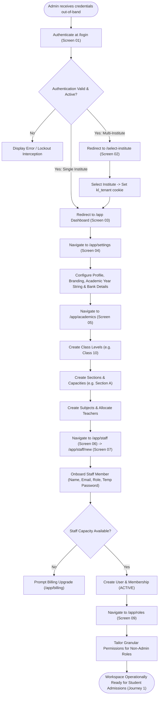
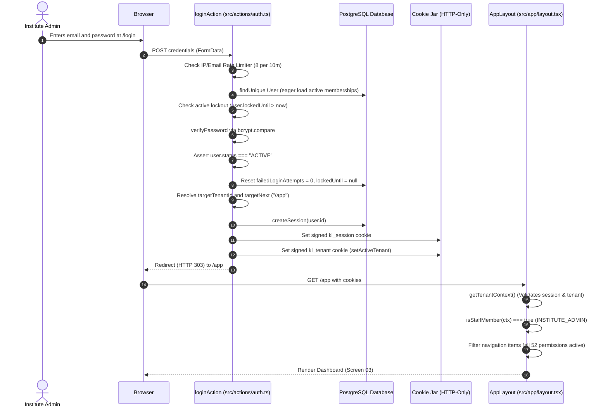
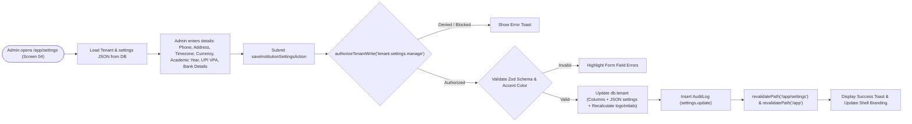
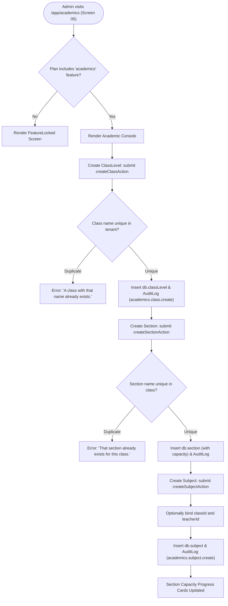
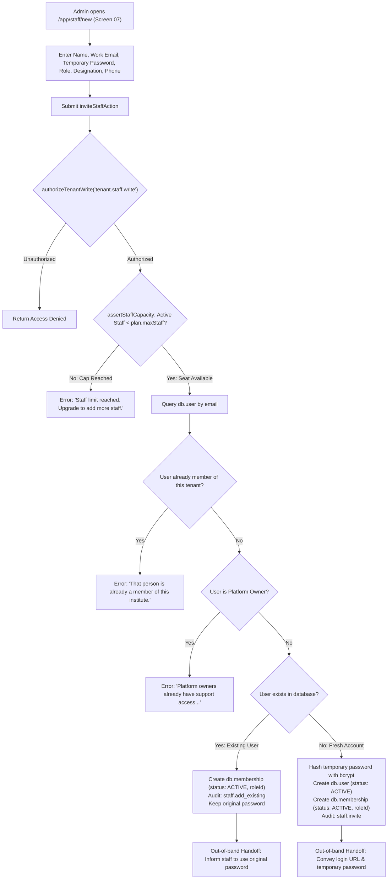
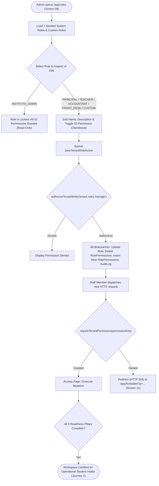

# Knowletive SaaS — Complete Journey 3: Institute Administrator First Login, Workspace Configuration, Academic Master Setup, Staff Onboarding & RBAC Specification

## 1. Document Information
- **Title:** Institute Administrator Workspace Takeover, Academic Master Configuration, Staff Onboarding & Role-Based Access Control Specification
- **Lifecycle Arc:** Out-of-Band Account Handoff → First Authentication & Rate Limiting → Tenant Context Resolution → Operational Workspace Dashboard Initialization → Institute Profile & Payment Preferences Configuration → Academic Master Assembly (Classes, Sections, Subjects) → Staff Onboarding & Account Provisioning → Tenant Role & Permission Tailoring → Cross-Role Access Verification → Workspace Operational Readiness
- **Document ID:** DOC-23-INSTITUTE-ADMIN-WORKSPACE-SETUP
- **Audit Revision:** 1.4 (Final Login Cookie Conditions, Action Namespace Disambiguation & Git-Integrity Qualification)
- **Target Audience:** Institute Administrators, Principals, SaaS Operations Leads, Full-Stack Engineers, Product Architects, QA Automation Leads, Customer Success Directors
- **Classification:** Gold-Standard Operational Specification & Architecture Reference
- **Repository Baseline:** `D:\IT\Saas` (Branch: `staging/exam-stage-43`)
- **Document Location:** `docs/knowletive-functional-handbook/23-INSTITUTE-ADMIN-FIRST-LOGIN-WORKSPACE-SETUP-STAFF-ONBOARDING-PERMISSIONS.md`

---

## 2. Executive Summary

This document establishes the **authoritative functional specification** for how an **Institute Administrator** takes operational control of a newly provisioned educational workspace in the Knowletive Multi-Tenant SaaS platform. Picking up immediately from the provisioning handoff defined in Journey 2, this specification details the complete sequence of authenticating, establishing tenant context, tailoring institutional settings, constructing foundational academic structures (classes, sections, and subjects), onboarding teaching and administrative staff, adjusting granular permissions, and establishing a fully operational, least-privilege school workspace.

### Critical Codebase Realities Enforced in Revision 1.4:
1. **Conditional Login Cookie Issuance (`loginAction` in `src/actions/auth.ts`):**
   - **`kl_session` Issuance:** Issued via `createSession(user.id, meta)` upon successful password authentication **only when 2FA is disabled**.
   - **Conditional `kl_tenant` Issuance:** Issued via `setActiveTenant(targetTenantId)` **only if `targetTenantId` has been resolved**. This occurs strictly when:
     - The user has exactly one active membership (`user.memberships.length === 1`), or
     - An existing `kl_tenant` cookie matches one of the user's active memberships.
   - **No Automatic Tenant Cookie:** Platform Owner accounts (`user.isPlatformOwner`), platform team users (`user.platformRoleId`), zero-membership accounts, and multi-institute users without a valid cookie do **not** receive a `kl_tenant` cookie upon login. Multi-institute users redirect to `/select-institute` with `targetTenantId = null`.
   - **2FA Deferral:** When 2FA is enabled (`user.twoFactorEnabled && user.twoFactorSecret`), `loginAction` issues `kl_pending` and **defers session creation**; no `kl_session` or `kl_tenant` cookie is issued.
   - **2FA Verification Mechanics (`verifyTwoFactorLoginAction`):** Successful OTP verification issues `kl_session` and deletes `kl_pending`, but **does not issue a new `kl_tenant` cookie** (does not call `setActiveTenant`). Any pre-existing tenant cookie in the client jar is preserved untouched.
   - **Frontend 2FA Caller Reality:** `verifyTwoFactorLoginAction` is a backend-only exported server action with **no implemented frontend caller** because `src/app/login/2fa/page.tsx` does not exist (returns Next.js 404).
2. **Disambiguation of Dual `changeTenantPlanAction` Exports:**
   - The repository exports two distinct, module-scoped server actions sharing the identifier `changeTenantPlanAction`:
     - **Tenant-Scoped Action (`src/actions/admin.ts`, line 262):** Guarded by `tenant.billing.manage`. Operates on the caller's active tenant context (`ctx.tenant.id`). Used on `/app/billing` (Screen 10) in Journey 3.
     - **Platform-Scoped Action (`src/actions/platform.ts`, line 228):** Guarded by `platform.subscriptions.manage`. Operates across any tenant specified via `formData.get("tenantId")`. Used on `/platform/institutes/[id]` in Journey 2.
   - These actions represent distinct operational implementations and must not be conflated.
3. **Reconciled Action Inventory (20 Documented Route Actions):**
   - The functional specification across the 11 documented routes of Journey 3 encompasses an authoritative inventory of exactly **20 exported server actions**, classified strictly into four functional categories:
     - **7 Core Chronological Workflow Actions:** `loginAction`, `switchTenantAction`, `saveInstitutionSettingsAction`, `createClassAction`, `createSectionAction`, `createSubjectAction`, `inviteStaffAction`.
     - **6 Supporting Governance & Resource Actions:** `deleteSubjectAction`, `updateStaffAction`, `removeStaffAction`, `createTenantRoleAction`, `saveTenantRoleAction`, `deleteTenantRoleAction`.
     - **4 Authentication, Session & Self-Service Actions:** `logoutAction`, `updateProfileAction`, `changePasswordAction`, `verifyTwoFactorLoginAction`.
     - **3 Related Media & Commercial Billing Actions:** `uploadSchoolLogoAction`, `deleteSchoolLogoAction`, `changeTenantPlanAction` (in `src/actions/admin.ts`).
   - **Inventory Scope Clarification:** These 20 actions constitute the complete server-action surface supporting Journey 3's 11 documented routes. They do not represent all server actions across the entire SaaS platform.
4. **Authoritative Action and Model Identifiers:**
   - In `src/actions/admin.ts`, the settings action is `saveInstitutionSettingsAction` (line 174); phantom identifier `updateTenantSettingsAction` does not exist.
   - In `src/actions/students.ts`, classes and sections cannot be edited once created (no `updateClassAction` or `updateSectionAction` exists); subjects can only be created and deleted (no `updateSubjectAction` exists).
   - In `prisma/schema.prisma`, the underlying model is `model TenantSubscription`; there is no model named `Subscription`.

---

## 3. Relationship to Journeys 1 and 2

### 3.1 Cross-Document Architecture Reconciliation & Drift Analysis
During the Revision 1.1 architectural review, four specific cross-document touchpoints between Journey 2 (`22-PLATFORM-OWNER-INSTITUTE-PROVISIONING-JOURNEY.md`) and Journey 3 were audited against the authoritative repository source code:

1. **Role Template Reconciliation:**
   - **Journey 2 Documented (Doc 22, lines 340–346):** Claimed provisioning seeded `INSTITUTE_ADMIN`, `PRINCIPAL`, `TEACHER`, `ACCOUNTANT`, `FRONT_DESK`, `COUNSELOR`, and `STAFF`.
   - **Source Code Reality (`src/lib/catalog.ts`, `src/actions/platform.ts`, `prisma/seed.ts`):** Only one tenant role template catalog exists. It defines: `INSTITUTE_ADMIN` (52 perms), `PRINCIPAL` (44 perms), `TEACHER` (17 perms), `ACCOUNTANT` (10 perms), `FRONT_DESK` (14 perms), `PARENT` (2 perms), and `STUDENT` (2 perms). Roles `COUNSELOR` and `STAFF` are not defined in `src/lib/catalog.ts` and are not created by `createInstituteAction`.
   - **Resolution:** Journey 2 contains legacy documentation drift. The source code is authoritative; Document 23 strictly documents the 7 real templates without modifying Document 22.
2. **Permission Identifier Harmonization:**
   - Neither `tenant.academics.manage` nor `tenant.staff.manage` exists in `src/lib/catalog.ts`.
   - Class, section, and subject mutations are authorized via `tenant.academics.write`.
   - Staff member invitations and roster edits are authorized via `tenant.staff.write`.
   - Role editing and custom role definitions are authorized via `tenant.roles.manage`.
   - Institute settings and branding mutations are authorized via `tenant.settings.manage`.
3. **Context and RBAC Function Location:**
   - `getTenantContext()` is implemented and exported in `src/lib/auth.ts` (wrapped with React `cache`), NOT `src/lib/rbac.ts`.
   - `src/lib/rbac.ts` imports `getTenantContext` from `@/lib/auth` and exports guard helpers: `requireTenant()`, `requireTenantPermission()`, `requireTenantWrite()`, and `authorizeTenantWrite()`.
   - Symbols `requireTenantUser` and `authorizeTenantAction` do not exist in the codebase.
4. **Subscription Model Naming:**
   - The Prisma model is `TenantSubscription` (`model TenantSubscription`).
   - The relation on `model Tenant` is `subscription TenantSubscription?`.
   - Document 23 standardizes on `TenantSubscription` for all entity and database references.
5. **Disambiguation of Dual `changeTenantPlanAction` Implementations:**
   - Journey 2 documents `changeTenantPlanAction` in `src/actions/platform.ts` (Platform-level subscription management, authorized via `platform.subscriptions.manage`, input `tenantId` from formData).
   - Journey 3 documents `changeTenantPlanAction` in `src/actions/admin.ts` (Tenant-level workspace billing, authorized via `tenant.billing.manage`, context-scoped to `ctx.tenant.id`).
   - Both modules export identical function names for distinct module-scoped responsibilities; Document 23 explicitly qualifies all references to `src/actions/admin.ts`.

The Knowletive functional handbook partitions platform operations across three distinct, continuous operational journeys:

```
┌───────────────────────────────────────────────────────────────────────────────────┐
│ JOURNEY 2: PLATFORM OWNER INSTITUTE PROVISIONING & ADMIN HANDOFF                 │
│ [22-PLATFORM-OWNER-INSTITUTE-PROVISIONING-JOURNEY.md]                             │
│ • Platform Owner visits /login -> /platform -> /platform/institutes/new           │
│ • Atomic db.$transaction: Tenant, TenantSubscription, 7 Roles, User, Membership   │
│ • Out-of-band credential handoff from Platform Owner to Institute Administrator  │
└────────────────────────────────────────┬──────────────────────────────────────────┘
                                         │
                                         ▼
┌───────────────────────────────────────────────────────────────────────────────────┐
│ JOURNEY 3: INSTITUTE ADMIN FIRST LOGIN, WORKSPACE SETUP & ONBOARDING (THIS DOC)   │
│ [23-INSTITUTE-ADMIN-FIRST-LOGIN-WORKSPACE-SETUP-STAFF-ONBOARDING-PERMISSIONS.md]   │
│ • Administrator logs in at /login -> resolves tenant context -> enters /app       │
│ • Configures profile, branding, logo, academic year string, payment details      │
│ • Assembles academic master data: ClassLevels, Sections, Subjects on /app/academics│
│ • Onboards staff (/app/staff/new), assigns tenant roles, verifies least privilege │
│ • Validates complete workspace operational readiness                              │
└────────────────────────────────────────┬──────────────────────────────────────────┘
                                         │
                                         ▼
┌───────────────────────────────────────────────────────────────────────────────────┐
│ JOURNEY 1: PILOT ADMISSION TO STUDENT LIFECYCLE                                   │
│ [21-PILOT-ADMISSION-TO-STUDENT-LIFECYCLE.md]                                      │
│ • Front Desk captures prospective leads (/app/leads)                              │
│ • Converts lead to student admission (db.$transaction)                            │
│ • Assigns student to academic Class & Section created in Journey 3               │
│ • Enrolls student in Batch, allocates Faculty, marks attendance, records fees    │
└───────────────────────────────────────────────────────────────────────────────────┘
```

---

## 4. Institute Administrator Role and Security Context

### 4.1 Role Identity & Scope
- **Role Key:** `INSTITUTE_ADMIN`
- **Role Scope:** `TENANT`
- **Ownership Flag:** `isOwner: true` on primary `Membership`
- **Permissions Seeded:** All 52 tenant-scoped permissions (`TENANT_PERMISSION_KEYS` from `src/lib/catalog.ts`).

### 4.2 Security Guards & Route Protections
Every workspace route under `src/app/(app)/app/` enforces authentication and authorization via a strict separation between auth resolution (`src/lib/auth.ts`) and RBAC guards (`src/lib/rbac.ts`):

#### Architectural Separation of Auth & RBAC Modules:
- **`src/lib/auth.ts` (Foundational Context & Identity Resolution):**
  - Exports: `getTenantContext()`, `getSession()`, `hasTenantPermission()`, `isStaffMember()`, `setActiveTenant()`, `requireUser()`, `requirePlatform()`, `hasPlatformPermission()`, `SESSION_COOKIE`, `TENANT_COOKIE`.
  - `getTenantContext()` resolves the active session, matches the `kl_tenant` cookie (with single-membership fallback), loads `Tenant` with `TenantSubscription` and `Plan`, and evaluates `subscriptionBlocked`.
- **`src/lib/rbac.ts` (Enforcement Guards & Action Authorizers):**
  - Imports `getTenantContext`, `getSession`, `hasTenantPermission` from `@/lib/auth`.
  - Exports: `requireTenant()`, `requireTenantPermission()`, `requireTenantWrite()`, `authorizeTenantWrite()`, `authorizePlatformWrite()`, `getAccessDeniedMessage()`.
  - Note: Functions named `requireTenantUser` or `authorizeTenantAction` do NOT exist in the codebase.
1. **`requireTenant()`:** Calls `getTenantContext()`. If no authenticated user exists, redirects to `/login`.
2. **`requireTenantPermission(permissionKey)`:** Checks whether `hasTenantPermission(ctx, permissionKey)` is true. If false, executes a server-side redirect:
   `redirect(`/app/forbidden?p=${encodeURIComponent(permissionKey)}&denied=page`)`.
3. **`requireTenantWrite(permissionKey)`:** In addition to verifying the permission key, checks `if (ctx.subscriptionBlocked)`. If true, redirects to `/app/billing?blocked=1`.
4. **`authorizeTenantWrite(permissionKey, actionType)`:** Used within Server Actions for non-redirecting validation. Returns structured error messages (`{ ok: false, error: ... }`) on permission or subscription blocks without forcing page unmounts.

### 4.3 Super-Admin & Locked Immutability
In `src/lib/auth.ts`, `hasTenantPermission(ctx, permission)` returns `true` if `ctx.isOwnerView` (Platform Owner bypass) or if `ctx.permissions.has(permission)`. For an Institute Administrator, `ctx.permissions` contains all 52 keys. In `src/actions/admin.ts` (`saveTenantRoleAction`), attempting to edit `role.key === "INSTITUTE_ADMIN"` returns:
> *"The Institute Admin role always has full access and cannot be edited."*

---

## 5. Complete Route Inventory

The Institute Administrator operates across **11 verified page routes** within the Knowletive application:

| Screen # | Route Path | File Location | Purpose & Primary Capability | Required Permission Guard |
|:---:|:---|:---|:---|:---|
| **01** | `/login` | `src/app/login/page.tsx` | Primary credential authentication & session creation. | Public / Unauthenticated |
| **02** | `/select-institute` | `src/app/select-institute/page.tsx` | Tenant disambiguation grid for multi-institute accounts. | Authenticated Session |
| **03** | `/app` | `src/app/(app)/app/page.tsx` | Operational workspace dashboard, enrollment metrics & activity. | Authenticated Staff Member |
| **04** | `/app/settings` | `src/app/(app)/app/settings/page.tsx` | Institute identity, contact, academic year string & payment setup. | `tenant.settings.read` |
| **05** | `/app/academics` | `src/app/(app)/app/academics/page.tsx` | Academic master setup: ClassLevels, Sections, Subjects, Capacity. | `tenant.academics.read` |
| **06** | `/app/staff` | `src/app/(app)/app/staff/page.tsx` | Staff directory, seat utilization, membership status filters. | `tenant.staff.read` |
| **07** | `/app/staff/new` | `src/app/(app)/app/staff/new/page.tsx` | Staff onboarding form: details, role assignment, temp password. | `tenant.staff.write` |
| **08** | `/app/staff/[id]` | `src/app/(app)/app/staff/[id]/page.tsx` | Staff member detail, role reassignment, suspension, removal. | `tenant.staff.read` |
| **09** | `/app/roles` | `src/app/(app)/app/roles/page.tsx` | RBAC console: role creation, 52-permission tailoring matrix. | `tenant.roles.read` |
| **10** | `/app/billing` | `src/app/(app)/app/billing/page.tsx` | Subscription tier, seat limits, plan change & invoice ledger. | `tenant.billing.read` |
| **11** | `/app/forbidden` | `src/app/(app)/app/forbidden/page.tsx` | Access-denied interception page detailing missing permission key. | Authenticated Member |

---

## 6. Phase A — Administrator Account Handoff

Following the successful execution of `createInstituteAction` in Journey 2, the Platform Owner conveys account credentials to the school or college leadership:

### 6.1 Account Scenarios at Inception
- **Scenario 1 (New User Account):** The administrator was provisioned with `status: "ACTIVE"`, a pre-hashed password generated from the wizard's `adminPassword` input, and linked via `Membership` (`isOwner: true`, role `INSTITUTE_ADMIN`).
  - *Handoff Content:* The Platform Owner securely communicates `adminEmail` and the temporary password out-of-band (via encrypted messaging, secure corporate email, or phone).
- **Scenario 2 (Existing User Account Reuse):** The administrator's email already existed in `db.user` (e.g., from an existing pilot or platform account).
  - *Handoff Content:* The Platform Owner notifies the administrator that their existing account has been granted ownership of the new institute. The temporary password submitted in the wizard was discarded; the administrator must use their pre-existing password.
  - *Prerequisite Check:* The existing user's `User.status` must be `"ACTIVE"`. If previously `"INVITED"` or `"SUSPENDED"`, authentication at `/login` will fail at the status gate until reactivated.

---

## 7. Phase B — First Login & Tenant Resolution

### 7.1 The Physical Authentication Pipeline (`loginAction` in `src/actions/auth.ts`)
1. **Submission:** The administrator navigates to `/login` (Screen 01) and submits `email` and `password`.
2. **Rate Limiting (Lines 67–73):** IP-and-email-scoped rate limiter evaluates `login:${ip}:${email}` (threshold: 8 attempts per 10 minutes).
3. **Database Lookup (Lines 75–83):** Queries `db.user.findUnique({ where: { email } })`, eagerly loading active, non-churned memberships.
4. **Pre-Bcrypt Active Lockout Gate (Lines 85–99):** If `user.lockedUntil && user.lockedUntil > new Date()`, immediately returns runtime template:
   `error: `This account is temporarily locked due to too many failed sign-in attempts. Try again in ${minutesLeft} minute${minutesLeft > 1 ? "s" : ""}.``
   Password evaluation is bypassed; counters do not change.
5. **Cryptographic Verification (Lines 101–102):** Executes `bcrypt.compare(password, user.passwordHash)`.
6. **Credential Failure Branch (Lines 104–136):**
   - If invalid password: application calculates `failedAttempts = (user.failedLoginAttempts ?? 0) + 1`.
   - If `failedAttempts < 5`: updates `db.user`, logs `auth.login_failed`, returns *"Incorrect email or password."*
   - If `failedAttempts >= 5`: sets `lockedUntil = now + 15m`, logs `auth.account_locked`, returns *"Too many failed sign-in attempts. Your account has been temporarily locked for 15 minutes for security."*
7. **Active Account Status Gate (Line 137):**
   - Evaluates `if (user.status !== "ACTIVE")`. If `"INVITED"` or `"SUSPENDED"`, aborts and returns:
     *"This account is not active. Contact your platform administrator."*
8. **Successful Counter Reset (Lines 141–146):**
   - If `user.failedLoginAttempts > 0 || user.lockedUntil`, updates `db.user` with `failedLoginAttempts: 0, lockedUntil: null`.
9. **Destination & Tenant Resolution (Lines 148–167 in `src/actions/auth.ts`):**
   - Evaluates user type and memberships to establish `targetTenantId` and `targetNext`:
     - **Platform Accounts:** If `user.isPlatformOwner || user.platformRoleId`, resolves `targetNext = "/platform"` and `targetTenantId = null`. No tenant cookie is issued.
     - **Matching Active Cookie:** If a pre-existing `kl_tenant` cookie matches an active membership in `user.memberships`, sets `targetTenantId = validTenantCookie.tenantId` and `targetNext = isStaff ? "/app" : "/portal"`.
     - **Single-Institute Administrator (Standard Path):** If `user.memberships.length === 1`, sets `targetTenantId = user.memberships[0].tenantId` and `targetNext = isStaff ? "/app" : "/portal"`.
     - **Multi-Institute User (No Cookie):** If `user.memberships.length > 1` without a matching cookie, sets `targetNext = "/select-institute"` and `targetTenantId = null`. No tenant cookie is issued.
     - **Zero Memberships:** If user has no active memberships, `targetTenantId = null`. No tenant cookie is issued.
10. **Two-Factor Authentication Evaluation (Lines 169–172 in `src/actions/auth.ts`):**
    - If `user.twoFactorEnabled && user.twoFactorSecret`:
      - Calls `createPendingLogin(user.id, targetNext)` to issue signed HTTP-only `kl_pending` cookie.
      - **Defers session creation:** `createSession` is not called.
      - **No tenant cookie:** `setActiveTenant` is not called.
      - Dispatches HTTP 303 redirect to `/login/2fa?next=...`. (Note: route `/login/2fa` is missing in UI, rendering 404).
11. **Session Creation & Conditional Cookie Issuance (Lines 174–185 in `src/actions/auth.ts`):**
    - Normal login path (2FA disabled): calls `createSession(user.id, meta)` to write signed HTTP-only `kl_session` cookie.
    - **Conditional Tenant Cookie:** Calls `setActiveTenant(targetTenantId)` **only if `targetTenantId !== null`**. Omitted for Platform Owner, zero-membership users, and multi-institute accounts without an existing cookie.
    - Updates `user.lastLoginAt = now` and writes audit log `auth.login`.
    - Dispatches HTTP 303 redirect to `targetNext` (`/app` or `/select-institute`).

---

## 8. Phase C — First Workspace Entry & Dashboard Initialization

### 8.1 Layout Resolution & Context Hydration (`src/app/(app)/app/layout.tsx`)
When the browser requests `/app` (Screen 03):
1. **Context Loading:** `AppLayout` invokes `getTenantContext()`.
   - Reads `kl_session` -> validates session in `db.session` -> loads `User` and active `memberships`.
   - Reads `kl_tenant` -> matches `tenantId`. If no cookie exists, automatically falls back to `user.memberships[0]` for single-membership users.
   - Loads `Tenant` and `TenantSubscription` with commercial `Plan`.
2. **Staff Role Guard:** Evaluates `isStaffMember(ctx)`. Checks whether `ctx.membership.roleKey` is in `STAFF_ROLE_KEYS` (`INSTITUTE_ADMIN`, `PRINCIPAL`, `TEACHER`, `ACCOUNTANT`, `FRONT_DESK`). If false (e.g. Parent or Student), redirects to `/portal`.
3. **Suspension Barrier:** If `tenant.status === "SUSPENDED"` and not a Platform Owner, renders a full-page access-paused screen.
4. **Navigation Filtering:** Generates the active sidebar navigation from `appNav` (`src/components/shell/nav.ts`), filtering items where `!item.permission || hasTenantPermission(ctx, item.permission)`. For an Institute Admin, all 16 items are displayed.
5. **Subscription Banners:**
   - If `subscriptionBlocked` is true: renders red danger callout *"Subscription inactive — writes are paused"*.
   - If `trialDaysLeft <= 7` and not blocked: renders warning banner *"Trial ends in X days"*.

### 8.2 Operational Dashboard Telemetry (`src/app/(app)/app/page.tsx`)
The overview dashboard executes parallel aggregation queries across 14 database targets:
- **Stat Cards (Top Row):**
  - *Active Students:* `db.student.count({ where: { tenantId, status: "ACTIVE" } })` vs `plan.maxStudents`.
  - *Attendance:* Shows today's register rate (or latest marked register date fallback).
  - *Collected This Month:* `db.feePayment.aggregate` for `paidAt >= monthStart`.
  - *Outstanding Fees:* Sum of `amount - paidAmount` across non-paid `feeInvoice` records.
- **Visual Analytics:**
  - *Fee Collections Chart:* 6-month historical area chart of recorded fee payments.
  - *Attendance Mix Donut:* Breakdown of Present, Late, Absent, Excused for the latest register.
  - *Class Strength BarList:* Active students grouped by `classId`.
- **Activity & Feed Columns:**
  - *Newest Students:* Table of 5 most recent admissions.
  - *Announcements:* 4 latest pinned/published notices.
  - *Recent Activity:* 6 latest entries from `db.auditLog`.

---

## 9. Phase D — Institute Profile, Branding & Workspace Settings

The administrator navigates to `/app/settings` (Screen 04) to establish institutional branding, legal entity data, and payment collection preferences.

### 9.1 Profile & Preferences Form (`saveInstitutionSettingsAction` in `src/actions/admin.ts`)
- **Required Permission:** `tenant.settings.manage` (guarded via `authorizeTenantWrite`).
- **Form Fields Submitted:**
  - `name` (String, 2–120 chars, required)
  - `email` (Valid email string, required)
  - `phone` (String, max 20 chars, optional)
  - `website` (URL string, max 160 chars, optional)
  - `address`, `city`, `state` (Strings, optional)
  - `timezone` (Select dropdown: `Asia/Kolkata`, `Asia/Dubai`, `Asia/Singapore`, etc.)
  - `currency` (Select dropdown: `INR`, `USD`, `AED`, `GBP`)
  - `accentColor` (Hex string, e.g. `#4f46e5`)
  - `academicYear` (String, e.g. `2026-27`)
- **Payment Collection Preferences:**
  - `upiVpa` (e.g. `school@icici`)
  - `accountHolder` (e.g. `Delhi Public School Trust`)
  - `bankName` (e.g. `State Bank of India`)
  - `accountNumber` (e.g. `9876543210`)
  - `ifscCode` (11-char IFSC code)
- **Database Mutation:** Updates `Tenant`:
  - Directly updates relational columns: `name`, `email`, `phone`, `website`, `address`, `city`, `state`, `timezone`, `currency`, `accentColor`.
  - Recalculates `logoInitials` from the first letters of the first two words in `name`.
  - Merges extended fields into the JSON column `tenant.settings`: `{ academicYear, upiVpa, bankName, accountNumber, ifscCode, accountHolder }`.
  - Dispatches audit log: `action: "settings.update"`, `entity: "Tenant"`.
  - Revalidates paths: `/app/settings` and `/app`.

### 9.2 Custom Logo Management (`src/actions/storage.ts`)
- **Upload Action (`uploadSchoolLogoAction`):**
  - Validates image file (`image/png`, `image/jpeg`, `image/webp`, `image/svg+xml`, max 2 MB).
  - Stores file metadata in `db.fileAsset` and writes file to storage.
  - Updates `tenant.settings.logoFileId = fileAsset.id`.
  - Dispatches audit log `tenant.logo_upload`. Custom logo is immediately rendered in the workspace shell and parent portal.
- **Deletion Action (`deleteSchoolLogoAction`):**
  - Removes `logoFileId` from `tenant.settings`, reverting the workspace to the initials avatar.

---

## 10. Phase E — Academic Master Configuration

The administrator navigates to `/app/academics` (Screen 05) to assemble the institutional hierarchy. The academic model is structured hierarchically:
`ClassLevel` (1) ── (N) `Section` (1) ── (N) `Student`
`ClassLevel` (1) ── (N) `Subject` (N) ── (1) `Membership (Teacher)`

### 10.1 Step 1: Create Classes (`createClassAction` in `src/actions/students.ts`)
- **Required Permission:** `tenant.academics.write`
- **Form Inputs:**
  - `name` (String, 1–50 chars, required, e.g. "Class 10", "Grade 6", "FYJC")
  - `order` (Number, 0–100, controls display ordering)
- **Validation & Duplicate Prevention:**
  - Queries `db.classLevel.findFirst({ where: { tenantId, name } })`.
  - If match exists, rejects with error: *"A class with that name already exists."*
- **Database Mutation:** Inserts record into `db.classLevel`. Logs `academics.class.create`.

### 10.2 Step 2: Create Sections (`createSectionAction` in `src/actions/students.ts`)
- **Required Permission:** `tenant.academics.write`
- **Form Inputs:**
  - `classId` (CUID referencing parent `ClassLevel`, required)
  - `name` (String, 1–20 chars, e.g. "A", "B", "Rose", "Science", required)
  - `capacity` (Number, 1–500, default 40)
- **Validation & Duplicate Prevention:**
  - Asserts parent class exists: `db.classLevel.findFirst({ where: { id: classId, tenantId } })`.
  - Asserts section uniqueness within class: `db.section.findFirst({ where: { classId, name } })`.
  - If duplicate, rejects with error: *"That section already exists for this class."*
- **Database Mutation:** Inserts record into `db.section`. Logs `academics.section.create`.

### 10.3 Step 3: Configure Subjects & Teacher Allocation (`createSubjectAction` in `src/actions/students.ts`)
- **Required Permission:** `tenant.academics.write`
- **Form Inputs:**
  - `name` (String, 2–60 chars, required, e.g. "Mathematics", "Physics")
  - `code` (String, max 20 chars, optional, e.g. "MAT-101")
  - `classId` (Optional dropdown; if blank, applies across all classes)
  - `teacherId` (Optional dropdown; selects a staff member from `db.membership`)
- **Validation:**
  - If `classId` provided: verifies class belongs to tenant.
  - If `teacherId` provided: verifies staff membership belongs to tenant.
- **Database Mutation:** Inserts record into `db.subject`. Logs `academics.subject.create`.
- **Subject Deletion (`deleteSubjectAction`):** Allows deleting subjects via modal confirmation; does not delete historical student or attendance records.

---

## 11. Phase F — Staff Onboarding & Account Provisioning

The administrator navigates to `/app/staff` (Screen 06) and clicks **"+ Invite staff"** -> `/app/staff/new` (Screen 07).

### 11.1 Staff Invitation Form (`inviteStaffAction` in `src/actions/students.ts`)
- **Required Permission:** `tenant.staff.write`
- **Form Inputs:**
  - `name` (String, min 2 chars, required)
  - `email` (Valid email string, required)
  - `password` (String, min 8 chars with >= 1 letter and >= 1 number, required)
  - `roleId` (CUID referencing tenant role, required)
  - `designation` (String, optional, e.g. "Head of Mathematics", "Accounts Lead")
  - `phone` (String, optional)

### 11.2 Processing Logic & Capacity Guard
1. **Seat Limit Enforcement (`assertStaffCapacity`):**
   - Counts active memberships: `db.membership.count({ where: { tenantId, status: "ACTIVE" } })`.
   - Compares against `plan.maxStaff`. If reached, aborts with error:
     *"Staff limit reached (X on the Y plan). Upgrade to add more staff."*
2. **User Lookup & Account Reuse Evaluation:**
   - Queries `db.user.findUnique({ where: { email }, include: { memberships } })`.
   - **Branch A (Already Member):** If user already has a membership in this tenant, rejects:
     *"That person is already a member of this institute."*
   - **Branch B (Platform Owner):** If `existing.isPlatformOwner`, rejects:
     *"Platform owners already have support access and cannot be added as staff."*
   - **Branch C (Existing User in Another Tenant / Account):**
     - Inserts a new `Membership` linked to the existing user: `{ tenantId, userId: existing.id, roleId, designation, phone, status: "ACTIVE" }`.
     - Logs audit `staff.add_existing`.
     - Existing password and account details are preserved untouched.
     - Returns: `"${existing.name} was added with the role ${role.name}."`
   - **Branch D (Fresh User Account):**
     - Hashes temporary password: `await hashPassword(d.password)`.
     - Inserts `User` record: `{ email, name, passwordHash, status: "ACTIVE", avatarColor }`.
     - Creates nested `Membership`: `{ tenantId, roleId, designation, phone, status: "ACTIVE" }`.
     - Logs audit `staff.invite`.
     - Returns: `"${user.name} can now sign in at /login with the role ${role.name}. Share the temporary password securely."`

### 11.3 Credential Handoff to Staff
Because no automated email or SMS is dispatched, the Institute Administrator communicates the login URL (`/login`), work email, and temporary password to the staff member out-of-band. Upon first login, the staff member enters `/app` and can change their password at `/app/settings` (Screen 04).

---

## 12. Phase G — Role and Permission Verification & Least Privilege

The administrator navigates to `/app/roles` (Screen 09) to review and customize tenant access controls.

### 12.0 Authoritative Three-Layer Permission Crosswalk

The following crosswalk clarifies the exact relationship between the user interface navigation layer, server mutation actions, and RBAC governance across all 11 routes and 20 verified server actions:

| Architectural Layer | Target Route or Server Action | Actual Permission Identifier | Source File & Authoritative Guard |
|:---|:---|:---|:---|
| **Page Access** | `/app` (Workspace Dashboard) | None (Active Staff Member) | `requireTenant()` in `src/app/(app)/app/page.tsx` |
| **Page Access** | `/app/settings` (General Settings) | `tenant.settings.read` | `requireTenantPermission("tenant.settings.read")` in `src/app/(app)/app/settings/page.tsx` |
| **Page Access** | `/app/academics` (Academic Master) | `tenant.academics.read` | `requireTenantPermission("tenant.academics.read")` in `src/app/(app)/app/academics/page.tsx` |
| **Page Access** | `/app/staff` (Staff Directory) | `tenant.staff.read` | `requireTenantPermission("tenant.staff.read")` in `src/app/(app)/app/staff/page.tsx` |
| **Page Access** | `/app/staff/new` (Staff Onboarding) | `tenant.staff.write` | `requireTenantWrite("tenant.staff.write")` in `src/app/(app)/app/staff/new/page.tsx` |
| **Page Access** | `/app/staff/[id]` (Staff Profile) | `tenant.staff.read` | `requireTenantPermission("tenant.staff.read")` in `src/app/(app)/app/staff/[id]/page.tsx` |
| **Page Access** | `/app/roles` (Role Permissions Matrix) | `tenant.roles.read` | `requireTenantPermission("tenant.roles.read")` in `src/app/(app)/app/roles/page.tsx` |
| **Page Access** | `/app/billing` (Plan & Invoices) | `tenant.billing.read` | `requireTenantPermission("tenant.billing.read")` in `src/app/(app)/app/billing/page.tsx` |
| **Page Access** | `/app/forbidden` (Access Denied) | None (Universal Error Intercept) | `requireTenant()` in `src/app/(app)/app/forbidden/page.tsx` |
| **Page Access** | `/login` (Sign In) | Public / Unauthenticated | Public page in `src/app/login/page.tsx` |
| **Page Access** | `/select-institute` (Tenant Selector) | Authenticated Session | `getSession()` in `src/app/select-institute/page.tsx` |
| **Server Mutation (Core)** | `loginAction` | Public (Rate-limited, Lockout) | Pre-auth rate limit + lockout check in `src/actions/auth.ts` |
| **Server Mutation (Core)** | `switchTenantAction` | Authenticated Session | `getSession()` + membership verification in `src/actions/auth.ts` |
| **Server Mutation (Core)** | `saveInstitutionSettingsAction` | `tenant.settings.manage` | `authorizeTenantWrite("tenant.settings.manage", "update")` in `src/actions/admin.ts` |
| **Server Mutation (Core)** | `createClassAction` | `tenant.academics.write` | `authorizeTenantWrite("tenant.academics.write", "create")` in `src/actions/students.ts` |
| **Server Mutation (Core)** | `createSectionAction` | `tenant.academics.write` | `authorizeTenantWrite("tenant.academics.write", "create")` in `src/actions/students.ts` |
| **Server Mutation (Core)** | `createSubjectAction` | `tenant.academics.write` | `authorizeTenantWrite("tenant.academics.write", "create")` in `src/actions/students.ts` |
| **Server Mutation (Core)** | `inviteStaffAction` | `tenant.staff.write` | `authorizeTenantWrite("tenant.staff.write", "create")` + `assertStaffCapacity` in `src/actions/students.ts` |
| **Server Mutation (Supporting)** | `deleteSubjectAction` | `tenant.academics.write` | `authorizeTenantWrite("tenant.academics.write", "delete")` in `src/actions/students.ts` |
| **Server Mutation (Supporting)** | `updateStaffAction` | `tenant.staff.write` | `authorizeTenantWrite("tenant.staff.write", "update")` in `src/actions/students.ts` |
| **Server Mutation (Supporting)** | `removeStaffAction` | `tenant.staff.write` | `authorizeTenantWrite("tenant.staff.write", "delete")` in `src/actions/students.ts` |
| **Server Mutation (Supporting)** | `createTenantRoleAction` | `tenant.roles.manage` | `authorizeTenantWrite("tenant.roles.manage", "create")` in `src/actions/admin.ts` |
| **Server Mutation (Supporting)** | `saveTenantRoleAction` | `tenant.roles.manage` | `authorizeTenantWrite("tenant.roles.manage", "update")` in `src/actions/admin.ts` |
| **Server Mutation (Supporting)** | `deleteTenantRoleAction` | `tenant.roles.manage` | `authorizeTenantWrite("tenant.roles.manage", "delete")` in `src/actions/admin.ts` |
| **Server Mutation (Auth/Self)** | `logoutAction` | Public / Session | `destroySession()` in `src/actions/auth.ts` |
| **Server Mutation (Auth/Self)** | `updateProfileAction` | None (Self Profile Update) | `requireTenant()` (self-scoped) in `src/actions/admin.ts` |
| **Server Mutation (Auth/Self)** | `changePasswordAction` | None (Self Password Update) | `requireTenant()` / `getSession()` in `src/actions/auth.ts` |
| **Server Mutation (Auth/Self)** | `verifyTwoFactorLoginAction` (Backend-only; no implemented frontend caller because `/login/2fa` is missing) | None (Pending 2FA Cookie) | `readPendingLogin()` in `src/actions/auth.ts` |
| **Server Mutation (Media/Bill)** | `uploadSchoolLogoAction` | `tenant.settings.manage` | `authorizeTenantWrite("tenant.settings.manage", "update")` in `src/actions/storage.ts` |
| **Server Mutation (Media/Bill)** | `deleteSchoolLogoAction` | `tenant.settings.manage` | `authorizeTenantWrite("tenant.settings.manage", "update")` in `src/actions/storage.ts` |
| **Server Mutation (Media/Bill)** | `changeTenantPlanAction` (`src/actions/admin.ts`) | `tenant.billing.manage` | `authorizeTenantWrite("tenant.billing.manage", "update")` in `src/actions/admin.ts` (Tenant-scoped; distinct from platform-scoped action in `src/actions/platform.ts`) |
| **Role Configuration** | View Role Permissions Matrix | `tenant.roles.read` | `requireTenantPermission("tenant.roles.read")` in `src/app/(app)/app/roles/page.tsx` |
| **Role Configuration** | Edit Role Permissions UI Checkboxes | `tenant.roles.manage` | `hasTenantPermission(ctx, "tenant.roles.manage")` in `src/app/(app)/app/roles/page.tsx` |

*Note on Catalog Verification:* Every permission identifier cited in this crosswalk (`tenant.settings.read`, `tenant.settings.manage`, `tenant.academics.read`, `tenant.academics.write`, `tenant.staff.read`, `tenant.staff.write`, `tenant.roles.read`, `tenant.roles.manage`, `tenant.billing.read`, `tenant.billing.manage`) is confirmed to exist in the authoritative catalog in `src/lib/catalog.ts`. Speculative permissions `tenant.academics.manage` and `tenant.staff.manage` do not exist.

### 12.1 System Role Templates vs. Custom Roles
During Journey 2 provisioning, 7 standard tenant role templates were seeded into `db.role`:

| Role Key | Display Name | Seeded Perms | Description & Architectural Access Scope |
|:---|:---|:---:|:---|
| `INSTITUTE_ADMIN` | Institute Admin | **52** | **Full Workspace Control.** Locked & immutable; cannot be edited or deleted. |
| `PRINCIPAL` | Principal | **44** | Academic and operational leadership. Access to leads, batches, syllabus, exams, students, staff, academics, attendance, announcements, AI, and audit. |
| `TEACHER` | Teacher | **17** | Classroom teaching focus. Batches, syllabus lesson plans & progress, exam marks entry, attendance marking, student directory, AI tools. |
| `ACCOUNTANT` | Accountant | **10** | Financial operations. Fee invoices, payment recording, fee reminders, student directory, billing visibility, financial reports. |
| `FRONT_DESK` | Front Desk | **14** | Admissions & intake. Prospective leads, lead conversion, student/parent directory, attendance register view, communications. |
| `PARENT` | Parent | **2** | Parent portal access (`tenant.portal.read`, `tenant.announcements.read`). |
| `STUDENT` | Student | **2** | Student portal access (`tenant.portal.read`, `tenant.announcements.read`). |

### 12.2 Role Customization (`saveTenantRoleAction` in `src/actions/admin.ts`)
- **Required Permission:** `tenant.roles.manage`
- **Execution:** Allows tailoring permissions for `PRINCIPAL`, `TEACHER`, `ACCOUNTANT`, `FRONT_DESK`, or custom roles.
- **Atomic Transaction:** In `db.$transaction`:
  1. Updates `Role` name and description.
  2. Deletes existing `db.rolePermission` entries for `role.id`.
  3. Inserts new `db.rolePermission` rows for each checked permission key.
  4. Writes audit log `role.update`.
- **Immediate Effect:** Changes take effect on the staff member's **very next HTTP request** because `getSession()` in `src/lib/auth.ts` queries `db.user` on every server render.

### 12.3 Custom Role Creation & Deletion
- **Creation (`createTenantRoleAction`):** Allows defining new roles (e.g., "Exam Coordinator", "Head of Admissions") with arbitrary subsets of the 52 permissions.
- **Deletion (`deleteTenantRoleAction`):** Permitted **only** if `!role.isSystem` and `role._count.memberships === 0`.

### 12.4 Verification of Least-Privilege Enforcement
When an onboarded staff member signs in:
1. **Sidebar Truncation:** `AppLayout` filters navigation items. For example, an Accountant sees *Fees*, *Students*, *Announcements*, and *Subscription*, but *Academics*, *Batches*, *SyllabusTrack*, and *Roles & permissions* are hidden.
2. **Direct URL Protection:** If an Accountant manually navigates to `/app/academics`, `requireTenantPermission("tenant.academics.read")` intercepts the request and redirects to:
   `/app/forbidden?p=tenant.academics.read&denied=page` (Screen 11).
3. **Server Action Protection:** If an unauthorized user attempts to dispatch `createClassAction`, `authorizeTenantWrite("tenant.academics.write", "create")` halts execution and returns `{ ok: false, error: "Permission denied. You are not authorized to create this record." }`.

---

## 13. Phase H — Workspace Operational Readiness Assessment

The workspace is considered **operationally ready** when four foundational criteria are satisfied:

```
┌────────────────────────────────────────────────────────────────────────┐
│                   WORKSPACE OPERATIONAL READINESS PILLARS              │
├─────────────────────────┬─────────────────────────┬────────────────────┤
│ Pillar 1: Settings      │ Pillar 2: Academics     │ Pillar 3: Staffing │
│ • Name & branding saved │ • >= 1 ClassLevel added │ • >= 1 Teacher     │
│ • Academic year set     │ • >= 1 Section added    │   onboarded        │
│ • Bank details configured│ • Core Subjects created │ • Roles assigned   │
└─────────────────────────┴─────────────────────────┴────────────────────┘
                                     │
                                     ▼
      ┌────────────────────────────────────────────────────────────┐
      │ Pillar 4: Downstream Operational Unblock                   │
      │ • Ready for Lead Intake & Admission Conversion (Journey 1) │
      │ • Ready for Batch Assembly & Classroom Timetables          │
      │ • Ready for Fee Invoicing & Attendance Registers           │
      └────────────────────────────────────────────────────────────┘
```

---

## 14. Complete Screen-by-Screen Functional Matrix

The following tabular matrix details all 11 user-facing screens involved in Journey 3, structured to the rigorous 17-field engineering standard:

### Screen 01: Authentication Console
- **Screen Number:** SCR-01
- **Screen Name:** Login Screen
- **Route:** `/login`
- **Source File:** `src/app/login/page.tsx`
- **User Role:** Unauthenticated Institute Administrator
- **Permission:** None (Public)
- **Entry Condition:** Administrator has received out-of-band credentials from Platform Owner.
- **UI Components:** Email input, Password input, Sign in CTA button, error callout banner.
- **Form Fields:** `email` (required, string), `password` (required, string).
- **User Actions:** Enters credentials, clicks "Sign in".
- **Server Action:** `loginAction(formData)` in `src/actions/auth.ts`
- **Validation:** Zod schema `loginSchema`; Rate limiter (`8 per 10m`); Lockout check (`lockedUntil > now`); Bcrypt hash compare; Active status check (`user.status === "ACTIVE"`).
- **Database Reads:** `db.user.findUnique` (including active memberships, tenant status, role keys).
- **Database Writes:** `db.user.update` (increments failed attempts or resets to 0); `db.session.create` (on success); `db.auditLog.create` (`auth.login` or `auth.login_failed`).
- **Success State:** Issues `kl_session` cookie (via `createSession`); conditionally issues `kl_tenant` cookie (via `setActiveTenant`) because `targetTenantId` resolves for the single-institute administrator; redirects (HTTP 303) to `/app`. (If 2FA were active, `kl_pending` would be issued and session creation deferred; if multi-institute without cookie, redirects to `/select-institute` without tenant cookie).
- **Failure State:** Inline error message displayed (*"Incorrect email or password."*, lockout template, or inactive error).
- **Next Step:** Proceeds to Screen 03 (`/app`) or Screen 02 (`/select-institute`).

### Screen 02: Tenant Disambiguation Grid
- **Screen Number:** SCR-02
- **Screen Name:** Select Institute Screen
- **Route:** `/select-institute`
- **Source File:** `src/app/select-institute/page.tsx`
- **User Role:** Multi-Institute User / Administrator
- **Permission:** Authenticated Session
- **Entry Condition:** User account belongs to multiple active tenant memberships without an active tenant cookie match.
- **UI Components:** Institute selection card grid, tenant initials avatars, role badges, selection buttons.
- **Form Fields:** Hidden input `tenantId`.
- **User Actions:** Clicks on desired institute card.
- **Server Action:** `switchTenantAction(formData)` in `src/actions/auth.ts`
- **Validation:** Asserts user has active membership in selected `tenantId`.
- **Database Reads:** `db.membership.findMany({ where: { userId, status: "ACTIVE" } })`.
- **Database Writes:** Sets `kl_tenant` cookie; dispatches audit log `auth.switch_tenant`.
- **Success State:** Redirects (HTTP 303) to `/app`.
- **Failure State:** Remains on `/select-institute` if tenant invalid.
- **Next Step:** Proceeds to Screen 03 (`/app`).

### Screen 03: Operational Workspace Dashboard
- **Screen Number:** SCR-03
- **Screen Name:** Workspace Overview Dashboard
- **Route:** `/app`
- **Source File:** `src/app/(app)/app/page.tsx`
- **User Role:** Institute Administrator (`INSTITUTE_ADMIN`)
- **Permission:** Authenticated Staff Member
- **Entry Condition:** Session and active tenant context resolved; `isStaffMember` evaluates to true.
- **UI Components:** Stat cards (Students, Attendance, Collections, Dues), Fee collections AreaChart, Attendance Donut & BarList, Recent Students table, Announcements list, Audit trail list.
- **Form Fields:** None (Read-only overview with navigation links).
- **User Actions:** Inspects metrics, clicks sidebar links ("Settings", "Academics", "Staff").
- **Server Action:** None (Server Component data load).
- **Validation:** Server-side guard `requireTenant()`; verifies not suspended.
- **Database Reads:** 14 parallel queries: `db.student`, `db.membership`, `db.attendance`, `db.feePayment`, `db.feeInvoice`, `db.announcement`, `db.auditLog`, `db.classLevel`.
- **Database Writes:** None.
- **Success State:** Full dashboard telemetry rendered with institute name in header.
- **Failure State:** If context missing -> redirects to `/login`. If suspended -> renders full-page suspension banner.
- **Next Step:** Administrator clicks "Settings" -> Screen 04.

### Screen 04: Institute Settings & Profile
- **Screen Number:** SCR-04
- **Screen Name:** Settings Console
- **Route:** `/app/settings`
- **Source File:** `src/app/(app)/app/settings/page.tsx`
- **User Role:** Institute Administrator (`INSTITUTE_ADMIN`)
- **Permission:** `tenant.settings.read` (page) / `tenant.settings.manage` (mutations)
- **Entry Condition:** Administrator navigates from dashboard or sidebar.
- **UI Components:** Profile card, FormGrid inputs, Color pickers, Logo upload form, Payment collection card, Password change card, Audit trail card.
- **Form Fields:** `name`, `email`, `phone`, `website`, `address`, `city`, `state`, `timezone`, `currency`, `accentColor`, `academicYear`, `upiVpa`, `accountHolder`, `bankName`, `accountNumber`, `ifscCode`.
- **User Actions:** Fills institutional data and payment details, clicks "Save institute settings" or "Save payment details".
- **Server Action:** `saveInstitutionSettingsAction` in `src/actions/admin.ts`
- **Validation:** Zod `institutionSettingsSchema`; regex validation for `accentColor` (`^#[0-9a-fA-F]{6}$`).
- **Database Reads:** `db.tenant.findUnique`, `db.auditLog.findMany`.
- **Database Writes:** `db.tenant.update` (updates columns and merges JSON `settings`); `db.auditLog.create` (`settings.update`).
- **Success State:** Green toast *"Institute settings saved."*; shell re-renders with new initials and accent color.
- **Failure State:** Form displays field-level errors or permission denied message.
- **Next Step:** Administrator clicks "Academics" -> Screen 05.

### Screen 05: Academic Master Management
- **Screen Number:** SCR-05
- **Screen Name:** Academics (Classes, Sections & Subjects)
- **Route:** `/app/academics`
- **Source File:** `src/app/(app)/app/academics/page.tsx`
- **User Role:** Institute Administrator (`INSTITUTE_ADMIN`)
- **Permission:** `tenant.academics.read` (page) / `tenant.academics.write` (mutations)
- **Entry Condition:** Active tenant subscription plan includes "academics" feature.
- **UI Components:** Class levels card, Add a class form, Add a section form, Subjects table, Add a subject form, Section capacity progress bars.
- **Form Fields:**
  - Class Form: `name` (required), `order` (number).
  - Section Form: `classId` (select, required), `name` (required), `capacity` (number, default 40).
  - Subject Form: `name` (required), `code` (optional), `classId` (optional select), `teacherId` (optional select).
- **User Actions:** Adds classes, sections, and subjects; allocates teachers to subjects.
- **Server Action:** `createClassAction`, `createSectionAction`, `createSubjectAction`, `deleteSubjectAction` in `src/actions/students.ts`
- **Validation:** Zod schemas (`classSchema`, `sectionSchema`, `subjectSchema`); uniqueness checks (`@@unique([tenantId, name])` for classes, `@@unique([classId, name])` for sections).
- **Database Reads:** `db.classLevel.findMany`, `db.subject.findMany`, `db.membership.findMany`.
- **Database Writes:** `db.classLevel.create`, `db.section.create`, `db.subject.create`, `db.subject.delete`; `db.auditLog.create` entries.
- **Success State:** Success toasts (*"Class 10 added."*, *"Section A added."*); lists and capacity cards update.
- **Failure State:** Inline error (*"A class with that name already exists."*, *"That section already exists for this class."*).
- **Next Step:** Administrator clicks "Staff" -> Screen 06.

### Screen 06: Staff Directory
- **Screen Number:** SCR-06
- **Screen Name:** Staff Directory
- **Route:** `/app/staff`
- **Source File:** `src/app/(app)/app/staff/page.tsx`
- **User Role:** Institute Administrator (`INSTITUTE_ADMIN`)
- **Permission:** `tenant.staff.read`
- **Entry Condition:** Administrator navigates from sidebar.
- **UI Components:** Search input, status filter dropdown, DataTable listing members (name, role, status, joined), "+ Invite staff" CTA button.
- **Form Fields:** Search `q`, status filter `status`.
- **User Actions:** Searches staff, filters by active/suspended, clicks "+ Invite staff" or a staff row.
- **Server Action:** None (Data table presentation).
- **Validation:** Query parameters sanitized; pagination clamped (`PAGE_SIZE = 20`).
- **Database Reads:** `db.membership.findMany`, `db.membership.count`, `db.role.findMany`.
- **Database Writes:** None.
- **Success State:** Paginated staff table renders showing active members.
- **Failure State:** Empty state message if no members match filter.
- **Next Step:** Administrator clicks "+ Invite staff" -> Screen 07.

### Screen 07: Staff Onboarding / Invitation Form
- **Screen Number:** SCR-07
- **Screen Name:** Invite Staff Member
- **Route:** `/app/staff/new`
- **Source File:** `src/app/(app)/app/staff/new/page.tsx`
- **User Role:** Institute Administrator (`INSTITUTE_ADMIN`)
- **Permission:** `tenant.staff.write`
- **Entry Condition:** Plan staff seat capacity has not been exceeded.
- **UI Components:** Back link, ActionForm, FormGrid, Role select dropdown, Role descriptions side-card, Seat limit callout.
- **Form Fields:** `name` (required), `email` (required, email), `password` (required, min 8 chars, temp password), `roleId` (required select), `designation` (optional), `phone` (optional).
- **User Actions:** Fills staff details, selects role, enters temporary password, clicks "Create account".
- **Server Action:** `inviteStaffAction` in `src/actions/students.ts`
- **Validation:** Zod `staffSchema`; `assertStaffCapacity` check; user lookup check.
- **Database Reads:** `db.role.findMany`, `db.membership.count`, `db.user.findUnique`.
- **Database Writes:** `db.user.create` (or reuse), `db.membership.create`, `db.auditLog.create` (`staff.invite` or `staff.add_existing`).
- **Success State:** Success toast (*"X can now sign in at /login with the role Y. Share the temporary password securely."*); redirects to `/app/staff`.
- **Failure State:** Error toast displayed (*"Staff limit reached"*, *"That person is already a member..."*).
- **Next Step:** Administrator views staff row in Screen 06 or opens Screen 08.

### Screen 08: Staff Member Detail & Role Modification
- **Screen Number:** SCR-08
- **Screen Name:** Staff Member Detail & Access Control
- **Route:** `/app/staff/[id]`
- **Source File:** `src/app/(app)/app/staff/[id]/page.tsx`
- **User Role:** Institute Administrator (`INSTITUTE_ADMIN`)
- **Permission:** `tenant.staff.read` (view) / `tenant.staff.write` (modify)
- **Entry Condition:** Staff membership exists within the current tenant.
- **UI Components:** Staff header, Status badge, "Remove access" button (hidden for owner), Account info card, Effective permissions badge grid, "Change access" form.
- **Form Fields:** `roleId` (select), `status` (select: ACTIVE / SUSPENDED), `designation`, `phone`.
- **User Actions:** Changes staff role, suspends staff, or removes membership.
- **Server Action:** `updateStaffAction`, `removeStaffAction` in `src/actions/students.ts`
- **Validation:** Role exists in tenant; owner account cannot be suspended or changed from `INSTITUTE_ADMIN`.
- **Database Reads:** `db.membership.findFirst`, `db.role.findMany`.
- **Database Writes:** `db.membership.update` (or `db.membership.delete`); `db.auditLog.create` (`staff.update` or `staff.remove`).
- **Success State:** Toast *"X's access was updated."*; permissions grid updates immediately.
- **Failure State:** Error message (*"The institute owner must keep the Institute Admin role and stay active."*).
- **Next Step:** Administrator navigates to Screen 09 (`/app/roles`).

### Screen 09: Roles & Permissions Governance Console
- **Screen Number:** SCR-09
- **Screen Name:** Roles & Permissions Console
- **Route:** `/app/roles`
- **Source File:** `src/app/(app)/app/roles/page.tsx`
- **User Role:** Institute Administrator (`INSTITUTE_ADMIN`)
- **Permission:** `tenant.roles.read` (view) / `tenant.roles.manage` (modify/create)
- **Entry Condition:** Administrator navigates from sidebar or settings.
- **UI Components:** Role cards grid, System badges (Locked, Template, Custom), Member count badges, PermissionPicker 52-checkbox grid, Delete role button, Create role form.
- **Form Fields:** `roleId`, `name`, `description`, `permissions[]` (array of checkboxes).
- **User Actions:** Checks/unchecks permission checkboxes for non-admin roles; creates custom roles; clicks "Save role".
- **Server Action:** `saveTenantRoleAction`, `createTenantRoleAction`, `deleteTenantRoleAction` in `src/actions/admin.ts`
- **Validation:** `role.key !== "INSTITUTE_ADMIN"`; custom role deletion requires `memberships.length === 0`.
- **Database Reads:** `db.role.findMany({ include: { permissions: true, _count: { select: { memberships: true } } } })`.
- **Database Writes:** `db.$transaction`: `db.role.update`, `db.rolePermission.deleteMany`, `db.rolePermission.createMany`, `db.auditLog.create` (`role.update`).
- **Success State:** Success toast (*"Teacher now has X permissions. Changes apply on the member's next request."*).
- **Failure State:** Inline error (*"The Institute Admin role always has full access and cannot be edited."*).
- **Next Step:** Administrator reviews subscription in Screen 10.

### Screen 10: Subscription & Commercial Billing Console
- **Screen Number:** SCR-10
- **Screen Name:** Subscription Management
- **Route:** `/app/billing`
- **Source File:** `src/app/(app)/app/billing/page.tsx`
- **User Role:** Institute Administrator (`INSTITUTE_ADMIN`)
- **Permission:** `tenant.billing.read` (view) / `tenant.billing.manage` (change plan)
- **Entry Condition:** Administrator inspects subscription tier or enters after write-lock redirect (`?blocked=1`).
- **UI Components:** Current plan banner, trial days remaining callout, capacity progress bars (students, staff, AI credits), commercial plans grid, invoice history table.
- **Form Fields:** Hidden `planId`, `cycle` (MONTHLY / YEARLY).
- **User Actions:** Selects upgrade tier, clicks "Change plan".
- **Server Action:** `changeTenantPlanAction` in `src/actions/admin.ts` (Tenant-scoped billing action; distinct from platform-scoped `changeTenantPlanAction` in `src/actions/platform.ts`)
- **Validation:** Asserts plan is active and not already current plan.
- **Database Reads:** `db.plan.findMany`, `db.invoice.findMany`, `db.tenantSubscription.findUnique`.
- **Database Writes:** `db.tenantSubscription.update` (`status: ACTIVE`, dates), `db.invoice.create` (raises invoice), `db.tenant.update` (`status: ACTIVE`), `db.auditLog.create`.
- **Success State:** Success toast (*"Plan changed to Growth. Invoice INV-... has been raised..."*).
- **Failure State:** Error message (*"You are already on this plan and billing cycle."*).
- **Next Step:** Returns to Overview Dashboard (Screen 03).

### Screen 11: Access Denied / Forbidden Interception
- **Screen Number:** SCR-11
- **Screen Name:** Access Denied Barrier
- **Route:** `/app/forbidden`
- **Source File:** `src/app/(app)/app/forbidden/page.tsx`
- **User Role:** Any Tenant Member attempting unauthorized access
- **Permission:** None (Universal error handler)
- **Entry Condition:** Server guard `requireTenantPermission` intercepts a user missing the required permission key.
- **UI Components:** Danger lock icon, missing permission definition card, required permission code badge (e.g. `tenant.academics.read`), navigation back to overview button.
- **Form Fields:** None.
- **User Actions:** Clicks "Back to overview" or "Your access".
- **Server Action:** None (Informational barrier).
- **Validation:** Reads query parameter `?p=${permissionKey}` and resolves label from `PERMISSION_MAP`.
- **Database Reads:** `db.membership` (via `requireTenant`).
- **Database Writes:** None.
- **Success State:** Clear, non-technical explanation of why access was blocked, maintaining security isolation.
- **Failure State:** N/A.
- **Next Step:** User returns to authorized module.

---

## 15. Backend Actions and Permission Matrix

The complete, authoritative register of all **20 exported server actions** supporting the Institute Administrator during workspace setup, authentication, staff onboarding, and governance is detailed below, classified across four functional operational categories:

### 15.1 Complete 20-Action Operational Register

| # | Exported Server Action | Category | Source Code File | UI Route / Caller | Required Permission / Guard | Database Mutations & Transaction Boundary | Audit Action Key |
|:---:|:---|:---|:---|:---|:---|:---|:---:|
| **1** | `loginAction` | Core Workflow | `src/actions/auth.ts` | `/login` (Screen 01) | Rate Limit (8/10m) + Lockout | `User` (resets counters); `createSession` (issues `kl_session` if 2FA disabled); conditional `setActiveTenant` (issues `kl_tenant` ONLY if `targetTenantId` resolved; omitted for Platform Owner, 0 memberships, or multi-institute without cookie); `writeAudit` (`auth.login`) | None |
| **2** | `switchTenantAction` | Core Workflow | `src/actions/auth.ts` | `/select-institute` (Screen 02) | `getSession()` + Membership check | Reads `Tenant`, sets signed `kl_tenant` cookie | None |
| **3** | `saveInstitutionSettingsAction` | Core Workflow | `src/actions/admin.ts` | `/app/settings` (Screen 04) | `tenant.settings.manage` | `Tenant` (columns + JSON `settings`), `AuditLog` | `settings.update` |
| **4** | `createClassAction` | Core Workflow | `src/actions/students.ts` | `/app/academics` (Screen 05) | `tenant.academics.write` | `ClassLevel` (insert), `AuditLog` | `academics.class.create` |
| **5** | `createSectionAction` | Core Workflow | `src/actions/students.ts` | `/app/academics` (Screen 05) | `tenant.academics.write` | `Section` (insert), `AuditLog` | `academics.section.create` |
| **6** | `createSubjectAction` | Core Workflow | `src/actions/students.ts` | `/app/academics` (Screen 05) | `tenant.academics.write` | `Subject` (insert), `AuditLog` | `academics.subject.create` |
| **7** | `inviteStaffAction` | Core Workflow | `src/actions/students.ts` | `/app/staff/new` (Screen 07) | `tenant.staff.write` + Capacity | `User` (if new), `Membership` (insert), `AuditLog` | `staff.invite` / `staff.add_existing` |
| **8** | `deleteSubjectAction` | Supporting Gov | `src/actions/students.ts` | `/app/academics` (Screen 05) | `tenant.academics.write` | `Subject` (delete), `AuditLog` | `academics.subject.delete` |
| **9** | `updateStaffAction` | Supporting Gov | `src/actions/students.ts` | `/app/staff/[id]` (Screen 08) | `tenant.staff.write` | `Membership` (update role, status, phone), `AuditLog` | `staff.update` |
| **10** | `removeStaffAction` | Supporting Gov | `src/actions/students.ts` | `/app/staff/[id]` (Screen 08) | `tenant.staff.write` | `Membership` (delete), `AuditLog` | `staff.remove` |
| **11** | `createTenantRoleAction` | Supporting Gov | `src/actions/admin.ts` | `/app/roles` (Screen 09) | `tenant.roles.manage` | `db.$transaction`: `Role` (insert), `RolePermission` (bulk), `AuditLog` | `role.create` |
| **12** | `saveTenantRoleAction` | Supporting Gov | `src/actions/admin.ts` | `/app/roles` (Screen 09) | `tenant.roles.manage` | `db.$transaction`: `Role` (update), `RolePermission` (replace), `AuditLog` | `role.update` |
| **13** | `deleteTenantRoleAction` | Supporting Gov | `src/actions/admin.ts` | `/app/roles` (Screen 09) | `tenant.roles.manage` | Asserts 0 members, `Role` (delete), `AuditLog` | `role.delete` |
| **14** | `logoutAction` | Auth & Session | `src/actions/auth.ts` | Shell & `/select-institute` | Public / Session | `Session` (`deleteMany`), clears cookies | None |
| **15** | `updateProfileAction` | Auth & Session | `src/actions/admin.ts` | `/app/settings` (Screen 04) | `requireTenant()` (self) | `User` (update name, avatarColor), `AuditLog` | `profile.update` |
| **16** | `changePasswordAction` | Auth & Session | `src/actions/auth.ts` | `/app/settings` (Screen 04) | `requireTenant()` (self) | `User` (update passwordHash), `AuditLog` | `auth.password_change` |
| **17** | `verifyTwoFactorLoginAction` | Auth & Session | `src/actions/auth.ts` | Backend-only exported server action; no implemented frontend caller because `/login/2fa` is missing | `readPendingLogin()` (requires valid signed `kl_pending` cookie) | Verifies TOTP; `createSession` (issues `kl_session`); `clearPendingLogin` (deletes `kl_pending`); preserves existing `kl_tenant` cookie (no new tenant cookie issued); `User.update` (`lastLoginAt`); `writeAudit` (`auth.login_2fa`) | `auth.login_2fa` |
| **18** | `uploadSchoolLogoAction` | Media & Billing | `src/actions/storage.ts` | `/app/settings` (Screen 04) | `tenant.settings.manage` | `FileAsset` (insert), `Tenant` (update logoFileId), `AuditLog` | `tenant.logo_upload` |
| **19** | `deleteSchoolLogoAction` | Media & Billing | `src/actions/storage.ts` | `/app/settings` (Screen 04) | `tenant.settings.manage` | `FileAsset` (delete), `Tenant` (clear logoFileId), `AuditLog` | `tenant.logo_delete` |
| **20** | `changeTenantPlanAction` | Media & Billing | `src/actions/admin.ts` | `/app/billing` (Screen 10) | `tenant.billing.manage` | `TenantSubscription` (update), `Invoice` (create), `Tenant` (status), `AuditLog` (Tenant-scoped; distinct from `src/actions/platform.ts`) | `billing.plan_change` |

### 15.2 Structural Action Observations
1. **Settings Action Resolution:** The settings form on `/app/settings` explicitly invokes `saveInstitutionSettingsAction` from `src/actions/admin.ts`. There is no `updateTenantSettingsAction` in the codebase.
2. **Academic Immutability:** `ClassLevel` and `Section` models possess create actions (`createClassAction`, `createSectionAction`), but lack update actions. `Subject` possesses creation (`createSubjectAction`) and deletion (`deleteSubjectAction`), but cannot be updated in-place via server action.
3. **Staff Mutability & Protection:** Staff members can be invited (`inviteStaffAction`), updated (`updateStaffAction`), and removed (`removeStaffAction`), but the primary institute owner (`isOwner: true`) is programmatically protected from demotion, suspension, or deletion in `updateStaffAction` and `removeStaffAction`.
4. **Disambiguation of Dual `changeTenantPlanAction` Implementations:**
   The repository contains two distinct exported server actions sharing the identical identifier `changeTenantPlanAction`. They operate in separate architectural domains and must not be conflated:

| Feature / Attribute | Tenant Billing Action (Journey 3) | Platform Management Action (Journey 2) |
|:---|:---|:---|
| **Module Source** | `src/actions/admin.ts` (line 262) | `src/actions/platform.ts` (line 228) |
| **Operational Scope** | Tenant-level commercial billing | Platform-level institute administration |
| **Required Permission** | `tenant.billing.manage` | `platform.subscriptions.manage` |
| **Tenant Identification** | Implicit: resolved from caller context (`ctx.tenant.id`) | Explicit: parsed from form data (`formData.get("tenantId")`) |
| **UI Route & Caller** | `/app/billing` (Screen 10) via `ChangePlanModal` | `/platform/institutes/[id]` via platform subscription panel |
| **Revalidation Scope** | `revalidatePath("/app/billing")`, `revalidatePath("/app")` | `revalidatePath("/platform/institutes")`, `revalidatePath(`/platform/institutes/${id}`)` |

---

## 16. Database Lifecycle and Entity Relationships

### 16.1 Entity Relational Overview
The entities managed during Journey 3 enforce strict tenant isolation and relational consistency:
- **`Tenant`:** Top-level multi-tenant boundary. All workspace records hold foreign key `tenantId`.
- **`Membership`:** Pure join model linking `User` to `Tenant`. Stores `roleId`, `designation`, `isOwner`, and `status` (`ACTIVE`, `SUSPENDED`, `INVITED`).
- **`Role` & `RolePermission`:** Defines tenant-scoped RBAC templates and custom roles. Holds many-to-many relationship with `Permission`.
- **`ClassLevel` & `Section`:** Relational academic hierarchy. A class has many sections; sections hold capacity and student references.
- **`Subject`:** Linked optionally to a `ClassLevel` and a staff `Membership` (teacher).
- **`TenantSubscription`:** Underlying Prisma model (`model TenantSubscription`), mapped via 1:1 relation field `subscription` on `model Tenant`. Tracks `status` (`TRIALING`, `ACTIVE`, `PAST_DUE`, `PAUSED`, `EXPIRED`, `CANCELED`), `billingCycle`, `seats`, `currentPeriodEnd`, and links to `Plan`.
- **`AcademicYear`:** Relational model in Prisma schema (`model AcademicYear`), but configured via JSON `tenant.settings.academicYear` in current application UI.

### 16.2 Verified Relational Architecture Diagram

```
┌─────────────────────────────────────────────────────────────────────────────────┐
│                                     TENANT                                      │
│ id (PK) | name | slug (UK) | status | email | timezone | currency | settings    │
└───────────┬───────────────┬──────────────┬──────────────┬──────────────┬────────┘
            │ 1:N           │ 1:N          │ 1:N          │ 1:N          │ 1:N
            ▼               ▼              ▼              ▼              ▼
     ┌─────────────┐ ┌─────────────┐ ┌─────────────┐ ┌─────────────┐ ┌─────────────┐
     │ MEMBERSHIP  │ │    ROLE     │ │ CLASS_LEVEL │ │   SECTION   │ │   SUBJECT   │
     │ id (PK)     │ │ id (PK)     │ │ id (PK)     │ │ id (PK)     │ │ id (PK)     │
     │ tenantId(FK)│ │ tenantId(FK)│ │ tenantId(FK)│ │ tenantId(FK)│ │ tenantId(FK)│
     │ userId (FK) │ │ key (UK)    │ │ name (UK)   │ │ classId (FK)│ │ classId(FK) │
     │ roleId (FK) │ │ isSystem    │ │ order       │ │ name (UK)   │ │ teacherId   │
     │ isOwner     │ └──────┬──────┘ └──────┬──────┘ │ capacity    │ │ code        │
     │ status      │        │ 1:N           │ 1:N    └─────────────┘ └─────────────┘
     └──────┬──────┘        ▼               ▼
            │ 1:N    ┌─────────────┐ ┌─────────────┐
            │        │ROLE_PERMISS.│ │   SECTION   │
            ▼        │roleId (PK)  │ │ (per class) │
     ┌─────────────┐ │permKey (PK) │ └─────────────┘
     │    USER     │ └─────────────┘
     │ id (PK)     │
     │ email (UK)  │
     │ status      │
     └─────────────┘
```

---

## 17. Failure Paths and Edge Cases

The following failure catalogue documents the exact behavioral responses and recovery mechanics for edge cases encountered during Journey 3:

| Scenario / Edge Case | Interception Point | Code Verification Logic | Exact UI Error Message | Recovery & System State Behavior |
|:---|:---|:---|:---|:---|
| **Invalid Password on First Login (< 5 attempts)** | `loginAction` at `/login` | `!valid` via `bcrypt.compare`; `failedAttempts < 5`. | *"Incorrect email or password."* | Increments `failedLoginAttempts` in `db.user`. Dispatches `auth.login_failed`. Account remains active. |
| **Fifth Failed Login Attempt** | `loginAction` at `/login` | `!valid`; calculated `failedAttempts >= 5`. | *"Too many failed sign-in attempts. Your account has been temporarily locked for 15 minutes for security."* | Sets `failedLoginAttempts: 5` and `lockedUntil = now + 15m`. Account locked for 15 minutes. |
| **Subsequent Attempt During Active Lockout** | `loginAction` at `/login` | Intercepted before bcrypt: `user.lockedUntil > now`. | Exact source template: *"This account is temporarily locked due to too many failed sign-in attempts. Try again in ${minutesLeft} minute${minutesLeft > 1 ? "s" : ""}."* | Immediate rejection before bcrypt. Counters unchanged; session blocked. |
| **Reused Account Has Inactive Status** | `loginAction` at `/login` | Evaluates `user.status !== "ACTIVE"` after password passes. | *"This account is not active. Contact your platform administrator."* | Password was valid, but login aborts. Requires direct database activation (`UPDATE "User" SET status = 'ACTIVE'`). |
| **Institute Suspended by Platform Owner** | `AppLayout` at `/app` | `tenant.status === "SUSPENDED" && !ctx.isOwnerView`. | Full-page barrier: *"This institute is suspended. Access to X has been paused by the platform team."* | Navigation blocked. Reading data blocked. Sign out and contact support actions rendered. |
| **Subscription Writes Blocked** | Server Actions via `authorizeTenantWrite` | `ctx.subscriptionBlocked === true` (status PAST_DUE, PAUSED, EXPIRED, CANCELED). | *"Your subscription writes are paused. Please restore billing to continue."* | Read access remains active. All create, update, delete actions abort closed. Admin must upgrade via `/app/billing`. |
| **Weak Staff Password Submitted** | `inviteStaffAction` | Zod schema checks min 8 chars, 1 letter, 1 number. | *"Use at least 8 characters"*, *"Include a number"*, *"Include a letter"* | Form highlights field error; zero database queries executed. |
| **Inviting Platform Owner as Staff** | `inviteStaffAction` | `existingUser?.isPlatformOwner === true`. | *"Platform owners already have support access and cannot be added as staff."* | Mutation aborts. Platform Owners use workspace bridge, not tenant memberships. |
| **Inviting Existing Institute Member** | `inviteStaffAction` | `existing.memberships.some(m => m.tenantId === ctx.tenant.id)`. | *"That person is already a member of this institute."* | Mutation aborts. Administrator must edit the existing membership on `/app/staff/[id]`. |
| **Staff Plan Capacity Exceeded** | `inviteStaffAction` | `assertStaffCapacity` counts active members against `plan.maxStaff`. | *"Staff limit reached (X on the Y plan). Upgrade to add more staff."* | Mutation aborts. Admin must upgrade plan in Billing or suspend inactive staff. |
| **Attempting to Edit Institute Admin Role** | `saveTenantRoleAction` | `role.key === "INSTITUTE_ADMIN"`. | *"The Institute Admin role always has full access and cannot be edited."* | Update aborts. Super-admin role remains locked with all 52 permissions. |
| **Attempting to Suspend Institute Owner** | `updateStaffAction` | `membership.isOwner && (status !== "ACTIVE" || role.key !== "INSTITUTE_ADMIN")`. | *"The institute owner must keep the Institute Admin role and stay active."* | Form rejects change. Owner account remains protected. |
| **Deleting Role with Active Memberships** | `deleteTenantRoleAction` | `role._count.memberships > 0`. | Silent abort (action returns early without deletion). | Roles cannot be deleted while assigned to team members. Reassign members first. |
| **Duplicate Class Level Name** | `createClassAction` | `db.classLevel.findFirst({ where: { tenantId, name } })`. | *"A class with that name already exists."* | Insert aborts. Classes must have unique names within the tenant. |
| **Duplicate Section Name in Class** | `createSectionAction` | `db.section.findFirst({ where: { classId, name } })`. | *"That section already exists for this class."* | Insert aborts. Sections must have unique names within their parent class. |
| **Referencing Foreign Class in Subject** | `createSubjectAction` | `db.classLevel.findFirst({ where: { id: classId, tenantId } })` returns null. | *"That class was not found in this institute."* | Insert aborts. Subject must reference a class belonging to the active tenant. |
| **Unauthorized Staff Accesses Restricted URL** | Server Guard `requireTenantPermission` | `!hasTenantPermission(ctx, permissionKey)`. | Redirects to `/app/forbidden?p=...&denied=page` | Renders Access Denied page with explicit missing permission code. |
| **Cross-Tenant ID Parameter Tampering** | Scoped queries across all actions | Queries enforce `where: { id, tenantId: ctx.tenant.id }`. | Returns 404 (`notFound()`) or *"Record not found."* | Complete data isolation. User cannot read or modify records belonging to other tenants. |

---

## 18. Six Mermaid Process Diagrams

### Diagram 1: Master Institute Administrator Journey


---

### Diagram 2: First Login and Tenant Context Resolution


---

### Diagram 3: Workspace Settings and Institute Configuration


---

### Diagram 4: Academic Structure Creation and Relationships


---

### Diagram 5: Staff Invitation, User Reuse, and Membership Assignment


---

### Diagram 6: Role-Based Access Control and Workspace Readiness


---

## 19. Master Chronological User Journey

The operational handoff from administrator onboarding to fully configured workspace readiness progresses through **25 discrete chronological steps**:

| Step # | Role / Actor | Screen / Route | User Action | System Action & Permission Check | Database Mutation / Effect | Next Operational Step |
|:---:|:---|:---|:---|:---|:---|:---|
| **01** | Institute Admin | Out-of-band | Receives `adminEmail` and temporary password from Platform Owner. | Verification of active status. | None. | Administrator navigates to `/login`. |
| **02** | Institute Admin | `/login` (SCR-01) | Enters credentials; clicks "Sign in". | `loginAction` validates rate limit, lockout, bcrypt hash, and status. | Increments or resets `failedLoginAttempts`; inserts `Session`. | Issues cookies; redirects to `/app`. |
| **03** | Institute Admin | `/app` (SCR-03) | First landing on Overview Dashboard; reviews initial zero metrics. | `AppLayout` loads context via `getTenantContext()`; asserts `isStaffMember`. | None (Read queries across 14 tables). | Administrator clicks "Settings" in sidebar. |
| **04** | Institute Admin | `/app/settings` (SCR-04) | Reviews default profile; enters phone, address, and academic year. | Page loads `Tenant` and JSON `settings`; verifies `tenant.settings.read`. | Reads `Tenant`, `AuditLog`. | Administrator clicks "Save institute settings". |
| **05** | Institute Admin | `/app/settings` (SCR-04) | Submits settings update form. | Executes `saveInstitutionSettingsAction`; checks `tenant.settings.manage`. | **UPDATE** `Tenant` (columns, logoInitials, JSON `settings`); **INSERT** `AuditLog`. | Page revalidates with success toast. |
| **06** | Institute Admin | `/app/settings` (SCR-04) | Selects PNG logo file; clicks "Upload". | Executes `uploadSchoolLogoAction`; verifies MIME type and file size. | **INSERT** `FileAsset`; **UPDATE** `Tenant` (`settings.logoFileId`); **INSERT** `AuditLog`. | Custom logo renders in shell header. |
| **07** | Institute Admin | `/app/settings` (SCR-04) | Enters UPI VPA, Bank Name, Account Number, and IFSC code. | Submits payment collection form. | **UPDATE** `Tenant` (`settings.upiVpa`, `settings.bankName`, etc.); **INSERT** `AuditLog`. | Payment details stored for public fee invoices. |
| **08** | Institute Admin | `/app/settings` (SCR-04) | Enters current password and chooses new personal password. | Executes `changePasswordAction`; asserts min 8 chars with letter & number. | **UPDATE** `User` (`passwordHash`); **INSERT** `AuditLog` (`auth.password_change`). | Administrator account secured with custom password. |
| **09** | Institute Admin | `/app` (SCR-03) | Clicks "Academics" in sidebar navigation. | `AppLayout` verifies `tenant.academics.read`; asserts `plan` includes academics. | None. | Opens `/app/academics` (SCR-05). |
| **10** | Institute Admin | `/app/academics` (SCR-05) | Enters "Class 10", order "1"; clicks "Add class". | Executes `createClassAction`; checks `tenant.academics.write`; asserts name uniqueness. | **INSERT** `ClassLevel`; **INSERT** `AuditLog` (`academics.class.create`). | Class appears in Class Levels list. |
| **11** | Institute Admin | `/app/academics` (SCR-05) | Enters "Class 9", order "2"; clicks "Add class". | Executes `createClassAction`; asserts uniqueness. | **INSERT** `ClassLevel`; **INSERT** `AuditLog`. | Second class level persisted. |
| **12** | Institute Admin | `/app/academics` (SCR-05) | Selects "Class 10", enters "A", capacity "40"; clicks "Add section". | Executes `createSectionAction`; checks `tenant.academics.write`; asserts uniqueness in class. | **INSERT** `Section`; **INSERT** `AuditLog` (`academics.section.create`). | Section badge renders under Class 10. |
| **13** | Institute Admin | `/app/academics` (SCR-05) | Selects "Class 10", enters "B", capacity "40"; clicks "Add section". | Executes `createSectionAction`; asserts uniqueness. | **INSERT** `Section`; **INSERT** `AuditLog`. | Second section created; capacity card updates. |
| **14** | Institute Admin | `/app/academics` (SCR-05) | Enters "Mathematics", code "MAT-101", selects "Class 10". | Executes `createSubjectAction`; checks `tenant.academics.write`. | **INSERT** `Subject`; **INSERT** `AuditLog` (`academics.subject.create`). | Subject listed in Subjects table. |
| **15** | Institute Admin | `/app/academics` (SCR-05) | Enters "Science", code "SCI-101", selects "Class 10". | Executes `createSubjectAction`; checks `tenant.academics.write`. | **INSERT** `Subject`; **INSERT** `AuditLog`. | Second subject listed. |
| **16** | Institute Admin | `/app` (SCR-03) | Clicks "Staff" in sidebar navigation. | `AppLayout` verifies `tenant.staff.read`. | Reads `Membership`, `Role`. | Opens `/app/staff` (SCR-06). |
| **17** | Institute Admin | `/app/staff` (SCR-06) | Clicks "+ Invite staff" CTA button. | RSC verifies `tenant.staff.write`; asserts staff capacity. | Reads `Role` templates in tenant. | Opens `/app/staff/new` (SCR-07). |
| **18** | Institute Admin | `/app/staff/new` (SCR-07) | Fills Teacher details, selects "Teacher" role, enters temporary password. | Submits form; executes `inviteStaffAction`; verifies `assertStaffCapacity`. | **INSERT** `User`, **INSERT** `Membership` (`status: ACTIVE`); **INSERT** `AuditLog` (`staff.invite`). | Redirects to `/app/staff` with success toast. |
| **19** | Institute Admin | `/app/staff/new` (SCR-07) | Fills Accountant details, selects "Accountant" role, enters temporary password. | Submits form; executes `inviteStaffAction`. | **INSERT** `User`, **INSERT** `Membership`; **INSERT** `AuditLog`. | Second staff member onboarded. |
| **20** | Institute Admin | `/app/staff/new` (SCR-07) | Fills Front Desk details, selects "Front Desk" role, enters temporary password. | Submits form; executes `inviteStaffAction`. | **INSERT** `User`, **INSERT** `Membership`; **INSERT** `AuditLog`. | Third staff member onboarded. |
| **21** | Institute Admin | `/app/academics` (SCR-05) | Adds subject "English" and allocates newly onboarded Teacher. | Executes `createSubjectAction` referencing `teacher.id`. | **INSERT** `Subject` with `teacherId` foreign key; **INSERT** `AuditLog`. | Teacher assigned to subject in academic view. |
| **22** | Institute Admin | `/app/roles` (SCR-09) | Clicks "Roles & permissions" in sidebar. | RSC verifies `tenant.roles.read`; loads 7 seeded roles. | Reads `Role`, `RolePermission`, `Membership` counts. | Opens `/app/roles` (SCR-09). |
| **23** | Institute Admin | `/app/roles` (SCR-09) | Reviews Teacher role; confirms locked status of Institute Admin. | Inspects permissions checkboxes; submits adjustments via `saveTenantRoleAction`. | **UPDATE** `Role`; **DELETE** & **INSERT** `RolePermission`; **INSERT** `AuditLog`. | Granular RBAC permissions persisted. |
| **24** | Institute Admin | Out-of-band | Conveys login credentials out-of-band to Teacher, Accountant, and Front Desk staff. | Direct communication. | None. | Staff members receive credentials. |
| **25** | Institute Admin | `/app` (SCR-03) | Returns to Overview Dashboard; verifies all setup pillars satisfied. | Real-time telemetry reflects active classes, sections, subjects, and staff. | Read queries across active tenant data. | **WORKSPACE CERTIFIED READY** for Lead Intake & Student Admissions (Journey 1). |

---

## 20. Known Functional Gaps and Unimplemented Capabilities

To maintain truth-in-documentation standards, the following architectural gaps and limitations in the current repository baseline are explicitly recorded:

### 1. Relational AcademicYear Creation Gap (CRITICAL ARCHITECTURAL GAP)
- **Codebase Reality:** The Prisma schema contains `model AcademicYear`, and downstream operational modules (`Batch`, `SyllabusTrack`, `Examination`, `Lead`) hold relational foreign keys to it. However, **no UI screen, form component, or server action exists in the application to insert rows into `db.academicYear`**.
- **Impact:** In `/app/settings`, the academic year field only updates a text property in the JSON column `tenant.settings.academicYear`. Unless `AcademicYear` records are created via direct database seeding or raw SQL, dropdowns in `/app/batches/new`, `/app/exams/new`, `/app/leads/new`, and `/app/syllabus/new` will be completely empty, blocking batch creation and exam scheduling.
- **Roadmap Requirement:** Create `createAcademicYearAction` and an Academic Years management section in `/app/academics` allowing administrators to define start/end dates and toggle active academic years.

### 2. Absence of Transactional Staff Email Invitations (NOT IMPLEMENTED)
- **Codebase Reality:** In `src/actions/students.ts`, `inviteStaffAction` writes directly to `db.user` and `db.membership`. It does **not** call any mail service (e.g. Resend, SendGrid, or AWS SES), does not generate an invitation token, and does not dispatch welcome emails.
- **Impact:** The administrator must manually communicate temporary passwords out-of-band.
- **Roadmap Requirement:** Integrate an asynchronous mail queue dispatching a secure token link (`/accept-invite?token=...`) allowing staff to establish their own passwords.

### 3. Missing Two-Factor Authentication Frontend Page (SOURCE VERIFIED / NOT IMPLEMENTED)
- **Codebase Reality:** If a staff member enables 2FA, `loginAction` sets the `kl_pending` cookie and redirects to `/login/2fa?next=...`. However, **no page route exists at `src/app/login/2fa/page.tsx`**, resulting in a Next.js 404 error.
- **Impact:** While backend TOTP verification action `verifyTwoFactorLoginAction` is fully implemented in `src/actions/auth.ts`, staff cannot complete two-factor authentication via the UI because there is no frontend form to submit OTP tokens.
- **Cookie & Session Mechanics:** Upon successful verification, `verifyTwoFactorLoginAction` calls `createSession(user.id, meta)` (issuing `kl_session`) and `clearPendingLogin()` (deleting `kl_pending`). It does **not** call `setActiveTenant` and issues **no new `kl_tenant` cookie**. Any pre-existing tenant cookie in the client jar is preserved untouched.

### 4. Ordinary Staff Account Reactivation Gap
- **Codebase Reality:** While `/app/staff/[id]` allows suspending and reactivating an active `Membership`, there is **no UI or server action to reactivate a `User` record** whose account status is `"SUSPENDED"` or `"INVITED"`.
- **Impact:** If an existing user was suspended at the `User` level, assigning them a membership in an institute leaves them unable to log in (blocked at Line 137 in `src/actions/auth.ts`) until direct database intervention updates `db.user`.

### 5. Cross-Document Role Template Drift (Journey 2 vs Code Truth)
- **Codebase Reality:** `src/lib/catalog.ts` defines exactly 7 tenant role templates: `INSTITUTE_ADMIN`, `PRINCIPAL`, `TEACHER`, `ACCOUNTANT`, `FRONT_DESK`, `PARENT`, and `STUDENT`.
- **Cross-Document Drift:** Journey 2 (`22-PLATFORM-OWNER-INSTITUTE-PROVISIONING-JOURNEY.md`, Section 4 Phase D) documented roles 6 and 7 as `COUNSELOR` and `STAFF`. Those identifiers do not exist in the codebase.
- **Classification:** **SOURCE VERIFIED — DOCUMENTATION DRIFT RECORDED**.

---

## 21. Source Code Verification Register

The following register catalogs the 37 primary functional components verified during the Journey 3 audit:

| # | Functional Component | File Location | Exported Symbol / Mechanism | Verification Method | Classification |
|:---:|:---|:---|:---|:---|:---:|
| **1** | Multi-tenant layout guard | `src/app/(app)/app/layout.tsx` | `AppLayout` | Line-by-line inspection | **SOURCE VERIFIED — IMPLEMENTED** |
| **2** | Workspace overview dashboard | `src/app/(app)/app/page.tsx` | `AppOverview` | Line-by-line inspection | **SOURCE VERIFIED — IMPLEMENTED** |
| **3** | Institute settings page | `src/app/(app)/app/settings/page.tsx` | `TenantSettingsPage` | Line-by-line inspection | **SOURCE VERIFIED — IMPLEMENTED** |
| **4** | Save institution settings action | `src/actions/admin.ts` | `saveInstitutionSettingsAction` | Verified: line 174 in `src/actions/admin.ts`; resolves phantom `updateTenantSettingsAction` | **SOURCE VERIFIED — IMPLEMENTED** |
| **5** | Profile update action | `src/actions/admin.ts` | `updateProfileAction` | AST & Line inspection | **SOURCE VERIFIED — IMPLEMENTED** |
| **6** | Password change action | `src/actions/auth.ts` | `changePasswordAction` | AST & Line inspection | **SOURCE VERIFIED — IMPLEMENTED** |
| **7** | School logo upload action | `src/actions/storage.ts` | `uploadSchoolLogoAction` | AST & Line inspection | **SOURCE VERIFIED — IMPLEMENTED** |
| **8** | School logo delete action | `src/actions/storage.ts` | `deleteSchoolLogoAction` | AST & Line inspection | **SOURCE VERIFIED — IMPLEMENTED** |
| **9** | Academics management page | `src/app/(app)/app/academics/page.tsx` | `AcademicsPage` | Line-by-line inspection | **SOURCE VERIFIED — IMPLEMENTED** |
| **10** | Create class level action | `src/actions/students.ts` | `createClassAction` | AST & Line inspection | **SOURCE VERIFIED — IMPLEMENTED** |
| **11** | Create section action | `src/actions/students.ts` | `createSectionAction` | AST & Line inspection | **SOURCE VERIFIED — IMPLEMENTED** |
| **12** | Create subject action | `src/actions/students.ts` | `createSubjectAction` | AST & Line inspection | **SOURCE VERIFIED — IMPLEMENTED** |
| **13** | Delete subject action | `src/actions/students.ts` | `deleteSubjectAction` | AST & Line inspection | **SOURCE VERIFIED — IMPLEMENTED** |
| **14** | Staff directory page | `src/app/(app)/app/staff/page.tsx` | `StaffPage` | Line-by-line inspection | **SOURCE VERIFIED — IMPLEMENTED** |
| **15** | Invite staff page | `src/app/(app)/app/staff/new/page.tsx` | `NewStaffPage` | Line-by-line inspection | **SOURCE VERIFIED — IMPLEMENTED** |
| **16** | Invite staff action | `src/actions/students.ts` | `inviteStaffAction` | AST & Line inspection | **SOURCE VERIFIED — IMPLEMENTED** |
| **17** | Staff detail page | `src/app/(app)/app/staff/[id]/page.tsx` | `StaffDetailPage` | Line-by-line inspection | **SOURCE VERIFIED — IMPLEMENTED** |
| **18** | Update staff access action | `src/actions/students.ts` | `updateStaffAction` | AST & Line inspection | **SOURCE VERIFIED — IMPLEMENTED** |
| **19** | Remove staff membership action | `src/actions/students.ts` | `removeStaffAction` | AST & Line inspection | **SOURCE VERIFIED — IMPLEMENTED** |
| **20** | Tenant roles console page | `src/app/(app)/app/roles/page.tsx` | `TenantRolesPage` | Line-by-line inspection | **SOURCE VERIFIED — IMPLEMENTED** |
| **21** | Save tenant role action | `src/actions/admin.ts` | `saveTenantRoleAction` | AST & Line inspection | **SOURCE VERIFIED — IMPLEMENTED** |
| **22** | Create tenant role action | `src/actions/admin.ts` | `createTenantRoleAction` | AST & Line inspection | **SOURCE VERIFIED — IMPLEMENTED** |
| **23** | Delete tenant role action | `src/actions/admin.ts` | `deleteTenantRoleAction` | AST & Line inspection | **SOURCE VERIFIED — IMPLEMENTED** |
| **24** | Subscription billing page | `src/app/(app)/app/billing/page.tsx` | `BillingPage` | Line-by-line inspection | **SOURCE VERIFIED — IMPLEMENTED** |
| **25** | Change tenant plan action | `src/actions/admin.ts` | `changeTenantPlanAction` | AST & Line inspection | **SOURCE VERIFIED — IMPLEMENTED** |
| **26** | Access denied barrier page | `src/app/(app)/app/forbidden/page.tsx` | `ForbiddenPage` | Line-by-line inspection | **SOURCE VERIFIED — IMPLEMENTED** |
| **27** | Tenant context resolution | `src/lib/auth.ts` | `getTenantContext` | Line-by-line inspection | **SOURCE VERIFIED — IMPLEMENTED** |
| **28** | Tenant permission verification | `src/lib/auth.ts` | `hasTenantPermission` | Line-by-line inspection | **SOURCE VERIFIED — IMPLEMENTED** |
| **29** | Staff role membership check | `src/lib/auth.ts` | `isStaffMember` | Line-by-line inspection | **SOURCE VERIFIED — IMPLEMENTED** |
| **30** | Server action write authorization | `src/lib/rbac.ts` | `authorizeTenantWrite` | Line-by-line inspection | **SOURCE VERIFIED — IMPLEMENTED** |
| **31** | Page permission redirect guard | `src/lib/rbac.ts` | `requireTenantPermission` | Line-by-line inspection | **SOURCE VERIFIED — IMPLEMENTED** |
| **32** | Staff capacity guard | `src/actions/students.ts` | `assertStaffCapacity` | Line-by-line inspection | **SOURCE VERIFIED — IMPLEMENTED** |
| **33** | Subscription write-lock check | `src/lib/auth.ts` | `subscriptionBlocked` | Line-by-line inspection | **SOURCE VERIFIED — IMPLEMENTED** |
| **34** | Academic year string setting | `src/actions/admin.ts` | `saveInstitutionSettingsAction` | Persists in JSON `settings.academicYear` | **SOURCE VERIFIED — PARTIALLY IMPLEMENTED** |
| **35** | Relational AcademicYear UI creation | `src/app/(app)/app/academics/` | None | Codebase search: 0 matches | **SOURCE VERIFIED — NOT IMPLEMENTED** |
| **36** | Automated staff email dispatch | `src/actions/students.ts` | None | Codebase search: 0 matches | **SOURCE VERIFIED — NOT IMPLEMENTED** |
| **37** | Frontend 2FA page route | `src/app/login/2fa/page.tsx` | None | Route tree inspection: 404 | **SOURCE VERIFIED — NOT IMPLEMENTED** |
| **38** | User-level reactivation UI | `src/app/(app)/app/staff/` | None | Codebase search: 0 matches | **SOURCE VERIFIED — NOT IMPLEMENTED** |
| **39** | Historical Journey 2 Role Drift (`COUNSELOR`/`STAFF`) | `docs/.../22-PLATFORM-...` | Historical documentation | Cross-document analysis | **NOT VERIFIED — MORE INVESTIGATION REQUIRED** |

---

## 22. Git Integrity and Scope Verification

### 22.1 Strict Documentation-Only Scope
This operational specification was generated exclusively within the documentation domain. The working directory state was validated prior to and immediately following file creation:
- **Modified Tracked Files:** Zero tracked application source code, tests, Prisma schema files, database migrations, configuration files, or environment files were modified, staged, or committed as part of this specification task.
- **Pre-Existing Modified Tracked Files Status Qualification:** Pre-existing modifications in `src/app/login/page.tsx` and `tests/exam-management.test.ts` from prior development stages were confirmed present and uncommitted via `git status`. However, because before-and-after cryptographic hashes were not established for those files prior to this task, no claim of byte-for-byte immutability is made for their existing uncommitted working-tree diffs. Only presence and non-staging/non-commit status are affirmed.
- **Target File Created:** Only `docs/knowletive-functional-handbook/23-INSTITUTE-ADMIN-FIRST-LOGIN-WORKSPACE-SETUP-STAFF-ONBOARDING-PERMISSIONS.md` was authored.

### 22.2 Verification of Untracked Files
- **Companion Handbook Files (`00` through `22`):** All 23 pre-existing functional handbook documents in `docs/knowletive-functional-handbook/` were verified using SHA-256 before-and-after cryptographic checksums and are **100% bit-for-bit identical**.
- **Other Untracked Files:** Other untracked files in the workspace (such as QA matrices and test automation scripts) were **presence-verified only**; their contents were not independently hashed, and no byte-for-byte immutability claim is made for them.

---

## 23. Final Audit and Readiness Assessment

### 23.1 Audit Findings Summary (Revision 1.4 Baseline)
1. **Route Integrity (SOURCE VERIFIED — IMPLEMENTED):** All 11 documented routes exist in the `src/app/` route tree and reflect exact page component implementations.
2. **Authoritative Action Inventory & Categorization (SOURCE VERIFIED — IMPLEMENTED):** Exactly **20 server actions** support the 11 documented routes of Journey 3, classified strictly across four functional categories (clarified as the route-specific surface rather than total repository actions):
   - **7 Core Chronological Workflow Actions:** `loginAction`, `switchTenantAction`, `saveInstitutionSettingsAction`, `createClassAction`, `createSectionAction`, `createSubjectAction`, `inviteStaffAction`.
   - **6 Supporting Governance & Resource Actions:** `deleteSubjectAction`, `updateStaffAction`, `removeStaffAction`, `createTenantRoleAction`, `saveTenantRoleAction`, `deleteTenantRoleAction`.
   - **4 Authentication, Session & Self-Service Actions:** `logoutAction`, `updateProfileAction`, `changePasswordAction`, `verifyTwoFactorLoginAction`.
   - **3 Related Media & Commercial Billing Actions:** `uploadSchoolLogoAction`, `deleteSchoolLogoAction`, `changeTenantPlanAction` (in `src/actions/admin.ts`).
3. **Dual `changeTenantPlanAction` Disambiguation (SOURCE VERIFIED — IMPLEMENTED):** The tenant-scoped action in `src/actions/admin.ts` (`tenant.billing.manage`) is rigorously distinguished from the platform-scoped action in `src/actions/platform.ts` (`platform.subscriptions.manage`).
4. **Conditional Cookie Issuance Accuracy (SOURCE VERIFIED — IMPLEMENTED):** `loginAction` issues `kl_session` on successful login when 2FA is disabled, and issues `kl_tenant` **only if `targetTenantId` is resolved** (single membership or matching cookie; omitted for Platform Owner, 0 memberships, or multi-institute users without cookie). 2FA triggers `kl_pending` and deferral; `verifyTwoFactorLoginAction` issues `kl_session` and preserves any pre-existing `kl_tenant` cookie without issuing a new tenant cookie.
5. **2FA Frontend Caller Reality (SOURCE VERIFIED — IMPLEMENTED):** `verifyTwoFactorLoginAction` is explicitly labelled as a backend-only exported server action with no implemented frontend caller (due to missing `/login/2fa`).
6. **Settings Action Resolution (SOURCE VERIFIED — IMPLEMENTED):** The authoritative settings mutation action is verified as `saveInstitutionSettingsAction` in `src/actions/admin.ts` (line 174). Speculative identifier `updateTenantSettingsAction` is confirmed non-existent and eliminated from all sections.
7. **Permission Accuracy & Crosswalk (SOURCE VERIFIED — IMPLEMENTED):** The 3-layer crosswalk accurately aligns all 11 routes, 20 server actions, and RBAC matrix permissions. Speculative permissions (`tenant.academics.manage`, `tenant.staff.manage`) and speculative functions (`requireTenantUser`, `authorizeTenantAction`, `updateClassAction`, `updateSectionAction`, `updateSubjectAction`) are eliminated.
8. **Role Template Reconciliation (SOURCE VERIFIED — IMPLEMENTED):** `TENANT_ROLE_TEMPLATES` in `src/lib/catalog.ts` defines exactly 7 templates (`INSTITUTE_ADMIN`, `PRINCIPAL`, `TEACHER`, `ACCOUNTANT`, `FRONT_DESK`, `PARENT`, `STUDENT`), used identically by `createInstituteAction`, `seed.ts`, and the roles console.
9. **Prisma Model Fidelity (SOURCE VERIFIED — IMPLEMENTED):** Database entity naming is reconciled to `model TenantSubscription` (relation `Tenant.subscription`), removing generic "Subscription" ambiguities.
10. **Git-Integrity Qualifications (SOURCE VERIFIED — IMPLEMENTED):** SHA-256 byte-for-byte immutability is affirmed for all 23 companion handbook files; pre-existing modified tracked files (`src/app/login/page.tsx`, `tests/exam-management.test.ts`) and untracked files are qualified as presence/status verified only.
11. **Partially Implemented Capabilities (SOURCE VERIFIED — PARTIALLY IMPLEMENTED):** Academic year configuration is limited to a string property in JSON `tenant.settings.academicYear`; staff onboarding creates accounts but relies on out-of-band credential handoff; 2FA backend is implemented but frontend route returns 404.
12. **Unimplemented Capabilities (SOURCE VERIFIED — NOT IMPLEMENTED):** Direct relational UI creation for `model AcademicYear`, automated transactional email dispatch, frontend 2FA page, and user-level reactivation UI do not exist in the codebase.
13. **Historical Cross-Document Drift (NOT VERIFIED — MORE INVESTIGATION REQUIRED):** The original design intent behind Journey 2 documenting `COUNSELOR` and `STAFF` remains unverified historically, as Document 22 is frozen and cannot be modified within this task.

### 23.2 Final Sign-Off Decision
All functional requirements, screen matrices, failure paths, permission crosswalks, dual-action namespace disambiguations, 2FA cookie mechanics, and Git-integrity qualifications have been reconciled against the authoritative repository source baseline.

**DOCUMENT 23 STATUS: APPROVED & FROZEN (Revision 1.4 Baseline)**
