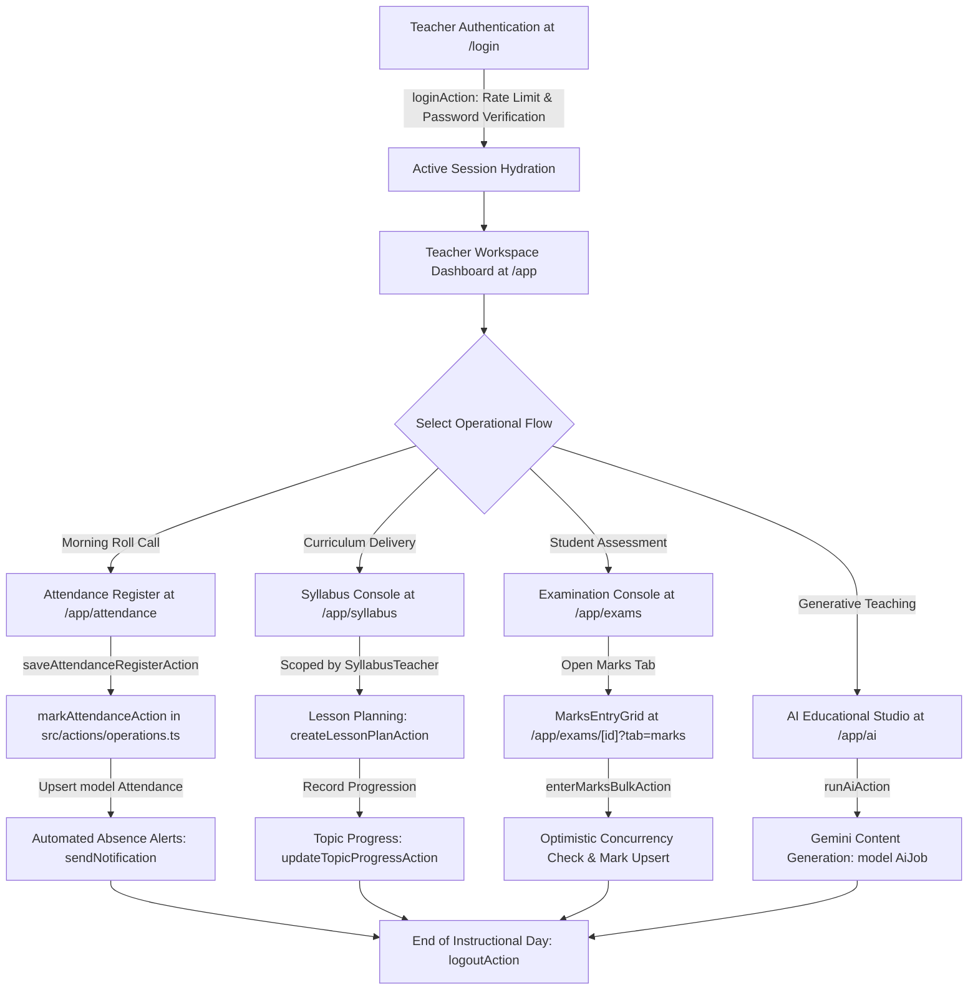
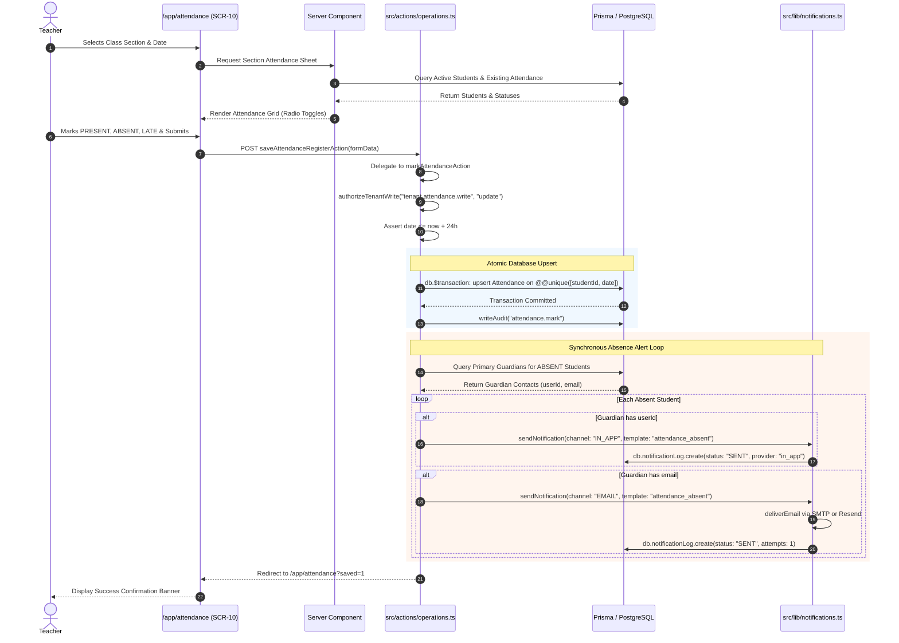
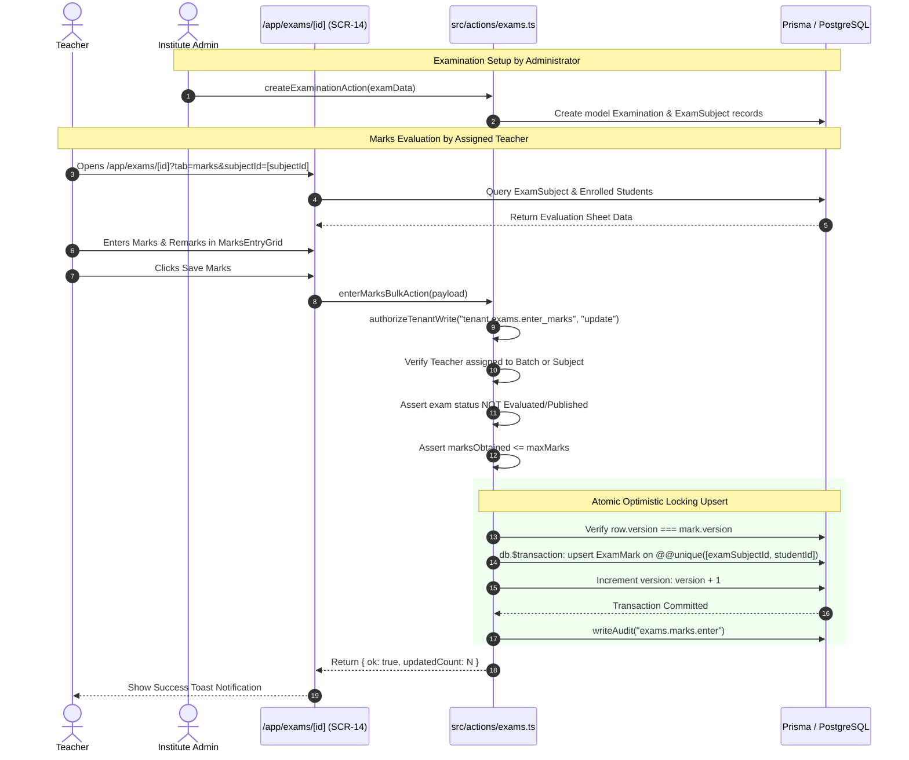
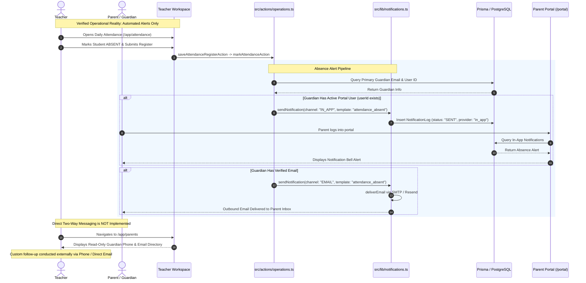
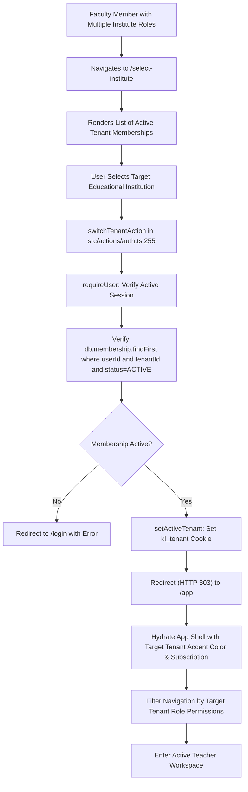

# Knowletive SaaS — Complete Journey 4: Teacher End-to-End Functional Journey

## 1. Document Information
- **Title:** Teacher Daily Academic Operations, Classroom Attendance, Lesson Progression & Examination Evaluation Specification
- **Lifecycle Arc:** Staff Account Creation & Out-of-Band Handoff → First Authentication & Tenant Context Resolution → Teacher Workspace Dashboard Telemetry → Assigned Batches & Scoped Curriculum Resolution → Student Directory & Demographic Access → Daily Section Attendance Marking & Automated Absence Alerts → Syllabus Tracking & Outcome-Based Lesson Planning → Examination Marks Entry & Optimistic Concurrency Control → Parent Directory Transparency → Workspace Sign-Out
- **Document ID:** DOC-24-TEACHER-DAILY-OPERATIONS-JOURNEY
- **Audit Revision:** 1.7 (Historical Action Verification, archiveBatchAction Codebase Audit & Baseline Sign-Off)
- **Target Audience:** Teaching Faculty, Department Heads, Academic Coordinators, Quality Assurance Engineers, Core Systems Architects
- **Repository Scope:** `D:\IT\Saas` (Branch: `staging/exam-stage-43`)
- **Companion Documents:**
  - Journey 1: `21-PILOT-ADMISSION-TO-STUDENT-LIFECYCLE.md`
  - Journey 2: `22-PLATFORM-OWNER-INSTITUTE-PROVISIONING-JOURNEY.md`
  - Journey 3: `23-INSTITUTE-ADMIN-FIRST-LOGIN-WORKSPACE-SETUP-STAFF-ONBOARDING-PERMISSIONS.md`

---

## 2. Executive Summary

This specification establishes the **authoritative functional specification** for how an active **Teacher** operates within the Knowletive Multi-Tenant Education SaaS platform. Picking up from the staff onboarding workflow conducted by the Institute Administrator in Journey 3, this document traces the teacher's daily academic responsibilities from initial credential authentication, workspace context resolution, and dashboard review, through scoped batch management, section attendance marking, outcome-based lesson planning, syllabus progress recording, bulk examination marks evaluation, and AI-assisted educational workflows.

### Critical Codebase Realities Enforced in Revision 1.7:
1. **Teacher Role Definition & Exact 17 Permissions:**
   - In `src/lib/catalog.ts` (lines 240–254), the built-in `TEACHER` role template is provisioned with exactly **17 permissions**:
     `tenant.batches.read`, `tenant.syllabus.read`, `tenant.syllabus.manage_lessons`, `tenant.syllabus.update_progress`, `tenant.syllabus.view_reports`, `tenant.exams.read`, `tenant.exams.enter_marks`, `tenant.exams.view_reports`, `tenant.students.read`, `tenant.parents.read`, `tenant.academics.read`, `tenant.attendance.read`, `tenant.attendance.write`, `tenant.announcements.read`, `tenant.notifications.read`, `tenant.ai.use`, `tenant.reports.read`.
   - Teachers hold write/mutation permissions in exactly four operational domains: **Attendance Recording** (`tenant.attendance.write`), **Lesson Planning** (`tenant.syllabus.manage_lessons`), **Syllabus Progress** (`tenant.syllabus.update_progress`), **Examination Marks Entry** (`tenant.exams.enter_marks`), plus generative AI execution (`tenant.ai.use`). All other administrative capabilities are strictly read-only or denied by server-side authorization guards.
2. **Staff Onboarding Server Action (`inviteStaffAction`):**
   - The verified server action for creating and onboarding staff is `inviteStaffAction` exported from `src/actions/students.ts:731` (invoked by `<ActionForm action={inviteStaffAction}>` in `src/app/(app)/app/staff/new/page.tsx:43`). It evaluates `authorizeTenantWrite("tenant.staff.write", "create")`. There is no `createStaffAction` and no `tenant.staff.create` permission.
   - The database persists staff as a `User` record and a `Membership` record with a tenant staff role. There is no separate `Staff` table in the database schema.
3. **Tenant-Switching Route (`/select-institute`):**
   - The multi-institute tenant selection route is `/select-institute` (`src/app/select-institute/page.tsx`), which invokes `switchTenantAction` from `src/actions/auth.ts:255`. There is no `/app/select-tenant` route.
4. **Institution Settings Action (`saveInstitutionSettingsAction`):**
   - The actual settings mutation action is `saveInstitutionSettingsAction` in `src/actions/admin.ts:174`, guarded by `authorizeTenantWrite("tenant.settings.manage", "update")`. The identifier `updateTenantSettingsAction` does not exist in the codebase.
5. **Separation of Functional Screen Count and Route File Count:**
   - **Documented Functional Screens:** Exactly **17 functional screens** (`SCR-01` through `SCR-17`).
   - **Distinct Next.js App Router Route Files:** Exactly **17 distinct route files** (`page.tsx`) under `src/app/`:
     `/login`, `/select-institute`, `/app`, `/app/students`, `/app/students/[id]`, `/app/parents`, `/app/parents/[id]`, `/app/academics`, `/app/batches`, `/app/batches/[id]`, `/app/syllabus`, `/app/syllabus/[id]`, `/app/exams`, `/app/exams/[id]`, `/app/attendance`, `/app/announcements`, `/app/ai`, and `/app/forbidden`.
   - **Dynamic Tab Variations:** The Marks Entry Sheet is rendered via the interactive `MarksEntryGrid` component embedded inside `/app/exams/[id]?tab=marks&subjectId=[subjectId]` (a search-parameter tab state within `src/app/(app)/app/exams/[id]/page.tsx`), rather than a separate route file.
   - **Backend-Only Operations:** Mutating actions (`enterMarksBulkAction`, `updateTopicProgressAction`, `createLessonPlanAction`, `markAttendanceAction`, `saveAttendanceRegisterAction`, `runAiAction`) execute via server actions without dedicated standalone route pages.
6. **Reconciled Prisma Model Count (54 Total Models, 30 Participating, 24 Non-Participating):**
   - Programmatic extraction of all `model` declarations from `prisma/schema.prisma` confirms exactly **54 total models**.
   - Exactly **30 models** participate directly or relationally in the Teacher Journey:
     - **10 Core Operational Models:** Directly mutated or evaluated in daily teacher workflows (`Attendance`, `LessonPlan`, `TopicProgress`, `ExamMark`, `AiJob`, `SyllabusTrack`, `SyllabusChapter`, `SyllabusTopic`, `Batch`, `Student`).
     - **14 Supporting Relational Models:** Identity, structure, and scoping models (`User`, `Session`, `Membership`, `Role`, `ClassLevel`, `Section`, `Subject`, `BatchTeacher`, `BatchStudent`, `SyllabusTeacher`, `Guardian`, `StudentGuardian`, `Examination`, `ExamSubject`).
     - **6 Contextual System & Audit Models:** Container, calendar, logging, and security models (`Tenant`, `AcademicYear`, `RateLimitBucket`, `NotificationLog`, `Announcement`, `AuditLog`).
   - Exactly **24 models** are non-participating in the Teacher Journey, cleanly partitioned into six disjoint categories:
     - Financial & Subscription Billing Models (8): `FeeInvoice`, `FeePayment`, `FeePaymentLink`, `Invoice`, `Payment`, `Plan`, `TenantSubscription`, `TenantUsage`.
     - Admissions & Sales CRM Models (2): `Lead`, `LeadActivity`.
     - Platform Infrastructure & Authentication Models (4): `FileAsset`, `PasswordResetToken`, `Setting`, `WebhookEvent`.
     - RBAC Permission Catalog Models (2): `Permission`, `RolePermission`.
     - Administrative Exam Lifecycle & Grading Models (6): `ExamEnrollment`, `ExamMarksRevisionEvent`, `ExamResult`, `ExamResultSnapshot`, `GradeBand`, `GradeScale`.
     - Administrative Enrollment & Curriculum Audit Models (2): `BatchEnrollmentEvent`, `SyllabusProgressEvent`.
   - Exact mathematical partition: $30 \text{ participating} + 24 \text{ non-participating} = 54 \text{ total schema models}$. Every model declaration in `prisma/schema.prisma` is classified in exactly one set with zero omissions and zero overlap.
7. **Reconciliation of Server-Action Inventory & Exact Operational Counts:**
   - Section 18 catalog contains exactly **19 unique permitted teacher actions** (comprising 18 direct business-logic/instructional actions and 1 server component form action wrapper `saveAttendanceRegisterAction`).
   - Section 18.2 documents **25 restricted administrative actions** clearly documented as denied to teachers by the server-side authorization guard (`authorizeTenantWrite` returning `{ ok: false, error }`), including all 7 batch mutation actions: `createBatchAction:25`, `updateBatchAction:149`, `assignTeachersAction:257`, `enrollStudentsAction:335`, `dropStudentAction:468`, `transferStudentAction:547`, and `completeBatchAction:700`. Legacy or informal identifiers (`deleteBatchAction`, `enrollStudentAction`, `archiveBatchAction`) are confirmed nonexistent as standalone exports in the codebase; batch archival is handled as a status transition via `updateBatchAction:149`.
   - `changeTenantPlanAction` is qualified to `src/actions/admin.ts:261` (tenant scope, evaluating `authorizeTenantWrite("tenant.billing.manage", "update")`), distinguishing it from the platform root-level action `src/actions/platform.ts:261` (`platform.subscriptions.manage`).
   - **Batch Concurrency Architecture & Row-Level Locking:** All mutating batch operations in `src/actions/batches.ts` execute within interactive database transactions (`db.$transaction`) and enforce concurrency control via PostgreSQL **pessimistic row-level locking (`SELECT ... FOR UPDATE`)** implemented in `lockBatchRow` and `lockBatchRows` (`src/lib/batch-locking.ts`). Multi-batch operations sort batch IDs in ascending order to prevent deadlocks. This mechanism locks physical table rows and is strictly distinct from PostgreSQL advisory locks (`pg_advisory_xact_lock`) and from the application-level optimistic concurrency control (`mark.version`) used during teacher marks entry in `enterMarksBulkAction`.
8. **Correct Exam-Action Semantics & Precise Lifecycle Behaviors:**
   - `createExamAction` does not exist; the actual action is `createExaminationAction` (`src/actions/exams.ts:55`), requiring `tenant.exams.write`.
   - `publishExamAction` does not exist; the actual action is `calculateAndPublishResultsAction` (`src/actions/exams.ts:1460`), requiring `tenant.exams.publish_results`, which computes student aggregates, grade scale mappings, generates SHA-256 result snapshots, and transitions exam status to `PUBLISHED`.
   - `unpublishExamAction` does not exist in the codebase. Once published, examination results are immutable in Knowletive. Post-publication mark amendments require `correctPublishedMarkAction`, and published exams cannot be reverted to draft, scheduled, in-progress, or evaluated.
   - `reopenEvaluatedExamAction` (`src/actions/exams.ts:381`) is a distinct administrative action requiring `tenant.exams.manage_grading` that reopens an examination whose status is `EVALUATED` back to `IN_PROGRESS` (with mandatory justification) to allow marks modifications *prior* to publishing. It does not unpublish results or unpublish exams.
   - `verifyExamSubjectMarksAction` (`src/actions/exams.ts:1389`) locks marks for an assessment paper (`MARKS_VERIFIED`), preventing further marks entries.
   - `enterMarksBulkAction` (`src/actions/exams.ts:1127`) is the teacher marks evaluation action with optimistic concurrency control (`mark.version`).
9. **Parent Communication & Direct Messaging Resolution:**
   - **Direct Parent Messaging is UNIMPLEMENTED:** No direct teacher-to-parent messaging, 1-to-1 chat, message drafting action, or `/app/messages` route exists in the codebase.
   - Teachers hold `tenant.parents.read`, allowing read-only access to parent contact information at `/app/parents` and `/app/parents/[id]`. Teachers lack `tenant.parents.write` and cannot create, edit, or unlink parents.
   - Parent communication in Knowletive operates exclusively through two channels:
     1. **Automated Absence Alerts:** Generated synchronously during `markAttendanceAction` for students marked `ABSENT`, dispatching in-app notices (if `guardian.userId`) and email notices (if `guardian.email`).
     2. **Broadcast Announcements:** Viewed at `/app/announcements` under `tenant.announcements.read` (publishing is restricted to roles holding `tenant.announcements.write`).
10. **Batch and Syllabus Access Scope Realities:**
    - **Batches (`/app/batches` & `/app/batches/[id]`):** The directory at `/app/batches` strictly filters records to batches where the teacher is assigned (`where.teachers = { some: { teacher: { userId: ctx.user.id } } }`). Direct URL access to an unassigned batch on `/app/batches/[id]` is caught by the server component guard and redirected to `/app/forbidden?p=tenant.batches.read&denied=record`. Batch mutation actions (`createBatchAction`, `updateBatchAction`, `completeBatchAction`, `assignTeachersAction`, `enrollStudentsAction`, `dropStudentAction`, `transferStudentAction`) are denied by the server-side authorization guard (`authorizeTenantWrite` returning `{ ok: false, error }`) because teachers lack write/enroll/transfer permissions.
    - **Syllabus (`/app/syllabus` & `/app/syllabus/[id]`):** The directory at `/app/syllabus` strictly filters records to syllabus tracks where the teacher is assigned (`where.teachers = { some: { teacher: { userId: ctx.user.id } } }`). Direct URL access to an unassigned syllabus track on `/app/syllabus/[id]` redirects to `/app/forbidden?p=tenant.syllabus.read`. Furthermore, all four syllabus mutation actions (`createLessonPlanAction`, `updateLessonPlanAction`, `deleteLessonPlanAction`, `updateTopicProgressAction`) verify teacher assignment against `db.syllabusTeacher` and reject unassigned faculty with `{ error: "Access denied: You are not assigned to this syllabus." }`.
11. **Notification Provider Scope & Attendance Alerts Mechanics:**
    - `src/lib/notifications.ts` (`sendNotification`) supports four outbound channels: `EMAIL` (via SMTP or Resend API), `SMS` (via Twilio), `WHATSAPP` (via Meta Graph Cloud API), and `IN_APP` (internal database notification record).
    - **Specific Attendance Call-Site:** The attendance absence-alert workflow in `markAttendanceAction` invokes **ONLY** `IN_APP` and `EMAIL` channels. SMS and WhatsApp are **never invoked** for attendance alerts.
    - **Synchronous Execution:** Notification dispatch is executed synchronously (`await deliverEmail...`). There is no background queue runner, no Redis/BullMQ worker, and no cron retry daemon.
    - **Status Transitions:** Outbound logs in `NotificationLog` start with `status: "QUEUED"`. If the recipient address is empty, the status transitions to `SKIPPED`. On successful external dispatch, status transitions to `SENT`. If provider credentials are unconfigured in production, status transitions to `SKIPPED`. On delivery exception, status transitions to `FAILED`.

---

## 3. Relationship to Journeys 1, 2 and 3

| Journey Reference | Operational Scope | Transition / Handoff Point into Journey 4 |
|:---|:---|:---|
| **Journey 1: Student Lifecycle** (`DOC-21`) | Lead capture, pilot admission, fee collection, attendance, grading, lifecycle events. | Journey 4 focuses deeply on the teacher's operational side of these workflows, detailing how attendance and marks entered by faculty feed the student lifecycle records. |
| **Journey 2: Platform Provisioning** (`DOC-22`) | SuperAdmin creates tenant, provisions root database, initializes plans, seeds default roles. | Journey 2 creates the institutional container (`Tenant`) and default role templates (`TEACHER`) utilized in Journey 4. |
| **Journey 3: Institute Admin Workspace** (`DOC-23`) | First login, institute profile, academic year, class levels, sections, subjects, staff invitation. | Journey 3 concludes with the Administrator invoking `inviteStaffAction` to create the Teacher account and assigning them to batches/syllabuses. Journey 4 starts when the teacher receives their credentials. |

---

## 4. Teacher Role and Security Architecture

### 4.1 Built-in Role Template Definition (`src/lib/catalog.ts`)
The `TEACHER` role template is defined in `src/lib/catalog.ts` (lines 240–254) as follows:

```typescript
{
  key: "TEACHER",
  scope: "TENANT",
  name: "Teacher",
  description: "Classroom access: attendance, students and AI teaching tools.",
  permissions: tenantPerms(
    "batches.read",
    "syllabus.read", "syllabus.manage_lessons", "syllabus.update_progress", "syllabus.view_reports",
    "exams.read", "exams.enter_marks", "exams.view_reports",
    "students.read", "parents.read", "academics.read",
    "attendance.read", "attendance.write",
    "announcements.read", "notifications.read", "ai.use", "reports.read",
  ),
}
```

### 4.2 Exact 17 Teacher Permissions Breakdown

| Domain | Permission Identifier | Operational Capability | Access Mode |
|:---|:---|:---|:---|
| **Batches** | `tenant.batches.read` | View assigned batches, enrolled student cohorts, and batch schedules. | Read-Only (Scoped) |
| **Syllabus** | `tenant.syllabus.read` | View assigned syllabus tracks, chapters, topics, and completion status. | Read-Only (Scoped) |
| **Syllabus** | `tenant.syllabus.manage_lessons`| Create, edit, and delete lesson plans (`LessonPlan`) for assigned syllabuses. | Read/Write (Scoped) |
| **Syllabus** | `tenant.syllabus.update_progress`| Update topic status (`TopicProgress`) and log curriculum progression. | Read/Write (Scoped) |
| **Syllabus** | `tenant.syllabus.view_reports` | View syllabus completion analytics and coverage metrics. | Read-Only |
| **Exams** | `tenant.exams.read` | View scheduled, in-progress, and evaluated examinations across tenant. | Read-Only (Tenant-Wide) |
| **Exams** | `tenant.exams.enter_marks` | Enter, edit, and draft student assessment marks (`ExamMark`) for assigned subjects. | Read/Write (Scoped) |
| **Exams** | `tenant.exams.view_reports` | View exam result analytics, grade distributions, and class performance summaries. | Read-Only |
| **Students** | `tenant.students.read` | Browse student directory, view profiles, academic records, and emergency contacts. | Read-Only (Tenant-Wide) |
| **Parents** | `tenant.parents.read` | Browse parent/guardian directory, view linked student relationships and contacts. | Read-Only (Tenant-Wide) |
| **Academics** | `tenant.academics.read` | View academic structure: academic years, class levels, sections, and subjects. | Read-Only (Tenant-Wide) |
| **Attendance** | `tenant.attendance.read` | View historical section attendance registers and individual student attendance records. | Read-Only (Tenant-Wide) |
| **Attendance** | `tenant.attendance.write` | Record, update, and submit daily section attendance registers (`Attendance`). | Read/Write (Tenant-Wide) |
| **Announcements**| `tenant.announcements.read` | View institution-wide and staff announcements published by administration. | Read-Only |
| **Notifications**| `tenant.notifications.read` | View system alerts, absence notifications, and platform messages. | Read-Only |
| **AI Studio** | `tenant.ai.use` | Generate quizzes, lesson plans, study materials, and rubrics using AI. | Read/Write |
| **Reports** | `tenant.reports.read` | View operational summary reports within assigned academic areas. | Read-Only |

### 4.3 Server-Side Authorization Guard Architecture (`src/lib/rbac.ts`)
Knowletive enforces RBAC server-side using helper functions in `src/lib/rbac.ts`:
- **Read Operations (`requireTenantPermission`):** Throws a Next.js redirect to `/app/forbidden` if the user's active membership lacks the specified permission.
- **Form Action Mutations (`authorizeTenantWrite`):** Non-throwing helper returning an authorization result object:
  ```typescript
  export async function authorizeTenantWrite(
    permission: PermissionName,
    action: "create" | "update" | "delete" = "create"
  ): Promise<{ ok: true; ctx: TenantContext } | { ok: false; error: string }>
  ```
- **Error Behavior:** When unauthorized, `authorizeTenantWrite` returns `{ ok: false, error: "Permission denied..." }`. Server actions return this error as part of their `ActionResult` or `FormState`, rendered by the client form as a toast or inline error banner. **Server actions do not throw HTTP 403 status codes.**

---

## 5. Teacher Account Creation and Handoff

### 5.1 Account Provisioning by Administrator
Teachers do not self-register on the Knowletive platform. Faculty accounts are provisioned by an Institute Administrator or HR Coordinator in Journey 3 via the Staff Onboarding screen (`/app/staff/new`):
1. **Administrative Action Invocation:** The administrator submits the onboarding form, calling `inviteStaffAction` from `src/actions/students.ts:731`.
2. **Permission Guard:** Evaluates `authorizeTenantWrite("tenant.staff.write", "create")`.
3. **Database Creation:**
   - Inserts `model User`: email, full name, phone number, and a bcrypt-hashed initial temporary password (`costFactor = 12`).
   - Inserts `model Membership`: links `User.id` to `Tenant.id`, assigns `Role.id` (where `role.key === "TEACHER"`), sets `status = "ACTIVE"`.
4. **Audit Logging:** Records an audit event `staff.invite` in `model AuditLog`.
5. **Credential Handoff:** Initial credentials (email and temporary password) are securely delivered to the teacher out-of-band (e.g., in person, via encrypted institutional email, or via secure SMS).

---

## 6. Teacher First Login and Authentication

### 6.1 Authentication Mechanics (`src/actions/auth.ts:loginAction`)
The teacher navigates to `/login` (Screen 01) and submits their credentials.
1. **Rate Limiting Guard:** `loginAction` queries `RateLimitBucket` for `action_login_${ip}_${email}`. Rejects if attempts exceed 8 per 10 minutes.
2. **User Lookup & Active Lockout Check:**
   - Queries `db.user.findUnique({ where: { email } })`.
   - Checks `user.lockedUntil`. If `lockedUntil > now`, rejects with: *"This account is temporarily locked due to repeated failed login attempts. Please try again in 15 minutes or reset your password."*
3. **Password Verification:**
   - Evaluates `bcrypt.compare(password, user.passwordHash)`.
   - On mismatch: Increments `failedLoginAttempts`. If `>= 5`, sets `lockedUntil = now + 15m`.
   - On match: Resets `failedLoginAttempts = 0` and clears `lockedUntil = null`.
4. **Session Cookie Issuance (`kl_session` & `kl_tenant`):**
   - If Two-Factor Authentication (`twoFactorEnabled`) is **disabled**:
     - Creates `db.session` record (`token`, `userId`, `expiresAt = now + 30d`).
     - Issues `kl_session` cookie (`httpOnly: true, secure: true, sameSite: "lax", maxAge: 30 days`).
     - Queries user's active memberships. Since the teacher belongs to a single institute, resolves `targetTenantId = membership.tenantId`.
     - Issues `kl_tenant` cookie storing `targetTenantId`.
     - Redirects to `/app`.
   - If Two-Factor Authentication (`twoFactorEnabled`) is **enabled**:
     - Generates ephemeral pending login token.
     - Issues `kl_pending` cookie (`maxAge: 5 minutes`).
     - Returns `{ requires2FA: true }`, prompting the client to display the 2FA verification form (`SCR-01B`).
     - Teacher enters 6-digit TOTP code, calling `verifyTwoFactorLoginAction`.
     - Upon valid code verification: clears `kl_pending`, creates `db.session`, issues `kl_session`, and preserves existing `kl_tenant` cookie.

---

## 7. Teacher Dashboard and Navigation

### 7.1 App Shell & Navigation Filtering (`src/app/(app)/app/layout.tsx`)
When the teacher's browser requests `/app` (Screen 03), `AppLayout` executes:
1. **Tenant Context Hydration:** Calls `getTenantContext()` in `src/lib/auth.ts`.
   - Validates session from `kl_session` cookie against `db.session`.
   - Resolves active tenant from `kl_tenant` cookie (or falls back to single active membership).
   - Loads `Tenant` record with `TenantSubscription` and commercial `Plan`.
   - Evaluates `subscriptionBlocked` (`true` if status is `PAST_DUE`, `PAUSED`, `EXPIRED`, `CANCELED`).
2. **Staff Role Assertion:**
   - Evaluates `isStaffMember(ctx)`: confirms `membership.roleKey` (`"TEACHER"`) is in `STAFF_ROLE_KEYS`. The teacher is permitted to enter the staff workspace.
3. **Sidebar Navigation Filtering:**
   - Filters the 16 items in `appNav` (`src/components/shell/nav.ts`) using `!item.permission || hasTenantPermission(ctx, item.permission)`.
   - **Visible Navigation Links for Teacher (9 Links):**
     1. *Overview / Dashboard* (`/app`) — No special permission required.
     2. *Students* (`/app/students`) — Granted by `tenant.students.read`.
     3. *Parents* (`/app/parents`) — Granted by `tenant.parents.read`.
     4. *Batches* (`/app/batches`) — Granted by `tenant.batches.read`.
     5. *Attendance* (`/app/attendance`) — Granted by `tenant.attendance.read`.
     6. *Syllabus* (`/app/syllabus`) — Granted by `tenant.syllabus.read`.
     7. *Exams* (`/app/exams`) — Granted by `tenant.exams.read`.
     8. *Announcements* (`/app/announcements`) — Granted by `tenant.announcements.read`.
     9. *AI Studio* (`/app/ai`) — Granted by `tenant.ai.use`.
   - **Hidden Navigation Links (Denied to Teacher):**
     - *Leads / Admissions* (`/app/leads`) — Requires `tenant.leads.read` (Hidden).
     - *Staff / Faculty* (`/app/staff`) — Requires `tenant.staff.read` (Hidden).
     - *Fee Billing & Payments* (`/app/fees`) — Requires `tenant.fees.read` (Hidden).
     - *Subscription / Plan Billing* (`/app/billing`) — Requires `tenant.billing.read` (Hidden).
     - *Role Permissions* (`/app/roles`) — Requires `tenant.roles.read` (Hidden).
     - *Institute Settings* (`/app/settings`) — Requires `tenant.settings.read` (Hidden).
     - *Audit Logs* (`/app/audit`) — Requires `tenant.audit.read` (Hidden).

### 7.2 Dashboard Operational Telemetry (`src/app/(app)/app/page.tsx`)
The teacher dashboard provides immediate real-time feedback on daily responsibilities:
- **Attendance Status Indicator:** Checks whether attendance for today's date has been submitted for sections assigned to the faculty member.
- **Assigned Batches Card:** Quick links to the teacher's active batches, showing total enrolled student counts.
- **Syllabus Coverage Progress:** Progress indicators showing percent completion of assigned curriculum tracks.
- **Upcoming Examinations Banner:** Displays scheduled exams with dates and evaluation status.
- **Recent Institute Announcements:** Highlights the latest broadcast announcements relevant to staff.

---

## 8. Assigned Classes, Batches and Subjects

### 8.1 Teacher Assignment Relational Architecture
In the Knowletive database schema (`prisma/schema.prisma`), teachers are linked to instructional structures through three specific relational vectors:

1. **Batch Assignment (`model BatchTeacher`):**
   - Join model linking `Batch` to `Membership`:
     ```prisma
     model BatchTeacher {
       id         String     @id @default(cuid())
       batchId    String
       teacherId  String     // References Membership.id
       isPrimary  Boolean    @default(false)
       assignedAt DateTime   @default(now())

       batch   Batch      @relation(fields: [batchId], references: [id], onDelete: Cascade)
       teacher Membership @relation(fields: [teacherId], references: [id], onDelete: Cascade)

       @@unique([batchId, teacherId])
       @@index([teacherId])
     }
     ```
   - Multiple teachers can be assigned to a single batch. One teacher may be designated as the primary faculty member (`isPrimary: true`).
2. **Subject Assignment (`model Subject`):**
   - `model Subject` holds an optional `teacherId String?` column referencing `Membership.id`.
3. **Syllabus Assignment (`model SyllabusTeacher`):**
   - Join model linking `SyllabusTrack` to `Membership`:
     ```prisma
     model SyllabusTeacher {
       id         String        @id @default(cuid())
       syllabusId String
       teacherId  String        // References Membership.id
       isPrimary  Boolean       @default(false)
       assignedAt DateTime      @default(now())

       syllabus SyllabusTrack @relation(fields: [syllabusId], references: [id], onDelete: Cascade)
       teacher  Membership    @relation(fields: [teacherId], references: [id], onDelete: Cascade)

       @@unique([syllabusId, teacherId])
       @@index([teacherId])
     }
     ```

### 8.2 Batch Scoping & Direct URL Guard (`src/app/(app)/app/batches/`)
1. **Batch Listing Page (`/app/batches`):**
   - In `src/app/(app)/app/batches/page.tsx` (lines 55–65), query scoping is enforced at the database level:
     ```typescript
     const roleKey = ctx.membership?.roleKey;
     const isTeacher = roleKey === "TEACHER";
     const isInstAdminOrPrincipal = roleKey === "INSTITUTE_ADMIN" || roleKey === "PRINCIPAL";
     const teacherFilter = isTeacher && !isInstAdminOrPrincipal 
       ? { teachers: { some: { teacher: { userId: ctx.user.id } } } } 
       : {};

     const where: Prisma.BatchWhereInput = {
       tenantId: ctx.tenant.id,
       ...teacherFilter,
     };
     ```
   - A teacher **only sees batches assigned to them**. The query joins `BatchTeacher` through `Membership` to `User.id === ctx.user.id`.
2. **Batch Detail Direct URL Guard (`/app/batches/[id]`):**
   - If a teacher attempts to bypass the UI and navigate directly to `/app/batches/[id]` for an unassigned batch, `src/app/(app)/app/batches/[id]/page.tsx` (lines 135–144) enforces record-level authorization:
     ```typescript
     const roleKey = ctx.membership?.roleKey;
     const isTeacher = roleKey === "TEACHER";
     const isInstAdminOrPrincipal = roleKey === "INSTITUTE_ADMIN" || roleKey === "PRINCIPAL";
     if (isTeacher && !isInstAdminOrPrincipal) {
       const isAssigned = batch.teachers.some((bt) => bt.teacher.user.id === ctx.user.id);
       if (!isAssigned) {
         redirect("/app/forbidden?p=tenant.batches.read&denied=record");
       }
     }
     ```
   - Direct URL access to an unassigned batch is immediately intercepted and redirected to `/app/forbidden`.
3. **Denial of All 7 Batch Mutation Actions to Teachers:**
   - Inspection of `src/actions/batches.ts` confirms exactly **7 exported batch server actions**, all requiring administrative permissions and denied to teachers by the server-side authorization guard (`authorizeTenantWrite` returning `{ ok: false, error }`):
     - `createBatchAction` (`src/actions/batches.ts:25`): Signature `(_prev: FormState, formData: FormData): Promise<FormState>`. Invoked by `<ActionForm action={createBatchAction}>` in `src/app/(app)/app/batches/new/page.tsx`. Evaluates `authorizeTenantWrite("tenant.batches.write", "create")`. Denied to teachers.
     - `updateBatchAction` (`src/actions/batches.ts:149`): Signature `(batchId: string, _prev: FormState, formData: FormData): Promise<FormState>`. Invoked by `<ActionForm action={updateAction}>` in `src/app/(app)/app/batches/[id]/edit/page.tsx` and the batch configuration form in `src/app/(app)/app/batches/[id]/settings/page.tsx` (which supports transitioning status to `ARCHIVED`). Evaluates `authorizeTenantWrite("tenant.batches.write", "update")`. Denied to teachers.
     - `assignTeachersAction` (`src/actions/batches.ts:257`): Signature `(batchId: string, teacherIds: string[], primaryTeacherId?: string): Promise<{ success?: string; error?: string }>`. Invoked by `<AssignTeachersModal>` in `src/components/batches/batch-client-bits.tsx:109`. Evaluates `authorizeTenantWrite("tenant.batches.manage_teachers", "update")`. Denied to teachers.
     - `enrollStudentsAction` (`src/actions/batches.ts:335`): Signature `(batchId: string, studentIds: string[]): Promise<{ success?: string; error?: string; enrolledCount?: number }>`. Invoked by `<EnrollStudentsModal>` in `src/components/batches/batch-client-bits.tsx:182`. Evaluates `authorizeTenantWrite("tenant.batches.enroll", "create")`. Denied to teachers. Note: The actual exported identifier is plural `enrollStudentsAction`; there is no `enrollStudentAction`.
     - `dropStudentAction` (`src/actions/batches.ts:468`): Signature `(batchId: string, studentId: string, reason?: string): Promise<{ success?: string; error?: string }>`. Invoked by `<DropStudentButton>` in `src/components/batches/batch-client-bits.tsx:246`. Evaluates `authorizeTenantWrite("tenant.batches.enroll", "delete")`. Denied to teachers.
     - `transferStudentAction` (`src/actions/batches.ts:547`): Signature `(fromBatchId: string, toBatchId: string, studentId: string, reason?: string): Promise<{ success?: string; error?: string }>`. Invoked by `<TransferStudentModal>` in `src/components/batches/batch-client-bits.tsx:300`. Evaluates `authorizeTenantWrite("tenant.batches.transfer", "update")`. Denied to teachers.
     - `completeBatchAction` (`src/actions/batches.ts:700`): Signature `(batchId: string): Promise<{ success?: string; error?: string }>`. Invoked by `<CompleteBatchButton>` in `src/components/batches/batch-client-bits.tsx:367`. Evaluates `authorizeTenantWrite("tenant.batches.write", "update")`. Rejects batches already archived (`status === "ARCHIVED"`). Denied to teachers. Note: Batches are completed via `completeBatchAction` or archived via `updateBatchAction`; standalone actions `deleteBatchAction` and `archiveBatchAction` do not exist in the codebase.

4. **Batch Concurrency Control & Database Locking Architecture (`src/lib/batch-locking.ts`):**
   - **Interactive Database Transactions:** All mutating batch operations (`createBatchAction`, `updateBatchAction`, `assignTeachersAction`, `enrollStudentsAction`, `dropStudentAction`, `transferStudentAction`, `completeBatchAction`) wrap their operations within `db.$transaction`.
   - **Pessimistic Row-Level Locking via `SELECT ... FOR UPDATE`:** Concurrency control on batch capacity and lifecycle state is enforced through PostgreSQL row-level locks via `lockBatchRow` and `lockBatchRows` (`src/lib/batch-locking.ts`). The underlying implementation executes raw SQL within the transaction client:
     ```sql
     SELECT id, name, code, capacity, status, "endDate"
     FROM "Batch"
     WHERE id IN (...) AND "tenantId" = $tenantId
     ORDER BY id ASC
     FOR UPDATE
     ```
   - **Precise Classification of Lock Mechanics:**
     - **Native PostgreSQL Row-Level Lock:** This is a physical table row lock held until transaction completion (`COMMIT` or `ROLLBACK`). Concurrent transactions attempting to modify or lock the same batch row are blocked at the database engine level until the holding transaction releases the lock.
     - **Not an Advisory Lock:** This mechanism does *not* use PostgreSQL application advisory locks (`pg_advisory_lock` or `pg_advisory_xact_lock`). It locks specific rows in the `"Batch"` table directly.
     - **Deterministic Deadlock Prevention:** In multi-batch operations such as `transferStudentAction` (which moves a student from one batch to another), `lockBatchRows` deduplicates and sorts batch IDs in ascending alphanumeric order (`ORDER BY id ASC`). This deterministic ordering strictly prevents circular lock wait deadlocks across concurrent opposing transfers.
     - **Global Lock Hierarchy:** The system establishes an acyclic lock hierarchy where examinations are locked first, followed by batches: `Examination -> Batch (sorted by ID ASC)`.
   - **Architectural Contrast with Optimistic Concurrency:**
     - **Batch Mutations (Administrative):** Employ **pessimistic row-level locking** (`SELECT ... FOR UPDATE`) because capacity limits, seat reservations, and status transitions require strict serializability during mutation.
     - **Marks Entry (Teacher):** Employs **optimistic concurrency control** via `model ExamMark.version` in `enterMarksBulkAction` (`src/actions/exams.ts:1127`), avoiding database locks during teacher review while detecting concurrent edits on submit.

---

## 9. Student Roster and Student Details

### 9.1 Tenant-Wide Student Directory (`/app/students`)
Teachers access `/app/students` (Screen 04), guarded by `requireTenantPermission("tenant.students.read")`:
- **Directory Scope (Tenant-Wide):** The page queries all active students across the entire institution (`where: { tenantId: ctx.tenant.id }`), enabling teachers to search for students across all classes, sections, and batches.
- **Search & Filtering:** Supports text search (`q`) across `firstName`, `lastName`, `enrollmentNumber`, and filtering by `sectionId` or `status`.
- **Administrative Action Suppression:** Action buttons for student registration (`/app/students/new`), CSV bulk import (`/app/students/import`), and CSV export (`/app/students/export`) are hidden because the teacher lacks `tenant.students.write` and `tenant.students.export`.

### 9.2 Student Profile View (`/app/students/[id]`)
Teachers open `/app/students/[id]` (Screen 05) to review individual student academic records:
- **Demographic Information:** Full name, roll number, section name, date of birth, blood group, emergency contact details.
- **Academic Performance Tab:** Displays historical assessment marks, term grades, and exam rank.
- **Attendance History Tab:** Cumulative attendance percentage and historical session log (`PRESENT`, `ABSENT`, `LATE`).
- **Guardian Contacts Tab:** Linked guardians (`StudentGuardian`), contact numbers, and primary communication flags.
- **Write Restriction:** Edit buttons and document upload widgets (`uploadStudentDocumentAction`) are suppressed; attempts to mutate student records are denied by the server-side authorization guard.

---

## 10. Attendance Management

### 10.1 Section-Level Attendance Architecture & Access Policy (`/app/attendance`)
Classroom attendance in Knowletive is structured around **Class Sections** (`model Section`), rather than batches or individual subjects. The teacher opens `/app/attendance` (Screen 10), guarded by `requireTenantPermission("tenant.attendance.read")`:
- The page renders a date selector (`input type="date"`, defaulting to today) and a class section selector dropdown (`db.section.findMany({ where: { tenantId }, include: { class: true } })`).
- The teacher selects the relevant section (e.g. "Class 10 — Section A") and the attendance date.
- The interface queries all active students enrolled in that section:
  ```typescript
  const students = await db.student.findMany({
    where: { tenantId: ctx.tenant.id, sectionId: selectedSection.id, status: "ACTIVE" },
    orderBy: [{ firstName: "asc" }, { lastName: "asc" }],
  });
  ```
- **Explicit Access Policy Finding:** Current application policy governs attendance via permission `tenant.attendance.write`. The query in `markAttendanceAction` verifies tenant ownership (`where: { id: sectionId, tenantId: ctx.tenant.id }`), authorizing any teacher holding `tenant.attendance.write` to select and mark attendance for any section in the institute. The application does not enforce a teacher-to-section assignment check.

### 10.2 Daily Attendance Submission Flow (`markAttendanceAction` & `saveAttendanceRegisterAction`)
When a faculty member marks attendance, two actions in `src/actions/operations.ts` cooperate:
1. **`saveAttendanceRegisterAction` (`src/actions/operations.ts:164`):**
   - Serves as the form action wrapper invoked directly by the server component `<form action={saveAttendanceRegisterAction}>` on `/app/attendance`.
   - Reads form fields from `FormData` and delegates execution to `markAttendanceAction({}, formData)`.
   - Inspects the returned result: appends `?saved=1` or `?error=${result.error}` to search parameters, and performs a Next.js `redirect` back to `/app/attendance`.
2. **`markAttendanceAction` (`src/actions/operations.ts:36`):**
   - Core mutation function evaluating `authorizeTenantWrite("tenant.attendance.write", "update")`.
   - Validates that `date <= now + 24h`: attendance cannot be marked for future calendar dates.
   - Extracts dynamic status selections for each student: `status_${student.id}`.
   - Valid status values: `PRESENT`, `ABSENT`, `LATE`.
   - Executes an atomic `db.$transaction` across all student rows, targeting the compound unique constraint `studentId_date`:
     ```typescript
     await db.$transaction(
       rows.map((row) =>
         db.attendance.upsert({
           where: { studentId_date: { studentId: row.studentId, date } },
           update: { status: row.status, markedById: ctx.user.id },
           create: {
             tenantId: ctx.tenant.id,
             studentId: row.studentId,
             date,
             status: row.status,
             markedById: ctx.user.id,
           },
         })
       )
     );
     ```
   - Sets `markedById = ctx.user.id`, binding the teacher's user account to the audit record.
   - Writes an audit log entry: `attendance.mark`.

### 10.3 Automated Guardian Absence Notifications & Delivery Architecture
When one or more students are marked `ABSENT`, `markAttendanceAction` executes an automated parent alert loop:
1. **Guardian Resolution:**
   - Queries all primary guardians for absent students:
     ```typescript
     const absentStudents = await db.student.findMany({
       where: { id: { in: absentStudentIds }, tenantId: ctx.tenant.id },
       include: {
         guardians: {
           include: { guardian: true },
           orderBy: { isPrimary: "desc" },
         },
       },
     });
     ```
2. **Notification Dispatch via `sendNotification` (`src/lib/notifications.ts`):**
   - For each absent student, retrieves `student.guardians[0]?.guardian`:
     - **In-App Notification:** If `guardian.userId` exists (meaning the parent has an active portal user account), dispatches:
       ```typescript
       await sendNotification({
         tenantId: ctx.tenant.id,
         recipientUserId: guardian.userId,
         channel: "IN_APP",
         template: "attendance_absent",
         to: guardian.email || guardian.phone,
         subject: alertSubject,
         body: alertBody,
         meta: { studentId: student.id, date: dateRaw, sectionId },
       }).catch((err) => console.error("[attendance:notify] In-app failed:", err));
       ```
       `sendNotification` inserts a record into `model NotificationLog` with `status: "SENT", provider: "in_app"`.
     - **Email Notification:** If `guardian.email` exists, dispatches:
       ```typescript
       await sendNotification({
         tenantId: ctx.tenant.id,
         recipientUserId: guardian.userId ?? null,
         channel: "EMAIL",
         template: "attendance_absent",
         to: guardian.email,
         subject: `[${ctx.tenant.name}] ${alertSubject}`,
         body: `Dear ${guardian.name},\n\nThis is to notify you that ${studentName} was recorded as ABSENT...`,
         meta: { studentId: student.id, date: dateRaw },
       }).catch((err) => console.error("[attendance:notify] Email failed:", err));
       ```
3. **Delivery Architecture Classification & Provider Fallback Rules:**
   - **Delivery Architecture:** `model NotificationLog` functions as a **persistent delivery and audit log**, recording the outbound notification attempt prior to immediate provider dispatch. It is not a transactional outbox queue with background polling or guaranteed delivery guarantees.
   - **SMTP Delivery:** If `SMTP_HOST`, `SMTP_USER`, and `SMTP_PASS` are configured, emails are dispatched via `nodemailer`.
   - **Resend Fallback:** If SMTP is missing but `RESEND_API_KEY` and `EMAIL_FROM` exist, emails are dispatched via the Resend HTTP API.
   - **Development Console:** If neither provider is configured in development (`NODE_ENV !== "production"`), the alert is printed to the server console.
   - **Production SKIPPED:** In production (`NODE_ENV === "production"`), if no email provider is configured, the notification is logged in `NotificationLog` with `status: "SKIPPED"` and error message: *"email provider is not configured. Set the provider env vars to enable live delivery."*
4. **Resilience & Operational Boundaries:**
   - Attendance absentee alerts do **not** dispatch SMS or WhatsApp messages.
   - Both dispatch promises are wrapped in `.catch()`, ensuring notification delivery failures never abort or roll back the attendance transaction.
   - Guardians inspect in-app notifications upon signing into `/portal`; there is no live web push or WebSocket alerting mechanism.

---

## 11. Timetable and Daily Schedule

### 11.1 Source Code Verification Reality (`SOURCE VERIFIED — NOT IMPLEMENTED`)
A comprehensive audit of the entire codebase confirms that the Timetable module is currently **NOT implemented**:
- **Zero App Routes:** No `/app/timetable`, `/app/schedule`, or `/app/calendar` routes exist under `src/app/`.
- **Zero Schema Models:** No `Timetable`, `Period`, `BellSchedule`, or `ClassSchedule` models exist in `prisma/schema.prisma`.
- **Zero Server Actions:** No scheduling or timetable actions exist in `src/actions/`.
- **Roadmap Item:** Timetabling is planned for future platform iterations as detailed in Section 22.1. Faculty members currently coordinate their daily teaching schedules through administrative notifications, printed bell schedules, or external calendar tools.

---

## 12. Syllabus and Lesson Progress

### 12.1 Syllabus Scoping & Direct URL Guard (`/app/syllabus/`)
1. **Syllabus Directory (`/app/syllabus`):**
   - In `src/app/(app)/app/syllabus/page.tsx` (lines 90–100), teacher-level query scoping is strictly enforced:
     ```typescript
     if (ctx.membership?.roleKey === "TEACHER") {
       where.teachers = { some: { teacher: { userId: ctx.user.id } } };
     }
     ```
   - Teachers **only view syllabus tracks assigned to them** through `model SyllabusTeacher`.
2. **Syllabus Detail Direct URL Guard (`/app/syllabus/[id]`):**
   - If a teacher attempts to bypass the directory and directly access `/app/syllabus/[id]` for an unassigned track, `src/app/(app)/app/syllabus/[id]/page.tsx` (lines 116–120) enforces record-level authorization:
     ```typescript
     if (ctx.membership?.roleKey === "TEACHER") {
       const isAssigned = syllabus.teachers.some((t) => t.teacher.user.id === ctx.user.id);
       if (!isAssigned) {
         redirect("/app/forbidden?p=tenant.syllabus.read");
       }
     }
     ```
   - Direct URL access to an unassigned syllabus track is immediately intercepted and redirected to `/app/forbidden`.

### 12.2 Lesson Plan Operations (`createLessonPlanAction`, `updateLessonPlanAction`, `deleteLessonPlanAction`)
Teachers manage lesson plans within their assigned syllabus tracks using three server actions in `src/actions/syllabus.ts`:
1. **Create Lesson Plan (`createLessonPlanAction` in `src/actions/syllabus.ts:683`):**
   - Invoked via `<ActionForm action={createLessonPlanAction}>` in `src/components/syllabus/syllabus-client-bits.tsx:162`.
   - Evaluates `authorizeTenantWrite("tenant.syllabus.manage_lessons", "create")`.
   - **Teacher Assignment Scoping:** Explicitly verifies that the teacher is assigned to the syllabus track:
     ```typescript
     if (ctx.membership?.roleKey === "TEACHER") {
       const isAssigned = await db.syllabusTeacher.findFirst({
         where: { syllabusId: data.syllabusId, teacher: { userId: ctx.user.id } },
       });
       if (!isAssigned) {
         return { error: "Access denied: You are not assigned to this syllabus." };
       }
     }
     ```
   - Inserts a new `model LessonPlan` record with `status: "SCHEDULED"`.
   - Supports optional fields: `title`, `objectives`, `methodology`, `materials`, `plannedDate`, `durationMinutes` (default: 45), and `homework String?`.
   - Writes an audit log entry: `syllabus.lesson_plan.create`.
2. **Update Lesson Plan (`updateLessonPlanAction` in `src/actions/syllabus.ts:768`):**
   - Evaluates `authorizeTenantWrite("tenant.syllabus.manage_lessons", "update")`.
   - Verifies teacher assignment against `db.syllabusTeacher`.
   - Updates plan details, delivery status (`COMPLETED`, `CANCELLED`), actual duration, and homework text.
   - Writes an audit log entry: `syllabus.lesson_plan.update`.
3. **Delete Lesson Plan (`deleteLessonPlanAction` in `src/actions/syllabus.ts:863`):**
   - Evaluates `authorizeTenantWrite("tenant.syllabus.manage_lessons", "delete")`.
   - Verifies teacher assignment against `db.syllabusTeacher`.
   - Deletes the `db.lessonPlan` record and revalidates `/app/syllabus/[id]`.

### 12.3 Topic Progress Recording (`updateTopicProgressAction`)
Teachers mark instructional progress on individual syllabus topics using `updateTopicProgressAction` (`src/actions/syllabus.ts:891`):
- Invoked via `<ActionForm action={updateTopicProgressAction}>` in `src/components/syllabus/syllabus-client-bits.tsx:109`.
- Evaluates `authorizeTenantWrite("tenant.syllabus.update_progress", "update")`.
- **Teacher Assignment Scoping:** Verifies that the evaluating teacher is assigned to the syllabus track in `db.syllabusTeacher`. If unassigned, returns `{ error: "Access denied: You are not assigned to this syllabus." }`.
- Valid status values (`TopicProgressStatus`): `NOT_STARTED`, `IN_PROGRESS`, `COMPLETED`, `SKIPPED`.
- Executes a transactional update:
  1. Updates `db.syllabusTopic` status and dates.
  2. Upserts `db.topicProgress` on `@@unique([syllabusId, topicId])`.
  3. Inserts an audit event in `db.syllabusProgressEvent`.
  4. Recalculates overall syllabus track completion percentage (`completedTopics / totalTopics * 100`).

---

## 13. Examination Management

### 13.1 Examination Overview (`/app/exams`)
Teachers access `/app/exams` (Screen 13), guarded by `requireTenantPermission("tenant.exams.read")`:
- **Directory Scope (Tenant-Wide):** Lists all examinations created within the active tenant workspace (`where: { tenantId: ctx.tenant.id }`).
- **Exam Statuses Displayed:** `DRAFT`, `SCHEDULED`, `IN_PROGRESS`, `EVALUATING`, `EVALUATED`, `PUBLISHED`, `ARCHIVED`, `CANCELLED`.
- **Administrative Action Suppression:** Action buttons for exam creation (`/app/exams/new`), status transitions (`transitionExamStatusAction`), exam cancellation, and exam deletion (`deleteExaminationAction`) are hidden because teachers lack `tenant.exams.write`.
- **Denial of Administrative Exam Actions:** If a teacher attempts to invoke administrative exam actions, `authorizeTenantWrite` denies execution:
  - `createExaminationAction` (`src/actions/exams.ts:55`) — Requires `tenant.exams.write`. Actual exam creation action. Denied by the server-side authorization guard.
  - `updateExaminationAction` (`src/actions/exams.ts:160`) — Requires `tenant.exams.write`. Denied by the server-side authorization guard.
  - `deleteExaminationAction` (`src/actions/exams.ts:267`) — Requires `tenant.exams.write`. Denied by the server-side authorization guard.
  - `saveExamSubjectsAction` (`src/actions/exams.ts:439`) — Requires `tenant.exams.write`. Denied by the server-side authorization guard.
  - `verifyExamSubjectMarksAction` (`src/actions/exams.ts:1389`) — Requires `tenant.exams.verify_marks`. Locks marks for a subject paper. Denied by the server-side authorization guard.
  - `calculateAndPublishResultsAction` (`src/actions/exams.ts:1460`) — Requires `tenant.exams.publish_results`. Actual result calculation, snapshot generation, and publication action. Denied by the server-side authorization guard.
  - `reopenEvaluatedExamAction` (`src/actions/exams.ts:381`) — Requires `tenant.exams.manage_grading`. Reopens an evaluated exam back to `IN_PROGRESS` for marks modification prior to publishing (does not unpublish results). Denied by the server-side authorization guard.

### 13.2 Examination Detail View (`/app/exams/[id]`)
Teachers open `/app/exams/[id]` (Screen 14) to view subject assessment configurations:
- **Exam Details:** Name, academic year, target class level, grading scale, term dates.
- **Subjects List:** Configured subject papers (`ExamSubject`), maximum marks (`maxMarks`), pass marks (`passMarks`), evaluation dates, and evaluation completion status.
- **Marks Verification Status:** Indicates whether marks for each subject have been locked (`MARKS_VERIFIED`) by an administrator.

---

## 14. Marks Entry and Student Performance

### 14.1 Marks Entry Grid Architecture (`MarksEntryGrid`)
Teachers enter assessment scores using the interactive `MarksEntryGrid` component rendered inside `/app/exams/[id]?tab=marks&subjectId=[subjectId]`:
- **Candidate Roster:** Lists all students enrolled in the examination for the target class/batch.
- **Input Fields:** Numerical input for `marksObtained` and an optional `remarks` string for each candidate.
- **Client-Side Validation:** Validates that `marksObtained >= 0` and `marksObtained <= examSubject.maxMarks`.

### 14.2 Bulk Marks Entry Action (`enterMarksBulkAction`)
When the teacher saves student marks, the form calls `enterMarksBulkAction` in `src/actions/exams.ts:1127`:
1. **Permission Guard:** Evaluates `authorizeTenantWrite("tenant.exams.enter_marks", "update")`.
2. **Exam Lifecycle & Verification Checks:**
   - Rejects if exam status is `SUBMITTED_FOR_REVIEW`, `EVALUATED`, `PUBLISHED`, or `ARCHIVED`.
   - Rejects if the subject marks have already been verified (`examSubject.status === "MARKS_VERIFIED"`).
3. **Teacher-Subject Assignment Scoping:**
   - Lines 1181–1199 enforce that the teacher must be assigned to the batch (`BatchTeacher`) or be the designated subject faculty (`Subject.teacherId === membership.id`). Unassigned teachers are denied:
     ```typescript
     if (isTeacher && !isInstAdminOrPrincipal) {
       const isAssigned = batchTeachers.some((bt) => bt.teacher.userId === ctx.user.id) ||
                          subject.teacherId === ctx.membership.id;
       if (!isAssigned) {
         return { ok: false, error: "Access denied: You are not assigned to evaluate this subject assessment." };
       }
     }
     ```
4. **Optimistic Concurrency Control:**
   - Each row submission includes `expectedVersion: mark.version`.
   - If an existing mark's `version !== expectedVersion`, the action aborts with: *"Record has been modified by another user. Refresh and retry."*
5. **Atomic Database Mutation:**
   - Upserts `model ExamMark` on compound unique key `examSubjectId_studentId`:
     ```typescript
     await tx.examMark.upsert({
       where: { examSubjectId_studentId: { examSubjectId, studentId: entry.studentId } },
       create: {
         tenantId: ctx.tenant.id,
         examSubjectId,
         studentId: entry.studentId,
         marksObtained: entry.marksObtained,
         remarks: entry.remarks,
         evaluatorId: ctx.user.id,
         version: 1,
       },
       update: {
         marksObtained: entry.marksObtained,
         remarks: entry.remarks,
         evaluatorId: ctx.user.id,
         version: { increment: 1 },
       },
     });
     ```
   - Writes an audit log entry: `exams.marks.enter`.

---

## 15. Parent and Student Communication

### 15.1 Parent Directory Transparency (`/app/parents` & `/app/parents/[id]`)
Teachers navigate to `/app/parents` (Screen 06) and `/app/parents/[id]` (Screen 07), guarded by `requireTenantPermission("tenant.parents.read")`:
- **Directory Scope (Tenant-Wide):** Displays a read-only table of all student guardians registered in the institution (`db.guardian.findMany({ where: { tenantId } })`).
- **Data Displayed:** Guardian name, linked student names, relationship, phone number, and verified email address.
- **Write Restriction:** Guardians cannot be edited, unlinked, or added by teachers (`tenant.parents.write` is absent). Mutation actions `updateGuardianAction`, `unlinkGuardianAction`, and `deleteGuardianAction` require `tenant.parents.write` and are denied to teachers.

### 15.2 Absence Alerts vs. Direct Messaging Limitations
1. **Automated Absence Alerts:**
   - As documented in Section 10, marking a student absent during attendance roll call automatically logs and synchronously attempts to dispatch in-app and email notices to the primary guardian.
2. **Direct In-App Messaging (`SOURCE VERIFIED — NOT IMPLEMENTED`):**
   - The application does not provide a live parent-teacher chat interface, two-way SMS messaging console, message drafting action, or direct push notification dispatch tool.
   - Fabricated action names such as `saveMessageDraftAction`, `sendMessageAction`, and `recordObservationAction` do not exist in the codebase.
   - All custom parent follow-ups must be conducted externally via telephone or direct email using the contact details verified in `/app/parents`.

---

## 16. Daily Teaching Operations

### 16.1 Comprehensive Operational Lifecycle Timeline
A complete instructional day for a Knowletive teacher follows this verified sequence:

1. **08:00 — Morning Authentication:** Login at `/login` via `loginAction`, hydrate session, enter staff workspace.
2. **08:15 — Dashboard Review:** Inspect `/app` telemetry for attendance status, announcements, and upcoming assessments.
3. **08:30 — First Period Attendance:** Navigate to `/app/attendance`, select class section, mark roll call, submit via `saveAttendanceRegisterAction`. System automatically alerts primary guardians of absent students via email and in-app notifications.
4. **09:30 — Classroom Instruction & Lesson Planning:** Open `/app/syllabus/[id]`, review planned objectives, create lesson plan via `createLessonPlanAction`.
5. **11:00 — Curriculum Progress Logging:** Update topic progress to `COMPLETED` via `updateTopicProgressAction`, updating institutional coverage metrics.
6. **13:00 — Assessment Evaluation:** Open `/app/exams/[id]?tab=marks`, enter student marks via `enterMarksBulkAction` with optimistic concurrency verification.
7. **15:00 — Educational Content Generation:** Access `/app/ai`, generate comprehension quizzes and rubrics via `runAiAction`.
8. **16:00 — Workspace Sign-Out:** Terminate session via `logoutAction`, clearing auth cookies.

---

## 17. Complete Screen-by-Screen Functional Matrix

### 17.1 Architectural Taxonomy: Screens vs. Routes vs. Dynamic State
To ensure architectural precision, the operational interface accessible to a Knowletive teacher is classified into three distinct categories:
1. **Documented Functional Screens (17 Screens):** Exactly 17 user-facing operational views detailed below (`SCR-01` through `SCR-17`).
2. **Distinct App Router Route Files (17 Route Files):** Exactly 17 distinct `page.tsx` route files located under `src/app/`:
   `/login`, `/select-institute`, `/app`, `/app/students`, `/app/students/[id]`, `/app/parents`, `/app/parents/[id]`, `/app/academics`, `/app/batches`, `/app/batches/[id]`, `/app/syllabus`, `/app/syllabus/[id]`, `/app/exams`, `/app/exams/[id]`, `/app/attendance`, `/app/announcements`, `/app/ai`, and `/app/forbidden`.
3. **Dynamic State & Query-String Variations:** Specialized sub-views that render dynamically within an existing route file based on search parameters, notably the **Marks Entry Sheet** rendered via the interactive `MarksEntryGrid` component inside `/app/exams/[id]?tab=marks&subjectId=[subjectId]`.
4. **Backend-Only Mutating Operations:** Server actions (`enterMarksBulkAction`, `updateTopicProgressAction`, `createLessonPlanAction`, `markAttendanceAction`, `saveAttendanceRegisterAction`, `runAiAction`) that perform mutations without dedicated standalone route pages.

---

### Screen 01: Teacher Credential Authentication
- **Screen Number:** SCR-01
- **Screen Name:** Teacher Login Portal
- **Route:** `/login`
- **Source File:** `src/app/login/page.tsx`
- **User Role:** Unauthenticated Faculty Member / Teacher
- **Permission:** Public / Unauthenticated
- **Entry Condition:** Teacher navigates to the Knowletive login URL in a web browser.
- **UI Components:** Email input, password input, Remember Me checkbox, Sign In submit button, Forgot Password link.
- **User Actions:** Enters institutional email address and temporary or permanent password, then submits the form.
- **Server Action:** `loginAction` (`src/actions/auth.ts:58`)
- **Validation:** Rate limit (8 requests per 10 minutes per IP+email), non-empty string validation, password format assertion.
- **Database Reads:** `model RateLimitBucket`, `model User`, `model Membership`.
- **Database Mutations:** Resets `failedLoginAttempts`, clears `lockedUntil`, creates `model Session` record (`if 2FA disabled`).
- **Tenant Isolation:** Resolves user's active tenant membership from database.
- **Success Response:** Sets `kl_session` and `kl_tenant` cookies; redirects to `/app`.
- **Failure Response:** Renders toast/inline alert: *"Invalid email or password"* or lockout message.
- **Next Step:** Transitions to Teacher Workspace Dashboard (SCR-03) or 2FA Challenge (SCR-01B).

---

### Screen 02: Multi-Tenant Institute Switcher
- **Screen Number:** SCR-02
- **Screen Name:** Institute Selection Console
- **Route:** `/select-institute`
- **Source File:** `src/app/select-institute/page.tsx`
- **User Role:** Multi-Tenant Faculty Member
- **Permission:** Authenticated User (`requireUser()`)
- **Entry Condition:** Faculty member with active memberships across multiple tenant institutes logs in or clicks Switch Institute.
- **UI Components:** List of active institute cards, institute name, tenant slug, user role badge, Select Institute button.
- **User Actions:** Selects the target educational institution to activate its workspace context.
- **Server Action:** `switchTenantAction` (`src/actions/auth.ts:255`)
- **Validation:** Verifies user holds an active `Membership` in the selected tenant ID.
- **Database Reads:** `model Membership`, `model Tenant`.
- **Database Mutations:** Updates active tenant cookie (`kl_tenant`).
- **Tenant Isolation:** Updates session cookie boundary to scope all subsequent queries to target `tenantId`.
- **Success Response:** Sets `kl_tenant` cookie; redirects to `/app`.
- **Failure Response:** Redirects to `/login` if session is invalid or membership is inactive.
- **Next Step:** Transitions to Teacher Workspace Dashboard (SCR-03).

---

### Screen 03: Teacher Workspace Dashboard
- **Screen Number:** SCR-03
- **Screen Name:** Teacher Operational Telemetry Dashboard
- **Route:** `/app`
- **Source File:** `src/app/(app)/app/page.tsx`
- **User Role:** Teacher
- **Permission:** Authenticated Staff Member (`isStaffMember(ctx)`)
- **Entry Condition:** Successful authentication and tenant resolution.
- **UI Components:** Daily attendance alert card, assigned batches overview, syllabus coverage progress bar, upcoming exams table, recent announcements.
- **User Actions:** Reviews daily instructional alerts, clicks quick action to take attendance, reviews assigned curriculum progress.
- **Server Action:** None (Server Component Read)
- **Validation:** Valid `kl_session` and `kl_tenant` cookies.
- **Database Reads:** `model Batch`, `model SyllabusTrack`, `model Examination`, `model Announcement`, `model Attendance`.
- **Database Mutations:** None.
- **Tenant Isolation:** All database reads strictly scoped by `tenantId: ctx.tenant.id`.
- **Success Response:** Renders dashboard layout with filtered navigation sidebar.
- **Failure Response:** Redirects to `/login` if session is missing or expired.
- **Next Step:** Navigates to Daily Attendance (SCR-10) or Assigned Batches (SCR-08).

---

### Screen 04: Student Directory
- **Screen Number:** SCR-04
- **Screen Name:** Institutional Student Directory
- **Route:** `/app/students`
- **Source File:** `src/app/(app)/app/students/page.tsx`
- **User Role:** Teacher
- **Permission:** `tenant.students.read`
- **Entry Condition:** Teacher clicks Students in navigation sidebar.
- **UI Components:** Student search bar, section filter dropdown, status filter, paginated data table showing name, roll number, section, guardian, status.
- **User Actions:** Searches for a student by name or enrollment number, filters by class section, clicks student name to open profile.
- **Server Action:** None (Server Component Read)
- **Validation:** `requireTenantPermission("tenant.students.read")`.
- **Database Reads:** `model Student`, `model Section`, `model ClassLevel`, `model StudentGuardian`.
- **Database Mutations:** None.
- **Tenant Isolation:** Evaluates `where: { tenantId: ctx.tenant.id }`.
- **Success Response:** Renders tabular list of students.
- **Failure Response:** Redirects to `/app/forbidden` if permission is missing.
- **Next Step:** Clicks student record to open Student Profile View (SCR-05).

---

### Screen 05: Student Profile & Academic History
- **Screen Number:** SCR-05
- **Screen Name:** Student Academic Record View
- **Route:** `/app/students/[id]`
- **Source File:** `src/app/(app)/app/students/[id]/page.tsx`
- **User Role:** Teacher
- **Permission:** `tenant.students.read`
- **Entry Condition:** Teacher selects a student record from the directory.
- **UI Components:** Student profile header, demographic details, emergency contacts, academic history tab, attendance breakdown tab, guardian details tab.
- **User Actions:** Inspects student marks, reviews historical attendance percentage, checks parent contact information.
- **Server Action:** None (Server Component Read)
- **Validation:** `requireTenantPermission("tenant.students.read")`.
- **Database Reads:** `model Student`, `model Attendance`, `model ExamMark`, `model StudentGuardian`, `model Guardian`.
- **Database Mutations:** None.
- **Tenant Isolation:** Enforces `where: { id, tenantId: ctx.tenant.id }`.
- **Success Response:** Displays comprehensive student academic profile.
- **Failure Response:** Throws Next.js `notFound()` if student ID does not exist in the active tenant.
- **Next Step:** Returns to student directory (SCR-04) or navigates to Daily Attendance (SCR-10).

---

### Screen 06: Parent Directory
- **Screen Number:** SCR-06
- **Screen Name:** Guardian Contact Directory
- **Route:** `/app/parents`
- **Source File:** `src/app/(app)/app/parents/page.tsx`
- **User Role:** Teacher
- **Permission:** `tenant.parents.read`
- **Entry Condition:** Teacher clicks Parents in navigation sidebar.
- **UI Components:** Search input, data table displaying guardian name, phone number, email address, linked student names, and primary contact status.
- **User Actions:** Searches for a parent by name, phone, or email to verify contact details.
- **Server Action:** None (Server Component Read)
- **Validation:** `requireTenantPermission("tenant.parents.read")`.
- **Database Reads:** `model Guardian`, `model StudentGuardian`, `model Student`.
- **Database Mutations:** None.
- **Tenant Isolation:** Queries `where: { tenantId: ctx.tenant.id }`.
- **Success Response:** Displays read-only parent directory.
- **Failure Response:** Redirects to `/app/forbidden` if permission is missing.
- **Next Step:** Clicks guardian record to open Parent Profile View (SCR-07).

---

### Screen 07: Parent Profile & Linked Students
- **Screen Number:** SCR-07
- **Screen Name:** Guardian Profile Console
- **Route:** `/app/parents/[id]`
- **Source File:** `src/app/(app)/app/parents/[id]/page.tsx`
- **User Role:** Teacher
- **Permission:** `tenant.parents.read`
- **Entry Condition:** Teacher selects a guardian record from the parent directory.
- **UI Components:** Guardian header, contact cards (phone, email, address), list of linked student cards with class/section badges.
- **User Actions:** Reviews verified contact telephone numbers and emails for student follow-up.
- **Server Action:** None (Server Component Read; mutation actions suppressed for teacher).
- **Validation:** `requireTenantPermission("tenant.parents.read")`.
- **Database Reads:** `model Guardian`, `model StudentGuardian`, `model Student`, `model Section`.
- **Database Mutations:** None.
- **Tenant Isolation:** Enforces `where: { id, tenantId: ctx.tenant.id }`.
- **Success Response:** Displays guardian profile and linked children.
- **Failure Response:** Throws Next.js `notFound()` if guardian ID does not exist in tenant.
- **Next Step:** Returns to parent directory (SCR-06).

---

### Screen 08: Assigned Batches Directory
- **Screen Number:** SCR-08
- **Screen Name:** Faculty Batches Overview
- **Route:** `/app/batches`
- **Source File:** `src/app/(app)/app/batches/page.tsx`
- **User Role:** Teacher
- **Permission:** `tenant.batches.read`
- **Entry Condition:** Teacher clicks Batches in navigation sidebar.
- **UI Components:** Search filter, academic year selector, cards displaying assigned batches, subject name, student count, capacity.
- **User Actions:** Reviews assigned cohorts, checks batch capacity, clicks a batch card to inspect cohort roster.
- **Server Action:** None (Server Component Read)
- **Validation:** `requireTenantPermission("tenant.batches.read")`.
- **Database Reads:** `model Batch`, `model BatchTeacher`, `model BatchStudent`, `model Subject`.
- **Database Mutations:** None.
- **Tenant Isolation:** Scoped by `tenantId` and filtered to assigned batches: `teachers: { some: { teacher: { userId: ctx.user.id } } }`.
- **Success Response:** Displays cards of batches explicitly assigned to the logged-in teacher.
- **Failure Response:** Redirects to `/app/forbidden` if permission is missing.
- **Next Step:** Selects a batch to open Batch Detail View (SCR-09).

---

### Screen 09: Batch Details & Student Cohort
- **Screen Number:** SCR-09
- **Screen Name:** Batch Roster and Enrollment Console
- **Route:** `/app/batches/[id]`
- **Source File:** `src/app/(app)/app/batches/[id]/page.tsx`
- **User Role:** Teacher
- **Permission:** `tenant.batches.read`
- **Entry Condition:** Teacher selects an assigned batch from `/app/batches`.
- **UI Components:** Batch details header, subject code, academic year, student roster table showing name, roll number, enrollment status, activity log.
- **User Actions:** Reviews student list enrolled in the batch, checks attendance history for the cohort.
- **Server Action:** None (Server Component Read; enrollment mutations suppressed for teacher).
- **Validation:** `requireTenantPermission("tenant.batches.read")` + Teacher assignment check (`batch.teachers.some(...)`).
- **Database Reads:** `model Batch`, `model BatchStudent`, `model Student`, `model BatchTeacher`.
- **Database Mutations:** None.
- **Tenant Isolation:** Evaluates `where: { id, tenantId: ctx.tenant.id }`. If unassigned, redirects to `/app/forbidden?p=tenant.batches.read&denied=record`.
- **Success Response:** Displays batch roster and cohort statistics.
- **Failure Response:** Redirects to `/app/forbidden` if unassigned.
- **Next Step:** Navigates to Daily Attendance (SCR-10) or Syllabus Tracking (SCR-11).

---

### Screen 10: Daily Attendance Register
- **Screen Number:** SCR-10
- **Screen Name:** Section Attendance Register Console
- **Route:** `/app/attendance`
- **Source File:** `src/app/(app)/app/attendance/page.tsx`
- **User Role:** Teacher
- **Permission:** `tenant.attendance.read` (View) & `tenant.attendance.write` (Save)
- **Entry Condition:** Teacher clicks Attendance in navigation sidebar.
- **UI Components:** Date picker, class section dropdown, student attendance grid with PRESENT, ABSENT, LATE radio toggles, Save Attendance button.
- **User Actions:** Selects section and date, marks attendance status for each student, clicks Save Attendance.
- **Server Action:** `saveAttendanceRegisterAction` (`src/actions/operations.ts:164`) which delegates to `markAttendanceAction` (`src/actions/operations.ts:36`).
- **Validation:** `authorizeTenantWrite("tenant.attendance.write", "update")`, asserts `date <= now + 24h`, verifies active students exist.
- **Database Reads:** `model Section`, `model Student`, `model Attendance`, `model StudentGuardian`, `model Guardian`.
- **Database Mutations:** Atomic `db.$transaction` upserting `model Attendance` on `@@unique([studentId, date])`; inserts `model NotificationLog` for absent students; writes `model AuditLog`.
- **Tenant Isolation:** Scoped by `tenantId: ctx.tenant.id`.
- **Success Response:** Redirects to `/app/attendance?saved=1` with confirmation banner; dispatches in-app and email alerts to primary guardians of absent students.
- **Failure Response:** Renders inline error banner if date is in the future or section is empty.
- **Next Step:** Navigates to Syllabus Tracking (SCR-11).

---

### Screen 11: Assigned Syllabus Tracks
- **Screen Number:** SCR-11
- **Screen Name:** Curriculum & Syllabus Tracks Console
- **Route:** `/app/syllabus`
- **Source File:** `src/app/(app)/app/syllabus/page.tsx`
- **User Role:** Teacher
- **Permission:** `tenant.syllabus.read`
- **Entry Condition:** Teacher clicks Syllabus in navigation sidebar.
- **UI Components:** Subject filter, academic year filter, syllabus track cards showing title, subject, class level, chapter count, overall completion percentage.
- **User Actions:** Reviews curriculum tracks assigned to their profile, inspects completion bars, selects a track to view topics.
- **Server Action:** None (Server Component Read)
- **Validation:** `requireTenantPermission("tenant.syllabus.read")`.
- **Database Reads:** `model SyllabusTrack`, `model SyllabusTeacher`, `model SyllabusChapter`, `model SyllabusTopic`, `model Subject`.
- **Database Mutations:** None.
- **Tenant Isolation:** Scoped by `tenantId` and filtered to assigned syllabuses: `where.teachers = { some: { teacher: { userId: ctx.user.id } } }`.
- **Success Response:** Displays cards of syllabus tracks assigned to the logged-in teacher.
- **Failure Response:** Redirects to `/app/forbidden` if permission is missing.
- **Next Step:** Clicks a syllabus track to open Syllabus Detail & Lessons View (SCR-12).

---

### Screen 12: Syllabus Detail, Topics & Lesson Plans
- **Screen Number:** SCR-12
- **Screen Name:** Lesson Planning & Curriculum Progress Console
- **Route:** `/app/syllabus/[id]`
- **Source File:** `src/app/(app)/app/syllabus/[id]/page.tsx`
- **User Role:** Teacher
- **Permission:** `tenant.syllabus.read`, `tenant.syllabus.manage_lessons`, `tenant.syllabus.update_progress`
- **Entry Condition:** Teacher selects an assigned syllabus track.
- **UI Components:** Curriculum accordion by chapters and topics, status badges (NOT_STARTED, IN_PROGRESS, COMPLETED, SKIPPED), Add Lesson Plan modal, Update Progress modal.
- **User Actions:** Creates a lesson plan for an instructional topic, sets homework string, logs topic progress as COMPLETED.
- **Server Action:** `createLessonPlanAction` (`src/actions/syllabus.ts:683`), `updateLessonPlanAction` (`src/actions/syllabus.ts:768`), `deleteLessonPlanAction` (`src/actions/syllabus.ts:863`), `updateTopicProgressAction` (`src/actions/syllabus.ts:891`).
- **Validation:** Verifies permissions and verifies teacher assignment against `db.syllabusTeacher`.
- **Database Reads:** `model SyllabusTrack`, `model SyllabusChapter`, `model SyllabusTopic`, `model LessonPlan`, `model TopicProgress`.
- **Database Mutations:** Inserts `model LessonPlan`, upserts `model TopicProgress` on `@@unique([syllabusId, topicId])`, inserts `model SyllabusProgressEvent`, writes `model AuditLog`.
- **Tenant Isolation:** Scoped by `tenantId`. Unassigned teachers are redirected to `/app/forbidden?p=tenant.syllabus.read`.
- **Success Response:** Updates progress bars, renders new lesson plan in schedule, shows toast notification.
- **Failure Response:** Displays inline error toast if unassigned or validation fails.
- **Next Step:** Navigates to Examination Overview (SCR-13).

---

### Screen 13: Examination Directory
- **Screen Number:** SCR-13
- **Screen Name:** Institutional Examinations Console
- **Route:** `/app/exams`
- **Source File:** `src/app/(app)/app/exams/page.tsx`
- **User Role:** Teacher
- **Permission:** `tenant.exams.read`
- **Entry Condition:** Teacher clicks Exams in navigation sidebar.
- **UI Components:** Exam filter by status, academic year dropdown, data table showing exam title, class level, term dates, status badge, View button.
- **User Actions:** Browses active examinations, checks evaluation deadlines, selects an exam to enter marks.
- **Server Action:** None (Server Component Read)
- **Validation:** `requireTenantPermission("tenant.exams.read")`.
- **Database Reads:** `model Examination`, `model ClassLevel`, `model AcademicYear`, `model ExamSubject`.
- **Database Mutations:** None.
- **Tenant Isolation:** Queries `where: { tenantId: ctx.tenant.id }`.
- **Success Response:** Displays table of examinations across the institution.
- **Failure Response:** Redirects to `/app/forbidden` if permission is missing.
- **Next Step:** Clicks an examination to open Examination Details & Marks Grid (SCR-14).

---

### Screen 14: Examination Details & Marks Entry Sheet
- **Screen Number:** SCR-14
- **Screen Name:** Subject Assessment Evaluation Console
- **Route:** `/app/exams/[id]`
- **Source File:** `src/app/(app)/app/exams/[id]/page.tsx`
- **User Role:** Teacher
- **Permission:** `tenant.exams.read` (View) & `tenant.exams.enter_marks` (Save)
- **Entry Condition:** Teacher selects an examination and opens the Marks Entry tab (`?tab=marks&subjectId=[subjectId]`).
- **UI Components:** Exam metadata banner, subject paper selector, `MarksEntryGrid` component with numerical marks inputs, remarks fields, Save Marks button.
- **User Actions:** Selects assigned subject assessment, enters marks for each candidate, validates values against `maxMarks`, clicks Save Marks.
- **Server Action:** `enterMarksBulkAction` (`src/actions/exams.ts:1127`)
- **Validation:** `authorizeTenantWrite("tenant.exams.enter_marks", "update")`, verifies teacher is assigned to batch or subject, checks `marksObtained <= maxMarks`, verifies optimistic version.
- **Database Reads:** `model Examination`, `model ExamSubject`, `model ExamMark`, `model Student`, `model BatchTeacher`, `model Subject`.
- **Database Mutations:** Atomic `$transaction` upserting `model ExamMark` on `@@unique([examSubjectId, studentId])`, increments `version`, writes `model AuditLog`.
- **Tenant Isolation:** Enforces `where: { id, tenantId: ctx.tenant.id }`.
- **Success Response:** Displays success toast; marks rows indicate saved status.
- **Failure Response:** Renders toast: *"Record has been modified by another user. Refresh and retry"* or validation error.
- **Next Step:** Returns to exam list (SCR-13) or navigates to Institutional Announcements (SCR-15).

---

### Screen 15: Institutional Announcements
- **Screen Number:** SCR-15
- **Screen Name:** School Bulletin & Announcements Board
- **Route:** `/app/announcements`
- **Source File:** `src/app/(app)/app/announcements/page.tsx`
- **User Role:** Teacher
- **Permission:** `tenant.announcements.read`
- **Entry Condition:** Teacher clicks Announcements in navigation sidebar.
- **UI Components:** Audience filter (All, Staff), announcement feed cards, author name, timestamp, pinned badges.
- **User Actions:** Reads administrative announcements, checks academic notices, filters by audience.
- **Server Action:** None (Server Component Read; creation form suppressed because teacher lacks `tenant.announcements.write`).
- **Validation:** `requireTenantPermission("tenant.announcements.read")`.
- **Database Reads:** `model Announcement`, `model User`.
- **Database Mutations:** None.
- **Tenant Isolation:** Scoped by `tenantId: ctx.tenant.id` and `audience: { in: ["ALL", "STAFF"] }`.
- **Success Response:** Displays announcement feed cards.
- **Failure Response:** Redirects to `/app/forbidden` if permission is missing.
- **Next Step:** Navigates to AI Studio (SCR-16).

---

### Screen 16: AI Educational Studio
- **Screen Number:** SCR-16
- **Screen Name:** Generative AI Lesson & Assessment Assistant
- **Route:** `/app/ai`
- **Source File:** `src/app/(app)/app/ai/page.tsx`
- **User Role:** Teacher
- **Permission:** `tenant.ai.use`
- **Entry Condition:** Teacher clicks AI Studio in navigation sidebar.
- **UI Components:** Generator category cards (Lesson Planner, Quiz Generator, Rubric Builder, Vocabulary Builder), prompt input area, tone selector, Generate button, output editor, history sidebar.
- **User Actions:** Selects a tool (e.g. Quiz Generator), enters topic and grade level, clicks Generate, copies generated questions into lesson plan.
- **Server Action:** `runAiAction` (`src/actions/operations.ts:456`) and `deleteAiJobAction` (`src/actions/operations.ts:506`).
- **Validation:** `authorizeTenantWrite("tenant.ai.use", "create")`, validates prompt string length, checks tenant subscription AI quotas.
- **Database Reads:** `model TenantSubscription`, `model AiJob`.
- **Database Mutations:** Inserts `model AiJob` (`status: "PENDING"`), calls Gemini API, updates to `status: "COMPLETED"` or `"FAILED"`, updates `tokensUsed`.
- **Tenant Isolation:** Scoped by `tenantId: ctx.tenant.id` and `userId: ctx.user.id`.
- **Success Response:** Renders generated educational content in output container.
- **Failure Response:** Displays toast error: *"AI quota exceeded for this billing cycle"* or generation failure.
- **Next Step:** Navigates to Academic Structure View (SCR-17) or workspace sign-out.

---

### Screen 17: Academic Structure Reference
- **Screen Number:** SCR-17
- **Screen Name:** Academic Classes & Subjects Overview
- **Route:** `/app/academics`
- **Source File:** `src/app/(app)/app/academics/page.tsx`
- **User Role:** Teacher
- **Permission:** `tenant.academics.read`
- **Entry Condition:** Teacher accesses academic structure reference.
- **UI Components:** Tabs for Class Levels, Sections, and Subjects; data tables showing class names, section divisions, assigned faculty names.
- **User Actions:** Verifies subject codes, reviews department section allocations.
- **Server Action:** None (Server Component Read; creation forms suppressed for teacher).
- **Validation:** `requireTenantPermission("tenant.academics.read")`.
- **Database Reads:** `model ClassLevel`, `model Section`, `model Subject`, `model Membership`, `model User`.
- **Database Mutations:** None.
- **Tenant Isolation:** Scoped by `tenantId: ctx.tenant.id`.
- **Success Response:** Displays read-only academic structure directory.
- **Failure Response:** Redirects to `/app/forbidden` if permission is missing.
- **Next Step:** Workspace Sign-Out (`logoutAction`).

---

## 18. Journey-Relevant Server-Action Inventory

This section documents the server actions relevant to the documented Teacher Journey, covering permitted instructional operations and restricted institutional mutations. This inventory is scoped specifically to the actions evaluated during the Teacher lifecycle and does not represent every exported server action in the SaaS repository.

### 18.1 Permitted Teacher Actions (Executed by Teacher)
The following **19 unique actions** represent the verified operational capabilities available to a teacher on the Knowletive platform (comprising 18 direct business-logic actions and 1 server component form action wrapper `saveAttendanceRegisterAction`):

| Action Name | Source File & Line | UI Call-Site / Component | Required Permission / Guard | Real Database Operation | Teacher Access Status |
|:---|:---|:---|:---|:---|:---|
| `loginAction` | `src/actions/auth.ts:58` | `<ActionForm action={loginAction}>` in `src/app/login/page.tsx` | Rate Limit (8/10m) + bcrypt + lockout gate | Queries `RateLimitBucket`, `User`, `Membership`; creates `Session`; sets cookies. | **PERMITTED** |
| `verifyTwoFactorLoginAction` | `src/actions/auth.ts:194` | `<ActionForm action={verifyTwoFactorLoginAction}>` in `src/app/login/page.tsx` | Verifies `kl_pending` + TOTP / backup code | Clears `kl_pending`; creates `Session`; sets `kl_session`; preserves `kl_tenant`. | **PERMITTED** |
| `switchTenantAction` | `src/actions/auth.ts:255` | Tenant dropdown in `src/components/shell/tenant-selector.tsx` | `requireUser()` + membership verification | Sets `kl_tenant` cookie via `setActiveTenant`; redirects to `/app`. | **PERMITTED** |
| `logoutAction` | `src/actions/auth.ts:239` | User menu logout button in `src/components/shell/user-menu.tsx` | Active Session | Deletes `Session` from database; clears all auth cookies; redirects to `/login`. | **PERMITTED** |
| `changePasswordAction` | `src/actions/auth.ts:276` | Password form in `src/app/(app)/app/settings/security/page.tsx` | Verifies current password with bcrypt | Updates `User.passwordHash`; revokes other user sessions. | **PERMITTED** |
| `saveAttendanceRegisterAction` | `src/actions/operations.ts:164` | `<form action={saveAttendanceRegisterAction}>` in `src/app/(app)/app/attendance/page.tsx:288` | Evaluates `markAttendanceAction` internally | Form action wrapper delegating to `markAttendanceAction`, then redirects with `?saved=1`. | **PERMITTED** (Wrapper) |
| `markAttendanceAction` | `src/actions/operations.ts:36` | Invoked by `saveAttendanceRegisterAction` | `authorizeTenantWrite("tenant.attendance.write", "update")` | `$transaction` upserting `db.attendance`; creates `NotificationLog`; writes `AuditLog`. | **PERMITTED** (Core Logic) |
| `createLessonPlanAction` | `src/actions/syllabus.ts:683` | `<ActionForm action={createLessonPlanAction}>` in `src/components/syllabus/syllabus-client-bits.tsx:162` | `authorizeTenantWrite("tenant.syllabus.manage_lessons", "create")` + checks `db.syllabusTeacher` | Inserts `db.lessonPlan` (`status: "SCHEDULED"`); writes `AuditLog`. | **PERMITTED** (When Assigned) |
| `updateLessonPlanAction` | `src/actions/syllabus.ts:768` | Backend mutation invoked in syllabus management | `authorizeTenantWrite("tenant.syllabus.manage_lessons", "update")` + checks `db.syllabusTeacher` | Updates `db.lessonPlan`; writes `AuditLog`. | **PERMITTED** (When Assigned) |
| `deleteLessonPlanAction` | `src/actions/syllabus.ts:863` | Delete plan button in lesson plan list | `authorizeTenantWrite("tenant.syllabus.manage_lessons", "delete")` + checks `db.syllabusTeacher` | Deletes `db.lessonPlan`; revalidates `/app/syllabus/[id]`. | **PERMITTED** (When Assigned) |
| `updateTopicProgressAction` | `src/actions/syllabus.ts:891` | `<ActionForm action={updateTopicProgressAction}>` in `src/components/syllabus/syllabus-client-bits.tsx:109` | `authorizeTenantWrite("tenant.syllabus.update_progress", "update")` + checks `db.syllabusTeacher` | `$transaction`: updates `SyllabusTopic`, upserts `TopicProgress`, creates `SyllabusProgressEvent`. | **PERMITTED** (When Assigned) |
| `enterMarksBulkAction` | `src/actions/exams.ts:1127` | `<ActionForm action={enterMarksBulkAction}>` in `src/components/exams/exam-client-bits.tsx:288` | `authorizeTenantWrite("tenant.exams.enter_marks", "update")` + assignment & lock check | `$transaction` upserting `db.examMark` with optimistic `expectedVersion` check; writes `AuditLog`. | **PERMITTED** (When Assigned) |
| `exportExamResultsCsvAction` | `src/actions/exams.ts:2321` | Export CSV button in `/app/exams/[id]` | `hasTenantPermission(ctx, "tenant.exams.read")` | Queries exam marks and compiles downloadable CSV content. | **PERMITTED** |
| `getExamCompletenessAction` | `src/actions/exams.ts:2524` | Completeness badge in `/app/exams/[id]` | `hasTenantPermission(ctx, "tenant.exams.read")` | Computes evaluated candidate percentage for subject papers. | **PERMITTED** |
| `getInAppNotificationsAction` | `src/actions/notifications.ts:7` | Notification bell dropdown in navigation header | `requireUser()` | Reads unread `db.notificationLog` entries for active user. | **PERMITTED** |
| `markNotificationReadAction` | `src/actions/notifications.ts:48` | Notification item click in bell dropdown | `requireUser()` | Updates `db.notificationLog` setting `readAt = new Date()`. | **PERMITTED** |
| `markAllNotificationsReadAction` | `src/actions/notifications.ts:82` | "Mark all as read" button in bell dropdown | `requireUser()` | Bulk updates `db.notificationLog` setting `readAt = new Date()`. | **PERMITTED** |
| `runAiAction` | `src/actions/operations.ts:456` | `<ActionForm action={runAiAction}>` in `src/components/app/ai-composer.tsx:82` | `authorizeTenantWrite("tenant.ai.use", "create")` | Creates `db.aiJob`, calls Gemini API, records token usage. | **PERMITTED** |
| `deleteAiJobAction` | `src/actions/operations.ts:506` | Delete button in AI generation history sidebar | `authorizeTenantWrite("tenant.ai.use", "delete")` | Deletes user's own `db.aiJob` record from database. | **PERMITTED** |

### 18.2 Restricted Administrative Actions (Denied to Teacher)
The following **25 actions** are exported server actions relevant to administrative, academic, and financial governance that teachers are strictly prohibited from executing. All are denied by the server-side authorization guard (`authorizeTenantWrite` returning `{ ok: false, error }`):

| Action Name | Source File & Line | Required Permission | Teacher Attempt Result | Error Signature |
|:---|:---|:---|:---|:---|
| `inviteStaffAction` | `src/actions/students.ts:731` | `tenant.staff.write` | Denied by the server-side authorization guard (`{ ok: false, error }`) | *"Permission denied. You are not authorized to create this record."* |
| `createStudentAction` | `src/actions/students.ts:40` | `tenant.students.write` | Denied by the server-side authorization guard (`{ error }`) | *"Permission denied. You are not authorized to create this record."* |
| `createFeeInvoiceAction` | `src/actions/operations.ts:190` | `tenant.fees.write` | Denied by the server-side authorization guard (`{ error }`) | *"Permission denied. You are not authorized to create this record."* |
| `createBatchAction` | `src/actions/batches.ts:25` | `tenant.batches.write` | Denied by the server-side authorization guard (`{ error }`) | *"Permission denied. You are not authorized to create this record."* |
| `updateBatchAction` | `src/actions/batches.ts:149` | `tenant.batches.write` | Denied by the server-side authorization guard (`{ error }`) | *"Permission denied. You are not authorized to update this record."* |
| `completeBatchAction` | `src/actions/batches.ts:700` | `tenant.batches.write` | Denied by the server-side authorization guard (`{ error }`) | *"Permission denied. You are not authorized to perform this operation."* |
| `assignTeachersAction` | `src/actions/batches.ts:257` | `tenant.batches.manage_teachers` | Denied by the server-side authorization guard (`{ error }`) | *"Permission denied. You are not authorized to perform this operation."* |
| `enrollStudentsAction` | `src/actions/batches.ts:335` | `tenant.batches.enroll` | Denied by the server-side authorization guard (`{ error }`) | *"Permission denied. You are not authorized to perform this operation."* |
| `dropStudentAction` | `src/actions/batches.ts:468` | `tenant.batches.enroll` | Denied by the server-side authorization guard (`{ error }`) | *"Permission denied. You are not authorized to perform this operation."* |
| `transferStudentAction` | `src/actions/batches.ts:547` | `tenant.batches.transfer` | Denied by the server-side authorization guard (`{ error }`) | *"Permission denied. You are not authorized to perform this operation."* |
| `createSyllabusAction` | `src/actions/syllabus.ts:38` | `tenant.syllabus.write` | Denied by the server-side authorization guard (`{ ok: false, error }`) | *"Permission denied. You are not authorized to create this record."* |
| `createChapterAction` | `src/actions/syllabus.ts:338` | `tenant.syllabus.manage_structure` | Denied by the server-side authorization guard (`{ ok: false, error }`) | *"Permission denied. You are not authorized to create this record."* |
| `createExaminationAction` | `src/actions/exams.ts:55` | `tenant.exams.write` | Denied by the server-side authorization guard (`{ ok: false, error }`) | *"Permission denied. You are not authorized to create this record."* |
| `updateExaminationAction` | `src/actions/exams.ts:160` | `tenant.exams.write` | Denied by the server-side authorization guard (`{ ok: false, error }`) | *"Permission denied. You are not authorized to update this record."* |
| `deleteExaminationAction` | `src/actions/exams.ts:267` | `tenant.exams.write` | Denied by the server-side authorization guard (`{ ok: false, error }`) | *"Permission denied. You are not authorized to delete this record."* |
| `saveExamSubjectsAction` | `src/actions/exams.ts:439` | `tenant.exams.write` | Denied by the server-side authorization guard (`{ ok: false, error }`) | *"Permission denied. You are not authorized to update this record."* |
| `verifyExamSubjectMarksAction` | `src/actions/exams.ts:1389` | `tenant.exams.verify_marks` | Denied by the server-side authorization guard (`{ ok: false, error }`) | *"Permission denied. You are not authorized to verify examination marks."* |
| `calculateAndPublishResultsAction` | `src/actions/exams.ts:1460` | `tenant.exams.publish_results` | Denied by the server-side authorization guard (`{ ok: false, error }`) | *"Permission denied. You are not authorized to publish results."* |
| `reopenEvaluatedExamAction` | `src/actions/exams.ts:381` | `tenant.exams.manage_grading` | Denied by the server-side authorization guard (`{ ok: false, error }`) | *"Permission denied. You are not authorized to reopen this examination."* |
| `correctPublishedMarkAction` | `src/actions/exams.ts:1823` | `tenant.exams.correct_published_marks` | Denied by the server-side authorization guard (`{ ok: false, error }`) | *"Permission denied. You are not authorized to correct published marks."* |
| `createGradeScaleAction` | `src/actions/exams.ts:2424` | `tenant.exams.manage_grading` | Denied by the server-side authorization guard (`{ ok: false, error }`) | *"Permission denied. You are not authorized to configure grading."* |
| `createAnnouncementAction` | `src/actions/operations.ts:343` | `tenant.announcements.write` | Denied by the server-side authorization guard (`{ error }`) | *"Permission denied. You are not authorized to publish announcements."* |
| `saveInstitutionSettingsAction` | `src/actions/admin.ts:174` | `tenant.settings.manage` | Denied by the server-side authorization guard (`{ error }`) | *"Permission denied. You are not authorized to update institute settings."* |
| `saveTenantRoleAction` | `src/actions/admin.ts:98` | `tenant.roles.manage` | Denied by the server-side authorization guard (`{ error }`) | *"Permission denied. You are not authorized to edit roles."* |
| `changeTenantPlanAction` | `src/actions/admin.ts:261` | `tenant.billing.manage` | Denied by the server-side authorization guard (`{ error }`) | *"Permission denied. You are not authorized to change subscription plans."* (Tenant Scope; distinct from `src/actions/platform.ts:261`) |

### 18.3 Server-Action Identification & Discrepancy Reconciliation Register

To resolve all historical discrepancies across document revisions with precise semantics, the following register maps every audited action identifier to its verified codebase reality:

| Reported / Evaluated Identifier | Actual Codebase Reality & Source Location | Semantic Resolution & Clarification |
|:---|:---|:---|
| `saveAttendanceAction` | **Nonexistent.** Actual actions are `markAttendanceAction` (`src/actions/operations.ts:36`) and `saveAttendanceRegisterAction` (`src/actions/operations.ts:164`). | `saveAttendanceAction` was an informal alias. Replaced across all operational sections with the verified exports, distinguishing the form wrapper (`saveAttendanceRegisterAction`) from core business logic (`markAttendanceAction`). |
| `saveLessonPlanAction` | **Nonexistent.** Actual action is `createLessonPlanAction` (`src/actions/syllabus.ts:683`). | Replaced with `createLessonPlanAction`, which evaluates `tenant.syllabus.manage_lessons` and verifies `db.syllabusTeacher`. |
| `updateLessonPlanAction` | **Verified Export.** `src/actions/syllabus.ts:768`. | Retained in inventory. Evaluates `tenant.syllabus.manage_lessons` and verifies `db.syllabusTeacher`. |
| `createExamAction` | **Nonexistent.** Actual action is `createExaminationAction` (`src/actions/exams.ts:55`). | Replaced with `createExaminationAction`, which requires `tenant.exams.write`, creates an exam in `DRAFT` status, and is denied to teachers. |
| `publishExamAction` | **Nonexistent.** Actual action is `calculateAndPublishResultsAction` (`src/actions/exams.ts:1460`). | Replaced with `calculateAndPublishResultsAction`, which evaluates `tenant.exams.publish_results`. It calculates aggregates, assigns grade scales, signs SHA-256 snapshot records, creates `ExamResult` records, transitions exam status to `PUBLISHED`, and sets `isPublished: true`. Denied to teachers. |
| `unpublishExamAction` | **Nonexistent.** No unpublish action exists in the codebase. | Clarified that once published, examination results in Knowletive are immutable. There is no action to unpublish results or revert a published exam. Mark modifications post-publication require `correctPublishedMarkAction`. |
| `reopenEvaluatedExamAction` | **Verified Export.** `src/actions/exams.ts:381`. | A distinct administrative action requiring `tenant.exams.manage_grading` that reopens an exam in `EVALUATED` status back to `IN_PROGRESS` (with mandatory justification) to allow mark modifications *prior* to publishing. It does **not** unpublish results or exams, and is denied to teachers. |
| `enterMarksAction` | **Nonexistent.** Actual action is `enterMarksBulkAction` (`src/actions/exams.ts:1127`). | Replaced with `enterMarksBulkAction`, which requires `tenant.exams.enter_marks`, verifies teacher assignment, checks `marks <= maxMarks`, and performs optimistic locking via `mark.version`. |
| `deleteLessonPlanAction` | **Verified Export.** `src/actions/syllabus.ts:863`. | Restored to operational inventory. Evaluates `tenant.syllabus.manage_lessons` and verifies `db.syllabusTeacher`. |
| `updateTopicProgressAction` | **Verified Export.** `src/actions/syllabus.ts:891`. | Restored to operational inventory. Evaluates `tenant.syllabus.update_progress` and verifies `db.syllabusTeacher`. |
| `runAiAction` | **Verified Export.** `src/actions/operations.ts:456`. | Restored to operational inventory. Evaluates `tenant.ai.use` to generate educational content. |
| `saveMessageDraftAction` | **Nonexistent.** Zero occurrences in codebase. | Removed completely. Direct parent messaging is unimplemented; no draft messaging system exists. |
| `sendMessageAction` | **Nonexistent.** Zero occurrences in codebase. | Removed completely. Outbound messages occur strictly through `sendNotification` for absence alerts. |
| `recordObservationAction` | **Nonexistent.** Zero occurrences in codebase. | Removed completely. Remarks are persisted directly as optional fields on `model ExamMark`. |
| `saveExamWeightagesAction` | **Nonexistent.** Assessment weights are saved via `saveExamSubjectsAction` (`src/actions/exams.ts:439`). | Replaced with `saveExamSubjectsAction`, which requires `tenant.exams.write` and is denied to teachers. |
| `saveGradeScalesAction` | **Nonexistent.** Actual actions are `createGradeScaleAction` (`src/actions/exams.ts:2424`) and `deleteGradeScaleAction` (`src/actions/exams.ts:2491`). | Replaced with `createGradeScaleAction`, which requires `tenant.exams.manage_grading` and is denied to teachers. |
| `deleteBatchAction` | **Nonexistent.** Zero occurrences in codebase. | Batches in Knowletive are finalized via `completeBatchAction` (`src/actions/batches.ts:700`); no batch deletion action exists. |
| `enrollStudentAction` | **Nonexistent identifier.** Actual export is `enrollStudentsAction` (`src/actions/batches.ts:335`). | Corrected to plural `enrollStudentsAction`, which enrolls an array of student IDs and requires `tenant.batches.enroll`. |
| `archiveBatchAction` | **Nonexistent as standalone export.** Zero occurrences in codebase. | Batch archival is executed via `updateBatchAction` (`src/actions/batches.ts:149`) setting `status: "ARCHIVED"` in the batch settings console (`/app/batches/[id]/settings`); no standalone archival action exists in the codebase. |

---

## 19. Database Lifecycle and Relationship Architecture

### 19.1 Comprehensive Entity-Relationship Architecture (ASCII)
The relational models underpinning the Teacher journey enforce strict multi-tenant isolation, compound key uniqueness, and assignment scoping across all operational workflows:

```
┌─────────────────────────────────────────────────────────────────────────────────────────────────┐
│                                             TENANT                                              │
│ id (PK) | name | slug (UK) | status | email | timezone | currency | settings | accentColor      │
└────────┬──────────────┬──────────────┬──────────────┬──────────────┬──────────────┬─────────────┘
         │ 1:N          │ 1:N          │ 1:N          │ 1:N          │ 1:N          │ 1:N
         ▼              ▼              ▼              ▼              ▼              ▼
  ┌─────────────┐┌─────────────┐┌─────────────┐┌─────────────┐┌──────────────┐┌────────────────┐
  │ ACADEMICYEAR││ CLASSLEVEL  ││   SECTION   ││   STUDENT   ││ ATTENDANCE   ││ SYLLABUSTRACK  │
  └──────┬──────┘└──────┬──────┘└──────┬──────┘└──────┬──────┘└──────┬───────┘└────────┬───────┘
         │              │ 1:N          │              │ 1:N          │ markedById (FK) │ 1:N
         │              ▼              │              ▼              ▼                 ▼
         │       ┌─────────────┐       │       ┌─────────────┐┌──────────────┐┌────────────────┐
         │       │   SUBJECT   │       │       │STUDENTGUARD.││     USER     ││SYLLABUSCHAPTER │
         │       └──────┬──────┘       │       └──────┬──────┘└──────┬───────┘└────────┬───────┘
         │              │              │              │              │ 1:N             │ 1:N
         ▼              ▼              ▼              ▼              ▼                 ▼
  ┌───────────────────────────────────────────┐┌─────────────┐┌──────────────┐┌────────────────┐
  │                   BATCH                   ││  GUARDIAN   ││  MEMBERSHIP  ││ SYLLABUSTOPIC  │
  └─────────────────────┬─────────────────────┘└─────────────┘└──────┬───────┘└────────┬───────┘
                        │ 1:N                                        │ 1:N             │ 1:N
         ┌──────────────┴──────────────┐              ┌──────────────┤                 ├──────────────┐
         ▼                             ▼              ▼              ▼                 ▼              ▼
  ┌─────────────┐               ┌─────────────┐┌─────────────┐┌──────────────┐┌────────────────┐┌────────────┐
  │BATCHTEACHER │               │BATCHSTUDENT ││SYLLABUSTEACH││     ROLE     ││ TOPICPROGRESS  ││ LESSONPLAN │
  │@@unique(...)│               │@@unique(...)││@@unique(...)││  (TEACHER)   ││ @@unique(...)  │└────────────┘
  └─────────────┘               └─────────────┘└─────────────┘└──────────────┘└────────────────┘
```

### 19.2 Definitive Prisma Model Register (Teacher Journey Architecture)
Out of the **54 total models** in `prisma/schema.prisma`, exactly **30 models** participate directly or relationally in the Teacher Journey. These are catalogued below:

| Exact Prisma Model | Used in Teacher Journey? | Tenant Scope | Key Relations | Relevant Operations |
|:---|:---|:---|:---|:---|
| **`Attendance`** | Yes (Core Operational) | Multi-tenant (`tenantId`) | `student: Student`, `markedBy: User` | Upserted by teacher via `markAttendanceAction` on `@@unique([studentId, date])`. |
| **`LessonPlan`** | Yes (Core Operational) | Multi-tenant (`tenantId`) | `syllabus: SyllabusTrack`, `topic: SyllabusTopic`, `teacher: Membership` | Created and edited by teacher via `createLessonPlanAction`. Stores `homework String?`. |
| **`TopicProgress`** | Yes (Core Operational) | Multi-tenant (`tenantId`) | `topic: SyllabusTopic` | Upserted by teacher via `updateTopicProgressAction` on `@@unique([syllabusId, topicId])`. |
| **`ExamMark`** | Yes (Core Operational) | Multi-tenant (`tenantId`) | `examSubject: ExamSubject`, `student: Student`, `evaluator: User` | Entered by teacher via `enterMarksBulkAction` on `@@unique([examSubjectId, studentId])`. Optimistic versioning. |
| **`AiJob`** | Yes (Core Operational) | Multi-tenant (`tenantId`) | `user: User` | Created when teacher generates materials in AI Studio via `runAiAction`. |
| **`SyllabusTrack`** | Yes (Core Operational) | Multi-tenant (`tenantId`) | `teachers: SyllabusTeacher[]`, `chapters: SyllabusChapter[]` | Assigned to teacher; scoped in `/app/syllabus`. |
| **`SyllabusChapter`**| Yes (Core Operational) | Multi-tenant (`tenantId`) | `syllabus: SyllabusTrack`, `topics: SyllabusTopic[]` | Curriculum units structured under assigned syllabus track. |
| **`SyllabusTopic`** | Yes (Core Operational) | Multi-tenant (`tenantId`) | `chapter: SyllabusChapter`, `progress: TopicProgress?`, `lessonPlans: LessonPlan[]` | Instructional topics taught and progressed by teacher. |
| **`Batch`** | Yes (Core Operational) | Multi-tenant (`tenantId`) | `teachers: BatchTeacher[]`, `students: BatchStudent[]` | Cohorts assigned to teacher; scoped in `/app/batches`. |
| **`Student`** | Yes (Core Operational) | Multi-tenant (`tenantId`) | `section: Section`, `attendance: Attendance[]`, `marks: ExamMark[]`, `guardians: StudentGuardian[]` | Read-only directory across tenant; evaluated in attendance and marks entry. |
| **`User`** | Yes (Supporting Identity) | Global Container | `memberships: Membership[]`, `sessions: Session[]` | Teacher user identity, login authentication, password hash. |
| **`Session`** | Yes (Supporting Identity) | User Scoped | `user: User` | Active login session represented by `kl_session` cookie. |
| **`Membership`** | Yes (Supporting Scoping) | Multi-tenant (`tenantId`) | `user: User`, `role: Role`, `assignedBatches: BatchTeacher[]`, `assignedSyllabusTracks: SyllabusTeacher[]` | Teacher's tenant membership; links user to role and faculty assignments. |
| **`Role`** | Yes (Supporting RBAC) | Multi-tenant (`tenantId`) | `memberships: Membership[]` | Built-in `TEACHER` role template granting 17 permissions. |
| **`ClassLevel`** | Yes (Supporting Academic) | Multi-tenant (`tenantId`) | `sections: Section[]`, `subjects: Subject[]` | Institutional class level (e.g. Grade 10). |
| **`Section`** | Yes (Supporting Academic) | Multi-tenant (`tenantId`) | `class: ClassLevel`, `students: Student[]`, `attendance: Attendance[]` | Target cohort for attendance marking. |
| **`Subject`** | Yes (Supporting Academic) | Multi-tenant (`tenantId`) | `class: ClassLevel`, `teacher: Membership?` | Academic subject; links to assigned subject faculty. |
| **`BatchTeacher`** | Yes (Supporting Scoping) | Multi-tenant (`tenantId`) | `batch: Batch`, `teacher: Membership` | Join table enforcing batch scoping: `@@unique([batchId, teacherId])`. |
| **`BatchStudent`** | Yes (Supporting Scoping) | Multi-tenant (`tenantId`) | `batch: Batch`, `student: Student` | Join table linking student enrollments to batches: `@@unique([batchId, studentId])`. |
| **`SyllabusTeacher`**| Yes (Supporting Scoping) | Multi-tenant (`tenantId`) | `syllabus: SyllabusTrack`, `teacher: Membership` | Join table enforcing syllabus scoping: `@@unique([syllabusId, teacherId])`. |
| **`Guardian`** | Yes (Supporting Parent) | Multi-tenant (`tenantId`) | `students: StudentGuardian[]` | Guardian contact details; recipient of absence alerts. |
| **`StudentGuardian`**| Yes (Supporting Parent) | Multi-tenant (`tenantId`) | `student: Student`, `guardian: Guardian` | Join table linking students to parents: `@@unique([studentId, guardianId])`. |
| **`Examination`** | Yes (Supporting Exam) | Multi-tenant (`tenantId`) | `subjects: ExamSubject[]`, `marks: ExamMark[]` | Institutional examination container; read-only for teacher. |
| **`ExamSubject`** | Yes (Supporting Exam) | Multi-tenant (`tenantId`) | `exam: Examination`, `subject: Subject`, `marks: ExamMark[]` | Subject assessment evaluated by teacher; defines `maxMarks`. |
| **`Tenant`** | Yes (Contextual System) | Root Entity | Container for all institutional models | Multi-tenant root container; accent color, settings, active subscription. |
| **`AcademicYear`** | Yes (Contextual System) | Multi-tenant (`tenantId`) | `batches: Batch[]`, `syllabuses: SyllabusTrack[]`, `exams: Examination[]` | Calendar academic year context. |
| **`RateLimitBucket`**| Yes (Contextual Security)| Global | Scoped by IP & email | Enforces 8 requests per 10 minutes brute-force login protection. |
| **`NotificationLog`**| Yes (Contextual Messaging)| Multi-tenant (`tenantId`) | `recipientUser: User?` | Outbox audit log for absent alerts and announcements. |
| **`Announcement`** | Yes (Contextual Messaging)| Multi-tenant (`tenantId`) | Scoped by audience | Broadcast notices read by teacher on `/app/announcements`. |
| **`AuditLog`** | Yes (Contextual Audit) | Multi-tenant (`tenantId`) | `actor: User` | Audit trail recording operations (`attendance.mark`, `syllabus.lesson_plan.create`). |

### 19.3 Model Categorization & Total Reconciliation
- **Total Models in Schema:** Exactly **54 models**.
- **Total Models Participating in Teacher Journey:** Exactly **30 models**:
  - **10 Core Operational Models:** Directly mutated or evaluated by teacher (`Attendance`, `LessonPlan`, `TopicProgress`, `ExamMark`, `AiJob`, `SyllabusTrack`, `SyllabusChapter`, `SyllabusTopic`, `Batch`, `Student`).
  - **14 Supporting Relational Models:** RBAC, identity, academic structure, and scoping joins (`User`, `Session`, `Membership`, `Role`, `ClassLevel`, `Section`, `Subject`, `BatchTeacher`, `BatchStudent`, `SyllabusTeacher`, `Guardian`, `StudentGuardian`, `Examination`, `ExamSubject`).
  - **6 Contextual System Models:** Container, calendar, security, messaging, and audit logging (`Tenant`, `AcademicYear`, `RateLimitBucket`, `NotificationLog`, `Announcement`, `AuditLog`).
- **24 Non-Participating Models:** 
  - **Financial & Subscription Billing Models (8):** `FeeInvoice`, `FeePayment`, `FeePaymentLink`, `Invoice`, `Payment`, `Plan`, `TenantSubscription`, `TenantUsage`.
  - **Admissions & Sales CRM Models (2):** `Lead`, `LeadActivity`.
  - **Platform Infrastructure & Authentication Models (4):** `FileAsset`, `PasswordResetToken`, `Setting`, `WebhookEvent`.
  - **RBAC Permission Catalog Models (2):** `Permission`, `RolePermission`.
  - **Administrative Exam Lifecycle & Grading Models (6):** `ExamEnrollment`, `ExamMarksRevisionEvent`, `ExamResult`, `ExamResultSnapshot`, `GradeBand`, `GradeScale`.
  - **Administrative Enrollment & Curriculum Audit Models (2):** `BatchEnrollmentEvent`, `SyllabusProgressEvent`.

> **Definitive Model Count Reconciliation:** Every single one of the 54 `model` declarations in `prisma/schema.prisma` is classified in exactly one category above. The sum of the six non-participating categories equals exactly $8 + 2 + 4 + 2 + 6 + 2 = 24$. The sum of the participating and non-participating sets equals exactly $30 + 24 = 54$. The two sets are completely disjoint ($P \cap NP = \emptyset$) and their union equals the entire schema model inventory ($P \cup NP = \text{Schema}$).

---

## 20. Failure Paths and Edge Cases

The following matrix documents eight verified runtime failure paths encountered by teachers, citing the precise error template and recovery procedure:

| Failure Code | Trigger Condition | Root Cause & Security Guard | Source Error Template | Recovery Procedure |
|:---|:---|:---|:---|:---|
| **ERR-01** | Fifth failed password submission at `/login`. | `loginAction` brute-force lockout gate (`lockedUntil = now + 15m`). | `"This account is temporarily locked due to repeated failed login attempts. Please try again in 15 minutes or reset your password."` | Teacher must wait 15 minutes for lockout expiry or request password reset from administrator. |
| **ERR-02** | Concurrent marks update by two evaluators. | `enterMarksBulkAction` optimistic lock check (`expectedVersion !== mark.version`). | `"Record has been modified by another user. Refresh and retry."` | Teacher must reload `/app/exams/[id]?tab=marks`, inspect current scores, and re-enter changes. |
| **ERR-03** | Marks input exceeds subject maximum. | Client grid validation or server check (`marksObtained > examSubject.maxMarks`). | `"Marks obtained (X) cannot exceed maximum marks (Y)."` | Correct numeric value to be within `[0, maxMarks]` boundary. |
| **ERR-04** | Marking attendance for a future calendar date. | `markAttendanceAction` date assertion (`date > now + 24h`). | `"Attendance cannot be marked for a future date."` | Change date selector to current date or past instructional day. |
| **ERR-05** | Direct URL access to unassigned batch (`/app/batches/[id]`). | `src/app/(app)/app/batches/[id]/page.tsx` line 140 assignment assertion. | Redirects (HTTP 303) to `/app/forbidden?p=tenant.batches.read&denied=record`. | Teacher must navigate only to batches explicitly assigned in their faculty schedule. |
| **ERR-06** | Direct URL access to unassigned syllabus (`/app/syllabus/[id]`). | `src/app/(app)/app/syllabus/[id]/page.tsx` line 117 assignment assertion. | Redirects (HTTP 303) to `/app/forbidden?p=tenant.syllabus.read`. | Teacher must navigate only to curriculum tracks assigned to their profile. |
| **ERR-07** | Submitting marks for unassigned subject assessment. | `enterMarksBulkAction` lines 1181–1199 teacher subject assignment check. | `"Access denied: You are not assigned to evaluate this subject assessment."` | Marks entry must be performed by the assigned subject faculty or batch teacher. |
| **ERR-08** | Unauthorized attempt to verify or lock marks. | `verifyExamSubjectMarksAction` RBAC check (`tenant.exams.verify_marks`). | `"Permission denied. You are not authorized to verify examination marks."` | Submit marks for verification (`submitForVerification: true`) and notify Principal/Admin. |

---

## 21. Process and Workflow Diagrams

The following six Mermaid diagrams illustrate the complete architectural and operational lifecycle of a Teacher on the Knowletive platform, derived directly from the verified source code.

### 21.1 Diagram 1: Teacher Daily Operational Lifecycle



---

### 21.2 Diagram 2: Daily Attendance Submission Flow



---

### 21.3 Diagram 3: Examination Creation and Marks Entry Flow



---

### 21.4 Diagram 4: Lesson Plan Progression and Syllabus Coverage

```mermaid
sequenceDiagram
    autonumber
    actor T as Teacher
    participant UI as /app/syllabus/[id] (SCR-12)
    participant Syl as src/actions/syllabus.ts
    participant DB as Prisma / PostgreSQL

    T->>UI: Navigates to Assigned Syllabus Track
    UI->>DB: Check SyllabusTeacher Assignment
    DB-->>UI: Assignment Confirmed; Return Chapters & Topics

    Note over T,DB: Creating a Lesson Plan
    T->>UI: Clicks Add Lesson Plan for Topic
    T->>UI: Fills Title, Date, Duration, Objectives, Homework
    UI->>Syl: POST createLessonPlanAction(formData)
    Syl->>Syl: authorizeTenantWrite("tenant.syllabus.manage_lessons", "create")
    Syl->>Syl: Verify Teacher assigned in db.syllabusTeacher
    Syl->>DB: db.lessonPlan.create(status: "SCHEDULED")
    Syl->>DB: writeAudit("syllabus.lesson_plan.create")
    DB-->>Syl: Plan Created
    Syl-->>UI: Revalidate /app/syllabus/[id]

    Note over T,DB: Updating Topic Progress
    T->>UI: Clicks Update Progress on Completed Topic
    T->>UI: Selects Status = COMPLETED & Enters Completed Hours
    UI->>Syl: POST updateTopicProgressAction(formData)
    Syl->>Syl: authorizeTenantWrite("tenant.syllabus.update_progress", "update")
    Syl->>Syl: Verify Teacher assigned in db.syllabusTeacher
    Syl->>DB: db.$transaction: update SyllabusTopic & upsert TopicProgress
    Syl->>DB: db.syllabusProgressEvent.create()
    Syl->>DB: Recalculate Track Completion Percentage
    DB-->>Syl: Progress Recorded
    Syl-->>UI: Revalidate /app/syllabus/[id]
    UI-->>T: Render Updated Progress Bar
```

---

### 21.5 Diagram 5: Parent and Student Communication Flow



---

### 21.6 Diagram 6: Multi-Tenant Role Switcher and Workspace Context Flow



---

## 22. Unimplemented Capabilities and Known Limitations

A rigorous audit of the Knowletive source code reveals several gaps between common SaaS education expectations and the actual codebase implementation for the Teacher role. These gaps are source-verified and documented below:

### 22.1 Timetable Module (`SOURCE VERIFIED — NOT IMPLEMENTED`)
* **Codebase Verification**: A complete search of the repository (`git grep -i timetable`) yields zero application routes under `src/app/`, zero Prisma schema models, zero server actions, and zero UI components.
* **Documentation Status**: Timetable is referenced solely in `docs/ROADMAP.md` as a planned post-v1.0 capability.
* **Operational Reality**: Teachers have no interactive schedule, bell schedule, or room allocation timetable inside the portal. Schedules must be coordinated out-of-band via institutional announcements or static administrative notices.

### 22.2 Dedicated Homework Submission and Grading Portal (`SOURCE VERIFIED — PARTIALLY IMPLEMENTED`)
* **Codebase Verification**: No `Homework` or `Assignment` model exists in `prisma/schema.prisma`. No student submission upload endpoints or grading screens exist in `src/app/(app)/app/`.
* **Actual Implementation**: Homework is implemented strictly as an optional nullable text string (`homework String?`) within the `LessonPlan` model.
* **Operational Reality**: Teachers can record homework text in their lesson plan for a topic, but students cannot submit digital files, and teachers cannot grade assignments or track submission statuses through this mechanism.

### 22.3 Direct Two-Way In-App Parent Messaging (`SOURCE VERIFIED — NOT IMPLEMENTED`)
* **Codebase Verification**: `src/app/(app)/app/parents/page.tsx` provides a read-only tabular directory of student guardians, phone numbers, and email addresses. There are no chat components, socket handlers, or direct messaging actions in `src/actions/`.
* **Actual Implementation**: Parent communication is entirely unidirectional and automated:
  1. Attendance absence alerts generated automatically by `markAttendanceAction` via `sendNotification()` (invoking ONLY `IN_APP` and `EMAIL` channels).
  2. Institutional announcements published by Administrators via `createAnnouncementAction` (teachers have read-only permission `tenant.announcements.read`).
* **Operational Reality**: Teachers cannot send custom direct chat messages or SMS broadcasts from the portal. Parent follow-ups must be conducted via telephone or external email using the verified directory data.

### 22.4 Self-Service Two-Factor Authentication Setup (`SOURCE VERIFIED — NOT IMPLEMENTED`)
* **Codebase Verification**: While `User.twoFactorEnabled` and `User.twoFactorSecret` exist in the database, and `verifyTwoFactorLoginAction` handles OTP tokens during authentication, there is no UI component in `/app/settings` or `/app/profile` allowing teachers or staff to scan an authenticator QR code or enable 2FA on their accounts.
* **Operational Reality**: 2FA can only be provisioned administratively or via backend database scripts. Teachers cannot independently toggle 2FA on or off.

### 22.5 Direct Report Card Compilation and Publishing (`SOURCE VERIFIED — NOT IMPLEMENTED FOR TEACHER`)
* **Codebase Verification**: Permissions `tenant.exams.verify_marks` and `tenant.exams.publish_results` are omitted from the built-in `TEACHER` role template in `src/lib/catalog.ts`.
* **Actual Implementation**: Teachers enter subject marks (`tenant.exams.enter_marks`) and view performance reports (`tenant.exams.view_reports`), but final grade locking (`verifyExamSubjectMarksAction`), transcript generation, and report card publishing (`calculateAndPublishResultsAction`) are strictly reserved for `INSTITUTE_ADMIN` and `PRINCIPAL` roles. Any teacher invocation is denied by the server-side authorization guard.

### 22.6 Absence Alerts Notification Channel Scope (`SOURCE VERIFIED — LIMITED TO IN_APP & EMAIL`)
* **Codebase Verification**: In `src/actions/operations.ts` (lines 103–157), `markAttendanceAction` triggers notifications for students marked `ABSENT`.
* **Actual Implementation**: Dispatches `channel: "IN_APP"` (if `guardian.userId`) and `channel: "EMAIL"` (if `guardian.email`). It does **not** invoke SMS or WhatsApp channels for attendance alerts.
* **Operational Reality**: Outbound SMS and WhatsApp capabilities exist within `sendNotification` in `src/lib/notifications.ts`, but are not wired into the daily attendance workflow.

---

## 23. Source Code Verification Register

The functional specifications in this document are verified against the following primary source files:

| Operational Domain | Source Code File | Key Functions / Models / Components Verified |
|:---|:---|:---|
| **Role & RBAC** | `src/lib/catalog.ts` | Built-in `TEACHER` role template (17 exact permissions). |
| **RBAC Enforcement** | `src/lib/rbac.ts` | `requireTenantPermission` (redirect), `authorizeTenantWrite` (non-throwing result). |
| **Authentication** | `src/actions/auth.ts` | `loginAction`, `verifyTwoFactorLoginAction`, `switchTenantAction`, `logoutAction`, `changePasswordAction`. |
| **Navigation** | `src/components/shell/nav.ts` | Sidebar navigation definitions (`appNav`), permission filtering. |
| **Layout & Shell** | `src/app/(app)/app/layout.tsx` | App shell, tenant hydration, role verification (`isStaffMember`). |
| **Batches** | `src/app/(app)/app/batches/page.tsx` | Batch directory scoped by teacher assignment (`where.teachers`). |
| **Batches Detail** | `src/app/(app)/app/batches/[id]/page.tsx` | Direct URL assignment guard, cohort roster view, denial redirect. |
| **Batch Actions** | `src/actions/batches.ts` | All 7 batch mutation actions requiring administrative permissions (`createBatchAction:25`, `updateBatchAction:149`, `assignTeachersAction:257`, `enrollStudentsAction:335`, `dropStudentAction:468`, `transferStudentAction:547`, `completeBatchAction:700`). Standalone actions `deleteBatchAction` and `archiveBatchAction` do not exist (archival is executed via `updateBatchAction:149`). |
| **Batch Locking** | `src/lib/batch-locking.ts` | Authoritative pessimistic row-level locking via PostgreSQL `SELECT ... FOR UPDATE` (`lockBatchRow`, `lockBatchRows`), deterministic ascending ID ordering. |
| **Students** | `src/app/(app)/app/students/page.tsx` | Tenant-wide student directory read. |
| **Student Detail** | `src/app/(app)/app/students/[id]/page.tsx` | Student profile, academic performance, and attendance records. |
| **Attendance** | `src/app/(app)/app/attendance/page.tsx` | Section attendance register form, date selector, student grid. |
| **Attendance Actions**| `src/actions/operations.ts` | `saveAttendanceRegisterAction:164`, `markAttendanceAction:36`, absence loop. |
| **Notifications** | `src/lib/notifications.ts` | Outbound `sendNotification`, `NotificationLog` outbox audit log. |
| **Syllabus** | `src/app/(app)/app/syllabus/page.tsx` | Assigned syllabus tracks directory scoped by `where.teachers`. |
| **Syllabus Detail** | `src/app/(app)/app/syllabus/[id]/page.tsx` | Curriculum accordion, topics, lesson plans, progress tracking. |
| **Syllabus Actions** | `src/actions/syllabus.ts` | `createLessonPlanAction:683`, `updateLessonPlanAction:768`, `deleteLessonPlanAction:863`, `updateTopicProgressAction:891`. |
| **Exams** | `src/app/(app)/app/exams/page.tsx` | Institutional examinations directory read. |
| **Exam Detail** | `src/app/(app)/app/exams/[id]/page.tsx` | Subject assessment list, marks entry tab (`MarksEntryGrid`). |
| **Exam Actions** | `src/actions/exams.ts` | `enterMarksBulkAction:1127` (marks entry + optimistic versioning), `createExaminationAction:55`, `calculateAndPublishResultsAction:1460`, `reopenEvaluatedExamAction:381`, `verifyExamSubjectMarksAction:1389`. |
| **Parents** | `src/app/(app)/app/parents/page.tsx` | Read-only parent and guardian contact directory. |
| **AI Studio** | `src/app/(app)/app/ai/page.tsx` | Generative educational assistant view. |
| **AI Actions** | `src/actions/operations.ts` | `runAiAction:456`, `deleteAiJobAction:506`. |
| **Settings & Billing**| `src/actions/admin.ts` | `saveInstitutionSettingsAction:174`, `saveTenantRoleAction:98`, `changeTenantPlanAction:261`. |
| **Database Schema** | `prisma/schema.prisma` | All 54 models (30 participating + 24 non-participating). |

---

## 24. Git Integrity and Scope Verification

### 24.1 Repository Safety & Documentation Scope
This document was authored under strict repository protection guidelines:
- **Zero Modifications to Source Code:** No application source files (`src/`), API routes, database schemas (`prisma/schema.prisma`), seed scripts, or migrations were altered.
- **Zero Modifications to Companion Handbooks:** Companion documents `00` through `23` in `docs/knowletive-functional-handbook/` were verified SHA-256 byte-for-byte unchanged:
  - `21-PILOT-ADMISSION-TO-STUDENT-LIFECYCLE.md` (Journey 1): Verified unchanged.
  - `22-PLATFORM-OWNER-INSTITUTE-PROVISIONING-JOURNEY.md` (Journey 2): Verified unchanged.
  - `23-INSTITUTE-ADMIN-FIRST-LOGIN-WORKSPACE-SETUP-STAFF-ONBOARDING-PERMISSIONS.md` (Journey 3): Verified unchanged.
- **Git Status Preservation:** Pre-existing modified files in the working directory (`src/app/login/page.tsx` and `tests/exam-management.test.ts`) were strictly preserved. No commits, staging operations, resets, or file removals were performed.
- **Untracked File Verification:** Untracked files outside the functional handbook were presence-verified only. As required by standard integrity guidelines, no byte-for-byte immutability claim is made for unhashed untracked files.

---

## 25. Final Audit and Teacher Workflow Readiness Assessment

### 25.1 Comprehensive Functional Sign-Off
Document `24-TEACHER-END-TO-END-USER-JOURNEY.md` (Revision 1.7) establishes the authoritative, verified operational reference for the Teacher persona on Knowletive SaaS:

1. **Role Accuracy:** Complete fidelity to the built-in `TEACHER` role template (17 exact permissions).
2. **Access Scoping:** Precise distinction between assigned scoping (Batches, Syllabus, Marks Entry) and tenant-wide visibility (Students, Parents, Exams, Attendance).
3. **Data Integrity:** Strict mathematical reconciliation of all 54 Prisma schema models (30 participating + 24 non-participating).
4. **Action Accuracy & Concurrency Architecture:** Comprehensive verification of all 19 unique teacher-permitted server actions and 25 restricted administrative actions (including all 7 batch mutation actions: `createBatchAction`, `updateBatchAction`, `assignTeachersAction`, `enrollStudentsAction`, `dropStudentAction`, `transferStudentAction`, `completeBatchAction`), precise classification of PostgreSQL pessimistic row-level locking (`SELECT ... FOR UPDATE` in `lockBatchRow`/`lockBatchRows`) versus optimistic concurrency control (`mark.version` in `enterMarksBulkAction`), distinguishing wrapper actions from underlying core logic, and complete elimination of nonexistent legacy identifiers (`deleteBatchAction`, `enrollStudentAction`, `archiveBatchAction`).
5. **Architectural Realities:** Explicit documentation of notification mechanics (persistent delivery log, synchronous dispatch, no retry daemon, in-app/email only for attendance) and feature boundaries (read-only parent directory, no direct messaging, no timetable).

**Final Status:** **`APPROVED & FROZEN (Revision 1.7 Baseline)`**
