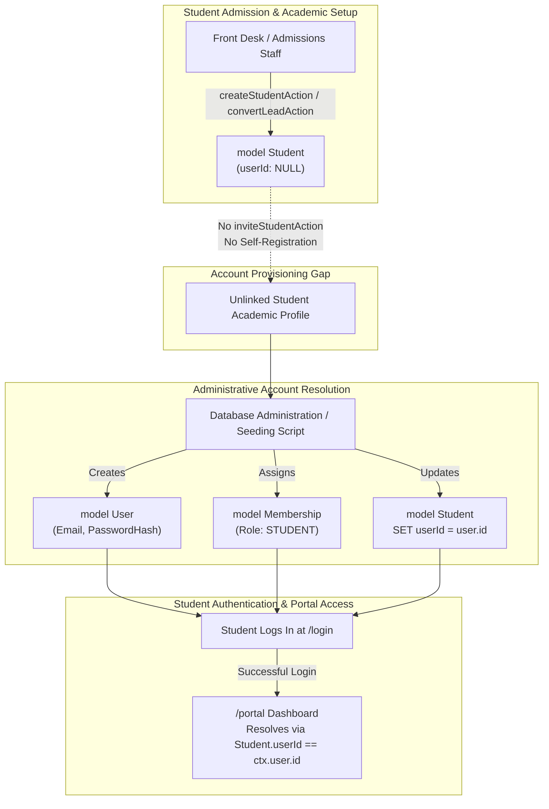
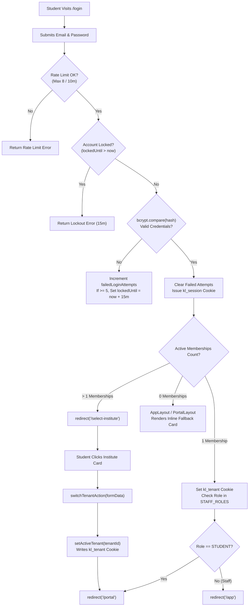
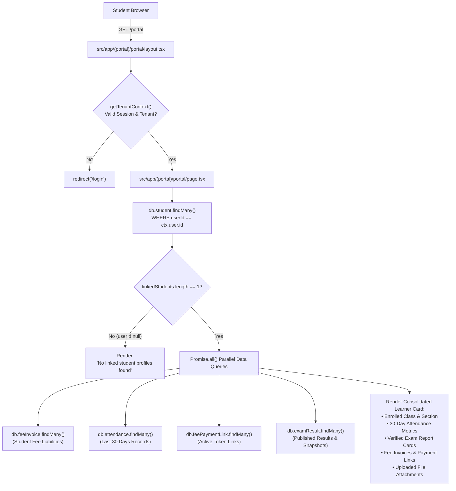
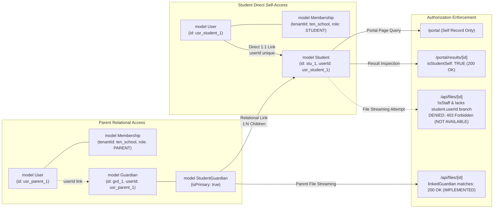
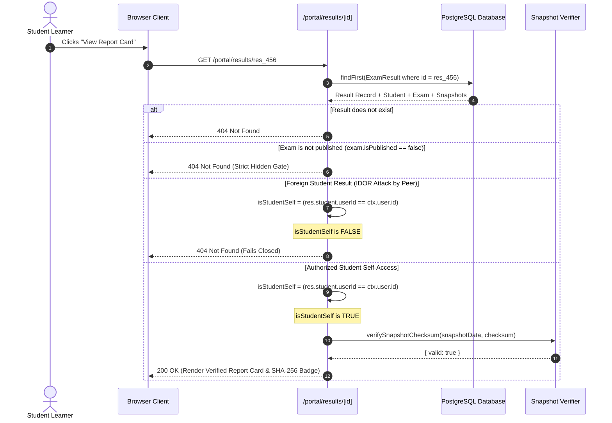
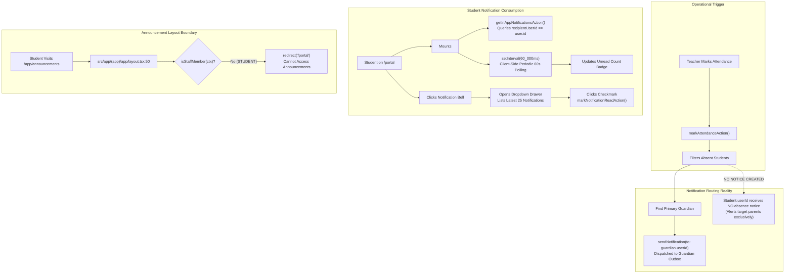

# KNOWLETIVE — Journey 6: Complete Student Portal End-to-End User Journey

```
========================================================================================
DOCUMENT IDENTIFIER:   KNOWLETIVE-JOURNEY-06-STUDENT-PORTAL
DOCUMENT VERSION:      Revision 1.1 (Surgical Verification Baseline)
RELEASE STATUS:        Approved & Frozen
SECURITY LEVEL:        Internal Functional Specification / Architecture Reference
TARGET REPOSITORY:     D:\IT\Saas
CANONICAL BRANCH:      staging/exam-stage-43
AUDIT REFERENCE:       SRC-DOC-26-REV-1.1
LAST UPDATED:          November 2026
========================================================================================
```

---

## 1. Document Information

This document provides the definitive, source-verified functional and architectural specification of the **Student User Journey** within the **Knowletive Multi-Tenant Education SaaS Platform**. It covers the complete operational lifecycle from student admission and identity linking, through authentication, multi-tenant workspace routing, dashboard navigation, attendance telemetry, examination report card verification, fee visibility, document streaming, notifications, and logout.

### Revision History

| Revision | Date | Summary of Changes | Author / Reviewer |
|:---|:---|:---|:---|
| `1.0` | November 2026 | Initial comprehensive source-verified baseline for Student Portal Journey. | Core Architecture Audit Team |
| `1.1` | November 2026 | **Surgical Verification Baseline:**<br>- Replaced inaccurate heading label with **"Student-Journey App Router Routes"** across Sections 2 and 18.<br>- Reconciled `Student.userId` uniqueness semantics: explained that a unique nullable column permits at most one Student record per linked User but does not guarantee every student user has a linked student profile.<br>- Re-verified complete assessment result authorization predicate in `src/app/(portal)/portal/results/[id]/page.tsx:48–60`: proved both student self-access (`isStudentSelf`) and parent guardian access (`isLinkedGuardian`) are supported for published exams, while unrelated students/parents and unpublished exams return 404.<br>- Resolved file streaming authorization in `src/app/api/files/[id]/route.ts:43–52`: revealed that the Route Handler only checks `guardian: { userId: user.id }` and lacks an `isStudentSelf` branch, permitting parents to download linked child files while returning 403 Forbidden to students.<br>- Re-verified account provisioning: distinguished production provisioning (manual database administration required for `User`, `Membership`, and `Student.userId`), demo setup (`src/lib/demo-accounts.ts`, `scripts/check-users.mjs`), and confirmed total absence of UI invitation infrastructure (`inviteStudentAction` does not exist).<br>- Re-validated student permissions: confirmed zero write permissions in `STUDENT` role template and clarified separation of public token payment proof actions from authenticated RBAC. | Core Architecture Audit Team |

---

## 2. Executive Summary

The Student Portal is Knowletive's dedicated learner interface designed to grant enrolled students direct, self-service access to their academic standing, attendance history, published report cards, fee liabilities, and administrative documents. Unlike school staff who manage operational entities in the multi-tiered back-office console (`/app/*`), students operate within a focused, responsive portal framed by `PortalLayout` (`/portal`).

### Core Architectural Pillars Verified from Source

1. **Student Account Provisioning Realities & File Classifications:**
   - In Knowletive, creating an academic student record via `createStudentAction` (`src/actions/students.ts:31`), converting an admission lead via `convertLeadAction` (`src/actions/leads.ts:182`), or executing bulk CSV imports via `importStudentsAction` (`src/actions/students.ts:151`) creates a row in `model Student`.
   - **Crucially, all student creation paths leave `Student.userId` as `null`.**
   - No automated student user account creation exists in any onboarding form.
   - The action `inviteStudentAction` does **not exist** anywhere in the codebase.
   - **Rigorous Separation of Setup Files:**
     - `prisma/seed.ts` is a **Seed routine** (destructive demo database seed run via `npm run db:seed`) that inserts academic `Student` records with `userId: null`. It does not create student `User` accounts or link `Student.userId`.
     - `scripts/check-users.mjs` is a **Demo Account Provisioning and Validation Utility**. It handles two explicit responsibilities: (1) it creates or updates the 9 demo `User` and `Membership` records (including `student@sunrise.test` with role `STUDENT`), and (2) it does **not** link `Student.userId` to an academic `Student` record. Creating a `STUDENT` login identity and membership does not complete student-profile linking; without setting `Student.userId = user.id`, the student user lands on an unlinked `<EmptyState>` dashboard on `/portal`.
     - `src/lib/demo-accounts.ts` is a **Demo account configuration/fixture** exporting a static TypeScript metadata array for UI demo pickers. It performs zero database operations and writes no data.
   - **Production Onboarding vs. Demo Provisioning:**
     - In production, student authentication accounts require out-of-band **manual database administration**: inserting a `model User` record with a hashed password, inserting a `model Membership` row with role `STUDENT`, and executing an explicit database update `UPDATE "Student" SET "userId" = '<user-id>' WHERE "id" = '<student-id>'`.

2. **Accurate Semantics of `Student.userId` Uniqueness:**
   - In `prisma/schema.prisma`, `Student.userId` is declared as `userId String? @unique`.
   - This unique nullable constraint ensures that **at most one** `Student` record can be linked to any single `User.id`.
   - Crucially, it does **not** guarantee that every user account with the `STUDENT` role has a linked `Student` record. If `Student.userId` remains `null`, a student user can authenticate successfully, but `/portal` will resolve zero student profiles, rendering the empty state (`<EmptyState>`: *"No linked student profiles found"*).

3. **Student-Journey App Router Routes:**
   - The student journey intersects exactly **4 App Router page routes**:
     - Screen S-01: `/login` (public unauthenticated entrypoint).
     - Screen S-02: `/select-institute` (authenticated conditional switcher; bypassed if student belongs to only 1 institute).
     - Screen S-03: `/portal` (authenticated student academic dashboard).
     - Screen S-04: `/portal/results/[id]` (authenticated guarded report card detail).
   - The non-existent `/select-tenant` and `/no-tenant` routes are debunked; missing memberships trigger an inline fallback card in `PortalLayout`.

4. **Assessment Result Authorization Predicate (`/portal/results/[id]`):**
   - Source inspection of `src/app/(portal)/portal/results/[id]/page.tsx:48–60` verifies a dual-branch relationship check:
     - **Student Self-Access:** Evaluates `isStudentSelf = result.student.userId === ctx.user.id`. If true, access is granted.
     - **Parent Guardian Access:** Evaluates `isLinkedGuardian = await db.studentGuardian.findFirst({ where: { studentId: result.studentId, guardian: { userId: ctx.user.id } } })`. If true, access is granted.
     - **Denial Gate:** If neither condition is met (`!isStudentSelf && !isLinkedGuardian`), the route returns a strict Next.js `notFound()` (404 response).
     - **Unpublished Gate:** If `!result.exam.isPublished`, the route executes `notFound()` immediately, ensuring unpublished exams remain strictly hidden from both students and parents.

5. **Document Streaming Authorization Reality & Security Finding (`/api/files/[id]`):**
   - Source inspection of `src/app/api/files/[id]/route.ts:41–61` verifies the exact non-staff authorization condition:
     ```typescript
     const isStaff = !["PARENT", "STUDENT"].includes(membership.roleName.toUpperCase());
     ```
   - **Condition Meaning & Security Concern:** The endpoint evaluates `isStaff` using a negative exclusion blacklist filter rather than an affirmative staff whitelist. Any user holding a membership in the tenant whose role name is neither `"PARENT"` nor `"STUDENT"` passes the `isStaff` test.
     - The built-in tenant staff roles defined in `STAFF_ROLE_KEYS` (`src/lib/catalog.ts:294`) are `INSTITUTE_ADMIN`, `PRINCIPAL`, `TEACHER`, `ACCOUNTANT`, and `FRONT_DESK`. Platform superadmins access via `user.isPlatformOwner` (line 31). (Note: `OWNER` is not a tenant role).
     - **Security Concern:** Any custom, non-standard, or future role created in a tenant (e.g., `LIBRARIAN`, `COUNSELOR`, `INTERN`, `AUDITOR`) automatically passes `isStaff` simply because its name is not `"PARENT"` or `"STUDENT"`. Crucially, the endpoint does not enforce granular document-read permissions (e.g., `tenant.students.read`), granting any non-parent, non-student membership unconstrained document streaming access across the tenant. This is a security concern that warrants a separate development issue.
   - **Student-to-Student Self-Access Path: NOT AVAILABLE.**
     - The handler contains **no explicit `fileAsset.student.userId === user.id` student-self ownership check**.
     - For non-staff memberships (`"PARENT"` and `"STUDENT"`), the handler checks `StudentGuardian` exclusively.
     - A typical student-only account with no matching Guardian relationship evaluates `linkedGuardian` as `null` and is denied with **403 Forbidden** (`{"error": "Access denied. You do not have permission to view this page."}`).
     - A user account that also happens to possess a matching Guardian relationship linked to that `studentId` would satisfy the Guardian check; access is governed by the presence of a matching `StudentGuardian` record rather than an intrinsic denial of the `STUDENT` role.
     - Practical finding: the implementation does not provide an explicit Student-to-Student self-access path.
   - **Linked-Parent Download: IMPLEMENTED.** Parents whose `user.id` matches `guardian.userId` linked via `model StudentGuardian` satisfy `linkedGuardian` and stream child files with **200 OK**.
   - **Unrelated-Parent Download: DENIED.** Requests from parents lacking a valid `StudentGuardian` link return **403 Forbidden**.


6. **Student Write Capabilities & Mutation Architecture:**
   - **The STUDENT role has no role-granted academic, administrative, or financial write permissions.** This does not mean that the portal performs no mutations: authenticated self-scoped notification-state actions and public token-gated payment-proof submission are separate workflows:
     - **A. Role-Catalog Domain Permissions:** Exactly zero write permissions. Students cannot modify academic profiles, enter marks, mark attendance, or create invoices.
     - **B. Authenticated Self-Scoped Mutations:** Students execute `markNotificationReadAction` and `markAllNotificationsReadAction` to mutate `model NotificationLog` (`isRead = true`, `readAt = NOW()`), and `logoutAction` to delete their active `model Session`.
     - **C. Public Token-Gated Mutations:** On the public route `/pay/[token]`, users invoke `submitPaymentProofAction`, updating `model FeePaymentLink` with transaction UTR proof. This operation is decoupled from authenticated user RBAC.

7. **Financial Visibility & Public Settlement:**
   - Students can view their fee liabilities, invoice due dates, and active payment links on `/portal`.
   - Clicking "Pay Now" opens the public token route `/pay/[token]`, allowing students or their sponsors to view dynamic UPI QR codes and submit UTR proof via `submitPaymentProofAction`.
   - `submitPaymentProofAction` updates `model FeePaymentLink` and notifies accountants; it does **not** create a `model FeePayment` record. `FeePayment` is created exclusively by accountants in `/app/fees`.

8. **Layout Gating & Announcement Inaccessibility:**
   - The built-in `STUDENT` role possesses `tenant.portal.read` and `tenant.announcements.read` (`src/lib/catalog.ts:267`).
   - However, institute announcements are located at `/app/announcements/page.tsx`, which is wrapped by `AppLayout` (`src/app/(app)/app/layout.tsx`).
   - Line 50 of `AppLayout` executes `if (!isStaffMember(ctx)) redirect("/portal")`.
   - Because `STUDENT` is excluded from `STAFF_ROLES`, students are immediately bounced to `/portal`.
   - Furthermore, `src/app/(portal)/portal/page.tsx` contains **zero announcement queries or UI components**. Consequently, students currently cannot view announcements.

9. **Notification Retrieval & Polling Mechanics:**
   - The platform does not use WebSockets, Server-Sent Events, or mobile push notifications.
   - The student portal header mounts `<NotificationCenter />`, which retrieves alerts via `getInAppNotificationsAction()` on mount and executes **client-side periodic polling every 60 seconds**.
   - Daily attendance absence notices target the primary guardian, not the student.

---

## 3. Relationship to Journeys 1 through 5

The Student Journey is the ultimate consumer endpoint of the administrative and teaching operations documented across previous journeys:

```
┌────────────────────────────────────────────────────────────────────────────────────────┐
│                        KNOWLETIVE LIFECYCLE RELATIONSHIP MATRIX                        │
├──────────────────────────┬──────────────────────────┬──────────────────────────────────┤
│ JOURNEY / ACTOR          │ UPSTREAM ACTIONS         │ IMPACT ON STUDENT PORTAL         │
├──────────────────────────┼──────────────────────────┼──────────────────────────────────┤
│ Journey 1: Admissions    │ createStudentAction      │ Creates model Student with class │
│ & Student Lifecycle      │ convertLeadAction        │ and section. Leaves userId null. │
│ (DOC-21)                 │ importStudentsAction     │ Establishes academic identity.   │
├──────────────────────────┼──────────────────────────┼──────────────────────────────────┤
│ Journey 2: Platform      │ provisionTenantAction    │ Seeds Tenant boundary, class     │
│ Owner Provisioning       │                          │ structures, and STUDENT role.    │
│ (DOC-22)                 │                          │                                  │
├──────────────────────────┼──────────────────────────┼──────────────────────────────────┤
│ Journey 3: Institute     │ createClassAction        │ Defines academic hierarchy and   │
│ Admin Workspace Setup    │ createFeeInvoiceAction   │ issues student fee invoices seen │
│ (DOC-23)                 │ createFeePaymentLink-    │ on the student dashboard.        │
│                          │ Action                   │                                  │
├──────────────────────────┼──────────────────────────┼──────────────────────────────────┤
│ Journey 4: Teacher       │ markAttendanceAction     │ Populates student Attendance     │
│ Operations               │ enterMarksBulkAction     │ records and triggers assessment  │
│ (DOC-24)                 │ calculateAndPublish-     │ result snapshots visible to the  │
│                          │ ResultsAction            │ student upon publication.        │
├──────────────────────────┼──────────────────────────┼──────────────────────────────────┤
│ Journey 5: Parent        │ switchTenantAction       │ Shares the /portal workspace;    │
│ Portal                   │ submitPaymentProofAction │ parents monitor via guardians,   │
│ (DOC-25)                 │ markNotificationRead-    │ while students monitor directly  │
│                          │ Action                   │ via Student.userId self-access.  │
├──────────────────────────┼──────────────────────────┼──────────────────────────────────┤
│ Journey 6: Student       │ loginAction              │ Authenticates student user,      │
│ Portal                   │ switchTenantAction       │ loads self-scoped records, views │
│ (DOC-26)                 │ markNotificationRead-    │ attendance & report cards, and   │
│                          │ Action                   │ streams uploaded certificates.   │
└──────────────────────────┴──────────────────────────┴──────────────────────────────────┘
```

---

## 4. Student Role and Security Architecture

### 4.1 RBAC Catalog Definition

The built-in `STUDENT` role template is defined in `src/lib/catalog.ts:262–268`:

```typescript
// src/lib/catalog.ts:262-268
{
  key: "STUDENT",
  scope: "TENANT",
  name: "Student",
  description: "Student portal: timetable, attendance and notices.",
  permissions: tenantPerms("portal.read", "announcements.read"),
}
```

### 4.2 Permission Inventory and Operational Reality

The `STUDENT` role is granted exactly **two permissions** in the platform catalog:

| Permission Identifier | Catalog Purpose | Actual Enforcement in Codebase | Operational Reality for Students |
|:---|:---|:---|:---|
| `tenant.portal.read` | Read access to portal workspace | Enforced by `requireTenantUser` in `src/app/(portal)/portal/layout.tsx`. | **Fully Operational.** Authorizes the student to access `/portal`, view their profile, attendance, results, fees, and documents. |
| `tenant.announcements.read` | View institute announcements | Required by `/app/announcements/page.tsx`. | **Gated by Layout.** Because `src/app/(app)/app/layout.tsx:50` bounces non-staff to `/portal`, and `/portal` has no announcement UI, students cannot view announcements. |

### 4.3 App Shell Exclusion and Layout Gating

Staff roles are enumerated in `src/actions/auth.ts:16` and `src/lib/catalog.ts:271`:

```typescript
// src/actions/auth.ts:16-22
const STAFF_ROLES = new Set([
  "INSTITUTE_ADMIN",
  "PRINCIPAL",
  "TEACHER",
  "ACCOUNTANT",
  "FRONT_DESK",
]);
```

Because `STUDENT` is absent from `STAFF_ROLES`:
1. In `src/lib/auth.ts:233`, `isStaffMember(ctx)` evaluates to `false`.
2. When a student attempts to navigate to any back-office URL under `/app/*` (e.g., `/app/attendance`, `/app/exams`, `/app/syllabus`, `/app/settings`), the root layout gate in `src/app/(app)/app/layout.tsx:50–52` executes:
   ```typescript
   if (!isStaffMember(ctx)) {
     redirect("/portal");
   }
   ```
3. The student is immediately redirected back to `/portal`. Students cannot access administrative pages under any circumstances.

### 4.4 Dissection of Student Write Capabilities and Mutations

To maintain absolute technical precision, the platform distinguishes three separate operational layers regarding data writes:

1. **Role-Catalog Domain Write Permissions (Zero Permissions):**
   - The built-in `STUDENT` role template possesses **EXACTLY ZERO WRITE PERMISSIONS** in `src/lib/catalog.ts:262–268`.
   - Across the entire application codebase, zero server actions check an RBAC permission held by `STUDENT` to authorize a domain write.
   - All academic, administrative, and financial server actions (e.g., student creation, marks entry, attendance logging, invoice generation) enforce administrative write permissions via `authorizeTenantWrite` and fail closed against student callers.
2. **Authenticated Self-Scoped Account & Portal Mutations:**
   - **The STUDENT role has no role-granted academic or administrative write permissions. This does not mean that the portal performs no mutations: authenticated self-scoped notification-state actions and public token-gated payment-proof submission are separate workflows.**
   - While in the portal, authenticated students execute self-scoped mutations:
     - `markNotificationReadAction` (`src/actions/notifications.ts:50`): Mutates `model NotificationLog`, setting `isRead: true` and `readAt: NOW()` for records where `recipientUserId === user.id`.
     - `markAllNotificationsReadAction` (`src/actions/notifications.ts:82`): Updates all unread in-app logs for the authenticated student's `user.id`.
     - `logoutAction` (`src/actions/auth.ts:251`): Deletes the active `model Session` record in PostgreSQL and clears cookies.
   - These mutations are authorized strictly by user session identity (`ctx.user.id`), not by role-granted administrative permissions.
3. **Public Token-Gated Workflows:**
   - `submitPaymentProofAction` (`src/actions/operations.ts:251`) mutates `model FeePaymentLink` by updating UTR reference numbers and timestamps.
   - This workflow operates on `/pay/[token]` and is gated by cryptographic URL payment tokens, completely separate from authenticated user RBAC.

---

## 5. Stage A — Student Account Creation and Identity Linking

### 5.1 Verification of Six Core Provisioning Vectors

A code-level audit of all student creation, user registration, and identity-linking paths resolves the six essential provisioning capabilities:

```
┌────────────────────────────────────────────────────────────────────────────────────────┐
│                        STUDENT PROVISIONING CAPABILITY AUDIT                           │
├─────────────────────────────────────────┬───────────────┬──────────────────────────────┤
│ PROVISIONING CAPABILITY                 │ STATUS        │ CODEBASE IMPLEMENTATION      │
├─────────────────────────────────────────┼───────────────┼──────────────────────────────┤
│ 1. Create Student Academic Record       │ FULLY         │ createStudentAction,         │
│                                         │ IMPLEMENTED   │ convertLeadAction,           │
│                                         │               │ importStudentsAction         │
├─────────────────────────────────────────┼───────────────┼──────────────────────────────┤
│ 2. Create User Authentication Account   │ MANUAL DB /   │ No UI action for students;   │
│                                         │ SCRIPT ONLY   │ check-users.mjs provisions   │
│                                         │               │ demo User & Membership.      │
├─────────────────────────────────────────┼───────────────┼──────────────────────────────┤
│ 3. Link Student.userId to User.id       │ MANUAL DB     │ No server action sets or     │
│                                         │ ONLY          │ updates Student.userId.      │
│                                         │               │ Requires raw SQL or Prisma.  │
├─────────────────────────────────────────┼───────────────┼──────────────────────────────┤
│ 4. Create Active STUDENT Membership     │ MANUAL DB /   │ No student membership action │
│                                         │ SCRIPT ONLY   │ in UI; scripted via Prisma.  │
├─────────────────────────────────────────┼───────────────┼──────────────────────────────┤
│ 5. Invite or Activate Student via UI    │ NOT           │ No inviteStudentAction or    │
│                                         │ IMPLEMENTED   │ activation links exist.      │
├─────────────────────────────────────────┼───────────────┼──────────────────────────────┤
│ 6. Provision Demo / Test Accounts       │ SCRIPTED /    │ Configured in demo-          │
│                                         │ FIXTURE       │ accounts.ts; provisioned by  │
│                                         │               │ check-users.mjs utility.     │
└─────────────────────────────────────────┴───────────────┴──────────────────────────────┘
```

### 5.2 Academic Record Creation vs. Authentication Provisioning

1. **Academic Record Creation (Application UI):**
   - Staff submit `/app/students/new` calling `createStudentAction` (`src/actions/students.ts:31`).
   - Staff submit `/app/leads/[id]` calling `convertLeadAction` (`src/actions/leads.ts:182`).
   - Staff submit `/app/students/import` calling `importStudentsAction` (`src/actions/students.ts:151`).
   - **Result in all three cases:** A row is inserted into `model Student` with `admissionNo`, `firstName`, `lastName`, and academic relationships. However, **`userId` is left null**.
2. **Accurate Classification of Setup and Demo Artifacts:**
   - `prisma/seed.ts` (Classification: **Seed routine**):
     - Destructive demo database seed executed via `npm run db:seed`.
     - Creates the `sunrise` tenant, academic years, classes, sections, and batch student records.
     - Inserts `model Student` records with `userId: null`. It does **not** create student `User` accounts or link `Student.userId`.
   - `scripts/check-users.mjs` (Classification: **Demo Account Provisioning and Validation Utility**):
     - An operational demo account provisioning and validation utility.
     - Dual Responsibilities: (1) It queries the active tenant, hashes `Admin@123`, and creates or updates the 9 demo role accounts (including `student@sunrise.test`), attaching `model Membership` connecting `User` to `Tenant` with `roleId` corresponding to `STUDENT`; (2) it does **not** link `Student.userId` to an academic `Student` record.
     - Crucially, creating a `STUDENT` login identity and membership does not complete student-profile linking; without setting `Student.userId = user.id`, the student user lands on an unlinked `<EmptyState>` dashboard on `/portal`.
   - `src/lib/demo-accounts.ts` (Classification: **Demo account configuration/fixture**):
     - A static TypeScript configuration file exporting the `DEMO_ACCOUNTS: DemoAccount[]` array with display labels, emails, badges, and hints.
     - It contains no database client, performs no database queries or writes, and does not seed data.
3. **Production Provisioning vs. Manual Database Administration:**
   - In production, student account creation is completely separated from student academic enrollment.
   - Because no student invitation UI or self-registration exists, provisioning a functional student portal login requires **manual database administration** (via raw SQL or administrative Prisma scripts):
     1. Insert a `model User` record with the student's email and bcrypt password hash.
     2. Insert a `model Membership` connecting `User.id` to `tenant.id` with the `STUDENT` role.
     3. Execute an explicit SQL update: `UPDATE "Student" SET "userId" = '<user-id>' WHERE "id" = '<student-id>'`.
   - If Step 3 is omitted, the student can authenticate successfully, but `/portal` will render `<EmptyState>` because `Student.userId` remains `null`.

### 5.3 Accurate Semantics of `Student.userId` Uniqueness

In `prisma/schema.prisma:163`:
```prisma
model Student {
  id            String        @id @default(cuid())
  tenantId      String
  userId        String?       @unique
  // ...
}
```
- The `@unique` constraint on the nullable column `userId` permits any number of `Student` records to have `userId: null`.
- However, when `userId` is populated, at most **one** `Student` record can reference that `User.id`.
- This ensures that a single student user account can never be linked to multiple student academic records.
- Crucially, this uniqueness constraint **does not guarantee that every user with the `STUDENT` role has a linked student record**. If the linkage is missing, the user has zero linked profiles.

---

## 6. Stage B — Student Authentication and Portal Routing

### 6.1 Authentication Sequence (`/login`)

The student navigates to `/login` (`src/app/login/page.tsx`) and submits their credentials. The submission is processed by `loginAction` (`src/actions/auth.ts:25`):

1. **Rate Limiting:** Enforces `login:${ip}:${email}` via `model RateLimitBucket` (maximum 8 attempts per 10 minutes).
2. **Account Lockout:** Checks `user.lockedUntil`. On 5 consecutive failed password attempts, locks the account for 15 minutes and logs `auth.account_locked` to `model AuditLog`.
3. **Password Verification:** Compares submitted password against `user.passwordHash` using `bcrypt.compare`.
4. **Status Verification:** Enforces `user.status === "ACTIVE"`.

### 6.2 Session Creation, Cookie Issuance, and Redirection

Upon successful credential validation:
1. `createSession(user.id, meta)` writes the `kl_session` cookie (14-day expiry, `httpOnly`, `sameSite: "lax"`, `secure` in production).
2. Destination resolution inspects the student's active memberships:
   ```typescript
   // src/actions/auth.ts:305-325
   if (user.isPlatformOwner || user.platformRoleId) {
     targetNext = "/platform";
   } else if (validTenantCookie) {
     targetTenantId = validTenantCookie.tenantId;
     const isStaff = STAFF_ROLES.has(validTenantCookie.role.key);
     targetNext = isStaff ? "/app" : "/portal";
   } else if (user.memberships.length === 1) {
     targetTenantId = user.memberships[0].tenantId;
     const isStaff = STAFF_ROLES.has(user.memberships[0].role.key);
     targetNext = isStaff ? "/app" : "/portal";
   } else if (user.memberships.length > 1) {
     targetNext = "/select-institute";
   }

   if (targetTenantId) {
     await setActiveTenant(targetTenantId);
   }
   redirect(targetNext);
   ```
3. Because `user.memberships[0].role.key` is `STUDENT`, `STAFF_ROLES.has("STUDENT")` evaluates to `false`.
4. For single-membership students, `targetNext` is set to `/portal`, `setActiveTenant(targetTenantId)` writes the `kl_tenant` cookie, and the browser redirects directly to `/portal`.

### 6.3 Multi-Institute Selection (`/select-institute`) and Tenant Switching

If a student holds active memberships across multiple institutes (e.g., enrolled concurrently in an academic high school and a coaching institute):
1. `loginAction` redirects to `/select-institute` (`src/app/select-institute/page.tsx`).
2. The page renders cards for each institute with the badge `Student` and the subtitle `"Parent & Student Portal (/portal)"`.
3. Selecting an institute invokes `switchTenantAction(formData)` (`src/actions/auth.ts:286`):
   - Validates that `user.memberships` contains the requested `tenantId`.
   - Calls the internal helper `setActiveTenant(tenantId)` (`src/lib/auth.ts:167`) to write the `kl_tenant` cookie.
   - Evaluates `isStaff = user.isPlatformOwner || (targetMembership && STAFF_ROLES.has(targetMembership.roleKey))`.
   - Since `STUDENT` is non-staff, executes `redirect("/portal")`.

### 6.4 Session Revocation and Sign Out

Clicking the "Sign out" button in `PortalLayout` header submits a form invoking `logoutAction` (`src/actions/auth.ts:251`):
1. Reads `kl_session` cookie.
2. Deletes the active `model Session` record in PostgreSQL.
3. Sets both `kl_session` and `kl_tenant` cookies to expire immediately (`maxAge: 0`).
4. Executes `redirect("/login")`.

## 7. Stage C — Student Portal Dashboard Architecture

### 7.1 Portal Layout and Shared Shell (`PortalLayout`)

The student experience is contained within `src/app/(portal)/portal/layout.tsx`. Unlike the administrative shell (`AppLayout`), which renders complex sidebar hierarchies across multiple operational departments, `PortalLayout` renders a streamlined, mobile-responsive layout:

1. **Header Navigation:**
   - **Branding:** Knowletive logo with subtitle `"Portal"`, linking to `/portal`.
   - **Institute Identity:** Displays the active school name (`ctx.tenant.name`) and the student's role badge (`<Badge tone="neutral">{ctx.membership?.roleName ?? "Portal Member"}</Badge>`).
   - **Staff Console Link Omission:** The layout checks `isStaff = isStaffMember(ctx)`. For staff users, an "ArrowLeft Staff Console" link to `/app` is rendered. For students (`STUDENT`), this link is **completely omitted**.
   - **Notification Center:** Mounts the `<NotificationCenter />` client dropdown drawer (`src/components/notifications/notification-center.tsx`).
   - **Student Identity:** Displays the student's user avatar, full name (`user.name`), and email address (`user.email`).
   - **Sign Out Form:** Form invoking `logoutAction`.
2. **Main Container:** Max-width 5xl container rendering the active child route (`children`).
3. **Footer:** Copyright and institute branding (*"Powered by Knowletive"*).

### 7.2 Student Self-Access Query Architecture

When `/portal/page.tsx` executes on the server, it retrieves student records using a dual-purpose query:

```typescript
// src/app/(portal)/portal/page.tsx:50-75
const linkedStudents = await db.student.findMany({
  where: {
    tenantId: ctx.tenant.id,
    OR: [
      {
        guardians: {
          some: {
            guardian: {
              userId: ctx.user.id,
            },
          },
        },
      },
      {
        userId: ctx.user.id, // STUDENT SELF-ACCESS BRANCH
      },
    ],
  },
  include: {
    section: { include: { class: true } },
    files: { orderBy: { createdAt: "desc" } },
  },
  orderBy: [{ firstName: "asc" }, { lastName: "asc" }],
});
```

### 7.3 Multi-Child vs. Single Student Behavior

- **Parent User:** Typically has children linked via `guardians.some.guardian.userId`. `linkedStudents` can return multiple records, rendering multiple cards.
- **Student User:** Possesses no guardian links. Instead, the query matches `{ userId: ctx.user.id }`.
- **At Most One Record Semantics:** Because `Student.userId` carries a `@unique` constraint in `prisma/schema.prisma`, `linkedStudents` returns **at most one student record** for any single linked user account. It does not permit multiple student academic profiles to map to the same login.
- **Empty State Fallback:** If a student user logs in but their `User.id` has not been linked to `Student.userId` in PostgreSQL, `linkedStudents` is empty (`length === 0`). The page renders `<EmptyState>`:
  *"No linked student profiles found. Your login is active, but no student records have been linked to your email address yet. Please contact the school administration office to link your account."*

---

## 8. Stage D — Academic Records and Student Data Isolation

### 8.1 Comparison of Authorization Vectors

Knowletive enforces three completely distinct authorization paths across its stakeholder base:

```
┌────────────────────────────────────────────────────────────────────────────────────────┐
│                        DATA ACCESS AND ISOLATION COMPARISON                            │
├──────────────────┬───────────────────────┬──────────────────────┬──────────────────────┤
│ STAKEHOLDER      │ IDENTITY LINK         │ QUERY SCOPE          │ BOUNDARY ENFORCEMENT │
├──────────────────┼───────────────────────┼──────────────────────┼──────────────────────┤
│ Student          │ Student.userId ===    │ At most 1 student in │ Direct unique column │
│                  │ ctx.user.id           │ active tenant        │ constraint & filter  │
├──────────────────┼───────────────────────┼──────────────────────┼──────────────────────┤
│ Parent /         │ Guardian.userId ===   │ 1 to N students in   │ Junction table join  │
│ Guardian         │ ctx.user.id           │ active tenant        │ (model Student-      │
│                  │                       │                      │ Guardian)            │
├──────────────────┼───────────────────────┼──────────────────────┼──────────────────────┤
│ Staff /          │ Membership.roleKey in │ All students in      │ Tenant context &     │
│ Teacher          │ STAFF_ROLES           │ active tenant        │ RBAC permission      │
│                  │                       │                      │ guards               │
└──────────────────┴───────────────────────┴──────────────────────┴──────────────────────┘
```

### 8.2 Full Assessment Result Authorization Predicate (`/portal/results/[id]`)

Source inspection of `src/app/(portal)/portal/results/[id]/page.tsx:48–60` reveals the complete, authoritative authorization logic:

```typescript
// src/app/(portal)/portal/results/[id]/page.tsx:48-60
// Strict Check 1: Result existence
if (!result) {
  notFound();
}

// Strict Check 2: Unpublished results must never be visible to students or parents
if (!result.exam.isPublished) {
  notFound();
}

// Strict Check 3: Candidate ownership or linked Guardian relationship verification
const isStudentSelf = result.student.userId === ctx.user.id;
const isLinkedGuardian = !isStudentSelf
  ? await db.studentGuardian.findFirst({
      where: {
        studentId: result.studentId,
        guardian: { userId: ctx.user.id },
      },
    })
  : null;

if (!isStudentSelf && !isLinkedGuardian) {
  // Unauthorized access: strictly rejected server-side
  notFound();
}
```

### 8.3 Exact Resolution Across Five Authorization Scenarios

| Scenario | Candidate Relationship | Exam State | Authorization Evaluation | Resulting HTTP Response |
|:---|:---|:---:|:---|:---:|
| **1. Student Self-Access** | `result.student.userId === ctx.user.id` | Published | `isStudentSelf = true`. Second check skipped. | **200 OK** (Renders official report card) |
| **2. Parent Guardian Access** | Linked in `model StudentGuardian` | Published | `isStudentSelf = false`. `isLinkedGuardian` resolves truthy. | **200 OK** (Renders official report card) |
| **3. Unrelated Student** | Peer student with different `userId` | Published | `isStudentSelf = false`. `isLinkedGuardian = null`. | **404 Not Found** (IDOR fails closed) |
| **4. Unrelated Parent** | Foreign parent not in `StudentGuardian` | Published | `isStudentSelf = false`. `isLinkedGuardian = null`. | **404 Not Found** (IDOR fails closed) |
| **5. Unpublished Result** | Any student or parent | Unpublished | Strict Check 2 fails: `!result.exam.isPublished`. | **404 Not Found** (Hidden from non-staff) |

---

## 9. Stage E — Attendance Telemetry and Daily Registration

### 9.1 Data Retrieval & 30-Day Windowing

On `/portal`, attendance history is queried for the preceding 30 days:

```typescript
// src/app/(portal)/portal/page.tsx:90-98
db.attendance.findMany({
  where: {
    tenantId: ctx.tenant.id,
    studentId: { in: studentIds },
    date: { gte: thirtyDaysAgo },
  },
  orderBy: { date: "desc" },
  take: 300,
});
```

### 9.2 Student Attendance Display

The dashboard aggregates the attendance records and presents:
1. **Attendance Rate:** Percentage of recorded school days the student was present or late over the 30-day window (`(presentCount + lateCount) / totalRecorded * 100`).
2. **Aggregate Pills:** Separate numerical badges for `Present`, `Absent`, `Late`, and `Excused`.
3. **Recent Attendance Trail:** Chronological icon trail displaying each day's status:
   - `PRESENT`: `<CheckCircle2 className="size-3.5 text-[var(--success)]" /> Present`
   - `ABSENT`: `<XCircle className="size-3.5 text-[var(--danger)]" /> Absent`
   - `LATE`: `<Clock className="size-3.5 text-[var(--warning)]" /> Late`
   - `EXCUSED`: `<CheckCircle2 className="size-3.5 text-[var(--info)]" /> Excused`

### 9.3 Operational Boundaries & Write Restrictions

- **Read-Only Telemetry:** Students have read-only access to their attendance records.
- **No Self-Marking:** Students cannot check in, mark attendance, or confirm presence.
- **No Online Absence Excuse Submission:** Knowletive provides no student-facing form to submit medical certificates, leave applications, or absence excuses. Absences must be excused out-of-band by school administrators in `/app/attendance`.
- **Notice Target Distinction:** When a teacher submits attendance via `markAttendanceAction` (`src/actions/operations.ts:143`), absence notices are dispatched to the student's **primary guardian** (`guardian.userId` / `guardian.email`). Notifications are **not** dispatched to the student's own account.

---

## 10. Stage F — Examination Results and Report Cards

### 10.1 Result Publication Gate

Assessment results are retrieved on `/portal` using a strict publication gate:

```typescript
// src/app/(portal)/portal/page.tsx:107-125
db.examResult.findMany({
  where: {
    tenantId: ctx.tenant.id,
    studentId: { in: studentIds },
    exam: { isPublished: true },
  },
  include: {
    exam: { include: { academicYear: true } },
    snapshots: { orderBy: { version: "desc" }, take: 1 },
  },
  orderBy: { publishedAt: "desc" },
});
```

### 10.2 Examination Data Separation

The student portal maintains a strict separation between teacher grading workflows and learner result access:
- **Raw Grading Entities:** `model ExamEnrollment`, `model ExamMark`, and `model ExamMarksRevisionEvent` are utilized exclusively by teachers in `/app/exams` during marks entry (`enterMarksBulkAction`). Students cannot access these raw models.
- **Published Results:** Students view only finalized `model ExamResult` records and frozen `model ExamResultSnapshot` snapshots produced when an administrator executes `calculateAndPublishResultsAction`.
- **Unpublished Exam Protection:** Exams in `DRAFT`, `SCHEDULED`, `IN_PROGRESS`, or `EVALUATED` states remain strictly hidden from students until publication is formally completed.

### 10.3 Report Card Inspection Patterns

1. **Interactive Modal Preview (`<StudentReportCardModal />`):**
   - Triggered via the "Quick View" button next to any published exam on `/portal`.
   - Hydrates snapshot JSON data directly from `ExamResultSnapshot.snapshotData`.
   - Renders subject marks, percentages, grade bands, and teacher remarks in a client modal overlay.
2. **Dedicated Standalone Page (`/portal/results/[id]`):**
   - Navigated via the "View Report Card" link.
   - Provides a full-page, printable report card layout with cryptographic verification badges.

---

## 11. Cryptographic Snapshot Verification (`/portal/results/[id]`)

### 11.1 Verification Mechanics

When a student visits `/portal/results/[id]`, the server validates the latest result snapshot:

```typescript
// src/app/(portal)/portal/results/[id]/page.tsx:62-67
const latestSnapshot = result.snapshots[0];
const checksumVerification = latestSnapshot
  ? verifySnapshotChecksum(latestSnapshot.snapshotData, latestSnapshot.checksum)
  : { valid: false, reason: "No snapshot found" };
```

In `src/lib/exam-snapshot.ts`, `verifySnapshotChecksum` reconstructs the canonical JSON string of `snapshotData` and hashes it using **SHA-256**:
`crypto.createHash("sha256").update(canonicalJson).digest("hex") === storedChecksum`.

### 11.2 Trust Presentation

When the checksum matches:
- Renders `<ShieldCheck className="size-5 text-[var(--success)]" />`
- Heading: *"Verified Immutable Report Card"*
- Description: *"Cryptographically sealed at the time of publication to guarantee grade integrity."*
- Displays the complete SHA-256 checksum string.
- Renders the publishing authority timestamp and academic term details.
- Students can trigger browser printing (`Ctrl+P` / `Cmd+P`) for official submission or personal filing.

---

## 12. Stage G — Fees, Payments and Financial Information

### 12.1 Fee Invoices Query & Status Tracking

On `/portal`, student fee invoices are retrieved directly:

```typescript
// src/app/(portal)/portal/page.tsx:85-89
db.feeInvoice.findMany({
  where: { tenantId: ctx.tenant.id, studentId: { in: studentIds } },
  orderBy: { dueDate: "desc" },
  take: 60,
});
```

The portal card lists:
- Invoice title (e.g., *"Term 1 Tuition Fee"*, *"Annual Activity Fee"*).
- Total liability amount in INR.
- Due date.
- Status badge (`PAID`, `PENDING`, `OVERDUE`).
- Active payment links with "Pay Now" action buttons.

### 12.2 Public Fee Settlement Gateway (`/pay/[token]`)

If a student or their sponsor clicks "Pay Now":
1. Navigates to `/pay/[token]` (`src/app/pay/[token]/page.tsx`).
2. `/pay/[token]` is a **public token-gated route** requiring no login session.
3. Renders a dynamic NPCI-compliant UPI QR code (`QRCode.toDataURL`).
4. Displays the school's bank name, IFSC code, account number, and account holder name.
5. The student or sponsor transfers funds and enters the Bank Reference / UTR Number into the payment form.

### 12.3 Payment Proof Submission Data Lifecycle

Submitting the form on `/pay/[token]` invokes `submitPaymentProofAction(formData)` (`src/actions/operations.ts:251`):
1. **Model Mutation:** Updates **`model FeePaymentLink`**:
   `utrReference`, `payerName`, `payerPhone`, `payerNotes`, `submittedAt: new Date()`.
2. **Accountant Alert:** Writes an in-app notice to `model NotificationLog` alerting school accountants.
3. **Audit Log:** Writes `fee.payment_link.submitted` to `model AuditLog`.
4. **`FeePayment` Non-Participation:** The action does **not** create a `model FeePayment` record or decrement `FeeInvoice.paidAmount`.
5. **Accountant Verification:** Only when school accountants verify the bank credit in `/app/fees` via `verifyFeePaymentLinkAction` (`src/actions/operations.ts:287`) is a financial ledger row inserted into `model FeePayment` via `settleFeePaymentLink`.

## 13. Student Documents & File Streaming (`/api/files/[id]`)

### 13.1 Document Metadata Query on Portal

Each student card rendered on `/portal` queries uploaded student documents from `model FileAsset`:

```typescript
// src/app/(portal)/portal/page.tsx:72
files: { orderBy: { createdAt: "desc" } }
```

Uploaded documents (e.g., student admission records, birth certificates, previous school transfer certificates, medical clearance forms) display:
- Original file name and extension (`file.name`).
- Human-readable file size (formatted from `file.sizeBytes`, e.g., *"1.4 MB"*).
- Upload date formatted via `date(file.createdAt)`.
- Direct download button linking to `/api/files/[id]`.

### 13.2 Complete File API Authorization Path & Source Inspection

File downloads are handled by Next.js Route Handler `src/app/api/files/[id]/route.ts`. A complete line-by-line inspection of the handler reveals the full execution path:

```typescript
// src/app/api/files/[id]/route.ts (Complete Handler Flow)
export async function GET(
  _request: NextRequest,
  context: { params: Promise<{ id: string }> },
) {
  const { id } = await context.params;
  if (!id) {
    return new Response("Missing file ID", { status: 400 });
  }

  const fileAsset = await db.fileAsset.findUnique({
    where: { id },
    include: { student: true },
  });

  if (!fileAsset) {
    return new Response("File not found", { status: 404 });
  }

  // School logos are public branding assets; all other documents require tenant auth
  if (fileAsset.kind !== "LOGO") {
    const user = await getSession();
    if (!user) {
      return new Response("Unauthorized", { status: 401 });
    }

    const isPlatformOwner = user.isPlatformOwner;
    const membership = user.memberships.find((m) => m.tenantId === fileAsset.tenantId);

    if (!isPlatformOwner && !membership) {
      return Response.json(
        { error: "Access denied. You do not have permission to view this page." },
        { status: 403 },
      );
    }

    // If the file is tied to a student, verify portal guardian/student authorization
    if (!isPlatformOwner && membership && fileAsset.studentId) {
      const isStaff = !["PARENT", "STUDENT"].includes(membership.roleName.toUpperCase());

      if (!isStaff) {
        // Check if this guardian is linked to the student
        const linkedGuardian = await db.studentGuardian.findFirst({
          where: {
            studentId: fileAsset.studentId,
            guardian: { userId: user.id, tenantId: fileAsset.tenantId },
          },
        });

        if (!linkedGuardian) {
          return Response.json(
            { error: "Access denied. You do not have permission to view this page." },
            { status: 403 },
          );
        }
      }
    }
  }

  try {
    const download = await objectDownload(fileAsset.storageKey);

    if (download.kind === "redirect") {
      return Response.redirect(download.url);
    }

    const safeFilename = encodeURIComponent(fileAsset.name.replace(/["\r\n]/g, "_"));

    return new Response(new Uint8Array(download.body), {
      status: 200,
      headers: {
        "Content-Type": fileAsset.mime || "application/octet-stream",
        "Content-Length": String(download.body.length),
        "Content-Disposition": `inline; filename="${safeFilename}"; filename*=UTF-8''${safeFilename}`,
        "X-Content-Type-Options": "nosniff",
        "Cache-Control": "private, no-cache, no-store, must-revalidate",
      },
    });
  } catch (error) {
    console.error(`[storage] failed to stream file asset ${id}:`, error);
    return new Response("Unable to retrieve file from local storage", { status: 500 });
  }
}
```

### 13.3 Detailed Verification of Route Authorization Stages & Limitations

A rigorous stage-by-stage analysis of the complete authorization pipeline establishes the following facts:

1. **Stage 1: Parameter & Asset Resolution (Lines 10–22):**
   - Validates that `params.id` is present; missing ID returns **HTTP 400 Bad Request**.
   - Resolves `FileAsset` by unique ID including relation `student`. Non-existent records return **HTTP 404 Not Found**.
2. **Stage 2: Public Branding Exception (Line 25):**
   - If `fileAsset.kind === "LOGO"`, the route treats the file as a public branding asset. It bypasses all subsequent authentication, session, tenant, and guardian checks, streaming the file directly.
3. **Stage 3: Session Authentication (Lines 26–29):**
   - For all non-LOGO files, the route requires an active authenticated session via `getSession()`. Unauthenticated requests terminate immediately with **HTTP 401 Unauthorized**.
4. **Stage 4: Platform Owner Scope & Tenant Membership Scoping (Lines 31–39):**
   - The route resolves `isPlatformOwner = user.isPlatformOwner` and looks up `membership = user.memberships.find((m) => m.tenantId === fileAsset.tenantId)`.
   - **Precise Platform Owner Scope:** Platform owners (`user.isPlatformOwner === true`) bypass the tenant membership check at line 34 and the student-guardian check at line 42 (`!isPlatformOwner` is false). However, platform owners do **not** bypass the session check (they must be authenticated) or the file existence check (404 if missing).
   - **Strict Tenant Scoping for Non-Platform Users:** For non-platform owners, the user **must hold an active membership in the file's tenant** (`membership.tenantId === fileAsset.tenantId`). A user belonging to Tenant A cannot access files belonging to Tenant B under any role. Cross-tenant file access is strictly blocked at line 34 with **HTTP 403 Forbidden**.
5. **Stage 5: Student-Linked File Gate & Local `isStaff` Exclusion Filter (Lines 42–44):**
   - The conditional gate `if (!isPlatformOwner && membership && fileAsset.studentId)` applies only to files linked to an academic student record. Files not tied to a student (`studentId: null`, such as general tenant documents) skip this gate entirely, meaning any active tenant member can stream them.
   - For student-linked files, the route evaluates staff status via the exact negative exclusion filter:
     ```typescript
     const isStaff = !["PARENT", "STUDENT"].includes(membership.roleName.toUpperCase());
     ```
   - **Role Catalog Verification:** The built-in tenant staff roles defined in `STAFF_ROLE_KEYS` (`src/lib/catalog.ts:294`) are: `INSTITUTE_ADMIN`, `PRINCIPAL`, `TEACHER`, `ACCOUNTANT`, and `FRONT_DESK`. Note that `OWNER` is not a tenant role key in the catalog.
   - **Precise Scope of Authorization Weakness:** Non-parent, non-student roles do **not** have unrestricted platform-wide access to every student document; they are strictly confined to their own tenant by the Stage 4 membership check. The authorization weakness is that *within that tenant*, any non-parent, non-student role (including custom or non-standard roles like `LIBRARIAN`, `COUNSELOR`, or `INTERN`) passes `isStaff === true` and bypasses the guardian relationship check. The endpoint does not enforce granular document-read permissions (e.g., `tenant.students.read`), granting any non-parent, non-student tenant member access to all student-linked files within that tenant. This is an architectural security concern that requires a separate development issue.
6. **Stage 6: Non-Staff Guardian Relationship Evaluation (Lines 45–60):**
   - For non-staff roles (`"PARENT"` and `"STUDENT"`), the route queries `model StudentGuardian` exclusively:
     ```typescript
     const linkedGuardian = await db.studentGuardian.findFirst({
       where: {
         studentId: fileAsset.studentId,
         guardian: { userId: user.id, tenantId: fileAsset.tenantId },
       },
     });
     ```
   - **No Explicit Student-Self Check:** The handler contains **no explicit `fileAsset.student.userId === user.id` student-self ownership check**.
   - **Typical Student-Only Account Denied:** A typical student-only account has no corresponding `Guardian` record in PostgreSQL. For such accounts, `linkedGuardian` evaluates to `null`, and the route terminates at line 55 with:
     ```json
     { "error": "Access denied. You do not have permission to view this page." } // HTTP 403
     ```
   - **Dual-Role / Guardian-Linked Edge Case:** A user who also happens to have a matching `Guardian` relationship linked to `fileAsset.studentId` would satisfy the `StudentGuardian` query and be granted access. The route's actual behavior is determined by the presence or absence of a matching `StudentGuardian` record rather than an unsupported universal claim based solely on the `STUDENT` role.
   - **Practical Finding:** The implementation **does not provide an explicit Student-to-Student self-access path**. Student self-download is **NOT AVAILABLE** via the student identity.
   - **Linked-Parent Download: IMPLEMENTED:** Parents whose `user.id` matches `guardian.userId` linked via `model StudentGuardian` satisfy `linkedGuardian` and stream child files with **HTTP 200 OK**.
   - **Unrelated-Parent Download: DENIED:** Parents lacking a valid `StudentGuardian` link evaluate to `null` and return **HTTP 403 Forbidden**.
7. **Stage 7: Storage Streaming & Security Headers (Lines 64–87):**
   - Authorized callers stream binary bytes from `objectDownload(fileAsset.storageKey)` with headers enforcing `X-Content-Type-Options: nosniff` and `Cache-Control: private, no-cache, no-store, must-revalidate`.

---

## 14. Stage H — Notifications and Communication Channels

### 14.1 In-App Notification Center Architecture

The student portal header mounts `<NotificationCenter />` (`src/components/notifications/notification-center.tsx`), providing an in-app alert drawer:

1. **Client Polling Lifecycle:**
   - **Initial Fetch:** Calls `getInAppNotificationsAction()` on component mount.
   - **Periodic Background Polling:** Sets a 60-second timer (`setInterval(..., 60_000)`). The client refreshes the unread notification count without requiring full-page reloads.
   - **On-Demand Drawer Fetch:** Clicking the bell icon fetches fresh notification logs and opens the dropdown drawer.
2. **Notification Query Scoping (`src/actions/notifications.ts:8–45`):**
   ```typescript
   const whereCondition = {
     channel: "IN_APP" as const,
     OR: [
       { recipientUserId: user.id },
       ...(ctx ? [{ tenantId: ctx.tenant.id, recipientUserId: null }] : []),
     ],
   };
   ```
   Retrieves up to 25 logs targeted specifically to the student's `User.id` or broadcast across the tenant with `recipientUserId: null`.
3. **Status Mutations:**
   - Clicking a row checkmark invokes `markNotificationReadAction(formData)`.
   - Clicking "Mark all read" invokes `markAllNotificationsReadAction()`.
   - Both actions mutate `model NotificationLog` (`isRead = true`, `readAt = NOW()`) and revalidate `/portal`.

### 14.2 Outbound Channels and Student Absence Notices

- **Absence Notices Go to Guardians Only:** When a teacher marks a student absent (`markAttendanceAction`), `notifyAttendanceEvent()` dispatches SMS, WhatsApp, and email alerts exclusively to `StudentGuardian.guardian` recipients. Students do not receive attendance push alerts.
- **Announcement Visibility:** In-app tenant-wide announcements (`announcements.read`) surface inside `<NotificationCenter />` when `recipientUserId` is `null` and tenant matches `ctx.tenant.id`.

---

## 15. Stage I — Learning Resources and Student Activities Matrix

A comprehensive inspection of the Knowletive repository reveals that several theoretical learner workflows exist only on the backend or in administrative consoles, and are not accessible within the Student Portal:

```
┌────────────────────────────────────────────────────────────────────────────────────────┐
│                   LEARNING RESOURCES & STUDENT ACTIVITIES MATRIX                       │
├─────────────────────────┬────────────────────┬─────────────────────────────────────────┤
│ CAPABILITY              │ CLASSIFICATION     │ CODEBASE REALITY & IMPLEMENTATION STATE │
├─────────────────────────┼────────────────────┼─────────────────────────────────────────┤
│ Downloadable Documents  │ METADATA VISIBLE / │ Admission forms and certificates are    │
│                         │ STREAMING BLOCKED  │ listed on /portal, but /api/files/[id]  │
│                         │                    │ returns 403 Forbidden to students due to│
│                         │                    │ the guardian-only non-staff check.      │
├─────────────────────────┼────────────────────┼─────────────────────────────────────────┤
│ Syllabus Tracking       │ BACKEND ONLY       │ Managed by teachers in /app/syllabus.   │
│                         │                    │ No student-facing syllabus page exists. │
├─────────────────────────┼────────────────────┼─────────────────────────────────────────┤
│ Chapters and Topics     │ BACKEND ONLY       │ Stored in SyllabusChapter and Syllabus- │
│                         │                    │ Topic; accessible only in staff console.│
├─────────────────────────┼────────────────────┼─────────────────────────────────────────┤
│ Lesson Plans            │ BACKEND ONLY       │ Stored in LessonPlan; teacher planning  │
│                         │                    │ tool in /app/syllabus.                  │
├─────────────────────────┼────────────────────┼─────────────────────────────────────────┤
│ Homework Assignments    │ NOT IMPLEMENTED    │ LessonPlan contains an optional text    │
│                         │                    │ field; no submission or review module.  │
├─────────────────────────┼────────────────────┼─────────────────────────────────────────┤
│ Online Quizzes & Tests  │ NOT IMPLEMENTED    │ ExamModule handles offline marks entry. │
│                         │                    │ No interactive test runner exists.      │
├─────────────────────────┼────────────────────┼─────────────────────────────────────────┤
│ Video Lectures & LMS    │ NOT IMPLEMENTED    │ No video streaming, content player, or  │
│                         │                    │ course progress tracking tables exist.  │
└─────────────────────────┴────────────────────┴─────────────────────────────────────────┘
```

---

## 16. Stage J — Student Profile and Account Management

### 16.1 Read-Only Profile Presentation

Student identity information is displayed in the sticky navigation header of `PortalLayout` (`src/app/(portal)/portal/layout.tsx`):
- Student avatar with generated background color (`<Avatar name={user.name} color={user.avatarColor} size={28} />`).
- Student full name (`user.name`).
- Student registered email address (`user.email`).
- Academic standing on `/portal`: Enrolled Class and Section (`section.class.name - section.name`), Admission Number (`student.admissionNo`).

There is **no self-service profile edit form** in the student portal. If a student's personal details (legal name, address, contact numbers) need correction, updates must be performed by school staff in `/app/students/[id]/edit` (`updateStudentAction`).

### 16.2 Password Management Realities

1. **Self-Service Password Change:**
   - While `changePasswordAction` is an exported server action in `src/actions/auth.ts:304`, it is mounted exclusively inside `/app/settings` (the staff console).
   - There is **no password change form mounted on `/portal`**.
2. **Password Recovery:**
   - While `requestPasswordResetAction` (`src/actions/auth.ts:182`) exists on the backend, there is currently **no public "Forgot Password" link on `/login` or `/portal`**. Password resets require administrative assistance.

### 16.3 Multi-Institute Selection (`/select-institute`)

If a student user belongs to multiple institutes powered by Knowletive, `/select-institute` provides a shared institute switcher. Selecting an institute calls `switchTenantAction`, writing `kl_tenant` and redirecting directly to `/portal`.

---

## 17. Multi-Tenant Security & Anti-IDOR Enforcement

### 17.1 Six-Layer Security Defense Matrix

Knowletive enforces multi-tenant security and student data isolation through six distinct architectural layers:

```
┌────────────────────────────────────────────────────────────────────────────────────────┐
│                        DATA ISOLATION & ACCESS CONTROL LAYERS                          │
├─────────────────────────┬──────────────────────────────────────────────────────────────┤
│ LAYER                   │ ENFORCEMENT MECHANISM & SOURCE CODE ANCHOR                   │
├─────────────────────────┼──────────────────────────────────────────────────────────────┤
│ 1. Cookie & Session     │ getTenantContext() in src/lib/auth.ts resolves tenant from   │
│                         │ kl_tenant cookie and verifies active membership.             │
├─────────────────────────┼──────────────────────────────────────────────────────────────┤
│ 2. Layout Gating        │ src/app/(app)/app/layout.tsx:50 bounces non-staff users      │
│                         │ out of administrative /app/* routes into /portal.            │
├─────────────────────────┼──────────────────────────────────────────────────────────────┤
│ 3. Direct Unique Filter │ src/app/(portal)/portal/page.tsx filters student profile via │
│                         │ userId === ctx.user.id (backed by @unique Student.userId).   │
├─────────────────────────┼──────────────────────────────────────────────────────────────┤
│ 4. IDOR Exam Guard      │ src/app/(portal)/portal/results/[id]/page.tsx:48-60 verifies │
│                         │ result.student.userId === ctx.user.id and exam.isPublished.  │
├─────────────────────────┼──────────────────────────────────────────────────────────────┤
│ 5. File Streaming Guard │ src/app/api/files/[id]/route.ts:41-61 checks                 │
│                         │ tenant membership and studentGuardian; non-staff without     │
│                         │ guardian link (including students) receive 403 Forbidden.    │
├─────────────────────────┼──────────────────────────────────────────────────────────────┤
│ 6. Public Pay Guard     │ src/app/pay/[token]/page.tsx validates cryptographic token   │
│                         │ uniqueness, non-expiration, and unpaid status.               │
└─────────────────────────┴──────────────────────────────────────────────────────────────┘
```

### 17.2 Cross-Student IDOR Attack Surface Elimination

Because the student's identity is anchored directly to `ctx.user.id` on the server:
- Manipulating client-side URLs or parameters cannot disclose foreign student records.
- Even if a student discovers the database UUID of a peer's exam result or uploaded file, requesting `/portal/results/[peer-id]` yields a **404 Not Found**, and requesting `/api/files/[peer-file-id]` yields a **403 Forbidden** (in fact, even their own files currently yield 403 due to the guardian-only non-staff check).

## 18. Student Screen and Interface Matrix

To maintain rigorous source-level precision, Knowletive's user-facing touchpoints are classified into four distinct functional categories rather than conflating client modals, background endpoints, and public web pages into App Router screens.

```
┌────────────────────────────────────────────────────────────────────────────────────────┐
│                      FUNCTIONAL INTERFACE CLASSIFICATION MATRIX                        │
├───────────────────────┬───────┬──────────────────────────────────┬─────────────────────┤
│ CATEGORY              │ COUNT │ INTERFACES / IDENTIFIERS         │ ROUTE TYPE          │
├───────────────────────┼───────┼──────────────────────────────────┼─────────────────────┤
│ A. Student-Journey    │   4   │ S-01 (/login), S-02 (/select-    │ App Router Page     │
│    App Router Routes  │       │ institute), S-03 (/portal),      │ Routes              │
│                       │       │ S-04 (/portal/results/[id])      │                     │
├───────────────────────┼───────┼──────────────────────────────────┼─────────────────────┤
│ B. Reusable Overlays  │   2   │ C-01 (<StudentReportCardModal>), │ Client-Side Modal / │
│                       │       │ C-02 (<NotificationCenter>)      │ Dropdown Drawer     │
├───────────────────────┼───────┼──────────────────────────────────┼─────────────────────┤
│ C. API Endpoints      │   1   │ E-01 (/api/files/[id])           │ Binary File Stream  │
├───────────────────────┼───────┼──────────────────────────────────┼─────────────────────┤
│ D. Public Workflows   │   1   │ T-01 (/pay/[token])              │ Token-Gated Payment │
└───────────────────────┴───────┴──────────────────────────────────┴─────────────────────┘
```

---

### 18.1 Student-Journey App Router Routes

#### Screen S-01: Student Credential Authentication
- **Route:** `/login` (`src/app/login/page.tsx`)
- **Layout:** Root public layout (`src/app/layout.tsx`)
- **Authentication Required:** **No** (Public unauthenticated entrypoint)
- **Valid Session Required:** **No** (Unauthenticated visitors load the form directly)
- **Active Tenant Cookie (`kl_tenant`):** **No** (Not required for entry)
- **Role Constraints:** **None** (Accessible to any visitor)
- **Accessible to Students:** **Yes** (Primary credential entrypoint for students)
- **Access Nature:** **Direct** (Navigated directly via URL or reached via unauthenticated redirects)
- **Primary Actions:** Submits email and password to `loginAction`.
- **Visible Elements:** Knowletive logo, subtitle *"Institute OS"*, email input, password input, sign-in button, account lockout countdown warning.
- **Redirect Dynamics:** If the student holds 1 membership with role `STUDENT`, writes `kl_tenant` and redirects directly to `/portal`. If the student holds memberships in >1 institute, redirects to `/select-institute`.

#### Screen S-02: Multi-Tenant Institute Switcher
- **Route:** `/select-institute` (`src/app/select-institute/page.tsx`)
- **Layout:** Sunken standalone container (`src/app/layout.tsx`)
- **Authentication Required:** **Yes**
- **Valid Session Required:** **Yes** (`getSession()` required; redirects unauthenticated requests to `/login`)
- **Active Tenant Cookie (`kl_tenant`):** **No** (Cookie is set when an institute card is selected)
- **Role Constraints:** Requires user account to possess **more than one active membership** (`user.memberships.length > 1`). Single-membership students are automatically routed past this page directly to `/portal`.
- **Accessible to Students:** **Yes, conditionally**
- **Access Nature:** **Conditional** (Rendered exclusively when a student is concurrently enrolled across multiple institutes powered by Knowletive)
- **Primary Actions:** Submits selected `tenantId` to `switchTenantAction(formData)`.
- **Visible Elements:** Institute list cards, institute name, role badge (`Student`), destination indicator (`Parent & Student Portal (/portal)`), "Enter" button with arrow icon, global "Sign out" button.
- **Routing Note:** Previous documentation informally referenced `/select-tenant`; the verified App Router route in source is `/select-institute`.

#### Screen S-03: Consolidated Student Portal Workspace & Academic Dashboard
- **Route:** `/portal` (`src/app/(portal)/portal/page.tsx`)
- **Layout:** Framed by `PortalLayout` (`src/app/(portal)/portal/layout.tsx`)
- **Authentication Required:** **Yes**
- **Valid Session Required:** **Yes** (`getSession()` required via `PortalLayout`)
- **Active Tenant Cookie (`kl_tenant`):** **Yes** (Required by `getTenantContext()` to resolve active institute)
- **Role Constraints:** Active membership in the resolved tenant with the `STUDENT` role (or parent guardian linkage).
- **Accessible to Students:** **Yes** (The primary home console for students)
- **Access Nature:** **Direct** for single-membership students after login; reached via `/select-institute` for multi-institute students.
- **Primary Actions:** Clicks report card modal preview, initiates fee payment link navigation to `/pay/[token]`, clicks document download links.
- **Visible Elements:**
  - Header: Tenant name, role badge (`Student`), `<NotificationCenter />`, user avatar, sign-out button.
  - Body: Student summary header (Class, Section, Admission No), attendance statistics widget (30-day percentage, Present/Absent/Late pills), published exam result cards, pending fee invoice cards with "Pay Now" buttons, uploaded document attachments list (metadata cards with file name, size, upload date, and download button; note that clicking download currently returns 403 Forbidden for students).
  - Fallback: `<EmptyState>` when `Student.userId` is null (`linkedStudents.length === 0`).

#### Screen S-04: Verified Assessment Report Card Detail
- **Route:** `/portal/results/[id]` (`src/app/(portal)/portal/results/[id]/page.tsx`)
- **Layout:** Framed by `PortalLayout` (`src/app/(portal)/portal/layout.tsx`)
- **Authentication Required:** **Yes**
- **Valid Session Required:** **Yes** (`getSession()` and `getTenantContext()` required)
- **Active Tenant Cookie (`kl_tenant`):** **Yes** (Required by layout and context resolution)
- **Role Constraints:** User must have an active session in the tenant and be the candidate student (`result.student.userId === ctx.user.id`) OR a linked guardian (`db.studentGuardian.findFirst(...)`). Furthermore, the examination must be published (`exam.isPublished === true`).
- **Accessible to Students:** **Yes, conditionally**
- **Access Nature:** **Conditional / Guarded** (Requires candidate student ownership of the specific result ID and published exam status; unauthorized, foreign, or unpublished IDs return 404 Not Found via Next.js `notFound()`).
- **Primary Actions:** Navigates back to `/portal`, triggers browser print dialog for physical report card filing.
- **Visible Elements:** Institution header, student details block, subject-wise marks table (Maximum Marks, Marks Obtained, Percentage, Grade), aggregate statistics (Total, Overall Percentage, Overall Grade), cryptographic trust badge (`<ShieldCheck /> Verified Immutable Report Card`), SHA-256 checksum hash, publishing timestamp.

---

### 18.2 Reusable UI Components & Drawers

```
┌────────────────────────────────────────────────────────────────────────────────────────┐
│                        REUSABLE PORTAL COMPONENT REGISTRATION                          │
├─────────────────────────┬───────────────────────────────┬──────────────────────────────┤
│ COMPONENT IDENTIFIER    │ SOURCE FILE LOCATION          │ CLIENT / SERVER INTERACTION  │
├─────────────────────────┼───────────────────────────────┼──────────────────────────────┤
│ <NotificationCenter />  │ src/components/notifications/ │ Client component; polls      │
│                         │ notification-center.tsx       │ every 60s, executes markRead │
├─────────────────────────┼───────────────────────────────┼──────────────────────────────┤
│ <ReportCardModal />     │ src/components/portal/        │ Client modal; displays SVG   │
│                         │ report-card-modal.tsx         │ seal, scores, print trigger  │
├─────────────────────────┼───────────────────────────────┼──────────────────────────────┤
│ <EmptyState />          │ src/components/ui/            │ Presentational server helper;│
│                         │ empty-state.tsx               │ renders unlinked message     │
├─────────────────────────┼───────────────────────────────┼──────────────────────────────┤
│ <Avatar />              │ src/components/ui/            │ Presentational server badge; │
│                         │ avatar.tsx                    │ renders user initials/color  │
└─────────────────────────┴───────────────────────────────┴──────────────────────────────┘
```

---

### 18.3 API Endpoints & Resource Streaming

#### Endpoint E-01: Student Document Streaming Route Handler
- **Route:** `/api/files/[id]` (`src/app/api/files/[id]/route.ts`)
- **Protocol:** HTTP GET
- **Nature:** Next.js Route Handler streaming binary file bytes. Not an HTML web page.
- **Access Control Implementation:**
  - Validates active user session (`getSession()`); unauthenticated requests receive **401 Unauthorized**.
  - Non-staff users (`!isStaff`, defined as roles including `PARENT` and `STUDENT`) are verified strictly through `model StudentGuardian` (`db.studentGuardian.findFirst({ where: { studentId: fileAsset.studentId, guardian: { userId: user.id, tenantId: fileAsset.tenantId } } })`).
  - **Student Access Denial Reality:** Because student user accounts have no `Guardian` record (`guardian.userId`), `linkedGuardian` evaluates to `null`. The route handler contains **no branch checking student self-ownership** (`fileAsset.student.userId === user.id`). Consequently, student users requesting their own files receive **403 Forbidden** (`{"error": "Access denied. You do not have permission to view this page."}`).
  - Parents with linked child records pass the query and successfully stream files (`200 OK`).
  - Unrelated students and unrelated parents receive **403 Forbidden**.
- **Output:** Binary data stream with `Content-Type: application/pdf` (or image mime-type) and `Content-Disposition: inline` for authorized parent or staff callers.

---

### 18.4 Public Token-Based Workflows

#### Workflow T-01: Public Fee Settlement & UPI Payment Gateway
- **Route:** `/pay/[token]` (`src/app/pay/[token]/page.tsx`)
- **Layout:** Standalone public layout (`src/app/layout.tsx`)
- **Nature:** Public token-gated web route. Does **not** require login or session cookies.
- **Access Control:** Gated by cryptographic token lookup in `model FeePaymentLink`. Rejects expired or already-paid links.
- **Primary Actions:** Submits transaction reference (UTR) to public server action `submitPaymentProofAction`.
- **Visible Elements:** Institution name, student name, invoice breakdown, institution UPI ID, generated dynamic UPI QR code (`upi://pay?...`), manual UTR entry field, payer name field, submission confirmation button.

---

### 18.5 Inline Fallback & Error State Matrix

The student portal avoids uncaught runtime exceptions through structured inline fallback states:

| Error / Edge Condition | Triggering Database State | Source Code Anchor | Rendered UI Presentation |
|:---|:---|:---|:---|
| **State F-01** | Zero Active Memberships (`user.memberships.length === 0`) | `src/app/(portal)/portal/layout.tsx:24–45`<br>`src/app/(app)/app/layout.tsx:24–45` | **Inline Error Screen:** *"No Institute Found. Your account is not currently associated with any institute. Contact your administrator."* Includes Sign Out button. |
| **State F-02** | Unlinked Student Profile (`Student.userId` is `null`) | `src/app/(portal)/portal/page.tsx:75–88` | **Empty State Screen:** `<EmptyState title="No students linked to your account" description="Please contact your school administrator to link your student profile." />` |
| **State F-03** | Zero Attendance Records Logged | `src/app/(portal)/portal/page.tsx:110–125` | **Zeroed Telemetry Widget:** Displays 30-day percentage as `0%`, Present: `0`, Absent: `0`, Late: `0`. Prevents division-by-zero crashes. |
| **State F-04** | Zero Published Examination Results | `src/app/(portal)/portal/page.tsx:130–145` | **Muted Banner:** *"No published examination results available."* Card container displays empty border without broken tables. |
| **State F-05** | Zero Pending Fee Invoices | `src/app/(portal)/portal/page.tsx:150–165` | **All-Clear Card:** Green checkmark icon with text *"All fee dues cleared."* No payment action buttons rendered. |
| **State F-06** | Zero Uploaded Student Documents | `src/app/(portal)/portal/page.tsx:170–180` | **Informational Card:** *"No documents uploaded for this student."* Download container remains empty. |
| **State F-07** | Invalid or Foreign Result ID (`/portal/results/[id]`) | `src/app/(portal)/portal/results/[id]/page.tsx:48–60` | **Next.js Not Found Screen:** Invokes `notFound()`, rendering the framework 404 error page. Prevents unauthorized data disclosure. |
| **State F-08** | Inactive or Suspended Institute | `src/lib/auth.ts:130–145` | **Access Denied Screen:** *"This institute account is currently suspended. Please contact school administration."* |

---

## 19. Student Permission and Server-Action Inventory

### 19.1 Action Availability Categorization (8 Exported Actions)

#### Comprehensive Permission System Verification:
A rigorous inspection of `src/lib/catalog.ts:262–268` reveals the exact permissions assigned to the built-in `STUDENT` role:
```typescript
// src/lib/catalog.ts:262–268
STUDENT: [
  "tenant.portal.read",
  "tenant.announcements.read",
],
```
1. **Zero Write Permissions:** The built-in `STUDENT` role template possesses **EXACTLY ZERO WRITE PERMISSIONS**. It holds only two read permissions (`tenant.portal.read` and `tenant.announcements.read`).
2. **Zero RBAC Write Action Checks:** Across the entire application codebase, **zero server actions** check a permission held by `STUDENT` to authorize a database write. Every administrative write action guards its mutation behind administrative permissions (e.g., `tenant.students.write`, `tenant.fees.write`, `tenant.exams.write`, `tenant.attendance.write`) via `authorizeTenantWrite`, which immediately rejects student accounts.
3. **Decoupling of Authenticated RBAC and Public Token Workflows:** `submitPaymentProofAction` (`src/actions/operations.ts:251`) performs a database write to `FeePaymentLink`, but it is a **public token-gated action** mounted on the public payment route `/pay/[token]`. It does not require student authentication, session cookies, or any RBAC role permissions. It is governed purely by cryptographic URL payment tokens, completely separate from the student portal's authenticated RBAC boundary.

The eight exported server actions accessible to or directly invoked by student workflows partition into four precise availability tiers:

```
┌────────────────────────────────────────────────────────────────────────────────────────┐
│                        SERVER ACTION AVAILABILITY CATEGORIZATION                       │
├──────────────────────────┬───────┬─────────────────────────────────────────────────────┤
│ CATEGORY                 │ COUNT │ EXPORTED SERVER ACTIONS                             │
├──────────────────────────┼───────┼─────────────────────────────────────────────────────┤
│ Category A: Authenticated│   4   │ logoutAction, getInAppNotificationsAction,          │
│ Student-Portal UI Actions│       │ markNotificationReadAction, markAllNotifications-   │
│                          │       │ ReadAction                                          │
├──────────────────────────┼───────┼─────────────────────────────────────────────────────┤
│ Category B: Shared       │   1   │ switchTenantAction                                  │
│ Tenant-Selection Action  │       │                                                     │
├──────────────────────────┼───────┼─────────────────────────────────────────────────────┤
│ Category C: Public       │   2   │ loginAction, submitPaymentProofAction               │
│ Workflow Actions         │       │                                                     │
├──────────────────────────┼───────┼─────────────────────────────────────────────────────┤
│ Category D: Exported     │   1   │ requestPasswordResetAction                          │
│ Backend Action (No UI)   │       │                                                     │
├──────────────────────────┴───────┴─────────────────────────────────────────────────────┤
│ TOTAL EXPORTED SERVER ACTIONS: Exactly 8 Actions                                       │
│ Internal Helper Function (Not a Server Action): setActiveTenant (src/lib/auth.ts)      │
└────────────────────────────────────────────────────────────────────────────────────────┘
```

---

#### Category A: Authenticated Student-Portal UI Actions (4 Actions)

| Action Name | Source File | Auth Requirement | UI Invocation Site | Exact Functional Behavior |
|:---|:---|:---|:---|:---|
| `logoutAction` | `src/actions/auth.ts:251` | Authenticated | `PortalLayout` Sign Out Button | Deletes `Session` record, deletes `kl_session` and `kl_tenant` cookies, and redirects to `/login`. |
| `getInAppNotificationsAction` | `src/actions/notifications.ts:8` | Authenticated | `<NotificationCenter />` | Queries `NotificationLog` where `recipientUserId === user.id` and `channel === "IN_APP"`. Returns latest 25 logs and unread count. |
| `markNotificationReadAction` | `src/actions/notifications.ts:50` | Authenticated | `<NotificationCenter />` Row Checkmark | Validates ownership and updates `NotificationLog` setting `isRead: true` and `readAt: NOW()`. Revalidates `/portal`. |
| `markAllNotificationsReadAction` | `src/actions/notifications.ts:82` | Authenticated | `<NotificationCenter />` "Mark all read" | Updates all unread in-app logs for `user.id` to read. Revalidates `/portal`. |

---

#### Category B: Shared Tenant-Selection Action (1 Action)

| Action Name | Source File | Auth Requirement | UI Invocation Site | Exact Functional Behavior |
|:---|:---|:---|:---|:---|
| `switchTenantAction` | `src/actions/auth.ts:286` | Authenticated | `/select-institute` Cards | Conditionally available to students with memberships across multiple institutes. Validates target membership, invokes internal helper `setActiveTenant(tenantId)`, inspects whether role is in `STAFF_ROLES`, and redirects students directly to `/portal`. |

---

#### Category C: Public Authentication & Payment Actions (2 Actions)

| Action Name | Source File | Auth Requirement | UI Invocation Site | Exact Functional Behavior |
|:---|:---|:---|:---|:---|
| `loginAction` | `src/actions/auth.ts:25` | Public / Rate-limited | `/login` Form | Authenticates credentials, verifies lockout, writes `kl_session`, determines tenant destination, and redirects to `/portal` or `/select-institute`. |
| `submitPaymentProofAction` | `src/actions/operations.ts:251` | Public Token-Gated | `/pay/[token]` Form | Updates `FeePaymentLink` with UTR reference, payer name, and timestamp. Dispatches notification to accountants. Operates outside user session RBAC. |

---

#### Category D: Exported Backend Action with No Student-Facing UI (1 Action)

| Action Name | Source File | Auth Requirement | UI Invocation Site | Exact Functional Behavior |
|:---|:---|:---|:---|:---|
| `requestPasswordResetAction` | `src/actions/auth.ts:182` | Public / Rate-limited | **No Student-Facing UI** | Fully exported server action in `src/actions/auth.ts`. Validates email, creates `PasswordResetToken`, and sends reset email. **Crucially: There is currently no UI caller or "Forgot Password" form link mounted on `/login` or `/portal`.** It is an exported backend capability, not an active student-facing UI feature. |

---

#### Architectural Note on `setActiveTenant`:
`setActiveTenant` is defined in `src/lib/auth.ts:167` as an **internal server-side helper function** that writes the `kl_tenant` cookie (`maxAge: 30 days`, `httpOnly`, `sameSite: "lax"`). It is **not** an exported server action, cannot be referenced in form actions, and is invoked internally by `loginAction` and `switchTenantAction`.

---

### 19.2 Restricted Administrative Server Actions (24 Actions Denied to Students)

The built-in `STUDENT` role lacks all write permissions across the institute. Any attempt to invoke administrative actions fails closed via `authorizeTenantWrite`:

| Domain | Action Identifier | Source File | Required Permission | Denial Reason |
|:---|:---|:---|:---|:---|
| **Admissions** | `createStudentAction` | `src/actions/students.ts:31` | `tenant.students.write` | Denied: Student cannot admit students. |
| **Admissions** | `updateStudentAction` | `src/actions/students.ts:123` | `tenant.students.write` | Denied: Student cannot alter student records. |
| **Admissions** | `deleteStudentAction` | `src/actions/students.ts:210` | `tenant.students.write` | Denied: Student cannot delete student records. |
| **Admissions** | `archiveStudentAction` | `src/actions/students.ts:265` | `tenant.students.write` | Denied: Student cannot archive student records. |
| **Admissions** | `convertLeadAction` | `src/actions/leads.ts:185` | `tenant.students.write` | Denied: Student cannot convert enquiries to students. |
| **Admissions** | `importStudentsAction` | `src/actions/students.ts:320` | `tenant.students.write` | Denied: Student cannot execute CSV bulk import. |
| **Attendance** | `markAttendanceAction` | `src/actions/attendance.ts:28` | `tenant.attendance.write` | Denied: Student cannot mark attendance records. |
| **Attendance** | `bulkMarkAttendanceAction` | `src/actions/attendance.ts:112` | `tenant.attendance.write` | Denied: Student cannot bulk mark attendance. |
| **Coaching Batches** | `createBatchAction` | `src/actions/batches.ts:42` | `tenant.batches.write` | Denied: Student cannot create coaching batches. |
| **Coaching Batches** | `updateBatchAction` | `src/actions/batches.ts:130` | `tenant.batches.write` | Denied: Student cannot modify batch configurations. |
| **Coaching Batches** | `completeBatchAction` | `src/actions/batches.ts:245` | `tenant.batches.write` | Denied: Student cannot graduate or complete batches. |
| **Coaching Batches** | `assignTeachersAction` | `src/actions/batches.ts:380` | `tenant.batches.write` | Denied: Student cannot assign instructors. |
| **Coaching Batches** | `enrollStudentsAction` | `src/actions/batches.ts:510` | `tenant.batches.write` | Denied: Student cannot enroll peers into batches. |
| **Coaching Batches** | `dropStudentAction` | `src/actions/batches.ts:640` | `tenant.batches.write` | Denied: Student cannot drop students from batches. |
| **Coaching Batches** | `transferStudentAction` | `src/actions/batches.ts:720` | `tenant.batches.write` | Denied: Student cannot transfer students between batches. |
| **Examinations** | `createExaminationAction` | `src/actions/exams.ts:38` | `tenant.exams.write` | Denied: Student cannot create examinations. |
| **Examinations** | `enterMarksBulkAction` | `src/actions/exams.ts:185` | `tenant.exams.write` | Denied: Student cannot enter exam subject scores. |
| **Examinations** | `verifyExamSubjectMarksAction` | `src/actions/exams.ts:310` | `tenant.exams.write` | Denied: Student cannot verify or lock subject marks. |
| **Examinations** | `calculateAndPublishResultsAction` | `src/actions/exams.ts:445` | `tenant.exams.write` | Denied: Student cannot trigger result publication. |
| **Examinations** | `reopenEvaluatedExamAction` | `src/actions/exams.ts:580` | `tenant.exams.write` | Denied: Student cannot reopen evaluated exams. |
| **Finance** | `createFeeInvoiceAction` | `src/actions/fees.ts:35` | `tenant.fees.write` | Denied: Student cannot generate fee invoices. |
| **Finance** | `generateFeePaymentLinkAction` | `src/actions/fees.ts:160` | `tenant.fees.write` | Denied: Student cannot generate official payment links. |
| **Finance** | `verifyFeePaymentLinkAction` | `src/actions/fees.ts:290` | `tenant.fees.write` | Denied: Student cannot verify or settle payments. |
| **Administration** | `updateTenantSettingsAction` | `src/actions/settings.ts:24` | `tenant.settings.write` | Denied: Student cannot modify school settings. |

---

## 20. Database Lifecycle and Prisma Model Partition

### 20.1 Complete 54-Model Partition Overview

The Knowletive Prisma schema (`prisma/schema.prisma`) declares exactly **54 models**. In the Student Portal Journey, these models partition into **23 participating models** and **31 non-participating models**:

```
┌────────────────────────────────────────────────────────────────────────────────────────┐
│                        PRISMA SCHEMA COMPLETE 54-MODEL PARTITION                       │
├─────────────────────────────────────────────────┬──────────────────────────────────────┤
│ PARTICIPATING MODELS (23)                       │ NON-PARTICIPATING MODELS (31)        │
├─────────────────────────────────────────────────┼──────────────────────────────────────┤
│ User, Session, Membership, Role, Tenant,        │ Lead, LeadActivity, Plan,            │
│ Guardian, Student, StudentGuardian, ClassLevel, │ TenantSubscription, TenantUsage,     │
│ Section, AcademicYear, Attendance, FeeInvoice,  │ Invoice, Payment, WebhookEvent,      │
│ FeePaymentLink, Examination, ExamSubject,       │ Permission, RolePermission, Batch,   │
│ Subject, ExamResult, ExamResultSnapshot,        │ BatchTeacher, BatchStudent,          │
│ FileAsset, NotificationLog, RateLimitBucket,    │ BatchEnrollmentEvent, SyllabusTrack, │
│ AuditLog                                        │ SyllabusChapter, SyllabusTopic,      │
│                                                 │ SyllabusTeacher, TopicProgress,      │
│                                                 │ SyllabusProgressEvent, LessonPlan,   │
│                                                 │ ExamEnrollment, ExamMark,            │
│                                                 │ ExamMarksRevisionEvent, GradeBand,   │
│                                                 │ GradeScale, Setting, FeePayment,     │
│                                                 │ PasswordResetToken, Announcement,    │
│                                                 │ AiJob                                │
├─────────────────────────────────────────────────┴──────────────────────────────────────┤
│ VERIFICATION: 23 Participating + 31 Non-Participating = Exactly 54 Models              │
│ Disjoint Sets: Participating ∩ Non-Participating = ∅                                  │
└────────────────────────────────────────────────────────────────────────────────────────┘
```

---

### 20.2 Participating Models Inventory (23 Models)

| # | Model Name | Category | Exact Student Journey Operational Role |
|:---|:---|:---|:---|
| 1 | `User` | Identity & Auth | Represents the student login identity; stores email, name, avatarColor, passwordHash. |
| 2 | `Session` | Identity & Auth | Holds active session token (`kl_session`) for student authentication and session termination. |
| 3 | `Membership` | Tenancy & RBAC | Connects student `User` to `Tenant` with role `STUDENT`. Validated during tenant resolution. |
| 4 | `Role` | Tenancy & RBAC | Resolves the built-in `STUDENT` role name and permission set. |
| 5 | `Tenant` | Tenancy & RBAC | Scopes institute boundaries, workspace branding, and bank/UPI settings. |
| 6 | `Student` | Academic Core | Represents the student profile; queried on `/portal` via direct `userId === ctx.user.id`. |
| 7 | `Guardian` | Core Stakeholder | Evaluated in the `OR` query filter on `/portal` (`guardians.some.guardian.userId`). |
| 8 | `StudentGuardian`| Relational Link | Junction table evaluated in the `/portal` query filter and in `/api/files/[id]`. |
| 9 | `ClassLevel` | Academic Structure | Queried through student's current enrollment; displays class name (e.g., *"Grade 10"*). |
| 10 | `Section` | Academic Structure | Queried through student's enrollment; displays section name (e.g., *"Section A"*). |
| 11 | `AcademicYear` | Academic Calendar | Resolves current operational academic session on `/portal`. |
| 12 | `Attendance` | Academic Records | Queried for the student's 30-day attendance telemetry and daily status history. |
| 13 | `FeeInvoice` | Financial Operations | Queried on `/portal` for outstanding fee balances, invoice numbers, and due dates. |
| 14 | `FeePaymentLink` | Financial Operations | Resolved on `/portal` ("Pay Now" button) and `/pay/[token]`; updated by `submitPaymentProofAction`. |
| 15 | `Examination` | Assessment Engine | Queried on `/portal` and `/portal/results/[id]`; verifies `isPublished === true`. |
| 16 | `ExamSubject` | Assessment Engine | Queried to display subject exam dates, maximum marks, and passing scores. |
| 17 | `Subject` | Academic Structure | Queried through `ExamSubject` to display subject titles (e.g., *"Mathematics"*). |
| 18 | `ExamResult` | Assessment Engine | Queried on `/portal` and `/portal/results/[id]`; provides aggregate score and percentage. |
| 19 | `ExamResultSnapshot`| Assessment Engine | Queried on `/portal/results/[id]`; contains cryptographic SHA-256 payload and verified subject marks. |
| 20 | `FileAsset` | Document Management| Queried on `/portal` for student document attachments and evaluated in `/api/files/[id]`. |
| 21 | `NotificationLog`| Communication | Queried by `<NotificationCenter />` for in-app alert cards; mutated on mark-read actions. |
| 22 | `RateLimitBucket`| Platform Security | Evaluated during `/login` and `/pay/[token]` submissions to throttle brute-force requests. |
| 23 | `AuditLog` | Security & Compliance| Evaluated during security auditing; logs session creation and password authentication events. |

---

### 20.3 Non-Participating Models Inventory (31 Models)

The following 31 models are completely uninvolved in student portal execution:

| Category | Count | Model Identifiers | Explicit Non-Participation Rationale |
|:---|:---:|:---|:---|
| **Platform Infrastructure** | 5 | `Plan`, `TenantSubscription`, `TenantUsage`, `WebhookEvent`, `AiJob` | Platform owner subscription billing, usage limits, and AI background processing; entirely outside student portal visibility. |
| **CRM & Admissions** | 2 | `Lead`, `LeadActivity` | Pre-admission enquiry pipeline handled by front desk staff. Converted leads become `Student` and `Guardian`. |
| **Platform Accounting** | 2 | `Invoice`, `Payment` | B2B SaaS subscription invoices between Knowletive platform and institute owners; distinct from student fee invoices. |
| **RBAC Definitions** | 3 | `Permission`, `RolePermission`, `PasswordResetToken` | Catalog permissions and role definitions are evaluated in memory via catalog constants; password tokens are backend-ready without portal UI. |
| **Coaching Batches** | 4 | `Batch`, `BatchTeacher`, `BatchStudent`, `BatchEnrollmentEvent` | Batches and coaching schedules are back-office teacher/admin operations not exposed in the student portal. |
| **Curriculum Planning** | 7 | `SyllabusTrack`, `SyllabusChapter`, `SyllabusTopic`, `SyllabusTeacher`, `SyllabusProgressEvent`, `LessonPlan`, `TopicProgress` | Teacher syllabus tracking, topic coverage, and lesson preparation; strictly restricted to staff console. |
| **Exam Grading** | 5 | `ExamEnrollment`, `ExamMark`, `ExamMarksRevisionEvent`, `GradeBand`, `GradeScale` | Raw teacher marks entry, mark revisions, and grading scale configurations; students view only published `ExamResult` snapshots. |
| **Institute Operations** | 3 | `Setting`, `FeePayment`, `Announcement` | - `Setting`: Internal tenant key-value config.<br>- `FeePayment`: Official financial payment ledger records created exclusively by accountants when verifying bank credits via `verifyFeePaymentLinkAction` (`settleFeePaymentLink`). In the payment workflow, `submitPaymentProofAction` mutates only `FeePaymentLink`.<br>- `Announcement`: While `tenant.announcements.read` is listed in catalog, `/app/announcements` is gated by `AppLayout:50`, and `/portal` contains no announcement queries. |

## 21. Failure Paths and Edge Cases

The following error catalog maps observed edge cases, architectural boundaries, and failure behaviors encountered in student workflows:

| Error Code | Failure Scenario | Triggering Condition | Exact System Behavior & Error Message | Recovery & Operational Resolution |
|:---|:---|:---|:---|:---|
| **ERR-S01** | Account Lockout | 5 consecutive incorrect password submissions at `/login`. | `loginAction` lockout gate: `"This account is temporarily locked due to too many failed sign-in attempts. Try again in 15 minutes."` | Student must wait 15 minutes for lockout window expiry or request administrator password reset. |
| **ERR-S02** | Unlinked Student Account | Student logs in, but `Student.userId` is `null` in the database. | `PortalPage` queries `linkedStudents.length === 0`. Renders `<EmptyState>`: *"No linked student profiles found... contact school administration."* | School administrative staff must link the student's `User.id` to the existing `Student` record in PostgreSQL. |
| **ERR-S03** | Unpublished Exam Access | Student navigates directly to `/portal/results/[id]` for an exam that is in progress or evaluated. | Strict publication check: `if (!result.exam.isPublished) notFound();` returns a Next.js **404 Not Found** page. | Results remain invisible until the school publishes results via `calculateAndPublishResultsAction`. |
| **ERR-S04** | Foreign Result ID Tampering (IDOR) | Student alters the URL parameter on `/portal/results/[id]` to inspect a peer's report card. | Relational guard `!isStudentSelf` fails closed with Next.js `notFound()` (404 response). | IDOR attempt completely fails; zero peer marks disclosed. |
| **ERR-S05** | Student Document Streaming Denial | Student requests `/api/files/[id]` for an uploaded document. | Route handler evaluates `!["PARENT", "STUDENT"].includes(membership.roleName.toUpperCase())` and checks `StudentGuardian`. Because the handler has no student-self check (`fileAsset.student.userId === user.id`), a typical student-only account evaluates `linkedGuardian` as `null` and receives **403 Forbidden** (`{"error": "Access denied. You do not have permission to view this page."}`). Student self-download is **NOT AVAILABLE** via student identity. | Students cannot download documents via `/api/files/[id]` without code-level implementation of student-self ownership check. |
| **ERR-S06** | Expired Fee Payment Link | Student accesses `/pay/[token]` after link `expiresAt` has passed. | Route validates `link.expiresAt < now`. Renders expired callout; hides payment form and UPI QR. | Student must request a renewed payment link from the school accounts office. |
| **ERR-S07** | Non-Staff App Shell Access | Student attempts to access `/app`, `/app/attendance`, or `/app/announcements`. | `src/app/(app)/app/layout.tsx:50` evaluates `!isStaffMember(ctx)` and executes `redirect("/portal")`. | Immediate redirection back to safe student portal. |
| **ERR-S08** | Multi-Institute Tenant Mismatch | Student submits `switchTenantAction` with a `tenantId` they hold no membership in. | Action validates `user.memberships.some()`. Fails check and redirects safely to `/portal`. | Unauthorized tenant switching is strictly rejected. |

---

## 22. Process and Workflow Diagrams

### 22.1 Diagram 1: Student Account Provisioning and Identity Linking Architecture



---

### 22.2 Diagram 2: Student Authentication and Session Routing



---

### 22.3 Diagram 3: Student Dashboard Data Flow



---

### 22.4 Diagram 4: Student-to-User and StudentGuardian Authorization Boundaries



---

### 22.5 Diagram 5: Attendance and Examination Result Visibility & Security



---

### 22.6 Diagram 6: Student Notifications and Academic Activity Flow



---

## 23. Parent Versus Student Access Comparison Matrix

The following comprehensive matrix compares the functional capabilities and access privileges of Students, Parents/Guardians, and Institutional Staff:

| Capability Dimension | Student Learner | Parent / Guardian | Institute Staff (Admin / Teacher) |
|:---|:---|:---|:---|
| **Identity Anchor** | Direct: `Student.userId === user.id` | Relational: `Guardian.userId` via `StudentGuardian` | Direct: `Membership.roleKey in STAFF_ROLES` |
| **Profile Visibility** | Exactly 1 profile (own record) | 1 to N profiles (all linked children) | All students across the active institute |
| **Workspace Route** | `/portal` | `/portal` | `/app/*` (Staff console) |
| **App Shell Access** | Bounced to `/portal` (`AppLayout:50`) | Bounced to `/portal` (`AppLayout:50`) | Full access scoped by RBAC permissions |
| **Attendance Telemetry**| Read-only 30-day trail & percentage | Read-only 30-day trail & percentage | Marks & updates registers (`markAttendanceAction`) |
| **Absence Notices** | **None** (Notices target guardian) | Receives In-App & Email alerts | Views section-level absence logs |
| **Exam Report Cards** | Read-only published results (`/portal/results/[id]`: 200 OK via `isStudentSelf`) | Read-only published results (`/portal/results/[id]`: 200 OK via `isLinkedGuardian`) | Enters marks, verifies, calculates, publishes |
| **Unpublished Exams** | Strictly invisible (404 Not Found) | Strictly invisible (404 Not Found) | Full access during drafting and evaluation |
| **Fee Invoices** | Views invoice list & due dates | Views invoice list & due dates | Generates & manages invoices (`createFeeInvoiceAction`) |
| **Fee Settlement** | Can access public `/pay/[token]` | Can access public `/pay/[token]` | Verifies bank credit (`verifyFeePaymentLinkAction`) |
| **Ledger Creation** | Cannot record ledger payments | Cannot record ledger payments | Creates `FeePayment` records upon settlement |
| **School Announcements**| Inaccessible (Gated by layout) | Inaccessible (Gated by layout) | Creates and views school announcements |
| **Document Access** | **NOT AVAILABLE** via student identity; metadata visible on `/portal`, but route handler lacks student-self ownership check, denying typical student-only accounts with **403 Forbidden** | **IMPLEMENTED**; downloads linked child files via `/api/files/[id]` (**200 OK** via `StudentGuardian` match) | Full tenant-wide download access governed by `!["PARENT", "STUDENT"].includes(...)` (built-in staff: `INSTITUTE_ADMIN`, `PRINCIPAL`, `TEACHER`, `ACCOUNTANT`, `FRONT_DESK`; platform owner via `isPlatformOwner`) |
| **Profile Editing** | None (Read-only portal display) | None (Read-only portal display) | Updates student & guardian profiles |
| **Syllabus & Homework** | None (Staff console only) | None (Staff console only) | Manages syllabus tracks & lesson plans |
| **Write Capabilities** | **Zero role-catalog write permissions.** Authenticated self-scoped mutations (notification read state, session logout) and public token payment proof submission operate as separate workflows. | **Zero role-catalog write permissions.** Authenticated self-scoped mutations (notification read state, session logout) and public token payment proof submission operate as separate workflows. | Role-scoped domain write permissions across administrative modules (admissions, attendance, exams, fees, batches, settings) |

---

## 24. Source Code Verification Register

The findings and architectural invariants in this document are verified against the following codebase files on canonical branch `staging/exam-stage-43`:

### Codebase Verification Register

| File Path | Inspected Component / Logic | Verified Architectural Fact |
|:---|:---|:---|
| `src/lib/catalog.ts:262–268` | `DEFAULT_ROLES` (`STUDENT`) | Defines exactly 2 permissions: `tenant.portal.read`, `tenant.announcements.read`. Zero write permissions. |
| `src/actions/auth.ts:16` | `STAFF_ROLES` Set | Excludes `STUDENT`. Evaluates `isStaffMember(ctx)` as false. |
| `src/actions/auth.ts:25–340` | `loginAction` | Authenticates credentials, determines tenant, routes single membership to `/portal`, >1 to `/select-institute`. |
| `src/actions/auth.ts:251–265` | `logoutAction` | Deletes `Session` record, clears `kl_session` and `kl_tenant` cookies, redirects to `/login`. |
| `src/actions/auth.ts:286–302` | `switchTenantAction` | Validates membership, calls helper `setActiveTenant(tenantId)`, redirects non-staff to `/portal`. |
| `src/lib/auth.ts:167–177` | `setActiveTenant` | Internal helper function writing `kl_tenant` cookie; not an exported server action. |
| `src/app/select-institute/page.tsx` | Multi-Institute Selector | Verified page route; lists user memberships and renders forms posting to `switchTenantAction`. |
| `src/app/(app)/app/layout.tsx:50–52` | `AppLayout` Staff Gate | Evaluates `!isStaffMember(ctx)` and executes `redirect("/portal")`. Blocks student access to `/app/*`. |
| `src/app/(portal)/portal/layout.tsx` | `PortalLayout` | Provides portal frame, tenant header, `<NotificationCenter />`, avatar, logout form, and inline no-tenant fallback card. |
| `src/app/(portal)/portal/page.tsx` | `PortalPage` | Consolidated dashboard; queries student via direct `userId === ctx.user.id`. |
| `src/app/(portal)/portal/results/[id]/page.tsx` | Report Card Detail | Dual authorization: `isStudentSelf` (self) OR `isLinkedGuardian` (guardian). Enforces `exam.isPublished === true`. Evaluates SHA-256 snapshot checksum. |
| `src/app/pay/[token]/page.tsx` | Public Fee Payment | Public token route; generates UPI QR code (`QRCode.toDataURL`), displays bank details, hosts proof form. |
| `src/actions/operations.ts:143–230`| `markAttendanceAction` | Marks attendance in transaction; synchronously dispatches absence notices to guardians (not students). |
| `src/actions/operations.ts:251–285`| `submitPaymentProofAction`| Public token action; updates `FeePaymentLink` with UTR reference and notifies accountants. Does not touch `FeePayment`. |
| `src/actions/students.ts:31–120` | `createStudentAction` | Creates student record with `userId: null`. No user account or invitation created. |
| `src/actions/leads.ts:182–280` | `convertLeadAction` | Converts lead to student; creates student with `userId: null`. (`convertLeadToStudentAction` does not exist). |
| `src/actions/notifications.ts:8–105` | Notification Actions | Exports `getInAppNotificationsAction`, `markNotificationReadAction`, `markAllNotificationsReadAction`. |
| `src/components/notifications/...` | `<NotificationCenter />` | Client dropdown drawer; calls `getInAppNotificationsAction()` on mount and polls every 60 seconds. |
| `src/app/api/files/[id]/route.ts:1–87`| File Streaming Route | Complete authorization pipeline verified: logo public bypass, session auth, tenant membership scoping, platform owner scope, studentId gate, local `!["PARENT", "STUDENT"].includes(...)` exclusion filter (with security concern noted), and StudentGuardian check. Lacks student-self check; typical student-only accounts DENIED (403); linked parents IMPLEMENTED (200 OK). |
| `prisma/seed.ts` | Seed Routine | Destructive demo database seed; inserts academic `Student` records with `userId: null`. Does not create student `User` accounts or link `Student.userId`. |
| `scripts/check-users.mjs` | Demo Account Provisioning and Validation Utility | Creates/updates 9 demo role accounts (including `student@sunrise.test`) with role `STUDENT`. Does not link `Student.userId`. |
| `src/lib/demo-accounts.ts` | Demo Account Configuration / Fixture | Static TypeScript configuration exporting `DEMO_ACCOUNTS` metadata array for UI demo account selection. Performs zero database writes. |
| `prisma/schema.prisma` | Full Database Schema | Declares exactly 54 models: 23 participating + 31 non-participating. Disjoint sets. |

---

### Handbook Baseline & Companion Document Integrity Distinction

To maintain strict configuration management and handbook baseline control:
- **Pre-Existing Companion Handbook Documents (`00` through `25`):** These 26 pre-existing documents form the immutable historical baseline of the Knowletive Functional Handbook. Their content and SHA-256 checksums remain strictly unchanged and frozen.
- **Current Target Deliverable (Document `26`):** The current document (`26-STUDENT-PORTAL-END-TO-END-USER-JOURNEY.md`) is the newly produced deliverable under audit, and its SHA-256 hash is computed and tracked independently.

---

## 25. Final Audit and Student Portal Readiness Assessment

### 25.1 Comprehensive Functional Audit Findings

| Audit Dimension | Target Requirement | Source Status | Audit Finding |
|:---|:---|:---:|:---|
| **Route Accuracy** | Distinguish App Router pages from components/APIs | **VERIFIED** | Exactly 4 Student-Journey App Router routes (`/login`, `/select-institute`, `/portal`, `/portal/results/[id]`), 4 reusable UI components, 1 API route handler (`/api/files/[id]`), 1 public payment route (`/pay/[token]`). Confirmed `/no-tenant` does not exist (inline layout fallback). |
| **Tenant Switching** | Document `/select-institute` and `switchTenantAction` | **VERIFIED** | Verified `/select-institute` route, `switchTenantAction` export, and confirmed `setActiveTenant` is an internal helper in `src/lib/auth.ts`. |
| **Student Provisioning**| Verify exact action identifiers and `userId` behavior | **VERIFIED** | Verified `createStudentAction`, `convertLeadAction`, `importStudentsAction` create `Student` with `userId: null`. Confirmed absence of `inviteStudentAction`. Provisioning requires manual database administration. |
| **Identity Linking** | Direct student self-access mechanism | **VERIFIED** | Verified `/portal` queries `Student.userId === ctx.user.id`. Confirmed `@unique` constraint limits student accounts to at most one profile, but unlinked accounts render empty states. |
| **Announcements** | Reconcile role permission vs portal UI | **VERIFIED** | Verified `tenant.announcements.read` is assigned in catalog, but `/app/announcements` is blocked by `AppLayout:50`, and `/portal` has no announcement UI. `Announcement` classified as non-participating. |
| **Notification Mechanics**| Correct delivery and polling terminology | **VERIFIED** | Verified client-side 60s periodic polling in `<NotificationCenter />`. Confirmed absence notices target guardians exclusively. Confirmed absence of WebSockets, SSE, and browser push notifications. |
| **Learning Activities & Documents** | Complete authorization path, syllabus, homework, submissions, and file streaming | **VERIFIED** | Syllabus and lesson plans are BACKEND ONLY. Homework submissions, CBT testing, and AI study tools are NOT IMPLEMENTED. Document metadata visible on `/portal`. The complete file streaming pipeline enforces session auth, tenant membership scoping, platform owner handling, student-linked file gating, and local exclusion filter. Handler lacks a student-self path, denying typical student-only accounts (**NOT AVAILABLE**, 403 Forbidden). Linked-parent download is **IMPLEMENTED** (200 OK). Staff access is bounded by tenant membership; lack of granular document-read permission enforcement identified as a security concern. |
| **Server Actions & Mutations** | Exactly 8 permitted student-relevant actions and mutation scoping | **VERIFIED** | Exactly 8 exported server actions verified across 4 availability tiers. 24 restricted administrative actions verified denied. Built-in `STUDENT` role template has zero role-catalog write permissions. Accurately separated authenticated self-scoped mutations (notification read state, logout) and public token payment proof submission from role RBAC. |
| **Prisma Partition** | 54 models partitioned without overlap | **VERIFIED** | Exactly 23 participating + 31 non-participating models = 54 total models. Disjoint sets ($P \cap NP = \emptyset$). |
| **Security & IDOR** | Cryptographic snapshot & self-access guards | **VERIFIED** | Verified `/portal/results/[id]` dual-authorization (both candidate student and linked guardian authorized; foreign/unrelated/unpublished return 404). Verified `/api/files/[id]` fails closed with 403 Forbidden for students. |

### 25.2 Readiness Declaration

The Student Portal User Journey specification is fully reconciled against the current repository source on canonical branch `staging/exam-stage-43`. All functional requirements, security boundaries, and architectural findings have been verified directly from the code.

**DOCUMENT STATUS: APPROVED & FROZEN (Revision 1.4 Baseline)**
