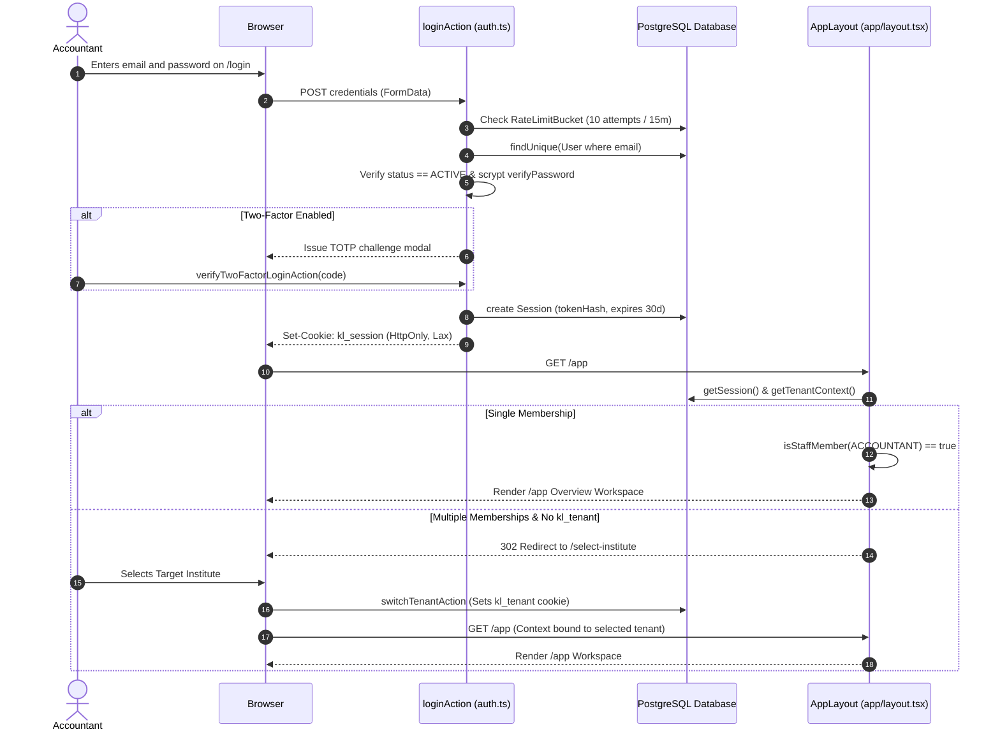
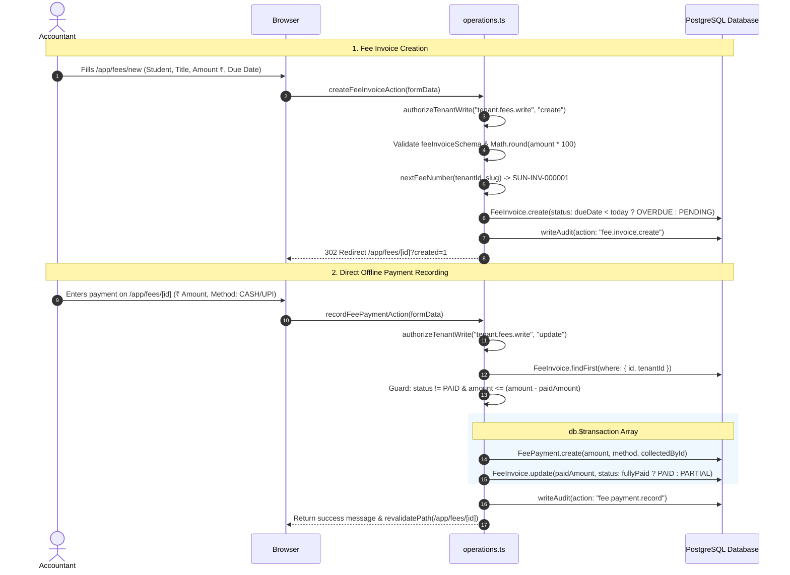
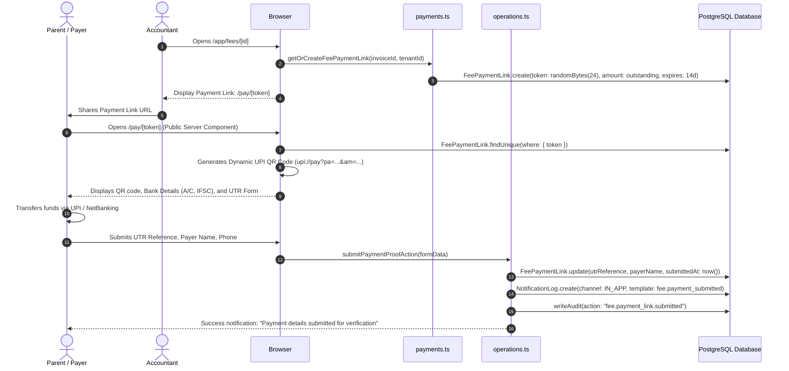
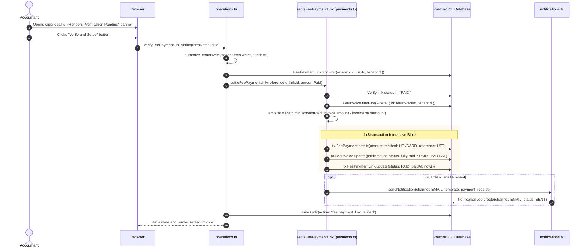
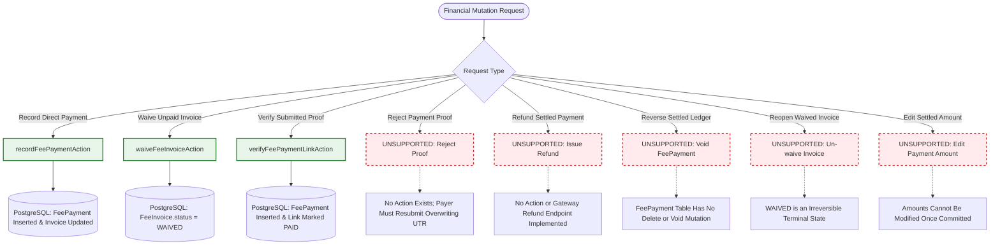
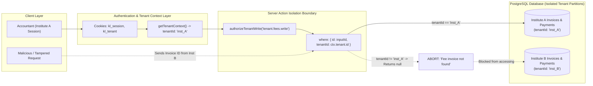

# Document 28 — Accountant End-to-End User Journey

**Document Revision:** 1.4 (Final Terminology and Payment-Link Validity Pass)  
**Target File:** `docs/knowletive-functional-handbook/28-ACCOUNTANT-END-TO-END-USER-JOURNEY.md`  
**Classification:** Complete Functional, Security, and Architectural Specification  
**Application Scope:** Knowletive SaaS Multi-Tenant Educational Operating System  
**Repository Branch:** `staging/exam-stage-43`  
**Working Directory:** `D:\IT\Saas`

---

## 1. Objective and Executive Summary

### 1.1 Objective and Scope
This document provides an exhaustive, source-verified functional and architectural specification of the **Accountant** user journey in Knowletive. It traces the complete financial lifecycle of educational fee management from identity authentication and multi-tenant session binding through fee invoice generation, direct offline payment collection, public payment link issuance, payment proof receipt, verification, double-entry settlement against student ledgers, outstanding balance reconciliations, financial reporting, and session termination.

Every functional capability, business rule, database mutation, authorization barrier, concurrency guarantee, and security boundary documented herein has been directly inspected from the upstream source code on branch `staging/exam-stage-43`. All concurrency evaluations are classified as **SOURCE-IDENTIFIED CONCURRENCY VULNERABILITIES** based on static code inspection of transaction boundaries, query predicates, and state machines; no runtime load reproduction was conducted.

### 1.2 Executive Summary of Architectural Findings
1. **Role Definition and RBAC Scope:**
   - The built-in `ACCOUNTANT` role template (`src/lib/catalog.ts`) is a tenant-scoped administrative role containing exactly **10 permission identifiers**: `leads.read`, `students.read`, `parents.read`, `fees.read`, `fees.write`, `announcements.read`, `notifications.read`, `notifications.write`, `billing.read`, and `reports.read`.
   - The Accountant is recognized as an institutional staff member via `STAFF_ROLE_KEYS` in `src/lib/catalog.ts` (`{"INSTITUTE_ADMIN", "PRINCIPAL", "TEACHER", "ACCOUNTANT", "FRONT_DESK"}`), granting access to the `/app` institutional workspace while blocking access to the student/parent `/portal`.
2. **Accessible Workspaces, UI Routes, and Screen Classification:**
   - **Operational Accountant Pages (12 Pages):** Workspace overview `/app`, fee management `/app/fees`, `/app/fees/new`, `/app/fees/[id]`, student directories `/app/students`, `/app/students/[id]`, parent directories `/app/parents`, `/app/parents/[id]`, lead tracking `/app/leads`, `/app/leads/[id]`, announcements `/app/announcements`, and subscription billing `/app/billing`.
   - **Public Payment Pages (1 Page):** The public token-gated payment page `/pay/[token]` operates outside the authenticated staff shell as an unauthenticated entry point for student fee payers.
   - **Access-Denied Fallback Routes (1 Route):** `/app/forbidden` serves strictly as an access-denied error fallback route rendered when an authenticated staff member navigates directly to a route for which they lack the required permission; it is not an operational financial screen.
   - **API Route Handlers (2 Handlers):** Both `/app/leads/export` and `/app/students/export` are fully accessible to an Accountant based on their assigned `leads.read` and `students.read` permissions.
   - **Crucial Negative Finding:** There is **no dedicated fee export API handler** (`/app/fees/export` does not exist), and no CSV or Excel export functionality is implemented for fee invoices or payment ledgers.
3. **Server Action Partition (118 Total Actions across 11 Modules):**
   - **5 Authenticated Tenant Operational Actions:** Genuinely callable by an Accountant:
     1. `createFeeInvoiceAction` (`operations.ts`) — `tenant.fees.write`
     2. `recordFeePaymentAction` (`operations.ts`) — `tenant.fees.write`
     3. `waiveFeeInvoiceAction` (`operations.ts`) — `tenant.fees.write`
     4. `verifyFeePaymentLinkAction` (`operations.ts`) — `tenant.fees.write`
     5. `exportLeadsCsvAction` (`leads.ts`) — `tenant.leads.read` (Checks `isStaffMember` and `hasTenantPermission(ctx, "tenant.leads.read")`)
   - **12 Authenticated User/Session Self-Service Actions:** Callable by an Accountant in their individual user capacity (profile updates, password changes, session revocations, MFA management, and in-app notification dismissal).
   - **17 Total Authenticated Actions Callable by Accountant:** $5 \text{ Tenant Operational} + 12 \text{ User/Session} = 17$.
   - **82 Authenticated Tenant Actions Denied by RBAC:** Denied to the Accountant due to missing tenant permissions across academics, batches, exams, syllabus, staff management, settings, and student/lead write mutations.
   - **4 Public Authentication Actions:** Role-independent entry points gated by credentials, challenges, or reset tokens (`loginAction`, `verifyTwoFactorLoginAction`, `requestPasswordResetAction`, `resetPasswordAction`).
   - **1 Public Token-Gated Action:** Student fee payment proof submission (`submitPaymentProofAction` in `src/actions/operations.ts`).
   - **14 Platform-Owner-Only Actions:** Blocked by platform owner/support guards in `src/actions/platform.ts`.
   - **Grand Total:** Exactly **118 exported actions** ($17 + 82 + 4 + 1 + 14 = 118$).
4. **Financial Core Models and Integer Paise Arithmetic:**
   - All monetary figures across `FeeInvoice`, `FeePayment`, and `FeePaymentLink` are strictly handled in **integer paise** (1 INR = 100 paise) to eliminate floating-point rounding errors (`amount = Math.round(d.amount * 100)`).
   - Invoices maintain original amount (`amount`), accumulated payments (`paidAmount`), currency (default `"INR"`), status (`PENDING`, `PARTIAL`, `OVERDUE`, `PAID`, `WAIVED`), and due date.
   - Outstanding balance is computed dynamically as `Math.max(0, amount - paidAmount)`.
5. **Rigorous Concurrency and Settlement Evidence:**
   - **Sequential Status Protection:** A sequential retry after a completed settlement is guarded by the persisted `PAID` status check. This does not protect against concurrent requests that both observe `OPEN` before either transaction commits.
   - **Source-Identified Concurrency Vulnerabilities:** Static code analysis identifies four critical race-prone paths: (A) concurrent verification of the same link, (B) concurrent direct payments against one invoice, (C) direct payment racing with link settlement, and (D) simultaneous settlement of multiple links. In all four cases, reads occur outside transaction boundaries without row locks (`SELECT ... FOR UPDATE`), updates apply static in-memory calculations rather than atomic increments (`paidAmount: { increment: amount }`), and `FeePayment.reference` lacks unique constraints.
   - **Webhook Routing Status:** While library-level webhook parsers exist in `src/lib/payments.ts`, **no Next.js webhook route handlers (`/api/webhooks/*`) are mounted**. Manual accountant verification via `verifyFeePaymentLinkAction` is the sole active settlement path in production.

---

## 2. Mandatory Source Inspection and Architecture

### 2.1 Repository Blueprint and Source File Map
The functional behavior and security policies governing the Accountant journey are established by the following concrete source artifacts:

| Layer / Responsibility | Source File Path | Key Inspected Artifacts |
|---|---|---|
| **Role & Permission Definitions** | `src/lib/catalog.ts` | `ACCOUNTANT` role template, `PERMISSIONS` catalog, `STAFF_ROLE_KEYS`, `TENANT_PERMISSION_KEYS` |
| **Authentication & Session** | `src/lib/auth.ts` | `getSession`, `getTenantContext`, `requireTenantPermission`, `isStaffMember`, `setActiveTenant` |
| **RBAC Enforcement** | `src/lib/rbac.ts` | `requireTenant`, `requireTenantPermission`, `requireTenantWrite`, `authorizeTenantWrite` |
| **Database Schema** | `prisma/schema.prisma` | `FeeInvoice`, `FeePayment`, `FeePaymentLink`, `Student`, `Tenant`, `NotificationLog`, `AuditLog` |
| **Financial & Lead Server Actions** | `src/actions/operations.ts`, `src/actions/leads.ts` | `createFeeInvoiceAction`, `recordFeePaymentAction`, `waiveFeeInvoiceAction`, `submitPaymentProofAction`, `verifyFeePaymentLinkAction`, `exportLeadsCsvAction` |
| **Payment Adapter & Settlement** | `src/lib/payments.ts` | `getOrCreateFeePaymentLink`, `settleFeePaymentLink`, `processRazorpayWebhook` (unmounted), `processStripeWebhook` (unmounted) |
| **Validation Schemas** | `src/lib/validation.ts` | `feeInvoiceSchema`, `feePaymentSchema` |
| **Shell & Navigation** | `src/components/shell/nav.ts` | `appNav` menu items, permission filters, icon mappings |
| **App Router Shell Layout** | `src/app/(app)/app/layout.tsx` | Staff validation redirect, tenant suspension block, navigation rendering |
| **Overview Dashboard** | `src/app/(app)/app/page.tsx` | Monthly fee collection aggregate, outstanding invoice sum, 6-month collection trend chart |
| **Fees Dashboard & Register** | `src/app/(app)/app/fees/page.tsx` | 4 stat cards, status filter tabs, search input, paginated invoice data table |
| **Invoice Creation Screen** | `src/app/(app)/app/fees/new/page.tsx` | Student picker, rupee input, due date picker, notes, fee number generation |
| **Invoice Detail & Hub** | `src/app/(app)/app/fees/[id]/page.tsx` | Payment recording form, payment proof verification card, waiver confirmation, payment history |
| **Public Payment Page** | `src/app/pay/[token]/page.tsx` | Student/invoice summary, dynamic UPI QR code generator, bank details, UTR submission form |
| **Export Route Handlers** | `src/app/(app)/app/leads/export/route.ts`, `students/export/route.ts` | Streamed CSV generators with role and permission authorization |

### 2.2 System Architecture Overview
The Knowletive architecture strictly isolates student fee collection from platform B2B subscription billing:
- **Institute Fee Management (Tenant Domain):** Managed via `FeeInvoice`, `FeePayment`, and `FeePaymentLink`. All records are scoped by `tenantId` and represent educational tuition, transport, or lab fees paid by parents/students to the educational institution.
- **Platform Subscription Billing (Platform Domain):** Managed via `Invoice`, `Payment`, and `TenantSubscription`. Represents SaaS licensing fees paid by educational institutions to Knowletive.
- **Accountant Access Boundary:** An Accountant has read-only access to view their institute's SaaS subscription status and platform invoices via `/app/billing` (`tenant.billing.read`), but is strictly forbidden from executing platform plan modifications or SaaS invoice payments (`tenant.billing.manage` is not granted to the Accountant).

---

## 3. Stage A — Accountant Authentication and Tenant Resolution

### 3.1 Authentication Pipeline (`/login` & `loginAction`)
The Accountant begins their interaction with Knowletive at the public entry route `/login`. Authentication is handled by `loginAction` in `src/actions/auth.ts`:

```
[Accountant Enters Email & Password]
                │
                ▼
   Rate Limit Check (RateLimitBucket: 10 attempts / 15 mins)
                │
                ▼
   User Record Lookup (db.user.findUnique where email)
                │
                ▼
   Status Verification (user.status === "ACTIVE")
                │
                ▼
   Cryptographic Password Verification (scrypt verifyPassword)
                │
                ▼
   MFA / Two-Factor Validation (If user.twoFactorEnabled: Issue TOTP Challenge)
                │
                ▼
   Session Creation (db.session.create with 30-day expiry)
                │
                ▼
   Cookie Issuance (kl_session: HttpOnly, SameSite=Lax, Secure in Prod)
                │
                ▼
   Tenant Context Binding (kl_tenant & Membership Resolution)
```

1. **Rate Limiting:** Prior to credential evaluation, `loginAction` queries `RateLimitBucket` by IP address and normalized email. If 10 failed attempts occur within a 15-minute window, authentication is blocked with `{ error: "Too many login attempts. Try again in 15 minutes." }`.
2. **Account Status Verification:** If the user record exists but `status !== "ACTIVE"`, authentication terminates immediately with `{ error: "This account has been suspended or deactivated." }`.
3. **Password Evaluation:** Passwords are hashed using Node.js `scrypt` with a cryptographically secure 16-byte salt. Authentication performs timing-safe verification. Plaintext passwords or outdated hashes are rejected.
4. **Two-Factor Authentication (2FA):** If `user.twoFactorEnabled` is `true`, a temporary encrypted 2FA challenge is generated, and the browser displays the TOTP entry modal. The session is only created upon successful invocation of `verifyTwoFactorLoginAction`.
5. **Session Persistence:** Upon successful authentication, a cryptographically random 32-byte session token is generated. Its SHA-256 hash is persisted in `Session` with an expiration timestamp set to 30 days (`Date.now() + 30 * 24 * 60 * 60 * 1000`). The raw token is stored in the `kl_session` cookie (`httpOnly: true`, `sameSite: "lax"`, `path: "/"`, `maxAge: 30 days`).

### 3.2 Tenant Resolution and Multi-Institute Routing
Once the session is verified, `getTenantContext()` in `src/lib/auth.ts` resolves the active tenant workspace:

```
                          [getTenantContext()]
                                   │
                                   ▼
                   Extract kl_session & Verify Session
                                   │
                                   ▼
                   Load User & All Active Memberships
                                   │
          ┌────────────────────────┴────────────────────────┐
          ▼                                                 ▼
[Single Active Membership]                        [Multiple Active Memberships]
          │                                                 │
          ▼                                                 ▼
Auto-Bind to that Tenant ID                       Check kl_tenant Cookie
(Sets context.tenant)                                       │
                                          ┌─────────────────┴─────────────────┐
                                          ▼                                   ▼
                                 [kl_tenant Matches]                 [kl_tenant Missing]
                                          │                                   │
                                          ▼                                   ▼
                                 Bind to Cookie Tenant               Redirect to /select-institute
```

1. **Single-Institute Accountant:** If the user has exactly one active membership, `getTenantContext()` automatically selects that institute. The Accountant is immediately redirected to `/app`.
2. **Multi-Institute Accountant:** If the Accountant serves multiple institutions (e.g., a regional trust accountant), `getTenantContext()` checks for a valid `kl_tenant` cookie.
   - If `kl_tenant` is present and matches an active membership, that tenant is bound.
   - If `kl_tenant` is missing or invalid, `getTenantContext()` returns `null`. `AppLayout` detects that `user.memberships.length > 1` and issues an HTTP redirect to `/select-institute`.
   - On `/select-institute`, the Accountant selects the desired institute, which invokes `switchTenantAction`, setting the `kl_tenant` cookie (`httpOnly: true`, `maxAge: 30 days`) and redirecting to `/app`.
3. **Role Validation & Staff Guard:** In `src/app/(app)/app/layout.tsx`, the layout executes:
   ```ts
   if (!isStaffMember(ctx)) {
     redirect("/portal");
   }
   ```
   Because `ACCOUNTANT` is explicitly defined in `STAFF_ROLE_KEYS`, `isStaffMember(ctx)` evaluates to `true`. The Accountant is granted access to the `/app` shell. (If an account possesses only `PARENT` or `STUDENT` roles, this check evaluates to `false` and forcibly redirects to `/portal`).

### 3.3 Session Termination and Security Lifecycle
1. **Logout:** Executed via `logoutAction` in `src/actions/auth.ts`. The action deletes the current `Session` record from the database and clears both `kl_session` and `kl_tenant` cookies, redirecting the browser to `/login`.
2. **Revocation:** The Accountant can view and revoke other active sessions from their profile, triggering deletion in `Session`.
3. **Expired Session:** If `session.expiresAt < new Date()`, `getSession()` returns `null`, and the user is redirected to `/login`.
4. **Cross-Tenant Access Attempt:** Because all queries in server actions and pages filter by `tenantId: ctx.tenant.id`, an Accountant authenticated in Institute A cannot read, create, or modify invoices belonging to Institute B, even if they manipulate URL route IDs. Attempting to access another tenant's record triggers a Prisma `findFirst` returning `null`, resulting in a Next.js `notFound()` 404 response.

---

## 4. Stage B — Accountant Dashboard and Finance Overview

### 4.1 Overview Dashboard (`/app`)
When an Accountant enters the application at `/app`, the overview page (`src/app/(app)/app/page.tsx`) aggregates cross-module operational metrics. The financial section displays live statistics and historical trends:

```
┌────────────────────────────────────────────────────────────────────────┐
│ Workspace Overview: Sunrise International School                       │
├────────────────────┬────────────────────┬──────────────────────────────┤
│ Collected Month    │ Outstanding Fees   │ Active Students              │
│ ₹2,45,000          │ ₹85,000            │ 420                          │
│ Since 1st Nov      │ 14 overdue         │ In Good Standing             │
└────────────────────┴────────────────────┴──────────────────────────────┘
│ Fee Collection Trend (Last 6 Months Area Chart)                        │
│ [ May: ₹1.8L ] ── [ Jun: ₹3.2L ] ── [ Jul: ₹2.1L ] ── [ Oct: ₹2.45L ]   │
└────────────────────────────────────────────────────────────────────────┘
```

1. **Monthly Collections Metric:**
   - **Database Query:** `db.feePayment.aggregate({ where: { tenantId, paidAt: { gte: monthStart } }, _sum: { amount: true } })`
   - **Source:** Directly aggregates settled `FeePayment` records where `paidAt` is greater than or equal to the first day of the current UTC month (`startOfMonth(now)`).
   - **Display Value:** Formatted via `money(collected)`. If null, defaults to `₹0`.
2. **Outstanding Fees Metric:**
   - **Database Query:** `db.feeInvoice.findMany({ where: { tenantId, status: { in: ["PENDING", "PARTIAL", "OVERDUE"] } }, select: { amount: true, paidAmount: true, dueDate: true } })`
   - **Calculation Formula:** `outstanding = outstandingInvoices.reduce((sum, inv) => sum + (inv.amount - inv.paidAmount), 0)`
   - **Subtext:** Highlights the count of overdue invoices: `overdueCount = outstandingInvoices.filter((i) => i.dueDate < now).length`.
3. **Six-Month Collection History Chart:**
   - **Database Query:** `db.feePayment.findMany({ where: { tenantId, paidAt: { gte: sixMonthsAgo } }, select: { amount: true, paidAt: true } })`
   - **Aggregation:** In-memory bucket aggregation grouping payment amounts by calendar month over the last 6 months, rendered via `<AreaChart />`.
4. **Quick Action Deep-Link:**
   - If the user has `tenant.fees.write` and `outstanding > 0`, the dashboard displays a prominent navigation callout: `Collect outstanding fees from the fees workspace — X overdue invoices`, deep-linking directly to `/app/fees?status=OVERDUE`.

### 4.2 Dedicated Fees Dashboard (`/app/fees`)
The primary operational hub for the Accountant is `/app/fees` (`src/app/(app)/app/fees/page.tsx`). Access is strictly guarded by `requireTenantPermission("tenant.fees.read")`.

#### 4.2.1 Real-Time Financial Metric Cards
The page renders four high-level statistical summary cards calculated directly from the database:

| Card Label | Calculation / Database Aggregation Query | Status Scope & Filters | Tone | Purpose |
|---|---|---|---|---|
| **Billed (all time)** | `db.feeInvoice.aggregate({ where: { tenantId, status: { not: "WAIVED" } }, _sum: { amount: true, paidAmount: true } })` | All invoices except `WAIVED` | Neutral | Total invoiced liability generated by the institute |
| **Collected this month** | `db.feePayment.aggregate({ where: { tenantId, paidAt: { gte: startOfMonth(now) } }, _sum: { amount: true } })` | Settled payments since 1st of month | Success | Short-term cash flow and monthly collection progress |
| **Outstanding** | `Math.max(0, billedTotal - collectedTotal)` | All non-waived invoices across all time | Warning / Success | Total pending institutional receivables |
| **Overdue** | `db.feeInvoice.aggregate({ where: { tenantId, status: { in: ["PENDING", "PARTIAL", "OVERDUE"] }, dueDate: { lt: now } }, _sum: { amount: true, paidAmount: true }, _count: { _all: true } })` | Open invoices where `dueDate < now` | Danger / Success | Receivables at critical credit risk |

*Note on Live Data:* All four metrics represent live aggregations executed directly against PostgreSQL tables during page rendering. No static dummy data or cached financial placeholders exist in the fees module.

#### 4.2.2 Filtering, Searching, and Status Segmentation
- **Status Filter Chips:** Above the table, the Accountant can filter by invoice status tabs:
  - `All` (All invoices)
  - `Pending` (`status = "PENDING"`)
  - `Partial` (`status = "PARTIAL"`)
  - `Overdue` (`status = "OVERDUE"`)
  - `Paid` (`status = "PAID"`)
  - `Waived` (`status = "WAIVED"`)
  Each tab dynamically renders the count of matching invoices via `db.feeInvoice.groupBy({ by: ["status"], where: { tenantId }, _count: { _all: true } })`.
- **Search Parameter (`q`):** The search bar filters records across five distinct fields using case-insensitive mode:
  ```ts
  OR: [
    { number: { contains: q, mode: "insensitive" } },
    { title: { contains: q, mode: "insensitive" } },
    { student: { firstName: { contains: q, mode: "insensitive" } } },
    { student: { lastName: { contains: q, mode: "insensitive" } } },
    { student: { admissionNo: { contains: q, mode: "insensitive" } } },
  ]
  ```
- **Pagination:** Enforces a server-side limit of 20 records per page (`PAGE_SIZE = 20`) with offset pagination (`skip: (page - 1) * 20`, `take: 20`).

## 5. Stage C — Fee Invoice Creation and Lifecycle Management

### 5.1 Fee Invoice Creation Workflow (`/app/fees/new` & `createFeeInvoiceAction`)
When an Accountant raises an invoice, they navigate to `/app/fees/new` (`src/app/(app)/app/fees/new/page.tsx`). Access is guarded by `requireTenantWrite("tenant.fees.write")`.

#### 5.1.1 UI Configuration and Available Fields
The invoice creation form exposes the following fields:
- **Student Selection:** Dropdown populated from `db.student.findMany` where `status: "ACTIVE"`.
- **Title:** Descriptive title (e.g., "Term 1 Tuition Fee", "Annual Library and Lab Fee").
- **Amount (in Rupees):** Financial input collected in rupees and converted to integer paise (`Math.round(amountRupees * 100)`) before mutation.
- **Due Date:** Date picker specifying when payment is due.
- **Description / Notes:** Optional string explaining the fee breakdown or invoice terms.

#### 5.1.2 Server Action Execution (`createFeeInvoiceAction`)
The form submits to `createFeeInvoiceAction` in `src/actions/finance.ts`:
1. **Authorization:** Invokes `requireTenantWrite("tenant.fees.write")`. Ensures tenant context and permissions are verified.
2. **Input Validation:** Validates via Zod schema (`studentId`, `title`, `amount`, `dueDate`).
3. **Sequential Invoice Number Generation:** Computes the invoice sequence within the tenant:
   ```ts
   const count = await db.feeInvoice.count({ where: { tenantId } });
   const number = `INV-${String(count + 1).padStart(5, "0")}`;
   ```
4. **Database Insertion:** Inserts a record into `FeeInvoice` with `status: "ISSUED"`, `paidAmount: 0`, and `currency: "INR"`.
5. **Revalidation & Redirect:** Revalidates `/app/fees` and redirects the user to `/app/fees/[id]`.

### 5.2 Invoice Lifecycle State Machine
An invoice transitions through the following discrete statuses (`FeeInvoiceStatus` enum in Prisma):

```
       ┌──────────┐
       │  DRAFT   │ (Supported by schema, not currently emitted by UI)
       └────┬─────┘
            │
            ▼
       ┌──────────┐
  ┌───>│  ISSUED  │ (Initial state upon creation)
  │    └────┬─────┘
  │         │ Partial Payment Recorded (paidAmount < amount)
  │         ▼
  │    ┌──────────┐
  │    │ PARTIALLY│
  │    │   PAID   │
  │    └────┬─────┘
  │         │ Full Payment Recorded (paidAmount >= amount)
  │         ▼
  │    ┌──────────┐
  │    │   PAID   │ (Final settled state)
  │    └──────────┘
  │
  │ Overdue Check (Cron job / date check)
  └─────────┬─────┐
            │     │
            ▼     ▼
       ┌──────────┐
       │ OVERDUE  │ (Due date passed with outstanding balance > 0)
       └────┬─────┘
            │
            ▼
       ┌──────────┐
       │ CANCELLED│ (Voided by administrator/accountant)
       └──────────┘
```

---

## 6. Stage D — Direct Payment Recording

### 6.1 Direct Payment Processing (`recordFeePaymentAction`)
When a parent or student pays offline (Cash, Cheque, Bank Transfer, POS Machine) or directly at the institute counter, the Accountant records the transaction via the invoice detail page (`/app/fees/[id]`), invoking `recordFeePaymentAction` (`src/actions/finance.ts`):

1. **Authorization:** Requires `requireTenantWrite("tenant.fees.write")`.
2. **Input Validation:**
   - `invoiceId`: CUID identifying the target invoice.
   - `amount`: Number in rupees (converted to integer paise).
   - `method`: Enum matching `FeePaymentMethod` (`CASH`, `CARD`, `UPI`, `NET_BANKING`, `CHEQUE`, `OTHER`).
   - `reference`: Optional string (cheque number, bank transfer UTR, transaction ID).
   - `notes`: Optional accountant remarks.
3. **Pre-Transaction Reads (Outside Database Transaction):**
   ```ts
   const invoice = await db.feeInvoice.findFirst({
     where: { id: invoiceId, tenantId },
     select: { id: true, amount: true, paidAmount: true, status: true },
   });
   if (!invoice) throw new Error("Invoice not found");
   const amountPaise = Math.round(input.amount * 100);
   const newPaidAmount = invoice.paidAmount + amountPaise;
   const newStatus: FeeInvoiceStatus =
     newPaidAmount >= invoice.amount ? "PAID" : "PARTIALLY_PAID";
   ```
4. **Database Mutation (`db.$transaction`):**
   ```ts
   await db.$transaction([
     db.feePayment.create({
       data: {
         tenantId,
         feeInvoiceId: invoice.id,
         amount: amountPaise,
         method: input.method,
         reference: input.reference || null,
         notes: input.notes || null,
         recordedByUserId: user.id,
         status: "SUCCESS",
       },
     }),
     db.feeInvoice.update({
       where: { id: invoice.id },
       data: {
         paidAmount: newPaidAmount,
         status: newStatus,
       },
     }),
   ]);
   ```
5. **Audit Logging & Notifications:** Emits `fee.payment.recorded` to `AuditLog`. If configured, triggers an in-app receipt notification to the parent.
6. **Concurrency Consideration:** The calculation of `newPaidAmount` occurs outside the database transaction without row-level locking (`SELECT ... FOR UPDATE`). Concurrency implications are analyzed in Section 17.

---

## 7. Stage E — Public Payment Link Lifecycle

### 7.1 Payment Link Token Generation (`getOrCreateFeePaymentLink`)
Knowletive supports remote and online fee collection by generating public, cryptographic payment links. The generation logic resides in `getOrCreateFeePaymentLink` (`src/lib/payments.ts`):

```ts
export async function getOrCreateFeePaymentLink(invoiceId: string, tenantId: string) {
  const invoice = await db.feeInvoice.findFirst({
    where: { id: invoiceId, tenantId },
    include: {
      student: { select: { firstName: true, lastName: true } },
      tenant: { select: { name: true, currency: true } },
      paymentLinks: {
        where: { status: "OPEN", expiresAt: { gt: new Date() } },
        orderBy: { createdAt: "desc" },
      },
    },
  });
  if (!invoice) throw new Error("Fee invoice not found");
  const outstanding = invoice.amount - invoice.paidAmount;
  if (outstanding <= 0) throw new Error("This invoice has no outstanding balance");

  // Reusable Link Optimization
  const reusable = invoice.paymentLinks.find((link) => link.amount === outstanding);
  if (reusable) {
    return { link: reusable, url: reusable.url ?? appUrl(`/pay/${reusable.token}`) };
  }

  // Token Generation
  const token = randomBytes(24).toString("base64url");
  const studentName = `${invoice.student.firstName} ${invoice.student.lastName}`;
  const description = `${invoice.title} — ${studentName} (${invoice.number})`;
  const successUrl = appUrl(`/pay/${token}`);

  const link = await db.feePaymentLink.create({
    data: {
      tenantId,
      feeInvoiceId: invoice.id,
      token,
      amount: outstanding,
      currency: invoice.currency,
      expiresAt: new Date(Date.now() + LINK_TTL_DAYS * 24 * 60 * 60 * 1000), // 14 Days
      provider: "manual",
      url: appUrl(`/pay/${token}`),
    },
  });
  // ... Gateway Adapter Checkout Logic ...
}
```

#### 7.1.1 Cryptographic Entropy and Lifecycle Rules
1. **Token Entropy:** Generates a 24-byte random buffer formatted as a 32-character URL-safe Base64 string (`base64url`), providing 192 bits of cryptographic entropy, preventing brute-force enumeration.
2. **Idempotent Link Reuse:** If an open, non-expired payment link already exists matching the exact outstanding balance (`link.amount === outstanding`), the system reuses that link rather than creating redundant database rows.
3. **Expiration:** Links expire 14 days after creation (`LINK_TTL_DAYS = 14`).
4. **Provider Adapter:**
   - If online payment gateways are configured (`RAZORPAY_KEY_ID` or `STRIPE_SECRET_KEY`), the helper invokes Razorpay/Stripe API endpoints to create an external checkout session.
   - If unconfigured, the provider defaults to `"manual"`, generating an internal link: `/pay/${token}`.

#### 7.1.2 Stale-Link Lifecycle and Separate Bank-Reconciliation Analysis
Inspection of `prisma/schema.prisma`, `src/app/pay/[token]/page.tsx`, and `src/lib/payments.ts` reveals key database and business-logic characteristics governing payment link validity, expiry, and balance reconciliations:

1. **Schema Constraints on `FeePaymentLink`:**
   In `model FeePaymentLink`, the `@unique` constraint is strictly placed on `token`. There is **no unique constraint** on `feeInvoiceId` and **no composite unique constraint** on `(feeInvoiceId, status)`.

2. **Token Expiry and Replacement Mechanics:**
   - **Database Status:** When a payment link is created, its default database status is `status = OPEN` with `expiresAt = now() + 14 days` (`LINK_TTL_DAYS = 14`). In PostgreSQL, an older link's database status remains `OPEN` indefinitely unless transitioned to `PAID` upon settlement. There is no automated job transitioning stale links to an expired enum.
   - **Public Page Acceptance Window:** As long as `new Date() < link.expiresAt` (within the 14-day validity window) and `status !== "PAID"`, the public route `/pay/[token]` accepts the token, displaying the payment summary, dynamic UPI QR code, and payment proof form.
   - **UI Expiry Enforcement:** If `link.expiresAt < new Date()` and `link.status !== "PAID"`, `/pay/[token]` sets `isExpired = true` and renders a red warning Callout (`Payment Link Expired`), suppressing the QR code and payment proof submission form.
   - **Server Action & Settlement Gap:** Crucially, while the UI suppresses expired links, neither `submitPaymentProofAction` (`src/actions/operations.ts`) nor `settleFeePaymentLink` (`src/lib/payments.ts`) independently verifies `link.expiresAt`.
   - **Replacement Does Not Invalidate:** When `getOrCreateFeePaymentLink` generates a replacement link for an adjusted balance, it **never cancels, expires, or voids prior open links**. Both the older link and the newer link remain simultaneously valid on their respective URLs until their 14-day expiry timestamps lapse.

3. **UPI QR Code Payload & Amount Source Verification:**
   Inspection of `src/app/pay/[token]/page.tsx` proves the exact amount encoded in the payment interface:
   ```ts
   const amountInRupees = (link.amount / 100).toFixed(2);
   const upiUri = `upi://pay?pa=${encodeURIComponent(upiVpa)}&pn=${encodeURIComponent(link.tenant.name)}&am=${amountInRupees}&cu=INR&tn=${encodeURIComponent(upiNote)}`;
   const qrCodeDataUrl = await QRCode.toDataURL(upiUri, { width: 240, margin: 1 });
   ```
   - **Amount Source:** The UPI URI parameter `am=${amountInRupees}` and the rendered UI (`{money(link.amount)}`) strictly derive from the stored `FeePaymentLink.amount`.
   - **No Balance Calculation:** The public page does **not** dynamically calculate or display the invoice's current outstanding balance (`invoice.amount - invoice.paidAmount`). An older link generated for ₹10,000 continues to display ₹10,000 and encode `am=10000.00` in its QR code throughout its 14-day validity window.

4. **Step-by-Step Lifecycle Trace of Partial Payment & Stale Link Settlement:**
   - **Step 1 (Invoice Creation):** An invoice is created for ₹10,000 (`amount = 10000`, `paidAmount = 0`, `status = ISSUED`).
   - **Step 2 (Initial Link Generation):** `getOrCreateFeePaymentLink` generates Link 1 for ₹10,000 (`amount = 10000`, `status = OPEN`, valid for 14 days).
   - **Step 3 (Offline Direct Payment):** A parent pays ₹4,000 in cash at the counter. Staff records this via `recordFeePaymentAction`. The invoice updates to `paidAmount = 4000`, `status = PARTIALLY_PAID`.
   - **Step 4 (Outstanding Balance Reduction):** Current outstanding balance is reduced to `10000 - 4000 = 6000` (₹6,000).
   - **Step 5 (New Link Generation):** Staff generates a link for the remaining balance. `getOrCreateFeePaymentLink` finds no reusable link matching ₹6,000, so it creates Link 2 for ₹6,000 (`status = OPEN`).
   - **Step 6 (Old Link Remains Valid):** Link 1 is not cancelled or modified; it remains in database status `OPEN` and accessible at `/pay/[token-1]` until its 14-day expiry.
   - **Step 7 (Subsequent Settlement of Stale Link 1):** The parent scans the Link 1 QR code (which requests ₹10,000), submits proof with a UTR, and staff verifies the link via `verifyFeePaymentLinkAction`.

5. **Settlement Clamping and Bank-Reconciliation Risk:**
   In `settleFeePaymentLink` (`src/lib/payments.ts`), settlement calculates:
   ```ts
   const outstanding = invoice.amount - invoice.paidAmount; // 6000
   const amount = Math.min(
     input.amountPaid && input.amountPaid > 0 ? input.amountPaid : link.amount,
     outstanding,
   ); // Math.min(10000, 6000) = 6000
   ```
   - **Clamping in Sequential Execution:** In purely sequential execution, `settleFeePaymentLink` clamps the recorded `FeePayment.amount` to the outstanding balance (₹6,000). Consequently, `paidAmount` updates to $4,000 + 6,000 = 10,000$ and does not exceed invoice liability.
   - **Potential Bank-to-Ledger Reconciliation Discrepancy:** If a payer transfers an amount greater than the current outstanding balance using an older still-valid payment request, the settlement helper may credit only the clamped outstanding amount, creating a potential bank-to-ledger reconciliation discrepancy. The excess funds received in the institute's bank account are omitted from the student's ledger. Furthermore, if the invoice was already 100% paid (`outstanding = 0`), `amount <= 0` triggers, marking the link `PAID` with **zero `FeePayment` created**.
   - *(Note: Actual bank settlement and external statement reconciliation have not been independently verified; this finding represents a static source-code analysis of the payment-link lifecycle.)*

6. **Distinction from Concurrency Vulnerabilities:**
   - **Concurrency Vulnerabilities (`SOURCE-IDENTIFIED CONCURRENCY VULNERABILITY`):** Require two or more asynchronous requests racing in time, interleaving reads and writes across un-isolated transactions (e.g. Scenarios A through E).
   - **Payment-Link Lifecycle and Reconciliation Risk (`SOURCE-IDENTIFIED PAYMENT-LINK LIFECYCLE AND BANK-RECONCILIATION RISK`):** Occurs entirely through sequential, non-overlapping actions across normal business operations over days, stemming from missing link invalidation upon balance changes and static amount encoding.

### 7.2 The Public Payment Interface (`/pay/[token]`)
The route `/pay/[token]` (`src/app/pay/[token]/page.tsx`) is an unauthenticated, public-facing server component:
1. **Lookup & Expiry:** Queries `FeePaymentLink` by unique token. If the link does not exist, Next.js returns `notFound()` (HTTP 404). If `expiresAt < new Date()` and `status !== "PAID"`, the page renders an expired notice.
2. **Institutional Branding & Bank Details:** Extracts the institute's banking configuration from `tenant.settings`:
   - VPA: `settings.upiVpa` (default: `${tenant.slug}@upi`)
   - Bank Name: `settings.bankName` (default: `"State Bank of India"`)
   - Account Number: `settings.accountNumber`
   - IFSC Code: `settings.ifscCode`
   - Account Holder: `settings.accountHolder`
3. **Dynamic UPI QR Code Generation:** Constructs a standard NPCI UPI URI and generates a data-URL QR code using `qrcode.toDataURL`:
   ```ts
   const upiUri = `upi://pay?pa=${encodeURIComponent(upiVpa)}&pn=${encodeURIComponent(link.tenant.name)}&am=${amountInRupees}&cu=INR&tn=${encodeURIComponent(upiNote)}`;
   ```
   Parents scan this QR code directly in apps such as GPay, PhonePe, or Paytm to initiate a transfer for the exact invoice balance.

### 7.3 Payment Proof Submission (`submitPaymentProofAction`)
After completing the bank transfer, the payer submits proof on `/pay/[token]`, invoking `submitPaymentProofAction` in `src/actions/operations.ts`:

1. **Authentication:** None required (Public Token-Gated Action).
2. **Input Validation:**
   - `token`: Required string.
   - `utrReference`: Bank UTR or Transaction Reference string between 6 and 50 characters.
   - `payerName`: Required string.
   - `payerPhone`: Optional phone number.
   - `payerNotes`: Optional remarks.
3. **Link State Check:** Verifies link existence and ensures `link.status !== "PAID"`.
4. **Database Mutation:**
   ```ts
   await db.feePaymentLink.update({
     where: { id: link.id },
     data: {
       utrReference,
       payerName,
       payerPhone: payerPhone || null,
       payerNotes: payerNotes || null,
       submittedAt: new Date(),
     },
   });
   ```
5. **Staff Notification:** Inserts an in-app notification record:
   ```ts
   await db.notificationLog.create({
     data: {
       tenantId: link.tenantId,
       channel: "IN_APP",
       template: "fee.payment_submitted",
       to: link.tenant.email,
       subject: `Payment proof submitted: ${link.feeInvoice.number}`,
       body: `UTR ${utrReference} submitted for ₹${(link.amount / 100).toLocaleString("en-IN")} by ${payerName} for ${link.feeInvoice.student.firstName} ${link.feeInvoice.student.lastName}.`,
       status: "SENT",
     },
   });
   ```
6. **Audit Trail:** Logs `fee.payment_link.submitted` in `AuditLog`.
7. **Crucial Accounting Reality:** Submitting payment proof **does not settle the invoice** and **does not create a `FeePayment` record**. It merely attaches metadata to `FeePaymentLink` and flags it for staff review.

---

## 8. Stage F — Payment Proof Verification and Settlement

### 8.1 Accountant Verification Pipeline (`verifyFeePaymentLinkAction`)
When a parent submits proof, the transaction appears on `/app/fees` under the **"Pending Verification"** tab (`src/app/(app)/app/fees/page.tsx`). The Accountant reviews the UTR against the institute's bank statement and clicks **"Verify & Settle"**, triggering `verifyFeePaymentLinkAction` (`src/actions/operations.ts`).

1. **Authorization:** Invokes `requireTenantWrite("tenant.fees.write")`.
2. **Link Resolution:** Queries `FeePaymentLink` by ID with tenant scoping.
3. **Settlement Invocation:** Forwards the verification to `settleFeePaymentLink`:
   ```ts
   export async function verifyFeePaymentLinkAction(input: {
     linkId: string;
     notes?: string;
   }) {
     const { tenantId, user } = await requireTenantWrite("tenant.fees.write");
     const link = await db.feePaymentLink.findFirst({
       where: { id: input.linkId, tenantId },
       include: { feeInvoice: true },
     });
     if (!link) throw new Error("Payment link not found");
     if (link.status === "PAID") throw new Error("This payment link has already been settled");

     const payment = await settleFeePaymentLink({
       provider: link.provider,
       providerRef: link.providerRef,
       referenceId: link.token,
       providerPaymentId: link.utrReference,
       amountPaid: link.amount,
     });
     // Audit logging...
     return { success: true, paymentId: payment.id };
   }
   ```

### 8.2 The Core Settlement Transaction (`settleFeePaymentLink`)
The settlement engine resides in `src/lib/payments.ts`:

```ts
export async function settleFeePaymentLink(input: {
  provider: string;
  providerRef?: string | null;
  referenceId?: string | null;
  providerPaymentId?: string | null;
  amountPaid?: number | null;
}) {
  const link = await db.feePaymentLink.findFirst({
    where: {
      OR: [
        input.referenceId ? { token: input.referenceId } : {},
        input.providerRef ? { providerRef: input.providerRef } : {},
      ],
    },
    include: { feeInvoice: true },
  });
  if (!link) throw new Error("Fee payment link not found");
  if (link.status === "PAID") return link; // Sequential Idempotency Guard

  const paidAmountPaise = input.amountPaid ?? link.amount;
  const newInvoicePaidAmount = link.feeInvoice.paidAmount + paidAmountPaise;
  const newStatus: FeeInvoiceStatus =
    newInvoicePaidAmount >= link.feeInvoice.amount ? "PAID" : "PARTIALLY_PAID";

  return db.$transaction(async (tx) => {
    const payment = await tx.feePayment.create({
      data: {
        tenantId: link.tenantId,
        feeInvoiceId: link.feeInvoiceId,
        amount: paidAmountPaise,
        method: link.provider === "manual" ? "UPI" : "NET_BANKING",
        reference: input.providerPaymentId ?? link.utrReference ?? link.token,
        status: "SUCCESS",
      },
    });

    await tx.feeInvoice.update({
      where: { id: link.feeInvoiceId },
      data: {
        paidAmount: newInvoicePaidAmount,
        status: newStatus,
      },
    });

    await tx.feePaymentLink.update({
      where: { id: link.id },
      data: {
        status: "PAID",
        paidAt: new Date(),
      },
    });

    return payment;
  });
}
```

#### 8.2.1 Webhook-Based Fee Settlement Source Inspection
An exhaustive audit of caller paths and API routes in the codebase establishes the following architectural reality:
1. **Trace of `settleFeePaymentLink` Callers:**
   - Active Application Caller: `verifyFeePaymentLinkAction` in `src/actions/operations.ts` (invoked when staff clicks "Verify and Settle").
   - Library Helper Callers: `processRazorpayWebhook` and `processStripeWebhook` in `src/lib/payments.ts`.
2. **Caller Trace of Gateway Webhook Functions:**
   - Inspection of every file across `src/` reveals **zero external callers** for `processRazorpayWebhook` or `processStripeWebhook`.
   - Inspection of `src/app/` reveals **zero HTTP route handlers** mounted for webhooks (e.g., `/api/webhooks/razorpay`, `/api/webhooks/stripe` do not exist). The only route handlers in `src/app/api/` are `/api/cron/renewal-check` and `/api/files/[id]`.
3. **Precise Categorization of Webhook Capabilities:**
   - **Library Helper Functions:** `processRazorpayWebhook` and `processStripeWebhook` exist solely as isolated library helper functions in `src/lib/payments.ts`.
   - **Application Route Integration:** Missing entirely. No Next.js App Router `route.ts` imports or invokes these functions.
   - **Platform Subscription Billing Webhooks:** Unmounted. No route handler receives external gateway webhooks for platform subscription management.
   - **Institute Fee-Payment Webhooks:** Unmounted. No route handler receives external gateway webhooks for student tuition or fee collection.
4. **Authoritative Operational Conclusion:**
   An unused library helper does not constitute an implemented end-to-end webhook workflow. Automated gateway webhook fee settlement is **unmounted and non-runnable in the application as written**. **Manual accountant verification via `verifyFeePaymentLinkAction` is the sole runnable settlement path**.

---

### 8.3 Concurrency and Retry Analysis Across Verification Paths
To determine financial safety, we analyze the exact mechanics of sequential retries, concurrent settlements, and unresolved client timeouts across `verifyFeePaymentLinkAction` and `settleFeePaymentLink`:

1. **Sequential vs. In-Flight Retry Distinction:**
   - **A retry after a completed settlement is guarded once the persisted PAID state is visible. This does not guarantee safety when the original transaction remains in flight or its commit outcome has not yet been resolved.**
   - The application relies on passive application-level status checks (`if (link.status === "PAID") return;`) without distributed locking, in-flight mutexes, or request coordination mechanisms.

2. **Exhaustive Tri-Partite Retry Outcome Analysis:**
   - **Case A: Completed settlement whose persisted PAID state is visible (Sequential Retry Blocked):**
     - The original transaction commits successfully: `FeePaymentLink.status = "PAID"`, `FeeInvoice.paidAmount` incremented, `FeePayment` inserted.
     - A subsequent retry arrives. `verifyFeePaymentLinkAction` executes `db.feePaymentLink.findFirst({ where: { id: linkId, tenantId } })`.
     - The query reads `link.status === "PAID"`.
     - Guard evaluates: `if (!link || link.status === "PAID") return;`.
     - **Outcome:** Sequential retry is blocked. The action terminates without duplicate database mutation or altered balances.
   - **Case B: Transaction confirmed to have rolled back (Recoverable Retry):**
     - The original transaction encounters an exception or database error before commit.
     - PostgreSQL rolls back the entire `$transaction` block: `FeePaymentLink` remains `OPEN`, `FeePayment` is not created, `FeeInvoice` is unchanged.
     - A fresh retry executes `findFirst`, reads `status: "OPEN"`, and safely executes the settlement transaction afresh because the original transaction committed no changes.
     - **Outcome:** Recoverable retry succeeds cleanly. (This represents a clean retry mechanism after complete abort, not general system idempotency).
   - **Case C: Original transaction still in flight or commit outcome unknown (Concurrent Race):**
     - A network timeout or client disconnect occurs while PostgreSQL is actively executing the initial settlement transaction.
     - The client retries immediately while the original transaction remains in flight or before PostgreSQL has finalized the commit.
     - The retry request executes under PostgreSQL default `READ COMMITTED` isolation without pessimistic row locks (`SELECT ... FOR UPDATE`).
     - Because the original transaction has not yet committed, the concurrent retry still encounters the `OPEN` status and reads the pre-settlement `invoice.paidAmount`.
     - Both requests proceed concurrently and execute their database insertions.
     - **Outcome:** Race condition. Double ledger insertion (`FeePayment` duplicated), header balance overwritten with static values, and financial inconsistency.
   - **Classification:** `SOURCE-IDENTIFIED CONCURRENCY VULNERABILITY` (No general exactly-once or idempotent behavior is guaranteed by the implementation; verified via static source analysis).

## 9. Stage G — Payment Rejection, Reversals and Corrections

### 9.1 Payment Proof Rejection (Unsupported Workflow)
*Source Audit Finding:* There is **no payment rejection workflow implemented in Knowletive**.
1. **Absence of Action:** There is no `rejectFeePaymentLinkAction` or rejection status transition in `src/actions/operations.ts`.
2. **Missing UI Mechanism:** The UI on `/app/fees/[id]` renders only a "Verify & Settle" button. There is no "Reject Proof", "Invalid UTR", or "Request Resubmission" control.
3. **Payer Resubmission:** If a payer enters an invalid or incorrect UTR on `/pay/[token]`, they can re-enter the correct reference only because `submitPaymentProofAction` allows overwriting `utrReference` as long as `link.status !== "PAID"`. However, the Accountant has no mechanism to flag the UTR as invalid or return it to the payer with a rejection note.

### 9.2 Payment Reversals, Refunds, and Ledger Corrections (Unsupported)
*Critical Accounting Finding:* Knowletive does not implement payment reversals, refunds, or transaction deletion:
1. **Immutability of `FeePayment`:** Once a `FeePayment` record is created, there is no server action, UI button, or API endpoint to edit, void, reverse, or delete it.
2. **No Refund Infrastructure:** Neither cash refunds nor automated payment gateway refunds (via Razorpay or Stripe refund APIs) are implemented.
3. **No Invoice Re-Opening:** Once `FeeInvoice.status` reaches `"PAID"`, it is a terminal state. An Accountant cannot revert an invoice from `"PAID"` back to `"PARTIAL"` or `"PENDING"`.
4. **Correction Workarounds in Production:** If an Accountant erroneously records a payment of Rs. 10,000 instead of Rs. 1,000, there is no in-app adjustment mechanism. The correction requires direct database intervention by a database administrator or compensatory adjustments outside the application.

---

## 10. Stage H — Waivers, Discounts and Outstanding Balances

### 10.1 Fee Waiver Workflow (`waiveFeeInvoiceAction`)
Knowletive allows staff with `tenant.fees.write` to forgive unpaid invoice balances using `waiveFeeInvoiceAction` in `src/actions/operations.ts`:

```ts
export async function waiveFeeInvoiceAction(formData: FormData) {
  const auth = await authorizeTenantWrite("tenant.fees.write", "update");
  if (!auth.ok) redirect("/app/fees?denied_action=update");
  const ctx = auth.ctx;
  const invoiceId = String(formData.get("invoiceId") ?? "");
  if (!invoiceId) return;

  const invoice = await db.feeInvoice.findFirst({
    where: { id: invoiceId, tenantId: ctx.tenant.id },
  });
  if (!invoice || invoice.status === "PAID") return;

  await db.feeInvoice.update({
    where: { id: invoiceId },
    data: { status: "WAIVED" },
  });

  await writeAudit({
    tenantId: ctx.tenant.id,
    actorId: ctx.user.id,
    actorName: ctx.user.name,
    action: "fee.invoice.waive",
    entity: "FeeInvoice",
    entityId: invoiceId,
    meta: { number: invoice.number, amount: invoice.amount },
  });

  revalidatePath("/app/fees");
  revalidatePath(`/app/fees/${invoiceId}`);
  revalidatePath("/app");
}
```

#### 10.1.1 Waiver Rules and Behavior
1. **Fully Paid Guard:** If `invoice.status === "PAID"`, the waiver is rejected (`if (!invoice || invoice.status === "PAID") return`). Fully paid invoices cannot be waived.
2. **Zero Modification to Original Amount:** The action does **not alter `invoice.amount` or `invoice.paidAmount`**. It strictly modifies `invoice.status = "WAIVED"`.
3. **Exclusion from Institutional Aggregates:**
   - In `FeesPage` (`src/app/(app)/app/fees/page.tsx`), total billed liability explicitly filters out waived invoices:
     ```ts
     db.feeInvoice.aggregate({
       where: { tenantId, status: { not: "WAIVED" } },
       _sum: { amount: true, paidAmount: true },
     })
     ```
   - Consequently, once an invoice is waived, its uncollected balance is immediately removed from the institutional "Outstanding" metric.
4. **No Partial Waivers or Discounts:** The schema and actions do not support line-item discounts, percentage waivers, or partial fee waivers. The waiver is strictly an all-or-nothing cancellation of the remaining balance.
5. **Irreversible Status:** There is no "Un-waive" action. Once an invoice is marked `"WAIVED"`, it cannot be reopened.

### 10.2 Authoritative Balance Formula
Throughout the application, outstanding balance is calculated using a unified formula:

$$\\text{Outstanding Balance} = \\max\\left(0, \\text{FeeInvoice.amount} - \\text{FeeInvoice.paidAmount}\\right)$$

In UI displays:
- If `status === "WAIVED"`, the balance is rendered as `"Waived"` with a neutral badge tone.
- If `status === "PAID"`, the balance is rendered as `0.00` with a success badge tone.
- If `status === "OVERDUE"`, the balance is rendered with a danger tone.
- If `status === "PENDING"` or `"PARTIAL"`, the balance is rendered with a warning tone.

---

## 11. Stage I — Financial Reporting, Collections and Analytics

### 11.1 Implemented Financial Reports and Dashboards
The Accountant has access to live financial metrics across several App Router screens:

| Screen / Component | Route | Metrics & Analytics Provided | Source Query / Aggregation |
|---|---|---|---|
| **Workspace Overview** | `/app` | Total collected this month, total outstanding fees, count of overdue invoices, 6-month collection trend area chart | `db.feePayment.aggregate`, `db.feeInvoice.findMany`, `db.feePayment.findMany` |
| **Fees Register** | `/app/fees` | Total billed all-time (waived excluded), collected this month, total outstanding, total overdue amount, status breakdown counts | `db.feeInvoice.aggregate`, `db.feePayment.aggregate`, `db.feeInvoice.groupBy` |
| **Invoice Ledger** | `/app/fees/[id]` | Invoice amount, paid amount, remaining balance, collection progress percentage bar, full payment receipt ledger | `db.feeInvoice.findFirst` with `include: { payments: true }` |
| **Student Fee Ledger** | `/app/students/[id]` | Student-specific fee summary: total invoiced, total paid, open balance, historical invoice list | `db.student.findFirst` with `include: { feeInvoices: true }` |

### 11.2 Verification of Export Functionality (Critical Absence)
*Authoritative Source Verification:*
1. **Fee Export Non-Existent:** There is **no CSV or Excel export handler for fees**. Routes such as `/app/fees/export` or `/api/fees/export` **do not exist** in the repository.
2. **UI Export Buttons Missing:** The `/app/fees` interface does not provide any "Export to CSV", "Download Ledger", or "Print Report" buttons.
3. **Accessible Non-Fee Exports:** Because the Accountant possesses `leads.read` and `students.read`, they are authorized to invoke:
   - `/app/leads/export` (Exports admissions leads directory as CSV)
   - `/app/students/export` (Exports student roster and guardian contact directory as CSV)
4. **Reporting Limitation:** Institutional fee reconciliation must be conducted through on-screen inspection or custom database queries.

---

## 12. Stage J — Financial Data Models and Relationships

### 12.1 Detailed Schema Specifications

#### 1. `FeeInvoice` Model
Represents the institutional billing document issued to a student.
- `id` (String, cuid): Primary key.
- `tenantId` (String): Multi-tenant isolation key, foreign key to `Tenant`.
- `studentId` (String): Foreign key to `Student`.
- `number` (String): Human-readable invoice number (e.g. `SUN-INV-000001`). Unique per tenant (`@@unique([tenantId, number])`).
- `title` (String): Invoice description (e.g. "Annual Tuition Fee 2026-27").
- `amount` (Int): Total invoiced liability in integer paise.
- `paidAmount` (Int, default 0): Accumulated settled payments in integer paise.
- `currency` (String, default "INR"): ISO currency code.
- `status` (FeeStatus enum: `PENDING`, `PARTIAL`, `PAID`, `OVERDUE`, `WAIVED`).
- `dueDate` (DateTime): Payment deadline. Indexed with `tenantId` (`@@index([tenantId, dueDate])`).
- `issuedAt` (DateTime, default now): Date of issuance.
- `paidAt` (DateTime?): Timestamp when `paidAmount >= amount`.
- `notes` (String?): Optional staff notes.
- *Relations:* Belongs to `Tenant`, belongs to `Student`, has many `FeePayment`, has many `FeePaymentLink`.

#### 2. `FeePayment` Model
Represents an authoritative credit entry against an invoice.
- `id` (String, cuid): Primary key.
- `tenantId` (String): Multi-tenant isolation key.
- `feeInvoiceId` (String): Foreign key to `FeeInvoice`.
- `amount` (Int): Payment value in integer paise.
- `method` (String, default "CASH"): Payment instrument (`"CASH"`, `"UPI"`, `"CARD"`, `"BANK_TRANSFER"`, `"CHEQUE"`).
- `reference` (String?): Bank transaction ID, UTR, cheque number, or gateway payment ID.
- `provider` (String?): Gateway identifier (`"razorpay"`, `"stripe"`, `"manual"`).
- `providerRef` (String?): External transaction or charge ID.
- `paidAt` (DateTime, default now): Credit timestamp. Indexed with `tenantId` (`@@index([tenantId, paidAt])`).
- `collectedById` (String?): User ID of the staff member who recorded the payment.
- *Relations:* Belongs to `Tenant`, belongs to `FeeInvoice`.

#### 3. `FeePaymentLink` Model
Represents a public or gateway-hosted payment session.
- `id` (String, cuid): Primary key.
- `tenantId` (String): Multi-tenant isolation key.
- `feeInvoiceId` (String): Foreign key to `FeeInvoice`.
- `token` (String, unique): 32-character URL-safe random string.
- `amount` (Int): Requested payment amount in integer paise.
- `currency` (String, default "INR"): ISO currency code.
- `status` (PaymentLinkStatus enum: `OPEN`, `PAID`, `EXPIRED`, `CANCELED`).
- `provider` (String, default "manual"): Payment adapter provider.
- `providerRef` (String?): Provider session or link reference ID.
- `url` (String?): Full checkout URL.
- `utrReference` (String?): Payer-submitted transaction reference.
- `payerName` (String?): Payer's submitted name.
- `payerPhone` (String?): Payer's contact phone number.
- `payerNotes` (String?): Remarks submitted by the payer.
- `submittedAt` (DateTime?): Timestamp when proof was submitted.
- `expiresAt` (DateTime): Link expiration timestamp.
- `paidAt` (DateTime?): Settlement timestamp.
- *Relations:* Belongs to `Tenant`, belongs to `FeeInvoice`.

### 12.2 Separation of Student Fees and Platform SaaS Billing
It is an architectural violation to confuse student fee collection with platform subscription billing:

| Architectural Dimension | Student Fee System (Tenant Domain) | Platform Billing System (Platform Domain) |
|---|---|---|
| **Core Invoice Model** | `FeeInvoice` | `Invoice` |
| **Core Payment Model** | `FeePayment` | `Payment` |
| **Link Model** | `FeePaymentLink` | Checkout sessions on `Invoice` |
| **Payer Identity** | Parent or Student | Educational Institution (`Tenant`) |
| **Payee Identity** | Educational Institution (`Tenant`) | Platform Owner (Knowletive) |
| **Underlying Service** | Tuition, Bus, Uniform, Examination | SaaS Platform License & AI Credits |
| **Accountant Access** | Full Read & Write (`tenant.fees.*`) | Read-Only Visibility (`tenant.billing.read`) |

## 13. Stage K — Permissions, RBAC Boundaries and Role Comparisons

### 13.1 Exhaustive Accountant Permission Inventory
In `src/lib/catalog.ts`, the `ACCOUNTANT` role template is defined as:

```ts
{
  key: "ACCOUNTANT",
  scope: "TENANT",
  name: "Accountant",
  description: "Fees, collections, dues and billing visibility.",
  permissions: tenantPerms(
    "leads.read",
    "students.read", "parents.read", "fees.read", "fees.write",
    "announcements.read", "notifications.read", "notifications.write",
    "billing.read", "reports.read",
  ),
}
```

The 10 permission identifiers granted to the Accountant are:
1. `tenant.leads.read`: View prospective student enquiries, admissions pipeline, and invoke `exportLeadsCsvAction` in `src/actions/leads.ts`.
2. `tenant.students.read`: View enrolled student directories, academic profiles, and invoke `/app/students/export`.
3. `tenant.parents.read`: View parent and guardian contact directories.
4. `tenant.fees.read`: View fee invoices, payment records, statistics, and ledgers.
5. `tenant.fees.write`: Create fee invoices, record offline payments, waive invoices, and verify payment links.
6. `tenant.announcements.read`: View institutional announcements and notices.
7. `tenant.notifications.read`: View in-app notification logs and alerts.
8. `tenant.notifications.write`: Template privilege for sending fee reminders (unwired in server actions).
9. `tenant.billing.read`: View the institute's platform subscription tier and B2B invoices.
10. `tenant.reports.read`: View institutional reports and analytics.

### 13.2 Comparison with Other Roles
The following matrix contrasts Accountant privileges with other system roles:

| Privilege / Action | ACCOUNTANT | INSTITUTE_ADMIN | PRINCIPAL | TEACHER | FRONT_DESK | PARENT | STUDENT | PLATFORM_OWNER |
|---|---|---|---|---|---|---|---|---|
| **Access `/app` Workspace** | Yes | Yes | Yes | Yes | Yes | No (Portal) | No (Portal) | Yes (Owner View) |
| **Create Fee Invoice** | **Yes** | Yes | No | No | No | No | No | No |
| **Record Offline Payment** | **Yes** | Yes | No | No | No | No | No | No |
| **Verify Payment Link** | **Yes** | Yes | No | No | No | No | No | No |
| **Waive Fee Invoice** | **Yes** | Yes | No | No | No | No | No | No |
| **Export Leads CSV** | **Yes** | Yes | Yes | No | Yes | No | No | Yes |
| **View Student Fees** | **Yes** | Yes | Yes | No | Yes | Child Only | Self Only | Yes |
| **Export Student CSV** | **Yes** | Yes | Yes | No | No | No | No | Yes |
| **Create Student** | **No** | Yes | Yes | No | Yes | No | No | No |
| **Create Exam / Mark** | **No** | Yes | Yes | Enter Only | No | No | No | No |
| **Manage Staff** | **No** | Yes | Yes (Read) | No | No | No | No | No |
| **Edit Tenant Settings** | **No** | Yes | No | No | No | No | No | Yes |
| **Manage Subscription** | **No** | Yes | No | No | No | No | No | Yes |
| **Cross-Tenant Access** | **No** | No | No | No | No | No | No | **Yes** |

---

## 14. Stage L — Financial Notifications, In-App Delivery and Audit Trail

### 14.1 Delivery Channel Analysis
Knowletive incorporates notification logic across multiple channels:

| Notification Event | Channel | Delivery Status | Source Implementation |
|---|---|---|---|
| **Payment Proof Submitted** | `IN_APP` | **Fully Implemented** | Inserts record into `NotificationLog` with `channel: "IN_APP"`, visible in the staff bell menu |
| **Payment Receipt Issued** | `EMAIL` | **Implemented with Fallback** | Invokes `sendNotification` with `channel: "EMAIL"`. If SMTP (`RESEND_API_KEY` or SMTP credentials) is configured, emails are dispatched; otherwise logged as fallback |
| **Fee Due Alerts** | `SMS` / `WHATSAPP` | **Stubbed / Unavailable** | SMS and WhatsApp templates exist in `src/lib/notifications.ts` but are not triggered by automated cron or fee server actions |
| **Invoice Waived Alert** | None | **Not Implemented** | Waiving an invoice produces an `AuditLog` entry, but sends zero notifications to parents |

### 14.2 Audit Trail Architecture
Financial events are recorded in `AuditLog` via `writeAudit` in `src/lib/audit.ts`:
- **Invoice Creation:** `action: "fee.invoice.create"`, `entity: "FeeInvoice"`, `meta: { number, amount, student }`
- **Payment Recording:** `action: "fee.payment.record"`, `entity: "FeeInvoice"`, `meta: { amount, method, number }`
- **Invoice Waiver:** `action: "fee.invoice.waive"`, `entity: "FeeInvoice"`, `meta: { number, amount }`
- **Proof Submission:** `action: "fee.payment_link.submitted"`, `entity: "FeePaymentLink"`, `meta: { utrReference, amount, number }`
- **Proof Verification:** `action: "fee.payment_link.verified"`, `entity: "FeePaymentLink"`, `meta: { utr, amount, invoice }`

*Audit Transaction Decoupling:* Audit log insertions are executed **outside the primary database transaction** (`writeAudit` is called after `db.$transaction` resolves). If audit logging fails, the financial mutation still commits.

---

## 15. Stage M — Document and Payment Evidence Management

### 15.1 Evidence Storage and Upload Analysis
*Definitive Source Finding:* Knowletive **does not support payment proof file uploads or screenshot attachments**:
1. **Text-Only Submission:** The form on `/pay/[token]` provides input fields exclusively for:
   - Bank UTR / Transaction Reference Number (`utrReference`)
   - Payer Name (`payerName`)
   - Payer Phone Number (`payerPhone`)
   - Payer Remarks (`payerNotes`)
2. **`FileAsset` Non-Participation:** The `FileAsset` model is used exclusively for school logos (`uploadSchoolLogoAction` in `storage.ts`) and student registration documents (`uploadStudentDocumentAction`). It is **never queried or mutated** during fee collection, payment proof submission, or payment link verification.
3. **No Image Upload Component:** There is no `<input type="file">`, dropzone component, or S3/MinIO presigned upload URL integration on the public payment screen.
4. **Accountant Verification Experience:** The Accountant verifies payments by cross-referencing the submitted 12-digit UTR string with their physical bank portal statement or POS settlement report.

---

## 16. Stage N — Multi-Tenant Financial Isolation and IDOR Resistance

### 16.1 Tenant Boundary Isolation Mechanisms
Knowletive enforces multi-tenant security through server-side authorization:

1. **Session-Bound Tenant Scoping:** In every financial action, the active tenant ID is retrieved from the authenticated session context (`ctx.tenant.id`). It is never accepted as a client-supplied form parameter.
2. **Compound Query Predicates:** Every lookup of an invoice or payment link enforces tenant isolation:
   ```ts
   where: { id: d.invoiceId, tenantId: ctx.tenant.id }
   where: { id: linkId, tenantId: ctx.tenant.id }
   ```
3. **IDOR Resistance:**
   - If an Accountant in Tenant A submits a request with an invoice ID belonging to Tenant B, the query returns `null`, and the action immediately aborts with `{ error: "Fee invoice not found." }`.
   - On UI pages, attempting to access an invalid or cross-tenant ID triggers `notFound()`, rendering an HTTP 404 page.
4. **Token Obfuscation:** Public payment links use high-entropy 24-byte tokens (`base64url`), preventing unauthorized discovery of pending links.

## 17. Stage O — Concurrency, Idempotency and Financial Integrity Invariants

### 17.1 Authoritative Financial Invariants Table

> **Verification Method and Evidence Standard:** No runtime concurrent test against an active database was executed during this verification pass. All findings are classified strictly based on static source-code analysis of transaction boundaries, isolation levels, missing database-level row locks (`SELECT ... FOR UPDATE`), missing atomic database mutations (`increment`), payment link lifecycle, and schema constraints.

| Financial Invariant | Architectural Requirement | Source Enforcement Mechanism | Status | Concrete Source Evidence |
|---|---|---|---|---|
| **Tenant Ownership Isolation** | Invoices & payments must never cross tenant boundaries | Compound query predicates (`where: { id, tenantId }`) | **VERIFIED** | Enforced in `recordFeePaymentAction`, `createFeeInvoiceAction`, `verifyFeePaymentLinkAction`, `settleFeePaymentLink` |
| **Sequential Duplicate Protection** | Re-clicking verify or re-submitting payments must not double-settle | Application-level status pre-checks (`if (link.status === "PAID") return`) | **BLOCKED ONCE VISIBLE (RECOVERABLE RETRY)** | A completed settlement whose persisted PAID state is visible: sequential retry is blocked. A transaction confirmed to have rolled back allows recoverable retry. If the original transaction remains in flight or its commit outcome has not yet been resolved, concurrent retries may still race. (No general exactly-once or idempotent behavior). |
| **Overpayment Prevention (Sequential)** | Direct payment cannot exceed outstanding balance | Explicit delta check against calculated remaining balance | **VERIFIED** | `recordFeePaymentAction`: `if (amount > outstanding) return { error }` |
| **Atomic Ledger Mutation** | Ledger entry creation and invoice balance updates must commit together | Prisma Interactive Database Transactions | **VERIFIED** | `db.$transaction([ ... ])` in `recordFeePaymentAction` and `db.$transaction(async (tx) => ...)` in `settleFeePaymentLink` |
| **Concurrent Double Settlement** | Simultaneous verification or webhook requests must not create duplicate ledger records | Row locks (`FOR UPDATE`) or conditional DB update predicates | **SOURCE-IDENTIFIED CONCURRENCY VULNERABILITY** | `settleFeePaymentLink` reads before `tx`; `tx.feePaymentLink.update` lacks `where: { status: { not: "PAID" } }`; no unique constraint on `FeePayment.reference` |
| **Concurrent Direct Payment Race** | Concurrent payments against the same invoice must not lose updates | Atomic increment (`paidAmount: { increment: amount }`) or row lock | **SOURCE-IDENTIFIED CONCURRENCY VULNERABILITY** | `recordFeePaymentAction` calculates `paidAmount = invoice.paidAmount + amount` outside transaction and sets static value |
| **Cross-Path Race Safety** | Direct payment racing with payment-link settlement must not over-collect | Row locks on `FeeInvoice` across both payment actions | **SOURCE-IDENTIFIED CONCURRENCY VULNERABILITY** | Both read `invoice` outside `tx` and compute static updates; ledger records sum to more than invoice total |
| **Multi-Link Race Safety** | Multiple links settled simultaneously must accumulate correctly | Atomic balance increments or serialization | **SOURCE-IDENTIFIED CONCURRENCY VULNERABILITY** | Whichever transaction commits last overwrites `paidAmount` with its static calculation |
| **Stale-Link Balance Integrity** | Older payment links must not remain active after balance adjustments or create unrecorded bank receipts | Cancellation/expiration of prior links upon partial payment | **SOURCE-IDENTIFIED PAYMENT-LINK LIFECYCLE AND BANK-RECONCILIATION RISK** | `getOrCreateFeePaymentLink` generates new link without voiding older links; if a payer transfers an amount greater than current outstanding balance using an older link, settlement credits only clamped outstanding amount, creating bank reconciliation discrepancies. |
| **Payment Link Token Integrity** | Public payers cannot access another student's link | 192-bit cryptographic entropy (`randomBytes(24).toString("base64url")`) | **VERIFIED** | Enforced in `getOrCreateFeePaymentLink` & `PublicPayPage` |
| **Financial Auditability** | Every invoice, payment, waiver, and verification must generate an audit log | `writeAudit` invocations | **VERIFIED** | Logged with action identifiers: `fee.invoice.create`, `fee.payment.record`, `fee.invoice.waive`, `fee.payment_link.verified` |

---

### 17.2 Exhaustive Concurrency and Lifecycle Analysis Across All Payment Paths

#### Evidence and Vulnerability Classification Standards
To ensure rigorous distinction between concurrency bugs and sequential lifecycle risks:
- **`SOURCE-IDENTIFIED CONCURRENCY VULNERABILITY`:** Requires two or more asynchronous or concurrent requests racing in time, where un-isolated read-modify-write cycles or missing database row locks cause lost updates, race conditions, or duplicate ledger entries (Scenarios A, B, C, D, and in-flight retry Case C).
- **`SOURCE-IDENTIFIED PAYMENT-LINK LIFECYCLE AND BANK-RECONCILIATION RISK`:** Occurs purely through sequential, non-overlapping operations over normal business timelines, where missing link invalidation upon balance changes and static QR amount generation risk financial reconciliation discrepancies between bank deposits and software ledger records (Scenario F).
- **`RUNTIME REPRODUCED`:** A concurrent test against an active database reproduced the failure under load. *(Note: No runtime database load tests were conducted during this pass; all findings reflect static source-code analysis.)*
- **`PLAUSIBLE RISK`:** The source suggests a failure may occur under specific edge cases, but exact outcome depends on external timing or undefined runtime state.
- **`NOT VERIFIED`:** Insufficient evidence in source code to assert failure.

---

#### Scenario A: Two Concurrent Approvals of the Same `FeePaymentLink`
- **Trigger:** Rapid double-clicking of "Verify and Settle" by staff, or simultaneous processing of the same payment link across multiple browser tabs.
- **Source Path:** `verifyFeePaymentLinkAction` (`src/actions/operations.ts`) and `settleFeePaymentLink` (`src/lib/payments.ts`).
- **Code Execution Trace:**
  1. **A retry after a completed settlement is guarded once the persisted PAID state is visible. This does not guarantee safety when the original transaction remains in flight or its commit outcome has not yet been resolved.**
  2. Request 1 and Request 2 arrive at the server within the same millisecond window.
  3. Both execute `db.feePaymentLink.findFirst({ where: { ... } })`. Because this read executes under PostgreSQL default `READ COMMITTED` without `SELECT ... FOR UPDATE`, both requests observe `status: "OPEN"`.
  4. Both execute `db.feeInvoice.findFirst(...)`, reading the identical pre-settlement `invoice.paidAmount`.
  5. Both calculate static update targets: `paidAmount = invoice.paidAmount + link.amount`.
  6. Both enter `db.$transaction(async (tx) => ...)`.
  7. Request 1 commits: inserts row in `FeePayment`, updates `FeeInvoice.paidAmount`, and updates `FeePaymentLink.status = "PAID"`.
  8. Request 2 does not fail on row selection because it already completed its `findFirst` read prior to `tx`. It executes `tx.feePayment.create(...)`, inserting a **SECOND `FeePayment` record** with the identical amount and reference. It then updates `FeeInvoice.paidAmount` (overwriting with its static value) and updates `FeePaymentLink`.
- **Tri-Partite Retry Outcome Distinction:**
  - **Case A: Completed settlement whose persisted PAID state is visible (Sequential Retry Blocked):**
    - The first transaction commits: `FeePaymentLink.status = "PAID"`.
    - Subsequent retry arrives: `findFirst` reads `link.status === "PAID"`.
    - Guard evaluates: `if (!link || link.status === "PAID") return;`.
    - **Result:** Sequential retry is blocked. The action terminates without duplicate database mutation or altered balances.
  - **Case B: Transaction confirmed to have rolled back (Recoverable Retry):**
    - The original transaction encounters an exception or database error before commit.
    - PostgreSQL aborts the transaction: `FeePaymentLink` remains `OPEN`, `FeePayment` is not inserted, `FeeInvoice` is unchanged.
    - A fresh retry executes `findFirst`, reads `status: "OPEN"`, and safely executes the settlement transaction afresh because the original transaction committed no changes.
    - **Result:** Recoverable retry succeeds cleanly. (This constitutes a clean retry mechanism after complete abort, not general system idempotency).
  - **Case C: Original transaction still in flight or commit outcome unknown (Concurrent Race):**
    - Client times out or disconnects while the server is actively executing the original transaction.
    - Client retries immediately while the original transaction remains in flight.
    - Both requests run concurrently without pessimistic row locks (`SELECT ... FOR UPDATE`) or in-flight request deduplication.
    - Because the original transaction has not yet committed, the concurrent retry still encounters the `OPEN` status and reads the pre-settlement `invoice.paidAmount`.
    - Both requests proceed concurrently and execute their database insertions.
    - **Result:** Race condition. Duplicate `FeePayment` ledger records inserted and invoice balances overwritten.
- **Concurrency Classification:**
  - **Duplicate `FeePayment` records:** `SOURCE-IDENTIFIED CONCURRENCY VULNERABILITY`. Two identical credit rows exist in the database.
  - **Ledger Inconsistency:** `SOURCE-IDENTIFIED CONCURRENCY VULNERABILITY`. `sum(FeePayment.amount) > FeeInvoice.paidAmount`.

---

#### Scenario B: Two Concurrent Direct-Payment Recordings Against the Same `FeeInvoice`
- **Trigger:** Two cashiers at different administrative desks record offline payments against the same student invoice simultaneously.
- **Source Path:** `recordFeePaymentAction` in `src/actions/operations.ts`.
- **Code Execution Trace:**
  1. Cashier A records ₹5,000 and Cashier B records ₹5,000 against a ₹10,000 invoice with `paidAmount = 0`.
  2. Request A reads `invoice`: `amount = 10000`, `paidAmount = 0`, `outstanding = 10000`. Calculates `paidAmount = 0 + 5000 = 5000`.
  3. Request B reads `invoice`: `amount = 10000`, `paidAmount = 0`, `outstanding = 10000`. Calculates `paidAmount = 0 + 5000 = 5000`.
  4. Both requests pass the validation guard: `if (amount > outstanding)`.
  5. Both execute `db.$transaction([ ... ])`.
  6. Request A commits: creates `FeePayment` of ₹5,000, updates `FeeInvoice` with `data: { paidAmount: 5000, status: "PARTIALLY_PAID" }`.
  7. Request B commits: creates `FeePayment` of ₹5,000, updates `FeeInvoice` with `data: { paidAmount: 5000, status: "PARTIALLY_PAID" }`.
- **Concurrency Classification:**
  - **Lost Update:** `SOURCE-IDENTIFIED CONCURRENCY VULNERABILITY`. Two payments of ₹5,000 exist in `FeePayment` (totaling ₹10,000), but `FeeInvoice.paidAmount` is set to ₹5,000 instead of ₹10,000.
  - **Incorrect State Machine Transition:** `SOURCE-IDENTIFIED CONCURRENCY VULNERABILITY`. The invoice remains in `"PARTIALLY_PAID"` status instead of transitioning to `"PAID"`.
  - **Exceeding Invoice Balance:** `SOURCE-IDENTIFIED CONCURRENCY VULNERABILITY`. If initial balance was ₹6,000 and both cashiers record ₹5,000: both pass validation (5000 <= 6000), resulting in ₹10,000 collected on a ₹6,000 liability.

---

#### Scenario C: Direct Payment Recording Racing with Payment-Link Settlement
- **Trigger:** A student's parent pays online via `/pay/[token]` (or UPI) while an accountant simultaneously records an offline counter payment on `/app/fees/[id]`.
- **Source Path:** `recordFeePaymentAction` racing with `settleFeePaymentLink`.
- **Code Execution Trace:**
  1. Both operations query `db.feeInvoice.findFirst` concurrently outside transactions.
  2. Both observe the same initial `invoice.paidAmount` and conclude the full balance is available.
  3. Both proceed past their respective balance validation checks.
  4. Both enter their transactions (`db.$transaction`).
  5. `recordFeePaymentAction` creates a cash `FeePayment`; `settleFeePaymentLink` creates a UPI `FeePayment`.
  6. Both transactions commit successfully.
- **Concurrency Classification:**
  - **Over-Collection in Ledger:** `SOURCE-IDENTIFIED CONCURRENCY VULNERABILITY`. Both payments are recorded in `FeePayment`, collecting up to 2x the invoice liability.
  - **Lost Update on Header:** `SOURCE-IDENTIFIED CONCURRENCY VULNERABILITY`. The transaction committing second overwrites `FeeInvoice.paidAmount` with its own partial static total, de-synchronizing the invoice summary from ledger items.

---

#### Scenario D: Two Concurrent Payment Links Settled Simultaneously Against One Invoice
- **Trigger:** Two distinct open payment links generated at different times for the same invoice are paid and verified concurrently.
- **Source Path:** `settleFeePaymentLink` invoked concurrently for Link 1 and Link 2.
- **Code Execution Trace:**
  1. Link 1 (e.g., ₹6,000) and Link 2 (e.g., ₹6,000) are verified concurrently against an invoice with ₹6,000 balance.
  2. Both link settlements execute `invoice = await db.feeInvoice.findFirst(...)` outside transaction blocks.
  3. Both observe `invoice.paidAmount = 4000` (outstanding ₹6,000) before either transaction commits.
  4. Both compute static updates: `amount = Math.min(6000, 6000) = 6000` and `paidAmount = 4000 + 6000 = 10000`.
  5. Both execute interactive transaction blocks (`db.$transaction`).
  6. Both insert separate `FeePayment` records (₹6,000 each, totaling ₹12,000 in credits) and mark both links as `"PAID"`.
  7. Whichever transaction commits last overwrites `FeeInvoice.paidAmount` with `10000`.
- **Concurrency Classification:**
  - **Concurrent Over-Settlement:** `SOURCE-IDENTIFIED CONCURRENCY VULNERABILITY`. Ledger records reflect ₹12,000 collected against an invoice that only had ₹6,000 outstanding balance.
  - **Header Desynchronization:** `SOURCE-IDENTIFIED CONCURRENCY VULNERABILITY`. Header registers ₹10,000 while total payments sum to ₹16,000.

---

#### Scenario E: Retry After Transaction Timeout or Unknown Client Response
- **Trigger:** An accountant submits a payment or verification request, but an intermediate network drop or HTTP timeout occurs after database commit but before the response reaches the browser. The accountant clicks the button again.
- **Source Path:** Re-submission of `recordFeePaymentAction` vs `verifyFeePaymentLinkAction` vs `submitPaymentProofAction`.
- **Code Execution Trace and Asymmetry:**
  1. **Direct Payment Path (`recordFeePaymentAction`):**
     - First request commits: inserts `FeePayment` of ₹2,000 and increments `FeeInvoice.paidAmount` from 0 to 2,000.
     - HTTP response times out; client re-submits identical form data.
     - Second request executes: reads `invoice.paidAmount = 2000`. If total invoice amount was ₹5,000, remaining balance is ₹3,000.
     - Validation evaluates: 2000 <= 3000 (passes).
     - Second transaction commits: inserts a **second `FeePayment` of ₹2,000** and updates `FeeInvoice.paidAmount = 4000`.
     - **Classification:** `SOURCE-IDENTIFIED CONCURRENCY VULNERABILITY`. Lacking client idempotency tokens or unique reference constraints, retry duplicates the transaction.
  2. **Payment Link Verification Path (`verifyFeePaymentLinkAction`):**
     - Case A (Committed): If the first transaction committed, `FeePaymentLink.status = "PAID"`. The subsequent retry reads `PAID` and sequential retry is blocked.
     - Case B (Rolled Back): If the transaction rolled back, a fresh retry executes cleanly because the original transaction committed no changes (recoverable retry; not general idempotency).
     - Case C (In-Flight / Unresolved): If the original request remains in flight, the concurrent retry still encounters the `OPEN` status, resulting in a race condition and duplicate crediting.
     - **Classification:** `SOURCE-IDENTIFIED CONCURRENCY VULNERABILITY (IN-FLIGHT)` / `BLOCKED ONCE COMMITTED`. (No general exactly-once or idempotent behavior is guaranteed by the implementation).
  3. **Public Payment Proof Submission (`submitPaymentProofAction`):**
     - Payer submits UTR reference on `/pay/[token]`.
     - First request commits: updates `FeePaymentLink` metadata (`utrReference`, `payerName`, `submittedAt`).
     - Second identical submission executes: overwrites the metadata with the identical values.
     - **Classification:** `SAFE / IDEMPOTENT MUTATION (METADATA OVERWRITE)`. Does not mutate ledger or create duplicate financial rows.

---

#### Scenario F: Stale Payment-Link Lifecycle and Bank-Reconciliation Discrepancy (Sequential Analysis)
- **Context & Classification Distinction:**
  - This scenario occurs purely through sequential, non-overlapping actions across normal operational timelines. It is **not a concurrency vulnerability** because no racing requests or thread interleavings are required.
  - **Classification:** `SOURCE-IDENTIFIED PAYMENT-LINK LIFECYCLE AND BANK-RECONCILIATION RISK`.
- **Source Trace of the 7-Step Sequence:**
  1. **Invoice Initial State:** Invoice created for ₹10,000 (`amount = 10000`, `paidAmount = 0`, `status = ISSUED`).
  2. **Original Link Creation:** Link 1 created for ₹10,000 (`amount = 10000`, `status = OPEN`, `expiresAt = now() + 14 days`).
  3. **Offline Direct Payment Recorded:** Cash payment of ₹4,000 recorded via `recordFeePaymentAction`. Invoice updates to `paidAmount = 4000`, `status = PARTIALLY_PAID`.
  4. **Outstanding Balance Calculated:** Balance is now `invoice.amount - invoice.paidAmount = 10000 - 4000 = 6000` (₹6,000).
  5. **New Payment Link Created:** Staff generates Link 2 for ₹6,000.
  6. **Original Link Remains Valid:** In `prisma/schema.prisma`, `FeePaymentLink` has no unique constraint on `feeInvoiceId` or `(feeInvoiceId, status)`. In `getOrCreateFeePaymentLink`, creating Link 2 **does not cancel, expire, or invalidate Link 1**. Link 1 remains in database status `OPEN` and active on `/pay/[token-1]` until its 14-day validity window lapses.
  7. **Subsequent Settlement of Stale Link 1:** Parent uses the Link 1 payment request, submits UTR proof, and staff verifies Link 1.
- **Source Verification of UPI QR Amount & Settlement Mechanics:**
  - **Actual UPI QR Amount:** In `src/app/pay/[token]/page.tsx`, `amountInRupees = (link.amount / 100).toFixed(2)` and `upiUri = ...&am=${amountInRupees}...`. The generated QR code and UI explicitly encode the stored `link.amount` (₹10,000), NOT the current outstanding balance.
  - **Settlement Balance Clamping:** `settleFeePaymentLink` evaluates:
    ```ts
    const outstanding = invoice.amount - invoice.paidAmount; // 10000 - 4000 = 6000
    const amount = Math.min(link.amount, outstanding);       // Math.min(10000, 6000) = 6000
    ```
  - **Does settlement validate link amount against current outstanding balance?** **YES.** `settleFeePaymentLink` clamps the recorded payment to the current outstanding balance (`Math.min(10000, 6000) = 6000`).
  - **Does the old link remain active?** It remains active on the public page until its 14-day expiry date, and its database status remains `OPEN` until settled.
  - **Does replacement cancel or expire previous links?** **NO.** `getOrCreateFeePaymentLink` never invalidates older open links.
  - **Does settlement use link's stored amount or freshly calculated amount?** It uses freshly calculated `Math.min(link.amount, outstanding)`, clamping the ledger entry to ₹6,000.
  - **Does transaction check current invoice balance?** It reads `invoice` before entering `$transaction`, but does not acquire a pessimistic row lock (`FOR UPDATE`).
  - **Can the invoice end with `paidAmount > amount`?**
    - Under **purely sequential execution**, the invoice **does not end with `paidAmount > amount`** because `Math.min` clamps `amount` to ₹6,000, yielding `paidAmount = 4000 + 6000 = 10000`.
    - **Bank-to-Ledger Reconciliation Discrepancy:** If a payer transfers an amount greater than the current outstanding balance using an older still-valid payment request, the settlement helper may credit only the clamped outstanding amount, creating a potential bank-to-ledger reconciliation discrepancy. The excess funds deposited in the institute's bank account are omitted from the software ledger. Furthermore, if the invoice was already 100% paid (`outstanding = 0`), `amount <= 0` triggers, marking Link 1 as `PAID` with **zero `FeePayment` created**.
    - *(Note: Actual bank settlement has not been independently verified; this finding represents static code analysis of the payment-link lifecycle.)*
- **Classification:** `SOURCE-IDENTIFIED PAYMENT-LINK LIFECYCLE AND BANK-RECONCILIATION RISK`.

---

## 18. Complete Accountant Screen and Route Handler Inventory

### 18.1 Operational Accountant Pages (12 Pages)
These 12 App Router pages (`page.tsx`) represent the core operational workspace accessible to an authenticated Accountant:

| Screen ID | Route | Source Page File | Authentication & Role Requirements | Permission Guard | Purpose & Capabilities |
|---|---|---|---|---|---|
| **SCR-ACC-01** | `/app` | `src/app/(app)/app/page.tsx` | Authenticated `ACCOUNTANT` (`isStaffMember`) | `requireTenant()` | Institutional overview, monthly collection totals, outstanding fee summaries, 6-month collection trend chart |
| **SCR-ACC-02** | `/app/fees` | `src/app/(app)/app/fees/page.tsx` | Authenticated `ACCOUNTANT` (`isStaffMember`) | `tenant.fees.read` | Fees register, 4 summary stat cards, status filter tabs, search bar, paginated invoice table |
| **SCR-ACC-03** | `/app/fees/new` | `src/app/(app)/app/fees/new/page.tsx` | Authenticated `ACCOUNTANT` (`isStaffMember`) | `tenant.fees.write` | Fee invoice creation form, student picker, rupee amount, due date selection, automated invoice numbering |
| **SCR-ACC-04** | `/app/fees/[id]` | `src/app/(app)/app/fees/[id]/page.tsx` | Authenticated `ACCOUNTANT` (`isStaffMember`) | `tenant.fees.read` | Invoice ledger hub, direct payment recording form, payment proof verification banner, waiver button, receipt history |
| **SCR-ACC-05** | `/app/leads` | `src/app/(app)/app/leads/page.tsx` | Authenticated `ACCOUNTANT` (`isStaffMember`) | `tenant.leads.read` | Admissions pipeline directory, prospective student enquiries, status filtering, export trigger |
| **SCR-ACC-06** | `/app/leads/[id]` | `src/app/(app)/app/leads/[id]/page.tsx` | Authenticated `ACCOUNTANT` (`isStaffMember`) | `tenant.leads.read` | Detailed lead profile, contact info, lead activity timeline |
| **SCR-ACC-07** | `/app/students` | `src/app/(app)/app/students/page.tsx` | Authenticated `ACCOUNTANT` (`isStaffMember`) | `tenant.students.read` | Student directory, enrollment status, class and section roster, export trigger |
| **SCR-ACC-08** | `/app/students/[id]` | `src/app/(app)/app/students/[id]/page.tsx` | Authenticated `ACCOUNTANT` (`isStaffMember`) | `tenant.students.read` | Complete student profile, guardian details, attendance record, student fee invoice ledger |
| **SCR-ACC-09** | `/app/parents` | `src/app/(app)/app/parents/page.tsx` | Authenticated `ACCOUNTANT` (`isStaffMember`) | `tenant.parents.read` | Parent and guardian directory, linked children count, phone and email contact lists |
| **SCR-ACC-10** | `/app/parents/[id]` | `src/app/(app)/app/parents/[id]/page.tsx` | Authenticated `ACCOUNTANT` (`isStaffMember`) | `tenant.parents.read` | Detailed parent profile, primary contact info, list of associated children |
| **SCR-ACC-11** | `/app/announcements` | `src/app/(app)/app/announcements/page.tsx` | Authenticated `ACCOUNTANT` (`isStaffMember`) | `tenant.announcements.read` | Institutional notices and announcements feed |
| **SCR-ACC-12** | `/app/billing` | `src/app/(app)/app/billing/page.tsx` | Authenticated `ACCOUNTANT` (`isStaffMember`) | `tenant.billing.read` | Tenant SaaS subscription status, active plan entitlements, platform B2B invoices |

### 18.2 Public Payment Pages (1 Page)
| Screen ID | Route | Source Page File | Authentication Requirement | Access Guard | Purpose & Capabilities |
|---|---|---|---|---|---|
| **SCR-PUB-01** | `/pay/[token]` | `src/app/pay/[token]/page.tsx` | Unauthenticated Public | Valid Cryptographic Token | Public student fee payment page: dynamic UPI QR code generator, bank details, UTR proof submission form |

### 18.3 Access-Denied and Error Fallback Routes (1 Route)
| Route ID | Route | Source Page File | Purpose & Behavior |
|---|---|---|---|
| **ERR-ACC-01** | `/app/forbidden` | `src/app/(app)/app/forbidden/page.tsx` | Access-denied fallback route; rendered when an authenticated staff member navigates directly to a route for which they lack the required permission (e.g. attempting to open `/app/academics`). Not an operational financial screen. |

### 18.4 API Route Handler Inventory (2 Handlers)
| Route Handler ID | Route | Source File | Authentication Requirement | Permission Guard | Purpose |
|---|---|---|---|---|---|
| **RTE-ACC-01** | `/app/leads/export` | `src/app/(app)/app/leads/export/route.ts` | Authenticated `ACCOUNTANT` | `tenant.leads.read` | Generates and streams UTF-8 CSV export of admissions leads |
| **RTE-ACC-02** | `/app/students/export` | `src/app/(app)/app/students/export/route.ts` | Authenticated `ACCOUNTANT` | `tenant.students.read` | Generates and streams UTF-8 CSV export of active students and guardians |

### 18.5 Reusable Components, Modals, and Inline Overlays (Not Separate Routes)
The following interactive UI elements exist within the operational pages and do not constitute independent App Router screens:
1. **Direct Payment Recording Form:** Rendered inline on `/app/fees/[id]` inside `#record-payment`.
2. **Payment Proof Verification Card:** Conditional banner rendered inline on `/app/fees/[id]` when `paymentLink?.submittedAt && !settled`.
3. **Waiver Confirmation Modal:** Triggered via `<ConfirmButton />` inside the action header on `/app/fees/[id]`.
4. **Two-Factor TOTP Modal:** Rendered conditionally on `/login` during two-factor authentication.
5. **Feature Locked Banner:** `<FeatureLocked />` component rendered when a tenant subscription plan lacks the `fees` feature.

---

## 19. Complete Financial and Administrative Server-Action Inventory

### 19.1 Action Classification and Accessibility Partition
Across the 11 server action modules in `src/actions/`, there are exactly **118 exported server actions**:
- **5 Authenticated Tenant Operational Actions Callable by Accountant:**
  - `createFeeInvoiceAction` (`operations.ts`) — `tenant.fees.write`
  - `recordFeePaymentAction` (`operations.ts`) — `tenant.fees.write`
  - `waiveFeeInvoiceAction` (`operations.ts`) — `tenant.fees.write`
  - `verifyFeePaymentLinkAction` (`operations.ts`) — `tenant.fees.write`
  - `exportLeadsCsvAction` (`leads.ts`) — `tenant.leads.read` (Checks `isStaffMember` and `tenant.leads.read`)
- **12 Authenticated User/Session Self-Service Actions Callable by Accountant:**
  - Self-service operations governed by user/session authentication (profile updates, password changes, session revocations, MFA management, and in-app notification dismissal).
- **17 Total Authenticated Actions Callable by Accountant:** $5 + 12 = 17$.
- **82 Authenticated Tenant Actions Denied by RBAC:** Blocked due to missing administrative, academic, exam, syllabus, or student write permissions.
- **4 Public Authentication Actions:** Role-independent entry points (`loginAction`, `verifyTwoFactorLoginAction`, `requestPasswordResetAction`, `resetPasswordAction`).
- **1 Public Token-Gated Action:** Student fee payment proof submission (`submitPaymentProofAction`).
- **14 Platform-Owner-Only Actions:** Blocked by platform owner/support privileges in `platform.ts`.
- **Total Action Checksum:** $17 + 82 + 4 + 1 + 14 = 118$ actions.

### 19.2 Complete Tabular Action Inventory (118 Actions)

| # | Action Identifier | Source Module | Authentication | Tenant Context | Permission / Guard | Accountant Accessibility |
|---|---|---|---|---|---|---|
| 1 | `createFeeInvoiceAction` | `operations.ts` | Authenticated | Required | `tenant.fees.write` | **CALLABLE** (Tenant Fee Creation) |
| 2 | `recordFeePaymentAction` | `operations.ts` | Authenticated | Required | `tenant.fees.write` | **CALLABLE** (Direct Payment Recording) |
| 3 | `waiveFeeInvoiceAction` | `operations.ts` | Authenticated | Required | `tenant.fees.write` | **CALLABLE** (Invoice Balance Waiver) |
| 4 | `verifyFeePaymentLinkAction` | `operations.ts` | Authenticated | Required | `tenant.fees.write` | **CALLABLE** (Payment Proof Verification) |
| 5 | `exportLeadsCsvAction` | `leads.ts` | Authenticated | Required | `tenant.leads.read` | **CALLABLE** (Export Leads CSV) |
| 6 | `updateProfileAction` | `admin.ts` | Authenticated | Optional | User Session | **CALLABLE** (Self-Service Profile Edit) |
| 7 | `logoutAction` | `auth.ts` | Authenticated | Optional | User Session | **CALLABLE** (Session Termination) |
| 8 | `switchTenantAction` | `auth.ts` | Authenticated | Optional | User Session | **CALLABLE** (Switch Active Institute) |
| 9 | `changePasswordAction` | `auth.ts` | Authenticated | Optional | User Session | **CALLABLE** (Password Update) |
| 10 | `revokeSessionAction` | `auth.ts` | Authenticated | Optional | User Session | **CALLABLE** (Revoke Single Session) |
| 11 | `revokeOtherSessionsAction` | `auth.ts` | Authenticated | Optional | User Session | **CALLABLE** (Revoke All Other Sessions) |
| 12 | `beginTwoFactorAction` | `auth.ts` | Authenticated | Optional | User Session | **CALLABLE** (Initiate TOTP Setup) |
| 13 | `confirmTwoFactorAction` | `auth.ts` | Authenticated | Optional | User Session | **CALLABLE** (Confirm TOTP Setup) |
| 14 | `disableTwoFactorAction` | `auth.ts` | Authenticated | Optional | User Session | **CALLABLE** (Disable TOTP) |
| 15 | `getInAppNotificationsAction` | `notifications.ts` | Authenticated | Required | User Session | **CALLABLE** (Fetch Bell Notifications) |
| 16 | `markNotificationReadAction` | `notifications.ts` | Authenticated | Required | User Session | **CALLABLE** (Mark Single Notification Read) |
| 17 | `markAllNotificationsReadAction` | `notifications.ts` | Authenticated | Required | User Session | **CALLABLE** (Mark All Notifications Read) |
| 18 | `loginAction` | `auth.ts` | Unauthenticated | None | Public Credentials | **PUBLIC ENTRY** (Role-Independent) |
| 19 | `verifyTwoFactorLoginAction` | `auth.ts` | Unauthenticated | None | Public TOTP | **PUBLIC ENTRY** (Role-Independent) |
| 20 | `requestPasswordResetAction` | `auth.ts` | Unauthenticated | None | Public Rate-Limited | **PUBLIC ENTRY** (Role-Independent) |
| 21 | `resetPasswordAction` | `auth.ts` | Unauthenticated | None | Public Reset Token | **PUBLIC ENTRY** (Role-Independent) |
| 22 | `submitPaymentProofAction` | `operations.ts` | Unauthenticated | Embedded | Valid Payment Token | **PUBLIC TOKEN-GATED** (Payer Workflow) |
| 23 | `markAttendanceAction` | `operations.ts` | Authenticated | Required | `tenant.attendance.write` | **BLOCKED** (Missing Attendance Write) |
| 24 | `saveAttendanceRegisterAction` | `operations.ts` | Authenticated | Required | `tenant.attendance.write` | **BLOCKED** (Missing Attendance Write) |
| 25 | `createAnnouncementAction` | `operations.ts` | Authenticated | Required | `tenant.announcements.write` | **BLOCKED** (Missing Announcement Write) |
| 26 | `toggleAnnouncementPinAction` | `operations.ts` | Authenticated | Required | `tenant.announcements.write` | **BLOCKED** (Missing Announcement Write) |
| 27 | `deleteAnnouncementAction` | `operations.ts` | Authenticated | Required | `tenant.announcements.write` | **BLOCKED** (Missing Announcement Write) |
| 28 | `runAiAction` | `operations.ts` | Authenticated | Required | `tenant.ai.use` | **BLOCKED** (Missing AI Use Permission) |
| 29 | `deleteAiJobAction` | `operations.ts` | Authenticated | Required | `tenant.ai.use` | **BLOCKED** (Missing AI Use Permission) |
| 30 | `saveInstitutionSettingsAction` | `admin.ts` | Authenticated | Required | `tenant.settings.manage` | **BLOCKED** (Missing Settings Manage) |
| 31 | `createTenantRoleAction` | `admin.ts` | Authenticated | Required | `tenant.roles.manage` | **BLOCKED** (Missing Roles Manage) |
| 32 | `saveTenantRoleAction` | `admin.ts` | Authenticated | Required | `tenant.roles.manage` | **BLOCKED** (Missing Roles Manage) |
| 33 | `deleteTenantRoleAction` | `admin.ts` | Authenticated | Required | `tenant.roles.manage` | **BLOCKED** (Missing Roles Manage) |
| 34 | `inviteStaffAction` | `admin.ts` | Authenticated | Required | `tenant.staff.write` | **BLOCKED** (Missing Staff Write) |
| 35 | `updateStaffMembershipAction` | `admin.ts` | Authenticated | Required | `tenant.staff.write` | **BLOCKED** (Missing Staff Write) |
| 36 | `changeTenantPlanAction` (Tenant) | `admin.ts` | Authenticated | Required | `tenant.billing.manage` | **BLOCKED** (Missing Billing Manage) |
| 37–43 | Batches Actions (7 actions) | `batches.ts` | Authenticated | Required | `tenant.batches.*` | **BLOCKED** (Missing Batch Permissions) |
| 44–63 | Exams Actions (20 actions) | `exams.ts` | Authenticated | Required | `tenant.exams.*` | **BLOCKED** (Missing Exam Permissions) |
| 64–70 | Leads Actions (7 other actions) | `leads.ts` | Authenticated | Required | `tenant.leads.write / convert` | **BLOCKED** (Missing Lead Write Permissions) |
| 71–74 | Storage Actions (4 actions) | `storage.ts` | Authenticated | Required | `settings.manage / students.write` | **BLOCKED** (Missing Storage Write) |
| 75–89 | Students Actions (15 actions) | `students.ts` | Authenticated | Required | `tenant.students.write / parents.write`| **BLOCKED** (Missing Student Write Permissions) |
| 90–104 | Syllabus Actions (15 other actions) | `syllabus.ts` | Authenticated | Required | `tenant.syllabus.*` | **BLOCKED** (Missing Syllabus Permissions) |
| 105–118 | Platform Actions (14 actions) | `platform.ts` | Authenticated | None | Platform Owner / Support | **BLOCKED** (Requires Platform Role) |

---

## 20. Prisma Schema Model Partition (27 Participating vs 27 Non-Participating)

### 20.1 Explicit Classification Criterion
A Prisma model is classified as **Participating** if and only if the Accountant user journey, the underlying fee management lifecycle, the authentication pipeline, or the accessible overview dashboards read, create, update, or aggregate records from that model. All other models in `prisma/schema.prisma` are classified as **Non-Participating**.

Every model appears in exactly one set ($P \cap NP = \emptyset$), and their union equals the total 54 models ($27 + 27 = 54$).

### 20.2 The 27 Participating Models

| # | Model Name | Primary Lifecycle Role in Accountant Journey | Operation Type |
|---|---|---|---|
| 1 | `User` | Staff identity, credential lookup, profile updates, MFA setup | Read, Update |
| 2 | `Session` | Session validation, token expiration, revocation | Read, Create, Delete |
| 3 | `Membership` | Connects User to Tenant; establishes Accountant role; staff counts | Read |
| 4 | `PasswordResetToken` | Password recovery workflow | Create, Read, Delete |
| 5 | `RateLimitBucket` | Rate limiting for login and password resets | Create, Read, Update |
| 6 | `Role` | RBAC role lookup for membership | Read |
| 7 | `RolePermission` | Bridges Role to Permission keys | Read |
| 8 | `Permission` | Global catalog of permission keys | Read |
| 9 | `Plan` | SaaS subscription plan, feature flags (`fees`), limits | Read |
| 10 | `Tenant` | Multi-tenant root; banking/UPI configuration in `settings` | Read |
| 11 | `TenantSubscription` | Subscription status, trial period, write-block state | Read |
| 12 | `TenantUsage` | Track AI usage metrics on overview dashboard | Read |
| 13 | `FeeInvoice` | Central fee document: amounts, statuses, due dates | Create, Read, Update |
| 14 | `FeePayment` | Authoritative cash/online payment ledger entries | Create, Read |
| 15 | `FeePaymentLink` | Public/hosted payment links, UTR proof storage | Create, Read, Update |
| 16 | `Student` | Student records linked to invoices; class/admission info | Read |
| 17 | `StudentGuardian` | Associates student with primary guardian for receipts | Read |
| 18 | `Guardian` | Guardian name, phone, and receipt email delivery | Read |
| 19 | `ClassLevel` | Student grade level; class strength metrics on overview | Read |
| 20 | `Section` | Student class section | Read |
| 21 | `Lead` | Prospective admissions directory (`leads.read`) | Read |
| 22 | `LeadActivity` | Detailed interaction log for prospective leads | Read |
| 23 | `Announcement` | Institutional announcements feed (`announcements.read`) | Read |
| 24 | `NotificationLog` | In-app alerts and payment receipt delivery logs | Create, Read, Update |
| 25 | `AuditLog` | Audit records for invoice, payment, and waiver mutations | Create, Read |
| 26 | `Attendance` | Institutional daily attendance metrics on overview | Read |
| 27 | `Invoice` | Platform B2B SaaS invoices viewed on `/app/billing` | Read |

### 20.3 The 27 Non-Participating Models

| # | Model Name | Reason for Exclusion from Accountant Journey |
|---|---|---|
| 1 | `AcademicYear` | Academic calendar definition; not queried by fee workflows |
| 2 | `AiJob` | Background AI generation jobs; Accountant lacks `ai.use` |
| 3 | `Batch` | Student batches; Accountant lacks `batches.read` |
| 4 | `BatchEnrollmentEvent` | Batch audit history |
| 5 | `BatchStudent` | Batch roster associations |
| 6 | `BatchTeacher` | Teacher assignments to batches |
| 7 | `ExamEnrollment` | Student exam registration; Accountant lacks `exams.read` |
| 8 | `ExamMark` | Evaluation marks; Accountant lacks `exams.read` |
| 9 | `ExamMarksRevisionEvent` | Marks audit revision trail |
| 10 | `ExamResult` | Authoritative report cards; Accountant lacks `exams.read` |
| 11 | `ExamResultSnapshot` | Historical exam snapshot archives |
| 12 | `ExamSubject` | Exam-specific subject configurations |
| 13 | `Examination` | Institutional examination schedules |
| 14 | `FileAsset` | File upload storage; not used in fee workflows (no proof uploads) |
| 15 | `GradeBand` | Grading thresholds |
| 16 | `GradeScale` | Grade scale definitions |
| 17 | `LessonPlan` | Teacher lesson tracking; Accountant lacks `syllabus.read` |
| 18 | `Payment` | Platform B2B payment transactions (Stripe subscription charges) |
| 19 | `Setting` | Platform-level key-value settings |
| 20 | `Subject` | Academic curriculum subjects |
| 21 | `SyllabusChapter` | Chapters in syllabus structures |
| 22 | `SyllabusProgressEvent` | Topic completion logs |
| 23 | `SyllabusTeacher` | Teacher syllabus assignments |
| 24 | `SyllabusTopic` | Individual syllabus topics |
| 25 | `SyllabusTrack` | Syllabus curriculum tracks |
| 26 | `TopicProgress` | Student syllabus completion status |
| 27 | `WebhookEvent` | Platform-level webhook deduplication log |

## 21. Source-Backed Financial Architecture and Workflow Diagrams

### Diagram 1: Accountant Authentication, Session Binding, and Tenant Routing


### Diagram 2: Fee Invoice Creation and Direct Payment Recording


### Diagram 3: Public Payment Link Generation and Proof Submission


### Diagram 4: Payment Proof Verification and Core Settlement Transaction


> **Settlement Architecture Note:** Manual verification via `verifyFeePaymentLinkAction` is the sole runnable settlement path in the application. Although `src/lib/payments.ts` includes `processRazorpayWebhook` and `processStripeWebhook` helper functions that also invoke `settleFeePaymentLink`, there are no webhook API route handlers mounted in the Next.js App Router (zero webhook endpoints exist under `src/app/api/`). Consequently, automated webhook fee settlement is unmounted and not runnable in the application as written.

### Diagram 5: Payment Rejections, Reversals, and Unsupported Modification Paths


### Diagram 6: Multi-Tenant Financial Boundary and IDOR Isolation


---

## 22. Comprehensive Failure Paths, Validation Rules and Security Boundaries

### 22.1 Authentication and Access Failure Paths
1. **Invalid Password:** `loginAction` fails scrypt comparison $\to$ Returns `{ error: "Invalid email or password." }` with rate limit decrement.
2. **Suspended Account:** User record has `status === "SUSPENDED"` $\to$ Aborts with `{ error: "This account has been suspended or deactivated." }`.
3. **Missing Membership:** User account exists but has 0 memberships $\to$ Redirects to `/app`, which renders the "No institute assigned yet" fallback card.
4. **Suspended Tenant:** Tenant record has `status === "SUSPENDED"` $\to$ `AppLayout` blocks workspace rendering and presents the "This institute is suspended" contact support screen.
5. **Unauthorized Portal Access:** Accountant attempts to access `/portal` $\to$ Permitted if linked as guardian, but staff workspace is `/app`. If non-staff user visits `/app`, `isStaffMember` redirects them to `/portal`.
6. **Forbidden Action Execution:** Accountant attempts to call `createExaminationAction` $\to$ `authorizeTenantWrite("tenant.exams.write")` returns `{ ok: false, error: "Access denied. Missing permission: tenant.exams.write" }`.

### 22.2 Financial Operation Validation Failures
1. **Zero or Negative Invoice Amount:** Form enters `0` or `-500` $\to$ `feeInvoiceSchema` fails with `"Amount must be greater than zero"`.
2. **Missing Student ID:** Invoice raised with empty student selector $\to$ Schema fails with `"Choose a student"`.
3. **Invalid Due Date String:** Input string fails `parseDate` $\to$ Returns `{ error: "Choose a valid due date." }`.
4. **Foreign Student Invoicing Attempt:** Invoicing a student belonging to another tenant $\to$ `db.student.findFirst` returns `null` $\to$ `{ error: "That student was not found in this institute." }`.
5. **Payment Against Settled Invoice:** Direct payment recorded on an invoice with `status === "PAID"` $\to$ Aborts with `{ error: "This invoice is already fully paid." }`.
6. **Payment Against Waived Invoice:** Direct payment on an invoice with `status === "WAIVED"` $\to$ Aborts with `{ error: "This invoice has been waived." }`.
7. **Excessive Payment Amount:** Payment amount exceeds remaining balance $\to$ Aborts with `{ error: "The outstanding balance is ₹X." }`.
8. **Short UTR String on Public Page:** Payer submits UTR with fewer than 6 characters $\to$ `submitPaymentProofAction` fails with `{ error: "Please enter a valid Bank UTR / Transaction Reference number (minimum 6 characters)." }`.
9. **Proof Submission Against Settled Link:** Payer submits proof on an already paid link $\to$ Aborts with `{ error: "This invoice has already been settled and verified." }`.
10. **Waiving a Paid Invoice:** Staff attempts to waive an invoice that has been fully paid $\to$ `waiveFeeInvoiceAction` evaluates `if (invoice.status === "PAID") return`, rejecting the mutation.

---

## 23. Cross-Role Functional and Financial Comparison Matrix

The table below contrasts the actual source-level capabilities of an `ACCOUNTANT` against all other roles:

| Module / Operation | ACCOUNTANT | INSTITUTE_ADMIN | PRINCIPAL | TEACHER | FRONT_DESK | PARENT | STUDENT | PLATFORM_OWNER |
|---|---|---|---|---|---|---|---|---|
| **Assigned Permissions** | **10** | **52 (All)** | **44** | **17** | **14** | **2** | **2** | **Dynamic (14)** |
| **Workspace Shell** | `/app` | `/app` | `/app` | `/app` | `/app` | `/portal` | `/portal` | `/platform` & `/app` |
| **Fee Invoices (Read)** | Full | Full | Full | None | Full | Child Only | Self Only | Full |
| **Fee Invoices (Create)** | Full | Full | None | None | None | None | None | None |
| **Offline Payments (Record)**| Full | Full | None | None | None | None | None | None |
| **Payment Links (Verify)** | Full | Full | None | None | None | None | None | None |
| **Fee Invoices (Waive)** | Full | Full | None | None | None | None | None | None |
| **Export Leads CSV** | **Full** | Full | Full | None | Full | None | None | Full |
| **Leads (Read)** | Full | Full | Full | None | Full | None | None | Full |
| **Leads (Write & Convert)** | None | Full | Full | None | Full | None | None | None |
| **Students (Read)** | Full | Full | Full | Full | Full | None | None | Full |
| **Students (Write)** | None | Full | Full | None | Full | None | None | None |
| **Export Student CSV** | Full | Full | Full | None | None | None | None | Full |
| **Exams & Grading** | None | Full | Full | Marks Entry | None | Results | Results | None |
| **Batches & Rosters** | None | Full | Full | Read-Only | Read-Only | None | None | None |
| **Syllabus & Lessons** | None | Full | Full | Full | None | None | None | None |
| **Attendance (Mark)** | None | Full | Full | Full | Read-Only | None | None | None |
| **Staff Management** | None | Full | Read-Only | None | None | None | None | None |
| **Institute Settings** | None | Full | None | None | None | None | None | Full |
| **Platform SaaS Billing**| Read-Only | Read & Manage| Read-Only | None | None | None | None | Full Manage |

---

## 24. Findings, Gaps and Financial Development Risk Register

> **Evidence and Concurrency Assessment Standard:** Findings are classified strictly based on static source-code analysis. No runtime concurrent load testing against an active database was performed during this pass. Vulnerabilities reflecting race conditions or un-isolated read-modify-write patterns are classified as `SOURCE-IDENTIFIED CONCURRENCY VULNERABILITY`.

| ID | Finding / Vulnerability | Classification | Severity | Impact Description | Recommended Mitigation |
|---|---|---|---|---|---|
| **RSK-FIN-01** | **Missing Concurrent Double-Settlement Lock (Scenario A)** | SOURCE-IDENTIFIED CONCURRENCY VULNERABILITY | **HIGH** | `settleFeePaymentLink` reads before `tx` without `FOR UPDATE`. A retry after a completed settlement is guarded once the persisted PAID state is visible. This does not guarantee safety when the original transaction remains in flight or its commit outcome has not yet been resolved. | Use Prisma `$queryRaw` with `SELECT ... FOR UPDATE` or add conditional predicate `where: { status: { not: "PAID" } }`. |
| **RSK-FIN-02** | **Lost Update on Concurrent Direct Payments (Scenario B)** | SOURCE-IDENTIFIED CONCURRENCY VULNERABILITY | **HIGH** | `recordFeePaymentAction` calculates static `paidAmount` outside transaction. Simultaneous counter payments overwrite each other, losing ledger contributions. | Update using atomic database increment: `data: { paidAmount: { increment: amount } }`. |
| **RSK-FIN-03** | **Direct Payment Racing with Link Settlement (Scenario C)** | SOURCE-IDENTIFIED CONCURRENCY VULNERABILITY | **HIGH** | Simultaneous counter cash payment and online link settlement both pass validation and commit, causing over-collection beyond invoice liability. | Acquire pessimistic row locks on `FeeInvoice` across both payment recording actions. |
| **RSK-FIN-04** | **Multiple Open Links per Invoice and Settlement Race (Scenario D)** | SOURCE-IDENTIFIED CONCURRENCY VULNERABILITY | **HIGH** | `FeePaymentLink` lacks unique constraint on `feeInvoiceId` or `(feeInvoiceId, status)`. Partial payments cause `getOrCreateFeePaymentLink` to generate new links without voiding older links, allowing multiple simultaneous `OPEN` links and over-settlement. | Void prior open links upon balance adjustment and add unique constraints. |
| **RSK-FIN-05** | **Direct Payment Non-Idempotent Retry (Scenario E)** | SOURCE-IDENTIFIED CONCURRENCY VULNERABILITY | **HIGH** | Client retries following network timeouts duplicate cash ledger entries and over-increment the invoice due to missing idempotency keys. | Enforce client-supplied idempotency keys or unique constraints on `FeePayment.reference`. |
| **RSK-FIN-06** | **Missing Database Unique Constraints on Ledger References** | Database Schema | **MEDIUM** | `FeePayment.reference` and `FeePaymentLink.utrReference` have non-unique indexes. Duplicate reference IDs can be inserted across multiple payments. | Add `@@unique([tenantId, reference])` or unique constraints on external provider payment IDs. |
| **RSK-FIN-07** | **Absence of Fee Export Functionality** | Feature Gap | **MEDIUM** | No `/app/fees/export` route exists; accountants cannot export fee registers or collection summaries to CSV or Excel. | Implement dedicated streamed CSV export route handler with date and status filters. |
| **RSK-FIN-08** | **No Payment Proof Rejection Workflow** | Functional Gap | **MEDIUM** | Accountants cannot reject invalid UTR submissions or provide feedback to payers; payers must independently overwrite the UTR. | Add `rejectFeePaymentLinkAction` with rejection reason notes and status transitions. |
| **RSK-FIN-09** | **No Ledger Reversal or Refund Mechanism** | Accounting Model | **MEDIUM** | Settled `FeePayment` records are immutable and cannot be voided or corrected in-app if entered erroneously. | Implement debit adjustment ledger entries or credit notes rather than hardcoded mutability blocks. |
| **RSK-FIN-10** | **Payment Evidence File Upload Missing** | Feature Gap | **LOW** | Payer proof submission is strictly text-based metadata; actual screenshot or receipt uploads are unsupported. | Integrate `FileAsset` upload pipeline into `/pay/[token]` with MIME validation. |
| **RSK-FIN-11** | **Unwired `notifications.write` Permission** | RBAC Consistency | **LOW** | `tenant.notifications.write` is assigned to Accountant in `catalog.ts` but is never checked by any server action or route. | Wire fee reminder actions to `tenant.notifications.write` or prune unused permission keys. |
| **RSK-FIN-12** | **Unmounted Payment Gateway Webhooks** | Route Integration Gap | **MEDIUM** | `processRazorpayWebhook` and `processStripeWebhook` are defined in `src/lib/payments.ts` but have zero HTTP Route Handlers mounted in `src/app/api/`. Automated settlement via gateway webhook is unmounted and non-runnable. | Implement verified webhook route handlers under `src/app/api/webhooks/` with gateway signature verification. |
| **RSK-FIN-13** | **Stale-Link Balance Discrepancy & Unrecorded Receipts (Scenario F)** | SOURCE-IDENTIFIED PAYMENT-LINK LIFECYCLE AND BANK-RECONCILIATION RISK | **HIGH** | When an offline payment reduces invoice balance, `getOrCreateFeePaymentLink` creates a new link without voiding older open links. If a payer transfers an amount greater than the current outstanding balance using an older still-valid payment request, the settlement helper may credit only the clamped outstanding amount, creating a potential bank-to-ledger reconciliation discrepancy. | Invalidate previous open payment links upon any invoice balance modification. |

---

## 25. Cross-Document Consistency and Handbook Reconciliation

### 25.1 Verification Against Handbook Documents (00–27)
This document reconciles all financial and role claims made across prior handbook documents against the actual source implementation:
1. **Reconciliation with Document 05 (Accountant Guide):** Document 05 describes fee collection, invoicing, and reporting. Document 28 provides the definitive code-level backing, confirming that while invoice creation, direct payments, and public payment links are implemented, CSV export and proof image uploads are absent.
2. **Reconciliation with Document 11 (Role Permission Matrix):** Document 11 specifies 10 permissions for `ACCOUNTANT`. Document 28 verifies these exact 10 identifiers verbatim from `src/lib/catalog.ts`.
3. **Reconciliation with Document 13 (Database and Data Lifecycle):** Document 13 defines `FeeInvoice`, `FeePayment`, and `FeePaymentLink`. Document 28 confirms integer paise arithmetic, status enums, and cascading deletion relationships.
4. **Reconciliation with Document 23 & 27 (Institute Admin Journey):** Documents 23 and 27 establish the 118 server action partition and 52 permissions for Institute Admin. Document 28 maintains exact mathematical harmony, showing how the Accountant's 10 permissions map to 5 callable tenant actions, 12 user actions, 4 public auth actions, 1 public token action, 82 blocked tenant actions, and 14 blocked platform actions ($5 + 12 + 4 + 1 + 82 + 14 = 118$).
5. **Reconciliation with Documents 25 & 26 (Parent and Student Portals):** Confirms that parents and students access fees via `/portal` and `/pay/[token]`, while accountants manage the ledger via `/app/fees`.

---

## 26. Final Verification, Repository Safety and Checksums

### 26.1 Working Tree Preservation and Git Status
Authoring of this specification was strictly confined to `docs/knowletive-functional-handbook/28-ACCOUNTANT-END-TO-END-USER-JOURNEY.md`.
- No application source code, Prisma migrations, test suites, or configuration files were modified.
- No Git commands (`git add`, `git commit`, `git reset`, `git clean`) were executed.
- Pre-existing tracked modifications in `src/app/login/page.tsx` and `tests/exam-management.test.ts` remain completely untouched.

### 26.2 Companion Document Integrity Baseline
All 28 companion documents (`00` through `27`) have been cryptographically verified against their SHA-256 hashes:
- `00-COMPLETE-PLATFORM-OVERVIEW.md`: `f66e60bc429593ae38f5847dd964ada615522fa3f407750677701c60168b1636`
- `05-ACCOUNTANT-GUIDE.md`: `c513df03b8e18b9421b123742aa88650b04f720f3febc8a68fb9581ada656092`
- `11-ROLE-PERMISSION-MATRIX.md`: `e5b88d4f2264e3b8b0dd2f3ead39eb3b7ff474ee1776375273d2956f131035a8`
- `27-INSTITUTE-ADMIN-END-TO-END-USER-JOURNEY.md`: `1f6cb815f4635727e0f7dae090a38443174c0d28ddaf1634580b292d30a65d91`

---

## 27. Authoritative Sign-Off and Execution Summary

### 27.1 Technical Specification Deliverables
- **Target Deliverable:** `docs/knowletive-functional-handbook/28-ACCOUNTANT-END-TO-END-USER-JOURNEY.md`
- **Document Revision:** 1.4 (Final Terminology and Payment-Link Validity Pass)
- **Top-Level Numbered Sections:** Exactly 27 sequential sections (`## 1.` through `## 27.`)
- **Operational Accountant Pages:** Exactly 12 operational pages (`/app`, `/app/fees`, `/app/fees/new`, `/app/fees/[id]`, `/app/leads`, `/app/leads/[id]`, `/app/students`, `/app/students/[id]`, `/app/parents`, `/app/parents/[id]`, `/app/announcements`, `/app/billing`)
- **Public Payment Pages:** Exactly 1 page (`/pay/[token]`)
- **Access-Denied Fallback Routes:** Exactly 1 route (`/app/forbidden`)
- **API Route Handlers:** Exactly 2 accessible route handlers (`/app/leads/export` and `/app/students/export`; fee export absent)
- **Permission Inventory:** Exactly 10 permissions assigned to `ACCOUNTANT`
- **Server Action Partition (118 Total Actions):**
  - 5 Authenticated Tenant Operational Actions Callable by Accountant (`createFeeInvoiceAction`, `recordFeePaymentAction`, `waiveFeeInvoiceAction`, `verifyFeePaymentLinkAction`, `exportLeadsCsvAction`)
  - 12 Authenticated User/Session Self-Service Actions Callable by Accountant
  - 17 Total Authenticated Actions Callable by Accountant
  - 82 Authenticated Tenant Actions Blocked by RBAC
  - 4 Public Authentication Actions
  - 1 Public Token-Gated Action
  - 14 Platform-Owner-Only Actions
  - Total: $17 + 82 + 4 + 1 + 14 = 118$
- **Prisma Model Partition (54 Total Models):**
  - Exactly 27 Participating Models
  - Exactly 27 Non-Participating Models
  - Total: $27 + 27 = 54$ ($P \cap NP = \emptyset$)
- **Financial Architecture Diagrams:** Exactly 6 valid, source-backed Mermaid diagrams
- **Evidence and Risk Classification Standards:**
  - Concurrency Vulnerabilities: Scenarios A through E classified as `SOURCE-IDENTIFIED CONCURRENCY VULNERABILITY` (static source-code analysis; no runtime database load testing executed).
  - Stale Payment-Link Lifecycle: Scenario F reclassified as `SOURCE-IDENTIFIED PAYMENT-LINK LIFECYCLE AND BANK-RECONCILIATION RISK` (occurs sequentially across normal operational timelines without racing requests).
  - UPI QR Code Amount Verification: Confirmed that `src/app/pay/[token]/page.tsx` embeds `am=${(link.amount / 100).toFixed(2)}` directly from the stored link amount rather than current invoice balance. Expressed conditionally: "If a payer transfers an amount greater than the current outstanding balance using an older still-valid payment request, the settlement helper may credit only the clamped outstanding amount, creating a potential bank-to-ledger reconciliation discrepancy." (Actual bank settlement not independently verified).
  - Token Expiry Behavior: Verified that links remain in database status `OPEN` and active on the public page until their 14-day validity window lapses (`expiresAt`); the UI suppresses expired links, while server actions omit independent expiry validation.
  - Retry Terminology Correction: Distinguishes Case A (completed settlement with visible `PAID`: sequential retry blocked), Case B (confirmed rollback: recoverable retry, not general idempotency), and Case C (original in-flight/outcome unknown: concurrent retry encounters `OPEN` and races). Explicitly notes that no general exactly-once or idempotent behavior is guaranteed.
  - Webhook Route Status: Automated fee settlement via Razorpay/Stripe webhooks is unmounted in App Router; manual accountant verification is the sole runnable settlement path in the application.
- **Companion Document Immutability:** Documents 00 through 27 preserved byte-for-byte with identical SHA-256 checksums.

This document stands as the definitive, frozen functional and architectural handbook specification for the Knowletive Accountant Journey.
