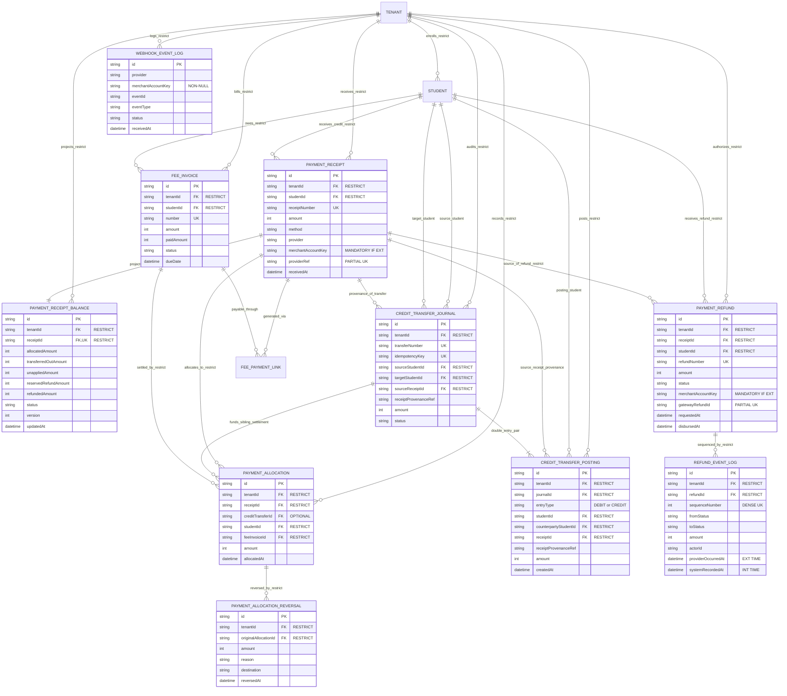
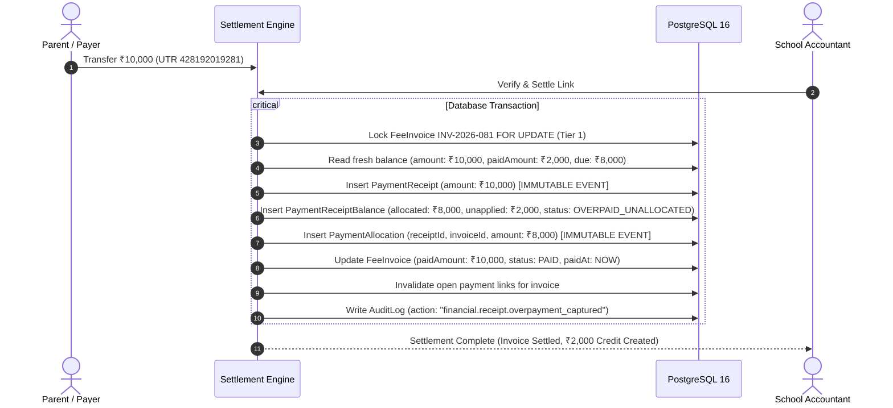
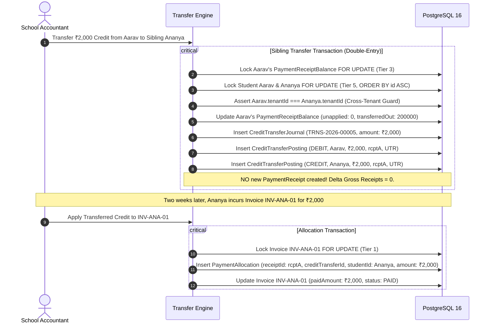
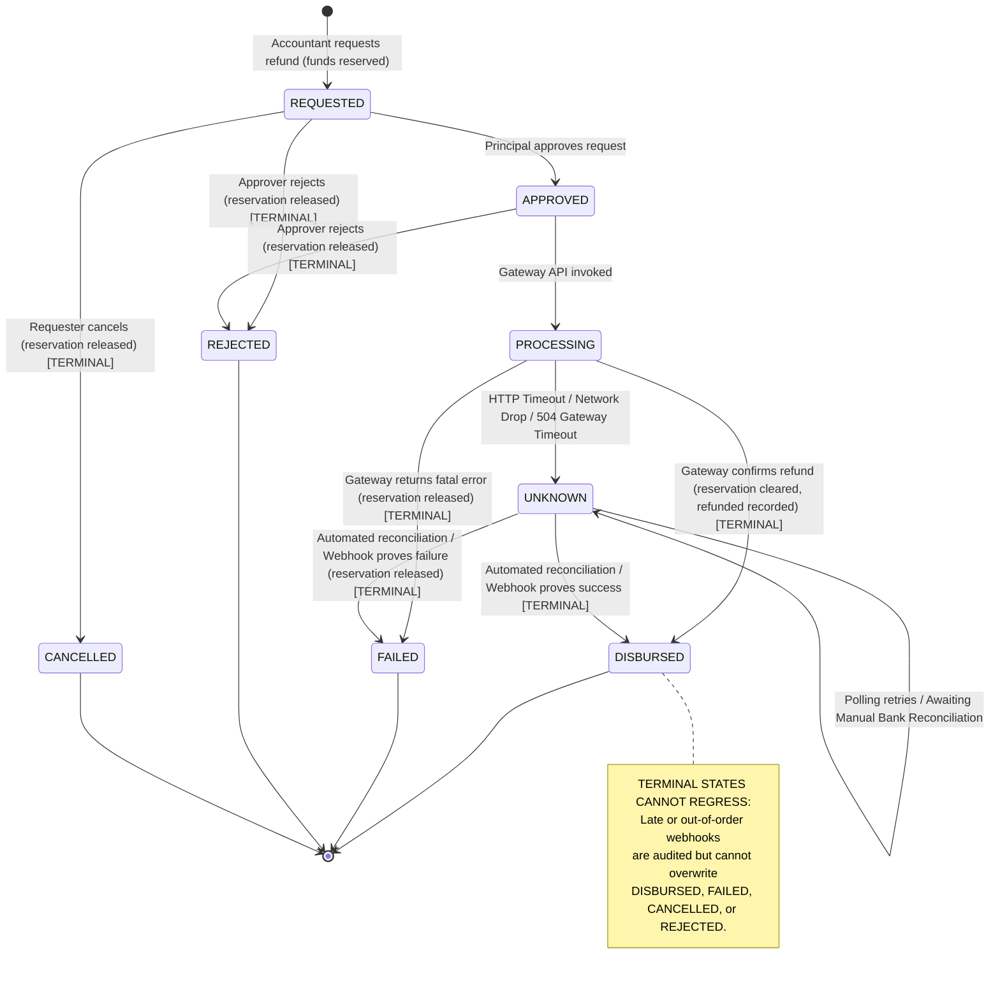
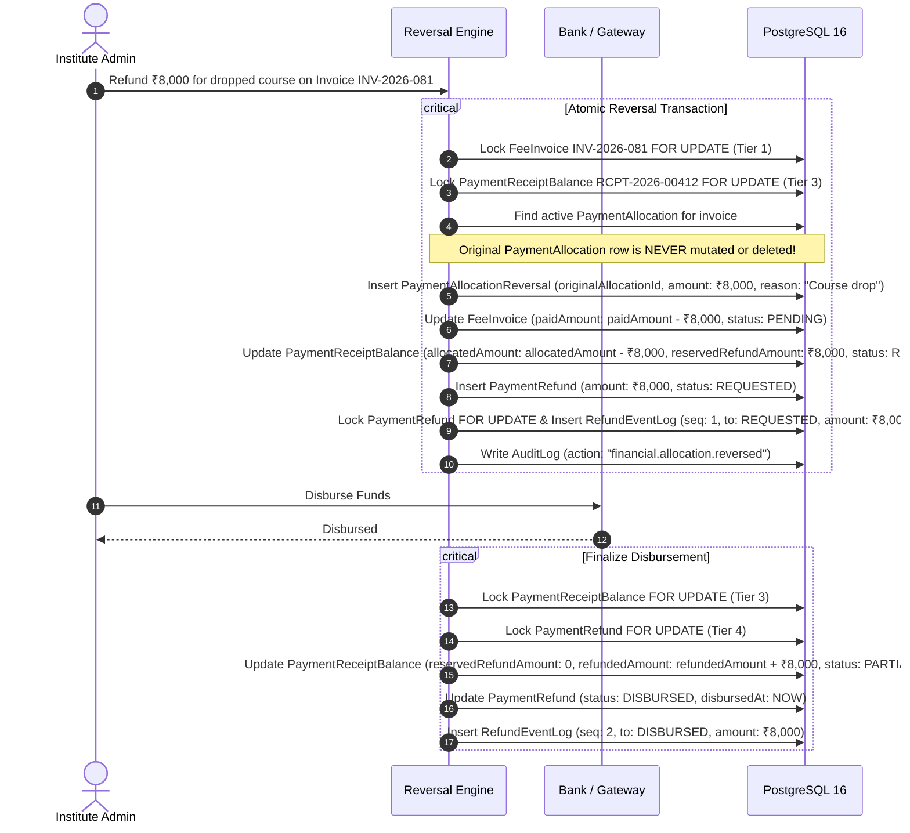
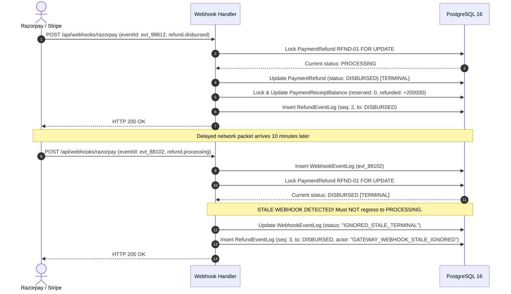
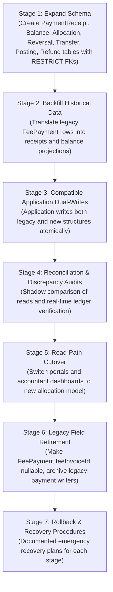
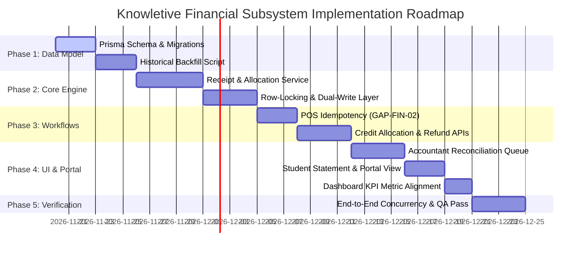

# Knowletive Architecture Design Document
# Document 32: Financial Ledger, Payment Allocation and Unapplied Credit Architecture

**Classification:** Architecture Specification & Technical Design  
**Repository:** `D:\IT\Saas`  
**Branch:** `staging/exam-stage-43`  
**Document Number:** 32  
**Document Version:** Revision 1.7 (Updated from Revision 1.6)  
**Date:** 2026-11-16  
**Target Subsystem:** Financial Operations, Invoicing, Payment Gateway Adapters & Student Account Statements  
**Related Findings:** `GAP-FIN-01` (Concurrency & Settlement Invariants), `GAP-FIN-02` (Cashier POS Idempotency), `GAP-SEC-02` (Payment Link Lifecycle & Late Capture)  
**Status:** PROPOSED TECHNICAL DESIGN (Design Task — No production execution in this pass)

---

## Document Revision History

| Revision | Date | Author / Context | Summary of Major Changes |
| :--- | :--- | :--- | :--- |
| **1.0** | 2026-11-16 | Platform Architecture Team | Initial proposal establishing decoupling of `PaymentReceipt` from `FeeInvoice`, introducing `PaymentAllocation`, `PaymentRefund`, and basic accounting invariants. |
| **1.1** | 2026-11-16 | Architecture Audit & Verification | Added preliminary credit ownership model, fund reservation, and draft SQL integrity queries. |
| **1.2** | 2026-11-16 | Task 8 Design Hardening | Multi-lock matrix, refund `UNKNOWN` state machine, provider idempotency scopes, and seven-stage migration. |
| **1.3** | 2026-11-16 | Task 9 Final Locking & Immutable History | Resolved `FeePaymentLink` / `PaymentReceipt` inversion; separated immutable allocations from append-only reversals (`PaymentAllocationReversal`). |
| **1.4** | 2026-11-16 | Task 10 Global Hierarchy & Balance Separation | Aligned Credit Transfer locking order; extracted `PaymentReceiptBalance` mutable projection from immutable `PaymentReceipt`. |
| **1.5** | 2026-11-16 | Task 11 Final Database Integrity Review | Audited foreign-key relationships to enforce `onDelete: Restrict`; defined soft-archival protocols; established initial partial unique indexes and authoritative refund replay. |
| **1.6** | 2026-11-16 | Task 12 Final Provider, Credit Transfer & Retention Review | Introduced `merchantAccountKey`; eliminated duplicate `PaymentReceipt` creation during sibling transfers; aligned statutory retention citations across Companies Act §128(5), CGST Act §36 / Rule 56(8), Income-tax Act 2025 §62 / Rule 46(8)-(9); introduced dense monotonic sequence numbering in `RefundEventLog`. |
| **1.7** | 2026-11-16 | Task 13 Final Financial Consistency Pass | **Mandatory Corrections:** (1) **Merchant Account Uniqueness**: Made `merchantAccountKey` strictly mandatory and non-null for all externally sourced payment references, refund references, and webhook events (`WebhookEventLog.merchantAccountKey` is non-null `String`); aligned PostgreSQL partial unique indexes (`uq_receipt_provider_account_ref`, `uq_refund_gateway_ref`, `uq_webhook_event_id`) and DB CHECK constraints for shared platform aggregator accounts (`PLATFORM_AGGREGATOR_MAIN`) vs tenant-owned BYO merchant accounts; (2) **Credit Transfer Double-Entry Accounting**: Expanded `CreditTransferJournal` to explicitly record two balanced, append-only postings (`CreditTransferPosting`: `DEBIT` source student, `CREDIT` destination student) linking both to original `PaymentReceipt` provenance without creating gross receipts ($\Delta \text{Gross Receipts} = 0$, $\sum \text{Debits} = \sum \text{Credits}$); established destination balance projection, cross-tenant isolation guards (`sourceStudent.tenantId === targetStudent.tenantId`), and idempotency duplicate rejection; (3) **Refund Sequence & Webhook Ordering**: Formalized atomic `sequenceNumber` allocation under parent `PaymentRefund` row locks (`SELECT ... FOR UPDATE`); explicitly decoupled `providerOccurredAt` (external gateway time), `systemRecordedAt` (internal commit time), and authoritative `sequenceNumber` (dense integer sequence); specified stale/out-of-order webhook protection ensuring delayed callbacks cannot regress terminal states (`DISBURSED`, `FAILED`, `CANCELLED`, `REJECTED`); established provider event deduplication via `(provider, merchantAccountKey, eventId)`. |

---

## Executive Summary

The Knowletive multi-tenant SaaS platform currently couples payment recording directly to a single invoice through `FeePayment.feeInvoiceId`. Under this legacy model, when funds enter the institute—whether through front-desk cash collection, bank transfer (NEFT/RTGS/IMPS), or an online gateway (Razorpay/Stripe)—the system attempts to record the entire incoming sum directly against a single `FeeInvoice`. 

While Task 2 (`GAP-FIN-01`), Task 4 (`GAP-SEC-02`), and Task 5 resolved race conditions, backend link expiration, and PostgreSQL CHECK constraints (`"paidAmount" <= "amount"`), they surfaced a fundamental architectural reality: **a payment receipt (cash inflow) is not conceptually identical to an invoice allocation (settlement of billed receivables)**. 

When a parent transfers ₹10,000 against an ₹8,000 invoice balance, recording ₹10,000 in `FeePayment.amount` while capping `FeeInvoice.paidAmount` at ₹8,000 and documenting the remaining ₹2,000 in unstructured strings (`notes`) and `AuditLog` records prevents silent fund truncation, but fails to provide a queryable, auditable accounting system. The excess ₹2,000 is invisible on student statements, cannot be automatically applied to future invoices, cannot be systematically refunded, and distorts reconciliation between gross collections and settled receivables.

This document specifies the technical architecture for a decoupled, double-entry-aligned **Financial Receipt, Allocation, and Unapplied Credit Subsystem** designed to eliminate these limitations prior to Prisma schema implementation.

---

## 1. Current Architecture & Codebase Audit

### 1.1 Existing Data Model Inspection

The platform's current financial schema in [prisma/schema.prisma](file:///D:/IT/Saas/prisma/schema.prisma#L699-L743) consists of three tightly coupled entities:

```prisma
model FeeInvoice {
  id          String    @id @default(cuid())
  tenantId    String
  studentId   String
  number      String
  title       String
  amount      Int       // Stored in paise (e.g., 1000000 = ₹10,000.00)
  paidAmount  Int       @default(0)
  currency    String    @default("INR")
  status      FeeStatus @default(PENDING) // PENDING, PARTIAL, PAID, OVERDUE, WAIVED
  dueDate     DateTime
  issuedAt    DateTime  @default(now())
  paidAt      DateTime?
  notes       String?
  createdAt   DateTime  @default(now())
  updatedAt   DateTime  @updatedAt

  tenant       Tenant           @relation(fields: [tenantId], references: [id], onDelete: Cascade)
  student      Student          @relation(fields: [studentId], references: [id], onDelete: Cascade)
  payments     FeePayment[]
  paymentLinks FeePaymentLink[]

  @@unique([tenantId, number])
  @@index([tenantId, status])
  @@index([tenantId, dueDate])
}

model FeePayment {
  id            String   @id @default(cuid())
  tenantId      String
  feeInvoiceId  String   // Mandatory 1:1 foreign key to FeeInvoice
  amount        Int      // Stored in paise
  method        String   @default("CASH") // CASH, UPI, CARD, BANK_TRANSFER, CHEQUE
  reference     String?
  provider      String?  // cashier, manual, razorpay, stripe
  providerRef   String?
  paidAt        DateTime @default(now())
  collectedById String?

  tenant     Tenant     @relation(fields: [tenantId], references: [id], onDelete: Cascade)
  feeInvoice FeeInvoice @relation(fields: [feeInvoiceId], references: [id], onDelete: Cascade)

  @@index([tenantId, paidAt])
  @@index([provider, providerRef])
}

model FeePaymentLink {
  id           String            @id @default(cuid())
  tenantId     String
  feeInvoiceId String
  token        String            @unique
  amount       Int
  currency     String            @default("INR")
  status       PaymentLinkStatus @default(OPEN) // OPEN, PAID, EXPIRED, CANCELED
  provider     String            @default("manual")
  providerRef  String?
  url          String?
  utrReference String?
  payerName    String?
  payerPhone   String?
  payerNotes   String?
  submittedAt  DateTime?
  expiresAt    DateTime
  paidAt       DateTime?
  createdAt    DateTime          @default(now())

  tenant     Tenant     @relation(fields: [tenantId], references: [id], onDelete: Cascade)
  feeInvoice FeeInvoice @relation(fields: [feeInvoiceId], references: [id], onDelete: Cascade)

  @@index([tenantId, status])
  @@index([feeInvoiceId])
  @@index([provider, providerRef])
  @@index([tenantId, submittedAt])
}
```

### 1.2 Inventory of Existing Calculations & Queries

A comprehensive scan of application workspaces reveals how financial figures are computed across the platform:

1. **Accountant Fees Workspace (`src/app/(app)/app/fees/page.tsx`):**
   - **Billed Total:** `db.feeInvoice.aggregate({ where: { tenantId, status: { not: "WAIVED" } }, _sum: { amount: true } })`
   - **Collected Total:** `db.feeInvoice.aggregate({ where: { tenantId, status: { not: "WAIVED" } }, _sum: { paidAmount: true } })`
   - **Monthly Collections KPI:** `db.feePayment.aggregate({ where: { tenantId, paidAt: { gte: startOfMonth } }, _sum: { amount: true } })`
   - **Outstanding Balance:** `Math.max(0, billedTotal - collectedTotal)`
2. **Institute Overview Dashboard (`src/app/(app)/app/page.tsx`):**
   - **Monthly Collection KPI:** `db.feePayment.aggregate({ where: { tenantId, paidAt: { gte: monthStart } }, _sum: { amount: true } })`
   - **Fee Receivables:** `db.feeInvoice.findMany({ where: { status: { in: ["PENDING", "PARTIAL", "OVERDUE"] } }, select: { amount: true, paidAmount: true } })`
3. **Student Profile Statement (`src/app/(app)/app/students/[id]/page.tsx`):**
   - **Billed:** `student.feeInvoices.filter(i => i.status !== "WAIVED").reduce((sum, i) => sum + i.amount, 0)`
   - **Paid:** `student.feeInvoices.filter(i => i.status !== "WAIVED").reduce((sum, i) => sum + i.paidAmount, 0)`
   - **Outstanding Due:** `totalBilled - totalPaid`
4. **Parent & Student Portal (`src/app/(portal)/portal/page.tsx`):**
   - **Total Due Banner:** `invoices.filter(i => i.status !== "PAID" && i.status !== "WAIVED").reduce((sum, i) => sum + (i.amount - i.paidAmount), 0)`
5. **Cashier Point of Sale (`src/actions/operations.ts:recordFeePaymentAction`):**
   - Checks `amount > (invoice.amount - invoice.paidAmount)`. Rejects cash collections exceeding current invoice outstanding balance.
6. **Payment Link Settlement (`src/lib/payments.ts:settleFeePaymentLink`):**
   - In Task 5: If `requestedAmount > outstanding`, records `FeePayment` with `amount = requestedAmount`, sets `FeeInvoice.paidAmount = invoice.amount`, and notes `overpaymentAmount` in text fields and `AuditLog`.

---

## 2. Identified Accounting Limitations

| Ref | Limitation | Root Cause | Impact |
| :--- | :--- | :--- | :--- |
| **LIM-01** | **Conflation of Receipts and Allocations** | `FeePayment` combines money receipt with invoice settlement in a single row. | Cannot accept unallocated deposits, advances, or payments covering multiple invoices. |
| **LIM-02** | **Conflation of Student and Payer Identity** | The data model assumes the student is the sole financial entity; payer identity is treated as an optional text string. | Cross-sibling payments, trust sponsorships, and third-party refunds cannot identify legal funds ownership. |
| **LIM-03** | **Rigid 1:1 Foreign Key Dependency** | `FeePayment.feeInvoiceId` is non-nullable. | A payment cannot exist without an invoice. Multi-invoice settlement requires artificial multi-transaction splitting. |
| **LIM-04** | **Unapplied Credit Invisibility** | Excess funds are stored in `invoice.notes`, `link.payerNotes`, and `AuditLog`. | Student account statements, parent portal, and balance summaries show ₹0 available credit. Future invoices cannot query or draw against credit. |
| **LIM-05** | **Dashboard Reconciliation Discrepancy** | `fees/page.tsx` aggregates `feePayment._sum.amount` for monthly KPI, but `feeInvoice._sum.paidAmount` for total collected. | When overpayments occur, monthly collections exceed invoice collections by the unapplied amount, creating an unexplained discrepancy on financial dashboards. |
| **LIM-06** | **Absence of Refund & Reversal Ledgers** | The database has no entity representing refund requests, approvals, or disbursements. | Refunding a student requires deleting `FeePayment` records (violating immutability) or manually mutating `paidAmount` downwards (corrupting audit trails). |
| **LIM-07** | **Late External Capture Vulnerability** | When external checkout completes after a link is canceled locally, settlement returns `null`. | The captured payment is logged in `AuditLog` but exists as an unmanaged liability outside the queryable financial ledger. |
| **LIM-08** | **Cashier POS Idempotency Vulnerability (`GAP-FIN-02`)** | `recordFeePaymentAction` lacks a client idempotency key check. | Front-desk cashier double-clicks or mobile network retries during partial payments can record two identical cash payments. |

---

## 3. Proposed Relational Data Model

### 3.1 Architectural Decomposition: The Three-Layer System

To strictly separate permanent accounting history from mutable operational state, the subsystem decomposes into three distinct architectural tiers:

1. **Layer 1: Immutable Financial Events (Append-Only Ledger)**
   - Rows in this layer record permanent, tamper-evident historical facts. `UPDATE` and `DELETE` queries are strictly prohibited.
   - Foreign-key relationships use `onDelete: Restrict` so parent records cannot be deleted out from under financial history.
   - Entities: `PaymentReceipt` (money capture event), `PaymentAllocation` (invoice settlement event), `PaymentAllocationReversal` (allocation reversal event), `CreditTransferJournal` (transfer header/audit), `CreditTransferPosting` (double-entry balanced debit/credit postings), `RefundEventLog` (authoritative refund state transition history), `WebhookEventLog` (raw gateway event payloads).
2. **Layer 2: Mutable Workflow Records (Operational State Machines)**
   - Entities managing operational lifecycles, approval workflows, and gateway coordination.
   - Entities: `PaymentRefund` (approval/disbursement workflow), `FeePaymentLink` (link lifecycle), `FeeInvoice` (billing lifecycle).
3. **Layer 3: Mutable Balance Projections & Summary Caches (Performance Indexes)**
   - Entities holding denormalized numeric counter fields maintained inside transaction boundaries to satisfy high-frequency dashboard queries and database CHECK constraints:
   - Entities: `PaymentReceiptBalance` (1:1 projection for each `PaymentReceipt`), `FeeInvoice.paidAmount` (denormalized invoice settlement counter).

```
       ┌────────────────────────────────────────────────────────┐
       │     Layer 1: Immutable Financial Events (Append-Only)  │
       │  PaymentReceipt, Allocations, Reversals, Postings, Logs│
       └───────────────────────────┬────────────────────────────┘
                                   │ drives
                                   ▼
       ┌────────────────────────────────────────────────────────┐
       │     Layer 2: Mutable Workflow Records (State Machines) │
       │      FeeInvoice, FeePaymentLink, PaymentRefund         │
       └───────────────────────────┬────────────────────────────┘
                                   │ computes
                                   ▼
       ┌────────────────────────────────────────────────────────┐
       │     Layer 3: Mutable Balance Projections & Caches      │
       │    PaymentReceiptBalance, FeeInvoice.paidAmount        │
       └────────────────────────────────────────────────────────┘
```

---

### 3.2 Proposed Prisma Schema with Strict Referential Integrity

```prisma
// ─────────────────────────────── Financial Ledger ───────────────────────────────

enum PaymentReceiptStatus {
  CAPTURED             // Funds successfully received in bank / cash drawer
  PARTIALLY_ALLOCATED  // Part of the receipt applied to one or more invoices
  FULLY_ALLOCATED      // Entire receipt applied to invoices
  OVERPAID_UNALLOCATED // Receipt contains unapplied customer credit balance
  REFUND_PENDING       // Refund requested or approved, funds reserved
  PARTIALLY_REFUNDED   // Partial refund disbursed to payer
  REFUNDED             // Entire receipt or unapplied balance refunded
  DISPUTED             // Chargeback or bank dispute active
  VOIDED               // Bounced cheque or cashier administrative void
}

enum RefundStatus {
  REQUESTED            // Refund request initiated by accountant (funds reserved)
  APPROVED             // Approved by principal / institute admin (funds reserved)
  PROCESSING           // Dispatched to external gateway / banking network (funds reserved)
  DISBURSED            // Gateway confirmed fund return to customer (reservation cleared, refunded recorded) [TERMINAL]
  FAILED               // Terminal gateway failure (funds safely un-reserved back to credit) [TERMINAL]
  REJECTED             // Request formally rejected by approver (funds released back to credit) [TERMINAL]
  CANCELLED            // Request cancelled prior to dispatch (funds released back to credit) [TERMINAL]
  UNKNOWN              // Gateway timed out or returned ambiguous state (FUNDS REMAIN RESERVED PENDING RECONCILIATION)
}

enum CreditTransferStatus {
  PENDING_APPROVAL     // Cross-sibling transfer initiated, awaiting review
  COMPLETED            // Compensating debits and credits posted
  REJECTED             // Transfer rejected
}

enum TransferPostingType {
  DEBIT                // Decrements source student's available credit
  CREDIT               // Credits destination student's available credit
}

// ── LAYER 1: IMMUTABLE FINANCIAL EVENTS (APPEND-ONLY) ──

model PaymentReceipt {
  id                 String   @id @default(cuid())
  tenantId           String
  studentId          String   // Primary student beneficiary at time of receipt
  receiptNumber      String   // Human-readable, e.g. "RCPT-2026-00142"
  amount             Int      // Gross money received in paise (IMMUTABLE EVENT)
  currency           String   @default("INR")
  method             String   // CASH, UPI, CARD, BANK_TRANSFER, CHEQUE
  reference          String?  // Bank UTR, Cheque No, or Gateway Payment Intent ID
  provider           String   @default("manual") // cashier, manual, razorpay, stripe
  merchantAccountKey String?  // External merchant/aggregator account key (MANDATORY for external providers)
  providerRef        String?  // External gateway transaction reference ID (Nullable: cashier cash has null)
  idempotencyKey     String?  // Client-supplied idempotency key (GAP-FIN-02)
  payloadHash        String?  // SHA-256 fingerprint of request parameters
  payerName          String?
  payerPhone         String?
  payerEmail         String?
  payerRelationship  String?  // FATHER, MOTHER, GUARDIAN, SPONSOR, SELF
  payerNotes         String?
  receivedAt         DateTime @default(now())
  createdById        String?
  createdAt          DateTime @default(now())

  // Foreign keys use RESTRICT to prevent financial history deletion
  tenant          Tenant                  @relation(fields: [tenantId], references: [id], onDelete: Restrict)
  student         Student                 @relation(fields: [studentId], references: [id], onDelete: Restrict)
  balance         PaymentReceiptBalance?  // 1:1 mutable projection
  allocations     PaymentAllocation[]
  refunds         PaymentRefund[]
  paymentLinks    FeePaymentLink[]
  creditTransfers CreditTransferJournal[]
  creditPostings  CreditTransferPosting[]

  @@unique([tenantId, receiptNumber])
  @@index([tenantId, studentId])
  @@index([tenantId, receivedAt])
}

model PaymentAllocation {
  id               String   @id @default(cuid())
  tenantId         String
  receiptId        String   // Provenance: references original gross PaymentReceipt
  creditTransferId String?  // Optional: references CreditTransferJournal if funded via sibling transfer
  studentId        String   // Student whose bill is being settled
  feeInvoiceId     String   // Invoice settled
  amount           Int      // Amount applied to invoice in paise (IMMUTABLE EVENT)
  allocatedAt      DateTime @default(now())
  allocatedById    String?
  createdAt        DateTime @default(now())

  tenant         Tenant                      @relation(fields: [tenantId], references: [id], onDelete: Restrict)
  receipt        PaymentReceipt              @relation(fields: [receiptId], references: [id], onDelete: Restrict)
  creditTransfer CreditTransferJournal?      @relation(fields: [creditTransferId], references: [id], onDelete: Restrict)
  feeInvoice     FeeInvoice                  @relation(fields: [feeInvoiceId], references: [id], onDelete: Restrict)
  reversals      PaymentAllocationReversal[]

  @@index([tenantId, receiptId])
  @@index([tenantId, feeInvoiceId])
  @@index([tenantId, studentId])
  @@index([feeInvoiceId, allocatedAt])
}

model PaymentAllocationReversal {
  id                   String   @id @default(cuid())
  tenantId             String
  originalAllocationId String   // References immutable original allocation
  amount               Int      // In paise (must be <= originalAllocation.amount)
  reason               String   // "Course drop", "Retroactive waiver", "Dispute"
  destination          String   @default("UNAPPLIED_CREDIT") // UNAPPLIED_CREDIT or REFUND_RESERVATION
  reversedAt           DateTime @default(now())
  reversedById         String?

  tenant             Tenant            @relation(fields: [tenantId], references: [id], onDelete: Restrict)
  originalAllocation PaymentAllocation @relation(fields: [originalAllocationId], references: [id], onDelete: Restrict)

  @@index([tenantId, originalAllocationId])
  @@index([originalAllocationId])
}

model CreditTransferJournal {
  id                   String                  @id @default(cuid())
  tenantId             String
  transferNumber       String                  // e.g. "TRNS-2026-00005"
  idempotencyKey       String?                 // Client idempotency token for transfer
  sourceStudentId      String                  // Source student debited
  targetStudentId      String                  // Destination student credited
  sourceReceiptId      String                  // Provenance: links to original physical PaymentReceipt
  receiptProvenanceRef String?                 // External bank UTR / Gateway Payment Intent ID
  amount               Int                     // Transferred paise (NO new PaymentReceipt created)
  reason               String                  // "Cross-sibling fee adjustment"
  status               CreditTransferStatus    @default(COMPLETED)
  authorizedGuardianId String?                 // Verified guardian linking both siblings
  guardianConsentRef   String?                 // Signed consent form asset ID or SMS OTP reference
  requestedById        String
  approvedById         String?
  executedAt           DateTime?
  createdAt            DateTime                @default(now())

  tenant        Tenant                  @relation(fields: [tenantId], references: [id], onDelete: Restrict)
  sourceStudent Student                 @relation("SourceTransfers", fields: [sourceStudentId], references: [id], onDelete: Restrict)
  targetStudent Student                 @relation("TargetTransfers", fields: [targetStudentId], references: [id], onDelete: Restrict)
  sourceReceipt PaymentReceipt          @relation(fields: [sourceReceiptId], references: [id], onDelete: Restrict)
  postings      CreditTransferPosting[] // Exactly two balanced postings per transfer (1 DEBIT, 1 CREDIT)
  allocations   PaymentAllocation[]

  @@unique([tenantId, transferNumber])
  @@unique([tenantId, idempotencyKey])
  @@index([tenantId, sourceStudentId])
  @@index([tenantId, targetStudentId])
  @@index([tenantId, sourceReceiptId])
}

model CreditTransferPosting {
  id                    String              @id @default(cuid())
  tenantId              String
  journalId             String              // Transfer ID / Journal header FK
  entryType             TransferPostingType // DEBIT or CREDIT
  studentId             String              // Student beneficiary of this posting (source for DEBIT, target for CREDIT)
  counterpartyStudentId String              // Opposite sibling student ID
  receiptId             String              // Provenance: links to original gross PaymentReceipt
  receiptProvenanceRef  String?             // Bank UTR or Gateway Payment Intent ID of original receipt
  amount                Int                 // Amount in paise
  createdAt             DateTime            @default(now())
  createdById           String?

  tenant              Tenant                @relation(fields: [tenantId], references: [id], onDelete: Restrict)
  journal             CreditTransferJournal @relation(fields: [journalId], references: [id], onDelete: Restrict)
  student             Student               @relation(fields: [studentId], references: [id], onDelete: Restrict)
  counterpartyStudent Student               @relation("PostingCounterparties", fields: [counterpartyStudentId], references: [id], onDelete: Restrict)
  receipt             PaymentReceipt        @relation(fields: [receiptId], references: [id], onDelete: Restrict)

  @@index([tenantId, journalId])
  @@index([tenantId, studentId])
  @@index([tenantId, receiptId])
}

model RefundEventLog {
  id                 String        @id @default(cuid())
  tenantId           String
  refundId           String
  sequenceNumber     Int           // Dense monotonic sequence per refund (1, 2, 3...) allocated under row lock
  fromStatus         RefundStatus?
  toStatus           RefundStatus  // Authoritative event outcome
  amount             Int           // Paise associated with this event
  actorId            String        // User ID, "SYSTEM_WEBHOOK", or "CRON_RECONCILER"
  gatewayPayload     String?       // Raw gateway request/response JSON
  gatewayCode        String?       // HTTP code or provider error code (e.g. "504", "insufficient_balance")
  idempotencyRef     String?       // Gateway refund idempotency key
  providerOccurredAt DateTime?     // External gateway event occurrence timestamp
  systemRecordedAt   DateTime      @default(now()) // Internal server transaction commit timestamp

  tenant Tenant        @relation(fields: [tenantId], references: [id], onDelete: Restrict)
  refund PaymentRefund @relation(fields: [refundId], references: [id], onDelete: Restrict)

  @@unique([refundId, sequenceNumber]) // Absolute database-enforced replay sequence per refund
  @@index([tenantId, systemRecordedAt])
}

model WebhookEventLog {
  id                 String    @id @default(cuid())
  provider           String    // "razorpay", "stripe"
  merchantAccountKey String    // MANDATORY: External merchant account receiving the webhook (e.g. "PLATFORM_AGGREGATOR_MAIN")
  eventId            String    // Gateway event ID
  eventType          String    // "payment.captured", "refund.processed"
  payload            String    // Raw JSON string
  status             String    // "PROCESSED", "IGNORED_STALE_TERMINAL", "FAILED", "PENDING_DEPENDENCY"
  receiptId          String?
  processingNote     String?
  receivedAt         DateTime  @default(now())

  @@unique([provider, merchantAccountKey, eventId]) // Global deduplication per external merchant account
  @@index([provider, eventType])
  @@index([receivedAt])
}

// ── LAYER 2: MUTABLE WORKFLOW RECORDS ──

model PaymentRefund {
  id                   String       @id @default(cuid())
  tenantId             String
  receiptId            String
  studentId            String       // Beneficiary student
  refundNumber         String       // e.g. "RFND-2026-00012"
  amount               Int          // Amount refunded in paise
  reason               String
  method               String       // CASH, BANK_TRANSFER, GATEWAY_ORIGINAL
  status               RefundStatus @default(REQUESTED) // Operational workflow status
  destinationAccount   String?      // Masked account / VPA (e.g. "****4921" or "parent@okhdfc")
  merchantAccountKey   String?      // External merchant account where refund executed (MANDATORY for gateway refunds)
  gatewayRefundId      String?      // External refund ID
  providerReconciledAt DateTime?    // Populated when UNKNOWN status is resolved via reconciliation
  failureReason        String?
  requestedById        String
  requestedAt          DateTime     @default(now())
  approvedById         String?
  approvedAt           DateTime?
  disbursedById        String?
  disbursedAt          DateTime?
  createdAt            DateTime     @default(now())
  updatedAt            DateTime     @updatedAt

  tenant    Tenant           @relation(fields: [tenantId], references: [id], onDelete: Restrict)
  receipt   PaymentReceipt   @relation(fields: [receiptId], references: [id], onDelete: Restrict)
  student   Student          @relation(fields: [studentId], references: [id], onDelete: Restrict)
  eventLogs RefundEventLog[]

  @@unique([tenantId, refundNumber])
  @@index([tenantId, receiptId])
  @@index([tenantId, studentId])
  @@index([tenantId, status])
}

// ── LAYER 3: MUTABLE BALANCE PROJECTIONS & SUMMARY CACHES ──

model PaymentReceiptBalance {
  id                   String               @id @default(cuid())
  tenantId             String
  receiptId            String               @unique // 1:1 foreign key to immutable PaymentReceipt
  allocatedAmount      Int                  @default(0) // Active allocations on student bills
  transferredOutAmount Int                  @default(0) // Transferred to siblings via CreditTransferJournal DEBIT postings
  unappliedAmount      Int                  @default(0) // Available customer credit in paise
  reservedRefundAmount Int                  @default(0) // Funds reserved for pending refunds
  refundedAmount       Int                  @default(0) // Disbursed refunds in paise
  status               PaymentReceiptStatus @default(CAPTURED)
  version              Int                  @default(1) // Optimistic concurrency / update version counter
  lastRebalancedAt     DateTime             @default(now())
  updatedAt            DateTime             @updatedAt

  tenant  Tenant         @relation(fields: [tenantId], references: [id], onDelete: Restrict)
  receipt PaymentReceipt @relation(fields: [receiptId], references: [id], onDelete: Restrict)

  @@index([tenantId, status])
  @@index([tenantId, unappliedAmount])
}
```

---

### 3.3 Statutory Record Retention Matrix & Legal Requirements

| Legal & Regulatory Authority | Covered Record Categories | Applicable Entity Scope | Statutory Retention Horizon | Statutory Extension Conditions | Core Technical Mandate |
| :--- | :--- | :--- | :--- | :--- | :--- |
| **Companies Act, 2013**<br>*(Section 128(5))* | Books of account, financial ledgers, vouchers, registers, cash books, invoices. | Institutes incorporated as Companies (e.g. Section 8 non-profits, Pvt Ltd ed-techs). | **8 financial years** immediately preceding the current year (or all years if incorporated $< 8$ yrs). | Extended indefinitely if an investigation has been ordered by Central Government under Chapter XIV. | Physical or electronic records must remain complete, legible, and verifiable. |
| **CGST Act, 2017**<br>*(Section 36)* | Tax invoices, credit notes, payment vouchers, output/input tax registers, electronic ledger extracts. | GST-registered educational institutions and commercial auxiliary service entities. | **72 months (6 years)** from due date of furnishing annual return for relevant year. | If party to an appeal, revision, or proceeding before Tribunal/Court, or under investigation: **1 year after final disposal or 72 months, whichever is later**. | Preservation of full taxable transaction provenance and billing history. |
| **CGST Rules, 2017**<br>*(Rule 56(8))* | Electronic books of account, audit trails, system edit/delete logs. | All registered persons maintaining electronic records. | Continuous operational requirement. | N/A — Governs data integrity, not retention duration. | **Audit Trail Integrity Mandate:** Mandates electronic edit/delete logs proving records have not been altered or purged without tamper-evident logging. Satisfied via append-only tables. |
| **Income-tax Act, 2025 & Income-tax Rules, 2026**<br>*(Section 62 & Rule 46(9))* | Books of account, fee receipts, payment links, bank transaction extracts, vouchers. | All taxable and exempt educational trusts, societies, and corporate entities. | **7 tax years** from the end of the relevant tax year. | Mandatory extension if assessment/reassessment is reopened under the Act until final disposal. | Transition provisions maintain applicability of repealed Income-tax Act 1961 (§44AA / Rule 6F) for earlier tax years. |
| **Income-tax Rules, 2026**<br>*(Rule 46(8))* | All electronic books of account and digital transaction archives. | All entities maintaining electronic accounts under the Act. | Continuous operational requirement. | N/A | **India Sovereignty & Daily Backup Mandate:** Electronic records must remain accessible in India at all times and be **backed up daily on servers physically located in India**. |

#### Proposed Product Policy vs Statutory Disclaimer
Because statutory periods vary across frameworks (72 months under GST; 7 tax years under Income-tax Rule 46(9); 8 financial years under Companies Act §128(5); extended during legal proceedings), Knowletive adopts a **conservative proposed baseline product retention policy of 8 financial years** (or until the resolution of any flagged tax disputes).
> [!IMPORTANT]
> **Legal Notice:** This 8-year product retention baseline is an operational platform safety rule, **NOT universal statutory advice**. Educational institutions operate under diverse legal forms (Public Trusts, Societies under Societies Registration Act 1860, Section 8 non-profit companies, or for-profit entities). Every tenant institute must submit their data retention and purge policies to **independent legal and tax-professional review** prior to production deployment.

---

### 3.4 Deterministic Balance Projection Rebuild Procedure

`PaymentReceiptBalance` is deterministically rebuilt from Layer 1 immutable events, utilizing the authoritative, sequentially ordered `RefundEventLog`:

```typescript
export async function rebuildPaymentReceiptBalance(
  tx: Prisma.TransactionClient,
  receiptId: string,
  tenantId: string
): Promise<void> {
  // 1. Fetch immutable receipt gross amount
  const receipt = await tx.paymentReceipt.findUniqueOrThrow({
    where: { id: receiptId },
    select: { amount: true },
  });

  // 2. Aggregate active allocations (Allocations minus Reversals)
  const allocAgg = await tx.paymentAllocation.aggregate({
    where: { receiptId, tenantId },
    _sum: { amount: true },
  });
  const totalAllocatedRaw = allocAgg._sum.amount ?? 0;

  const reversalAgg = await tx.$queryRaw<{ totalReversed: bigint }[]>`
    SELECT COALESCE(SUM(r.amount), 0) AS "totalReversed"
    FROM "PaymentAllocationReversal" r
    JOIN "PaymentAllocation" a ON a.id = r."originalAllocationId"
    WHERE a."receiptId" = ${receiptId} AND r."tenantId" = ${tenantId}
  `;
  const totalReversed = Number(reversalAgg[0]?.totalReversed ?? 0n);
  const activeAllocated = Math.max(0, totalAllocatedRaw - totalReversed);

  // 3. Aggregate sibling credit transfers out via balanced DEBIT postings
  const debitAgg = await tx.creditTransferPosting.aggregate({
    where: { receiptId, tenantId, entryType: "DEBIT" },
    _sum: { amount: true },
  });
  const transferredOutAmount = debitAgg._sum.amount ?? 0;

  // 4. Authoritative Refund State derived strictly from RefundEventLog sequence
  const refundEvents = await tx.$queryRaw<{ refundId: string; latestStatus: RefundStatus; amount: number }[]>`
    SELECT DISTINCT ON (e."refundId")
      e."refundId",
      e."toStatus" AS "latestStatus",
      r.amount
    FROM "RefundEventLog" e
    JOIN "PaymentRefund" r ON r.id = e."refundId"
    WHERE r."receiptId" = ${receiptId} AND e."tenantId" = ${tenantId}
    ORDER BY e."refundId", e."sequenceNumber" DESC
  `;

  let refundedAmount = 0;
  let reservedRefundAmount = 0;

  for (const event of refundEvents) {
    if (event.latestStatus === "DISBURSED") {
      refundedAmount += event.amount;
    } else if (["REQUESTED", "APPROVED", "PROCESSING", "UNKNOWN"].includes(event.latestStatus)) {
      reservedRefundAmount += event.amount;
    }
  }

  // 5. Calculate unapplied customer credit strictly via conservation
  const unappliedAmount = receipt.amount - (activeAllocated + transferredOutAmount + reservedRefundAmount + refundedAmount);
  if (unappliedAmount < 0) {
    throw new Error(`Integrity violation: Negative unapplied balance on receipt ${receiptId}`);
  }

  // 6. Derive projection status
  let status: PaymentReceiptStatus = "CAPTURED";
  if (refundedAmount === receipt.amount) {
    status = "REFUNDED";
  } else if (refundedAmount > 0) {
    status = "PARTIALLY_REFUNDED";
  } else if (reservedRefundAmount > 0) {
    status = "REFUND_PENDING";
  } else if (activeAllocated + transferredOutAmount === receipt.amount) {
    status = "FULLY_ALLOCATED";
  } else if (activeAllocated + transferredOutAmount > 0 && unappliedAmount > 0) {
    status = "PARTIALLY_ALLOCATED";
  } else if (unappliedAmount > 0) {
    status = "OVERPAID_UNALLOCATED";
  }

  // 7. Update mutable projection record atomically
  await tx.paymentReceiptBalance.upsert({
    where: { receiptId },
    create: {
      tenantId,
      receiptId,
      allocatedAmount: activeAllocated,
      transferredOutAmount,
      unappliedAmount,
      reservedRefundAmount,
      refundedAmount,
      status,
      version: 1,
      lastRebalancedAt: new Date(),
    },
    update: {
      allocatedAmount: activeAllocated,
      transferredOutAmount,
      unappliedAmount,
      reservedRefundAmount,
      refundedAmount,
      status,
      version: { increment: 1 },
      lastRebalancedAt: new Date(),
    },
  });
}
```

---

## 4. Entity-Relationship Diagram



---

## 5. Financial Conservation Invariant & Authoritative Ledger Design

### 5.1 The Seven Conserved Balances Defined

Every rupee received by the platform exists in exactly one of several mutually exclusive, conserved accounting states:

1. **Gross Receipt ($\text{amount}$):** Total captured monetary inflow acknowledged on the immutable `PaymentReceipt`. Counted strictly once.
2. **Active Allocations ($\text{allocatedAmount}$):** Portion of the receipt currently applied to valid `FeeInvoice` records:
   $$\text{allocatedAmount} = \sum_{a \in \text{Allocations}} a.\text{amount} - \sum_{r \in \text{Reversals}} r.\text{amount}$$
3. **Transferred-Out Credit ($\text{transferredOutAmount}$):** Funds transferred to a sibling student via `CreditTransferJournal` DEBIT postings. Sibling transfers **never create new receipts**, avoiding artificial inflation of collections ($\Delta \text{Gross Receipts} = 0$).
4. **Reversed Allocations ($\text{reversedAllocations}$):** Sum of immutable reversal events recorded in `PaymentAllocationReversal`.
5. **Available Unapplied Credit ($\text{unappliedAmount}$):** Customer credit currently unencumbered and available to be allocated against subsequent bills or requested for refund.
6. **Reserved Refunds ($\text{reservedRefundAmount}$):** Credit explicitly earmarked and locked by an in-flight refund workflow whose authoritative `RefundEventLog` status is $\in$ {`REQUESTED`, `APPROVED`, `PROCESSING`, `UNKNOWN`}.
7. **Completed / Disbursed Refunds ($\text{refundedAmount}$):** Total capital physically returned to the customer whose authoritative `RefundEventLog` status is `DISBURSED`.

---

### 5.2 Mathematical Conservation Invariants & Double-Entry Proofs

#### Invariant 1: Single-Receipt Conservation
For every receipt and its associated balance projection at any snapshot in time:
$$\mathbf{PaymentReceipt.amount} = \mathbf{allocatedAmount} + \mathbf{transferredOutAmount} + \mathbf{unappliedAmount} + \mathbf{reservedRefundAmount} + \mathbf{refundedAmount}$$
Where all components on `PaymentReceiptBalance` are strictly non-negative integers:
$$\text{allocatedAmount} \ge 0, \quad \text{transferredOutAmount} \ge 0, \quad \text{unappliedAmount} \ge 0, \quad \text{reservedRefundAmount} \ge 0, \quad \text{refundedAmount} \ge 0$$

#### Invariant 2: Invoice Settlement Conservation
For every `FeeInvoice`:
$$\mathbf{paidAmount} = \sum_{\substack{a \in \text{Allocations} \\ a.\text{feeInvoiceId} = \text{invoice.id}}} a.\text{amount} - \sum_{\substack{r \in \text{Reversals} \\ r.\text{originalAllocation.feeInvoiceId} = \text{invoice.id}}} r.\text{amount} \le \text{amount}$$

#### Invariant 3: Double-Entry Credit Transfer Equality & Gross Receipts Invariance
For every `CreditTransferJournal` transaction $J$:
$$\sum_{p \in J.\text{postings}} [p.\text{entryType} = \text{DEBIT} \cdot p.\text{amount}] = \sum_{p \in J.\text{postings}} [p.\text{entryType} = \text{CREDIT} \cdot p.\text{amount}] = J.\text{amount}$$
$$\text{Net Institute Liability Change} = -\sum \text{Debits} + \sum \text{Credits} = 0$$
$$\Delta \mathbf{Gross\ Receipts} = \Delta \sum \mathbf{PaymentReceipt.amount} = 0$$

*Proof of Invariance:*  
Because an internal credit transfer is strictly modeled through paired `CreditTransferPosting` rows in Layer 1 and balance counter shifts in Layer 3 without inserting a new `PaymentReceipt`, the set of `PaymentReceipt` records is unmodified ($\Delta N = 0$, $\Delta \text{amount} = 0$). Therefore, school bank reconciliations, tax returns, and gross receipts metrics are mathematically immune to artificial internal inflation.

---

### 5.3 Diagnostic SQL Reconciliation Queries

#### Audit Query 1: Single-Receipt Conservation Discrepancy
```sql
SELECT 
    r.id AS receipt_id, r.tenant_id, r.receipt_number, r.amount AS gross_amount,
    b.allocated_amount, b.transferred_out_amount, b.unapplied_amount, b.reserved_refund_amount, b.refunded_amount,
    (r.amount - (b.allocated_amount + b.transferred_out_amount + b.unapplied_amount + b.reserved_refund_amount + b.refunded_amount)) AS discrepancy_paise
FROM "PaymentReceipt" r
JOIN "PaymentReceiptBalance" b ON b.receipt_id = r.id
WHERE r.amount != (b.allocated_amount + b.transferred_out_amount + b.unapplied_amount + b.reserved_refund_amount + b.refunded_amount);
```

#### Audit Query 2: Double-Entry Credit Transfer Balance Verification
```sql
SELECT 
    j.id AS journal_id,
    j.tenant_id,
    j.transfer_number,
    j.amount AS journal_amount,
    COALESCE(SUM(CASE WHEN p.entry_type = 'DEBIT' THEN p.amount ELSE 0 END), 0) AS total_debits,
    COALESCE(SUM(CASE WHEN p.entry_type = 'CREDIT' THEN p.amount ELSE 0 END), 0) AS total_credits,
    (COALESCE(SUM(CASE WHEN p.entry_type = 'DEBIT' THEN p.amount ELSE 0 END), 0) - 
     COALESCE(SUM(CASE WHEN p.entry_type = 'CREDIT' THEN p.amount ELSE 0 END), 0)) AS posting_discrepancy
FROM "CreditTransferJournal" j
LEFT JOIN "CreditTransferPosting" p ON p.journal_id = j.id
GROUP BY j.id, j.tenant_id, j.transfer_number, j.amount
HAVING j.amount != COALESCE(SUM(CASE WHEN p.entry_type = 'DEBIT' THEN p.amount ELSE 0 END), 0)
    OR j.amount != COALESCE(SUM(CASE WHEN p.entry_type = 'CREDIT' THEN p.amount ELSE 0 END), 0);
```

#### Audit Query 3: Invoice Settlement vs Active Allocation Sum
```sql
SELECT 
    i.id AS invoice_id,
    i.tenant_id,
    i.number AS invoice_number,
    i.paid_amount AS invoice_paid_amount,
    COALESCE(SUM(a.amount) - COALESCE(SUM(r.amount), 0), 0) AS calculated_active_allocations,
    (i.paid_amount - COALESCE(SUM(a.amount) - COALESCE(SUM(r.amount), 0), 0)) AS discrepancy_paise
FROM "FeeInvoice" i
LEFT JOIN "PaymentAllocation" a ON a.fee_invoice_id = i.id
LEFT JOIN "PaymentAllocationReversal" r ON r.original_allocation_id = a.id
GROUP BY i.id, i.tenant_id, i.number, i.paid_amount
HAVING i.paid_amount != COALESCE(SUM(a.amount) - COALESCE(SUM(r.amount), 0), 0);
```

#### Audit Query 4: Refund Reservation & Disbursement Integrity via Sequence-Ordered Event Log
```sql
WITH LatestRefundStatus AS (
    SELECT DISTINCT ON (e.refund_id)
        e.refund_id,
        r.receipt_id,
        r.amount,
        e.to_status AS status
    FROM "RefundEventLog" e
    JOIN "PaymentRefund" r ON r.id = e.refund_id
    ORDER BY e.refund_id, e.sequence_number DESC
)
SELECT 
    rc.id AS receipt_id,
    rc.tenant_id,
    rc.receipt_number,
    b.reserved_refund_amount,
    COALESCE(SUM(CASE WHEN l.status IN ('REQUESTED', 'APPROVED', 'PROCESSING', 'UNKNOWN') THEN l.amount ELSE 0 END), 0) AS calculated_reserved,
    b.refunded_amount,
    COALESCE(SUM(CASE WHEN l.status = 'DISBURSED' THEN l.amount ELSE 0 END), 0) AS calculated_disbursed
FROM "PaymentReceipt" rc
JOIN "PaymentReceiptBalance" b ON b.receipt_id = rc.id
LEFT JOIN LatestRefundStatus l ON l.receipt_id = rc.id
GROUP BY rc.id, rc.tenant_id, rc.receipt_number, b.reserved_refund_amount, b.refunded_amount
HAV b.reserved_refund_amount != COALESCE(SUM(CASE WHEN l.status IN ('REQUESTED', 'APPROVED', 'PROCESSING', 'UNKNOWN') THEN l.amount ELSE 0 END), 0)
    OR b.refunded_amount != COALESCE(SUM(CASE WHEN l.status = 'DISBURSED' THEN l.amount ELSE 0 END), 0);
```

---

## 6. Credit Ownership Architecture & Edge-Case Governance

### 6.1 The Ownership Model & Sibling Transfer Execution

1. **Beneficiary Student Subledger:** Every `PaymentReceipt` records `studentId` as the primary academic beneficiary. Unapplied credit attaches to this student subledger.
2. **Payer Legal Linkage:** The receipt explicitly persists `payerName`, `payerPhone`, `payerEmail`, and `merchantAccountKey`. Legal claim to unspent funds belongs to the original payer.
3. **Cross-Sibling Credit Transfers (Balanced Double-Entry Model):**
   - When Parent P transfers ₹3,000 credit from Child A to Child B:
     - **Zero new `PaymentReceipt` records are created.**
     - Atomic transaction executes under canonical lock ordering:
       1. Lock Child A's source `PaymentReceiptBalance` `FOR UPDATE` (Tier 3).
       2. Read fresh `unappliedAmount`. If `unappliedAmount < 300000`, transaction aborts with `InsufficientUnappliedCreditError` (`422 Unprocessable Entity`).
       3. Lock `Student` rows for Child A and Child B in ascending ID order (`ORDER BY id ASC`, Tier 5).
       4. **Cross-Tenant Guard:** Strictly assert `sourceStudent.tenantId === targetStudent.tenantId === session.tenantId`. If students belong to different institutes, abort immediately with `CrossTenantTransferForbiddenError` (`403 Forbidden`).
       5. Update Child A's `PaymentReceiptBalance`:
          - `unappliedAmount = unappliedAmount - 300000`
          - `transferredOutAmount = transferredOutAmount + 300000`
          - `version = version + 1`, `lastRebalancedAt = NOW()`
       6. Insert `CreditTransferJournal` record (`transferNumber: "TRNS-2026-00005"`, `amount: 300000`, `sourceReceiptId: rcptA.id`, `receiptProvenanceRef: rcptA.reference`, `status: COMPLETED`).
       7. Insert two append-only, balanced postings in `CreditTransferPosting`:
          - **DEBIT Posting:** `{ journalId, entryType: "DEBIT", studentId: childA.id, counterpartyStudentId: childB.id, receiptId: rcptA.id, receiptProvenanceRef: rcptA.reference, amount: 300000 }`
          - **CREDIT Posting:** `{ journalId, entryType: "CREDIT", studentId: childB.id, counterpartyStudentId: childA.id, receiptId: rcptA.id, receiptProvenanceRef: rcptA.reference, amount: 300000 }`
     - **Destination Balance Projection & Drawdown:**
       - Child B's available transferred credit pool is projected by querying active CREDIT postings minus subsequent allocations:
         $$\text{AvailableTransferredCredit}(\text{Child B}) = \sum \text{Postings}_{\text{CREDIT}}(\text{Child B}) - \sum \text{Allocations}_{\text{Transferred}}(\text{Child B})$$
       - When Child B incurs an invoice, `PaymentAllocation` settles the bill referencing `receiptId: rcptA.id` (preserving true external bank provenance) and `creditTransferId: journal.id` (tracking the sibling transfer authorization).
     - **Idempotency Guard:** `UNIQUE(tenantId, idempotencyKey)` on `CreditTransferJournal` guarantees duplicate client submissions are rejected with `23505` unique violation.
4. **Student Graduation or Withdrawal:** Generates an actionable task on the Accountant Queue: disburse refund or transfer to active sibling.
5. **Guardian Replacement & AML Rules:** Refunds must return strictly to the original payment instrument / payer account.

---

## 7. End-to-End Walkthroughs: Overpayment, Credit Drawdown & Allocation Reversals

### 7.1 Scenario 1: The ₹10,000 Payment vs ₹8,000 Invoice Overpayment



---

### 7.2 Scenario 2: Sibling Transfer & Subsequent Allocation (Zero Gross Inflation)



---

### 7.3 Scenario 3: Complete Refund Lifecycle with Terminal State Protections



---

### 7.4 Scenario 4: Refunding a Previously Allocated Payment (Course Drop / Retroactive Waiver)



---

## 8. Late External Payment Capture & Webhook State Machine

> [!NOTE]
> **Codebase Reality Check:** External gateway webhook endpoints (such as `POST /api/webhooks/razorpay` or `POST /api/webhooks/stripe`) are **NOT currently mounted in `src/app/api/`** in this repository. All webhook specifications in this section represent **proposed target architecture** to be implemented alongside the financial ledger migration.

### 8.1 Late External Capture Processing
When a parent completes external gateway checkout after a link has expired or been cancelled locally:
1. Webhook strikes ingestion endpoint.
2. Deduplication check: `WebhookEventLog` queried on `(provider, merchantAccountKey, eventId)`.
3. Ingestion transaction locks `FeeInvoice` `FOR UPDATE` (Tier 1), then `FeePaymentLink` `FOR UPDATE` (Tier 2).
4. If invoice is already `PAID` via another channel (e.g. front-desk cashier cash):
   - External money has entered the institute bank account and must be acknowledged!
   - System inserts immutable `PaymentReceipt` for the captured sum.
   - System inserts `PaymentReceiptBalance` with `allocatedAmount = 0`, `unappliedAmount = receipt.amount`, and `status = OVERPAID_UNALLOCATED`.
   - Invoice `paidAmount` is untouched, preserving exact accounting without invoice balance corruption.

### 8.2 Webhook Ingestion & Deduplication Architecture
External gateways deliver webhooks with at-least-once semantics, routinely retrying identical payloads when acknowledgement is delayed:
1. `WebhookEventLog` defines a strict PostgreSQL unique index:
   `CREATE UNIQUE INDEX uq_webhook_event_id ON "WebhookEventLog" ("provider", "merchantAccountKey", "eventId");`
2. When a webhook arrives, the ingestion handler attempts to insert the event payload with `status: "PROCESSING"`.
3. If PostgreSQL returns unique constraint violation `23505`:
   - Handler acknowledges the request with `HTTP 200 OK` immediately.
   - Processing terminates without touching ledger rows.
4. If insert succeeds, transaction proceeds to state machine evaluation.

### 8.3 Stale / Out-of-Order Webhook Handling & Terminal State Protection
Gateways do not guarantee strictly ordered delivery; a delayed `refund.processing` or `refund.created` callback may arrive *after* `refund.disbursed` has already been processed:
1. **Terminal Refund States Defined:**
   - The four terminal states are: `DISBURSED`, `FAILED`, `CANCELLED`, `REJECTED`.
   - Once a `PaymentRefund` reaches any terminal state, its financial settlement is final.
2. **Terminal Non-Regression Invariant:**
   - **A delayed or out-of-order webhook MUST NOT regress a terminal state under any circumstances.**
   - If an incoming webhook targets a `PaymentRefund` whose current status $\in$ {`DISBURSED`, `FAILED`, `CANCELLED`, `REJECTED`}:
     - The handler **refuses to mutate `PaymentRefund.status`**.
     - The handler **refuses to adjust `PaymentReceiptBalance`** (preventing illegal fund un-reservation or balance shifts).
     - The handler records an audit row in `RefundEventLog` with `actorId: "GATEWAY_WEBHOOK_STALE_IGNORED"`, `fromStatus = currentTerminalStatus`, `toStatus = currentTerminalStatus`, and the raw payload.
     - The event is marked `status = "IGNORED_STALE_TERMINAL"` in `WebhookEventLog`.
     - Handler returns `HTTP 200 OK` to the gateway.



---

## 9. Cashier POS & Gateway Provider Idempotency Architecture

### 9.1 Risk Analysis: Front-Desk Partial Payment Double-Clicks

When an accountant records cash or manual POS card collection at the front desk:
1. Student owes ₹8,000 on Invoice `INV-100`.
2. Accountant enters ₹1,000 partial payment and clicks **"Record payment"**.
3. Due to UI latency or mouse double-click, two concurrent POST requests strike `recordFeePaymentAction`.
4. Because ₹1,000 + ₹1,000 = ₹2,000 $\le$ ₹8,000, PostgreSQL row locks do not reject the second payment—they serialize it!
5. **Impact:** The invoice registers ₹2,000 paid. The physical cash drawer has ₹1,000, creating an unexplained ₹1,000 cash shortage at end-of-day audit.

---

### 9.2 Provider & System Idempotency Database Uniqueness Rules

To eliminate collisions while supporting both shared platform aggregator accounts and tenant-owned merchant accounts under PostgreSQL null semantics (where `NULL != NULL`), the database defines the following non-overlapping constraints:

| Token / Reference | PostgreSQL Constraint DDL | Architectural Scope & Merchant Account Multi-Tenancy |
| :--- | :--- | :--- |
| **Cashier Idempotency Key** | `CREATE UNIQUE INDEX uq_receipt_cashier_idempotency ON "PaymentReceipt" ("tenantId", "idempotencyKey") WHERE "idempotencyKey" IS NOT NULL;` | Scoped per tenant. Protects front-desk double-clicks. Nullable for automated scripts. |
| **Payment Provider Reference** | `CREATE UNIQUE INDEX uq_receipt_provider_account_ref ON "PaymentReceipt" ("provider", "merchantAccountKey", "providerRef") WHERE "providerRef" IS NOT NULL AND "merchantAccountKey" IS NOT NULL;` | **Unified Scope:** Evaluates uniqueness strictly within the actual external merchant account. Mandatory non-null `merchantAccountKey` for external records. Cashier cash rows (`providerRef IS NULL`) never collide. |
| **Provider Webhook Event ID** | `CREATE UNIQUE INDEX uq_webhook_event_id ON "WebhookEventLog" ("provider", "merchantAccountKey", "eventId");` | Strictly unique per gateway merchant account. `merchantAccountKey` is mandatory and non-null. Prevents duplicate webhook ingestion. |
| **Refund Provider Reference** | `CREATE UNIQUE INDEX uq_refund_gateway_ref ON "PaymentRefund" ("provider", "merchantAccountKey", "gatewayRefundId") WHERE "gatewayRefundId" IS NOT NULL AND "merchantAccountKey" IS NOT NULL;` | Prevents duplicate recording of external gateway refund disbursements within any merchant account. |
| **Credit Transfer Idempotency** | `CREATE UNIQUE INDEX uq_credit_transfer_idempotency ON "CreditTransferJournal" ("tenantId", "idempotencyKey") WHERE "idempotencyKey" IS NOT NULL;` | Rejects duplicate sibling credit transfer submissions. |

#### Database CHECK Constraints for Mandatory External Merchant Keys:
```sql
ALTER TABLE "PaymentReceipt"
  ADD CONSTRAINT chk_receipt_external_merchant_key
  CHECK (("provider" IN ('cashier', 'manual') AND "providerRef" IS NULL) OR ("providerRef" IS NOT NULL AND "merchantAccountKey" IS NOT NULL));

ALTER TABLE "PaymentRefund"
  ADD CONSTRAINT chk_refund_external_merchant_key
  CHECK (("gatewayRefundId" IS NULL) OR ("gatewayRefundId" IS NOT NULL AND "merchantAccountKey" IS NOT NULL));
```

#### Shared Platform vs Tenant-Owned Account Key Resolution:
```typescript
export function resolveMerchantAccountKey(tenant: Tenant, provider: string): string {
  // If tenant has configured their own BYO gateway credentials (e.g. custom MID)
  if (tenant.customGatewayEnabled && tenant.gatewaySettings?.[provider]?.merchantId) {
    return `TENANT_${tenant.id}_${tenant.gatewaySettings[provider].merchantId}`;
  }
  // Otherwise, tenant routes through Knowletive's shared platform aggregator account
  return "PLATFORM_AGGREGATOR_MAIN";
}
```

---

## 10. Locking Hierarchy, Interaction Matrix & Concurrency Controls

### 10.1 Multi-Lock Interaction Matrix (Strict Five-Tier Hierarchy)

$$\mathbf{Tier\ 1:\ FeeInvoice} \longrightarrow \mathbf{Tier\ 2:\ FeePaymentLink} \longrightarrow \mathbf{Tier\ 3:\ PaymentReceiptBalance} \longrightarrow \mathbf{Tier\ 4:\ LedgerEvents} \longrightarrow \mathbf{Tier\ 5:\ Student}$$

| Operation | Resources Touched | Canonical Lock Sequence | Concurrency Interaction | Potential Conflict / Inversion Mitigations |
| :--- | :--- | :--- | :--- | :--- |
| **1. Cashier Settlement** | `FeeInvoice`, `FeePaymentLink`, `PaymentReceipt`, `PaymentReceiptBalance`, `PaymentAllocation` | Lock `FeeInvoice` FOR UPDATE $\rightarrow$ Lock/Update `FeePaymentLink`s (CANCELED) $\rightarrow$ Insert `PaymentReceipt` $\rightarrow$ Insert `PaymentReceiptBalance` $\rightarrow$ Insert `PaymentAllocation` | Competes with concurrent link clicks or online checkout completions on the same invoice. | **Unified:** Cancels open links before inserting receipt. Follows Tier 1 $\rightarrow$ Tier 2 $\rightarrow$ Tier 3 $\rightarrow$ Tier 4. |
| **2. Manual Link Settlement** | `FeeInvoice`, `FeePaymentLink`, `PaymentReceipt`, `PaymentReceiptBalance`, `PaymentAllocation` | Lock `FeeInvoice` FOR UPDATE $\rightarrow$ Lock `FeePaymentLink` FOR UPDATE $\rightarrow$ Insert `PaymentReceipt` $\rightarrow$ Insert `PaymentReceiptBalance` $\rightarrow$ Insert `PaymentAllocation` | Competes with cashier cash collection occurring simultaneously. | **Unified:** Follows identical `Invoice` $\rightarrow$ `Link` $\rightarrow$ `Receipt` order as late capture. |
| **3. Late Provider Capture** | `FeeInvoice`, `FeePaymentLink`, `PaymentReceipt`, `PaymentReceiptBalance` | Lock `FeeInvoice` FOR UPDATE $\rightarrow$ Lock `FeePaymentLink` FOR UPDATE $\rightarrow$ Insert `PaymentReceipt` $\rightarrow$ Insert `PaymentReceiptBalance` (UNALLOCATED) | Webhook arrives after cashier cash payment has already marked invoice `PAID` and link `CANCELED`. | **Inversion Resolved:** Strictly acquires `FeeInvoice` $\rightarrow$ `FeePaymentLink` $\rightarrow$ `PaymentReceiptBalance`. |
| **4. Payment-Link Invalidation** | `FeeInvoice`, `FeePaymentLink` | Lock `FeeInvoice` FOR UPDATE $\rightarrow$ Lock `FeePaymentLink` FOR UPDATE (CANCELED) | Triggered when invoice is waived or manually closed. | Follows Tier 1 $\rightarrow$ Tier 2. |
| **5. Invoice Waiver** | `FeeInvoice`, `FeePaymentLink` | Lock `FeeInvoice` FOR UPDATE $\rightarrow$ Lock `FeePaymentLink` FOR UPDATE (CANCELED) | Competes with cashier settlement. | Follows Tier 1 $\rightarrow$ Tier 2. |
| **6. Credit Allocation** | `FeeInvoice`, `PaymentReceiptBalance`, `PaymentAllocation` | Lock `FeeInvoice` FOR UPDATE $\rightarrow$ Lock `PaymentReceiptBalance` FOR UPDATE $\rightarrow$ Insert `PaymentAllocation` | Competes with other credit allocations drawing from the same receipt. | Does not touch `FeePaymentLink`. Follows Tier 1 $\rightarrow$ Tier 3 $\rightarrow$ Tier 4. |
| **7. Allocation Reversal** | `FeeInvoice`, `PaymentReceiptBalance`, `PaymentAllocationReversal` | Lock `FeeInvoice` FOR UPDATE $\rightarrow$ Lock `PaymentReceiptBalance` FOR UPDATE $\rightarrow$ Insert `PaymentAllocationReversal` | Competes with simultaneous credit reallocation or refund request. | Follows Tier 1 $\rightarrow$ Tier 3 $\rightarrow$ Tier 4. |
| **8. Refund Reservation** | `PaymentReceiptBalance`, `PaymentRefund`, `RefundEventLog` | Lock `PaymentReceiptBalance` FOR UPDATE $\rightarrow$ Insert `PaymentRefund` $\rightarrow$ Lock `PaymentRefund` FOR UPDATE $\rightarrow$ Insert `RefundEventLog` (seq: 1) | Competes with credit drawdown on the same receipt. | Does not touch `FeeInvoice` or `FeePaymentLink`. Follows Tier 3 $\rightarrow$ Tier 4. |
| **9. Refund Disbursement** | `PaymentReceiptBalance`, `PaymentRefund`, `RefundEventLog` | Lock `PaymentReceiptBalance` FOR UPDATE $\rightarrow$ Lock `PaymentRefund` FOR UPDATE $\rightarrow$ Insert `RefundEventLog` (seq: N) | Competes with reservation updates. | Follows Tier 3 $\rightarrow$ Tier 4. Prevents reservation/disbursement deadlock. |
| **10. Credit Transfer (Double-Entry)** | `PaymentReceiptBalance` (source), `Student` (source & target), `CreditTransferJournal`, `CreditTransferPosting` | Lock source `PaymentReceiptBalance` FOR UPDATE (Tier 3) $\rightarrow$ Lock `Student` rows (Tier 5, sorted `id ASC`) $\rightarrow$ Insert `CreditTransferJournal` $\rightarrow$ Insert paired `CreditTransferPosting`s | Cross-sibling transfers competing with credit drawdown. | **No Duplicate Receipt Created:** Decrements source unapplied credit and inserts double-entry postings. Parent row locks strictly precede child inserts. |

---

### 10.2 Technical Taxonomy: Row Locks vs Inserts vs Foreign Keys vs Index Conflicts

1. **Explicit Pessimistic Row Locks (`SELECT ... FOR UPDATE`):** Explicitly requested on existing tuples (`FeeInvoice`, `FeePaymentLink`, `PaymentReceiptBalance`, `PaymentRefund`, `Student`). Blocks concurrent sessions from acquiring conflicting locks on those specific tuples until commit.
2. **Implicit Row Locks via `UPDATE`:** Acquired automatically when modifying tuples (e.g. updating `FeeInvoice.paidAmount` or `PaymentReceiptBalance`).
3. **Tuple `INSERT`s and Foreign Key `FOR KEY SHARE` Lock Effects:**
   - Inserting a child record (`CreditTransferJournal`, `CreditTransferPosting`, `PaymentAllocation`) automatically acquires internal shared read locks (`FOR KEY SHARE`) on referenced parents (`Student`, `PaymentReceipt`).
   - **Mandatory Policy:** In Credit Transfer, **all required parent row locks (`PaymentReceiptBalance` Tier 3, then `Student` rows in ascending ID order Tier 5) MUST be acquired BEFORE issuing child `INSERT` statements**. Pre-locking existing rows in canonical order completely eliminates relational cross-table deadlocks (`40P01`).
4. **Unique Index Conflicts:** Evaluated on partial unique indexes; duplicate insertions block until the primary transaction commits, returning `23505`.

---

### 10.3 Removal of Universal Deadlock Freedom Guarantees & Mandatory Retry Handlers

In high-concurrency relational databases, **universal deadlock freedom cannot be guaranteed purely by application convention**. All financial service callers must implement automated exponential backoff retry wrappers catching `40P01` (deadlock detected) and `40001` (serialization failure).

---

### 10.4 Atomic Sequence Number Allocation under PaymentRefund Row Locks

To guarantee strict monotonic gapless event replay without race conditions:
```sql
-- 1. Pessimistically lock parent PaymentRefund row (Tier 4)
SELECT id, status, amount, "tenantId" 
FROM "PaymentRefund" 
WHERE id = $refundId AND "tenantId" = $tenantId 
FOR UPDATE;

-- 2. Compute next dense monotonic sequence number under the held row lock
SELECT COALESCE(MAX("sequenceNumber"), 0) + 1 AS "nextSeq"
FROM "RefundEventLog"
WHERE "refundId" = $refundId;

-- 3. Insert append-only event log with explicit sequence and separated time dimensions
INSERT INTO "RefundEventLog" (
  id, "tenantId", "refundId", "sequenceNumber", "fromStatus", "toStatus",
  amount, "actorId", "gatewayPayload", "gatewayCode", "idempotencyRef",
  "providerOccurredAt", "systemRecordedAt"
) VALUES (
  gen_random_uuid(), $tenantId, $refundId, $nextSeq, $currentStatus, $newStatus,
  $amount, $actorId, $gatewayPayload, $gatewayCode, $idempotencyRef,
  $providerOccurredAt, NOW()
);
```

#### Separation of Time and Sequence Dimensions:
- `providerOccurredAt`: Timestamp reported in external gateway payload (e.g. Razorpay `created_at` or Stripe `created`). Represents external occurrence time. Nullable for front-desk actions.
- `systemRecordedAt`: Server wall-clock commit timestamp (`DateTime @default(now())`).
- `sequenceNumber`: Authoritative monotonic integer sequence (`1, 2, 3...`) uniquely identifying the chronological transition order, immune to clock skew.

---

## 11. Financial Reporting & Dashboard Reconciliation

### 11.1 Standardized Metrics Definition

| Standard Financial Metric | Mathematical Formula | Core Data Source | Business Meaning |
| :--- | :--- | :--- | :--- |
| **Gross Receipts (Cash Inflow)** | $\sum \text{PaymentReceipt.amount}$ | `PaymentReceipt` | Total actual money received into school bank accounts or cash drawers. Sibling transfers **never inflate this metric** ($\Delta \text{Gross Receipts} = 0$). |
| **Applied Billed Settlements** | $\sum \text{PaymentAllocation.amount} - \sum \text{Reversals.amount}$ | `PaymentAllocation` & Reversals | Funds officially applied to reduce student billed invoice receivables. |
| **Unapplied Credit Liability** | $\sum \text{PaymentReceiptBalance.unappliedAmount}$ | `PaymentReceiptBalance` | Cash held by the institute that has not yet been applied to any bill (institute liability). |
| **Sibling Transferred Credit** | $\sum \text{CreditTransferPosting.amount} \quad (\text{DEBIT})$ | `CreditTransferPosting` | Internal credit transfers between siblings. Net effect on total institute liability is exactly ₹0 ($\sum \text{Debits} = \sum \text{Credits}$). |
| **Reserved / Pending Refunds** | $\sum \text{PaymentReceiptBalance.reservedRefundAmount}$ | `PaymentReceiptBalance` | Credit currently locked in an active refund workflow. |
| **Disbursed Refunds** | $\sum \text{PaymentReceiptBalance.refundedAmount}$ | `PaymentReceiptBalance` | Funds physically returned to customers. |
| **Net Cash Collections** | $\text{Gross Receipts} - \text{Disbursed Refunds}$ | Combined | Net liquid funds retained by the school. |
| **Total Billed Receivables** | $\sum \text{FeeInvoice.amount} \quad (\text{status} \ne \text{WAIVED})$ | `FeeInvoice` | Total charges issued to students. |
| **Outstanding Billed Receivables** | $\text{Total Billed Receivables} - \text{Applied Billed Settlements}$ | Combined | Total unpaid invoiced fees currently owed to the institute. |
| **Net Student Obligation** | $\text{Outstanding Receivables} - \text{Unapplied Credit Liability}$ | Combined | The true economic balance of the student account. |

---

### 11.2 Exact Aggregation Queries

```typescript
// 1. Applied Billed Settlements for Tenant (Allocations minus Reversals)
const appliedTotal = await db.$queryRaw<{ totalPaise: bigint }[]>`
  SELECT (COALESCE(SUM(a.amount), 0) - COALESCE(SUM(r.amount), 0)) AS "totalPaise"
  FROM "PaymentAllocation" a
  LEFT JOIN "PaymentAllocationReversal" r ON r."originalAllocationId" = a.id
  WHERE a."tenantId" = ${tenantId}
`;

// 2. Unapplied Customer Credit Liability
const unappliedLiability = await db.paymentReceiptBalance.aggregate({
  where: { tenantId },
  _sum: { unappliedAmount: true, reservedRefundAmount: true },
});

// 3. Gross Receipts and Disbursed Refunds (Exact Inflow, Unaffected by Sibling Transfers)
const receiptTotals = await db.paymentReceipt.aggregate({
  where: { tenantId },
  _sum: { amount: true },
});
const refundTotals = await db.paymentReceiptBalance.aggregate({
  where: { tenantId },
  _sum: { refundedAmount: true },
});

// 4. Sibling Transferred Credit Volume (Proves Debits == Credits)
const transferDebits = await db.creditTransferPosting.aggregate({
  where: { tenantId, entryType: "DEBIT" },
  _sum: { amount: true },
});
const transferCredits = await db.creditTransferPosting.aggregate({
  where: { tenantId, entryType: "CREDIT" },
  _sum: { amount: true },
});
// transferDebits._sum.amount === transferCredits._sum.amount strictly!

// 5. Outstanding Billed Receivables
const billedTotals = await db.feeInvoice.aggregate({
  where: { tenantId, status: { not: "WAIVED" } },
  _sum: { amount: true, paidAmount: true },
});
```

---

## 12. Seven-Stage Migration, Compatibility & Rollback Strategy



---

## 13. Expanded Integration Test Plan

When implementation begins, the test suite must execute against a real PostgreSQL 16 instance (`localhost:5432`) to verify the following 16 automated test specifications:

| Test ID | Test Name | Scenario Description | Expected Invariant & Assertions |
| :--- | :--- | :--- | :--- |
| **Test-LEDG-01** | Single Exact Settlement | ₹8,000 cashier cash payment against ₹8,000 invoice balance. | Receipt created. `PaymentReceiptBalance` has `allocatedAmount = 800000`, `unappliedAmount = 0`, `status = FULLY_ALLOCATED`. Invoice `paidAmount = 800000`, `status = PAID`. |
| **Test-LEDG-02** | Overpayment Partitioning | ₹10,000 payment against ₹8,000 outstanding invoice balance. | Receipt `amount = 1000000`. `PaymentReceiptBalance` has `allocatedAmount = 800000`, `unappliedAmount = 200000`, `status = OVERPAID_UNALLOCATED`. Invoice `paidAmount = 800000`. |
| **Test-LEDG-03** | Multi-Invoice Split Allocation | Single ₹15,000 receipt allocated across Invoice A (₹10,000) and Invoice B (₹5,000). | Exactly 2 active `PaymentAllocation` rows created atomically. Both invoices marked `PAID`. `PaymentReceiptBalance` has `allocatedAmount = 1500000`, `unappliedAmount = 0`. |
| **Test-LEDG-04** | Subsequent Credit Utilization | Student with ₹2,000 unapplied credit applies credit to new ₹3,500 bill. | Allocation of ₹2,000 created. `PaymentReceiptBalance.unappliedAmount` drops from ₹2,000 to ₹0. New invoice `paidAmount = ₹2,000`, remaining due ₹1,500 (`PARTIAL`). |
| **Test-LEDG-05** | Complete Refund Workflow with Sequence Numbers | Refund of ₹2,000 unapplied credit through REQUESTED $\rightarrow$ APPROVED $\rightarrow$ DISBURSED. | Fund reservation decrements `unappliedAmount` to 0 and sets `reservedRefundAmount = 200000`. Disbursement sets `reserved = 0`, `refundedAmount = 200000`. Sequenced `RefundEventLog` rows verified (seq: 1, 2, 3). |
| **Test-LEDG-06** | Refund of Allocated Payment via Reversal Event | Student withdraws from course; ₹8,000 settled payment is refunded. | Original allocation preserved unmodified. `PaymentAllocationReversal` row inserted. Invoice `paidAmount` drops to 0 (`status = PENDING`). `PaymentReceiptBalance` records `refundedAmount = 800000`. |
| **Test-LEDG-07** | Late Gateway Capture on Canceled Link | Gateway captures ₹5,000 on link canceled due to prior cash payment. | Receipt created with `amount = 500000`. `PaymentReceiptBalance` has `allocatedAmount = 0`, `unappliedAmount = 500000`, `status = OVERPAID_UNALLOCATED`. Invoice `paidAmount` untouched. Follows uniform lock hierarchy. |
| **Test-LEDG-08** | Cashier POS Idempotency (GAP-FIN-02) | Rapid concurrent duplicate POST requests with identical `idempotencyKey`. | Exactly 1 `PaymentReceipt` and 1 `PaymentAllocation` inserted. Both HTTP requests return success. Cash drawer is not double-counted. |
| **Test-LEDG-09** | Idempotency Key Tamper Rejection | Duplicate `idempotencyKey` submitted with altered payment amount. | Second request rejected with `422 Unprocessable Entity` (`"payload mismatch"`). Security audit logged. |
| **Test-LEDG-10** | Sibling Transfer Double-Entry Invariance | Transfer ₹3,000 credit from Child A to Child B under canonical locking order. | Child A `unappliedAmount` drops by ₹3,000; `transferredOutAmount` increases by ₹3,000. Exactly 2 balanced `CreditTransferPosting` rows (`DEBIT` & `CREDIT`) inserted. **Zero new PaymentReceipts created** ($\Delta \text{Gross Receipts} = 0$). Sum of debits equals sum of credits. |
| **Test-LEDG-11** | Cross-Tenant Transfer Rejection | Attempt to transfer credit between students belonging to different tenant institutes. | Transaction strictly rejected with `403 Forbidden` (`CrossTenantTransferForbiddenError`). Ledger records zero state changes. |
| **Test-LEDG-12** | Concurrency Lock Hierarchy Verification | High-concurrency test verifying multi-lock ordering under simultaneous cashier, late capture, allocation, and sibling transfer requests. | Zero deadlock exceptions (`40P01`) under canonical hierarchy ordering. |
| **Test-LEDG-13** | Database Constraint Safety | Direct raw SQL attempts to set negative balance or violate conservation. | PostgreSQL aborts transactions with constraint violation errors. Data integrity remains pristine. |
| **Test-LEDG-14** | Deterministic Balance Rebuild Procedure | Deliberately alter `PaymentReceiptBalance` counters, execute `rebuildPaymentReceiptBalance`. | Counters strictly recompute to exact sums of Layer 1 event tables and sequence-ordered `RefundEventLog`. |
| **Test-LEDG-15** | Out-of-Order Webhook Delivery Protection | Delayed webhook callback for `refund.processing` arrives after refund is already in terminal `DISBURSED` state. | Handler logs webhook in `WebhookEventLog` with status `IGNORED_STALE_TERMINAL`. `PaymentRefund.status` remains `DISBURSED`. No balance counters mutated. HTTP 200 returned. |
| **Test-LEDG-16** | Merchant Account Uniqueness & Webhook Deduplication | Test identical provider references across shared platform account vs distinct tenant BYO accounts. | Identical refs across same `merchantAccountKey` trigger `23505` duplicate rejection. Distinct `merchantAccountKey`s succeed without collision. Cash nulls never collide. |

---

## 14. Implementation Roadmap & Governance Decisions

### 14.1 Phased Implementation Roadmap



| Phase | Milestone | Scope | Deliverables |
| :--- | :--- | :--- | :--- |
| **Phase 1** | **Schema Foundation** | Add `PaymentReceipt`, `PaymentReceiptBalance`, `PaymentAllocation`, `PaymentAllocationReversal`, `PaymentRefund`, `RefundEventLog`, `CreditTransferJournal`, `CreditTransferPosting`, `WebhookEventLog` with `onDelete: Restrict` and `merchantAccountKey` partial unique indexes. | Prisma schema migration, automated backfill verification script. |
| **Phase 2** | **Core Transaction Engine** | Refactor `settleFeePaymentLink` and `recordFeePaymentAction` to generate receipts, balances, allocations, and double-entry sibling transfers. | Pessimistic locking service, atomic multi-invoice allocation handler. |
| **Phase 3** | **Credit & POS Idempotency** | Implement `idempotencyKey` guard (`GAP-FIN-02`), gateway webhook deduplication, and atomic refund sequence logging. | POS client form token generator, gateway webhook adapter. |
| **Phase 4** | **Dashboards & Portals** | Update accountant views, student profiles, and parent portal to display available credit. | Net collection KPI updates, student account statement revamp. |
| **Phase 5** | **Hardening & Verification** | Execute full 16-test concurrency suite against real PostgreSQL 16. | Final sign-off report and production deployment runbook. |

---

### 14.2 Six Formalized Governance & Policy Decisions

Before code implementation commences, institute leadership and stakeholders must formally ratify the following business rules:

1. **Credit Expiry & Forfeiture Policy:**
   - *Question:* Does unapplied student credit expire at the close of an academic fiscal year?
   - *Architecture Recommendation:* Educational fees held as advance credit represent customer liabilities. Unapplied credit should roll over indefinitely until student graduation or formal withdrawal, at which point it must convert to a mandatory refund or authorized family transfer.
2. **Cross-Sibling Credit Transfer Authorization:**
   - *Question:* Can an accountant transfer credit between siblings with 1-click discretion?
   - *Architecture Recommendation:* Require explicit maker-checker workflow: Accountant initiates request with attached guardian authorization (or SMS OTP consent), and Institute Admin / Principal approves before ledger journal execution. Sibling transfers must never inflate gross collections ($\Delta \text{Gross Receipts} = 0$).
3. **Automated vs Manual Credit Drawdown:**
   - *Question:* When a new invoice is generated for a student with available credit, should the system automatically allocate existing credit to reduce the invoice balance?
   - *Architecture Recommendation:* Provide a tenant-level configurable toggle (`autoApplyStudentCredit: boolean`). When enabled, the invoice billing cron automatically executes an active allocation from existing unapplied receipts.
4. **Gateway Convenience Fee & Surcharge Refund Policy:**
   - *Question:* If a parent paid online with an added gateway convenience fee (e.g. 1.8% UPI/Card fee), does the institute refund the gross amount or net tuition?
   - *Architecture Recommendation:* Default to refunding net tuition. Gateway fees deducted by payment processors are non-recoverable and should be itemized separately on receipts.
5. **Maker-Checker Dual-Authorization Thresholds:**
   - *Question:* At what monetary threshold should refunds require Principal approval?
   - *Architecture Recommendation:* Refunds under ₹1,000 can be disbursed directly by the Chief Accountant. Refunds $\ge$ ₹1,000 require dual authorization (Accountant requests, Principal / Institute Admin approves).
6. **Chargeback & Dispute Reserve Policy:**
   - *Question:* How should the ledger handle active bank disputes or chargebacks?
   - *Architecture Recommendation:* When a gateway webhook emits `payment.disputed`, the linked `PaymentReceiptBalance` transitions to `DISPUTED`. If unapplied, credit is frozen; if already allocated, the institute receivable is reopened pending dispute arbitration.

---

*End of Document 32 (Revision 1.7).*
