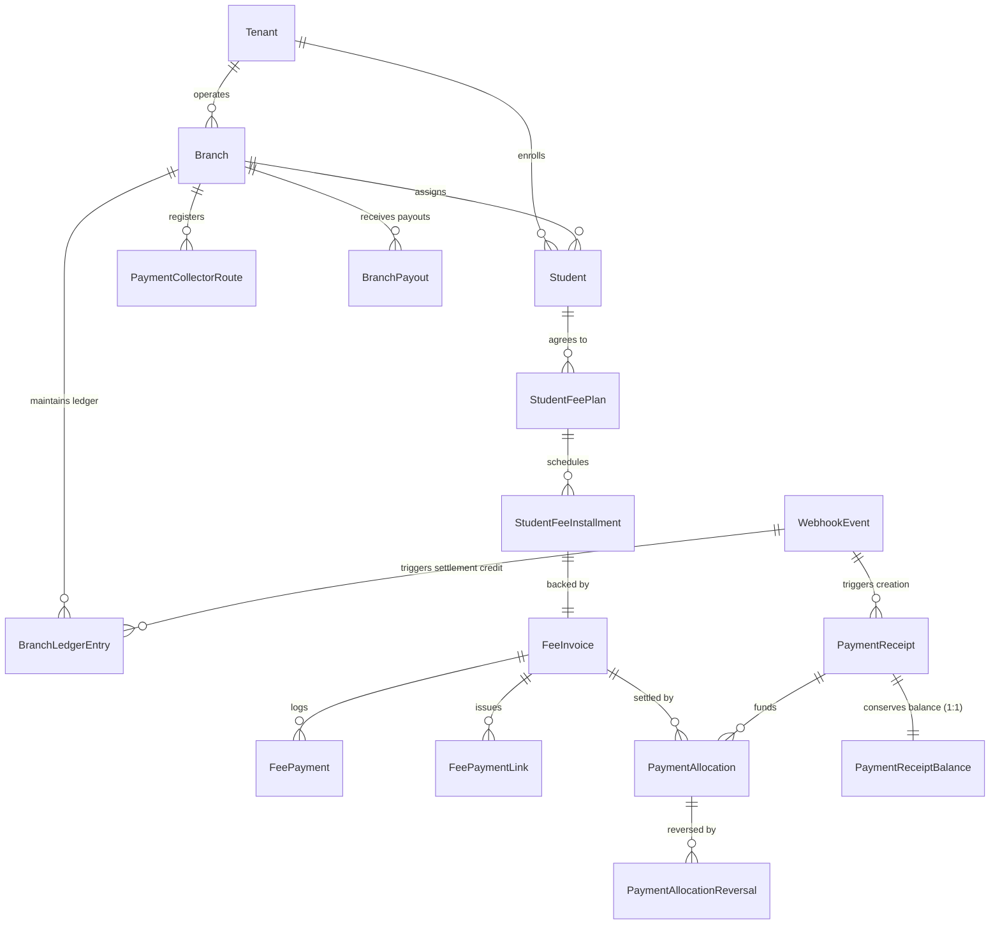
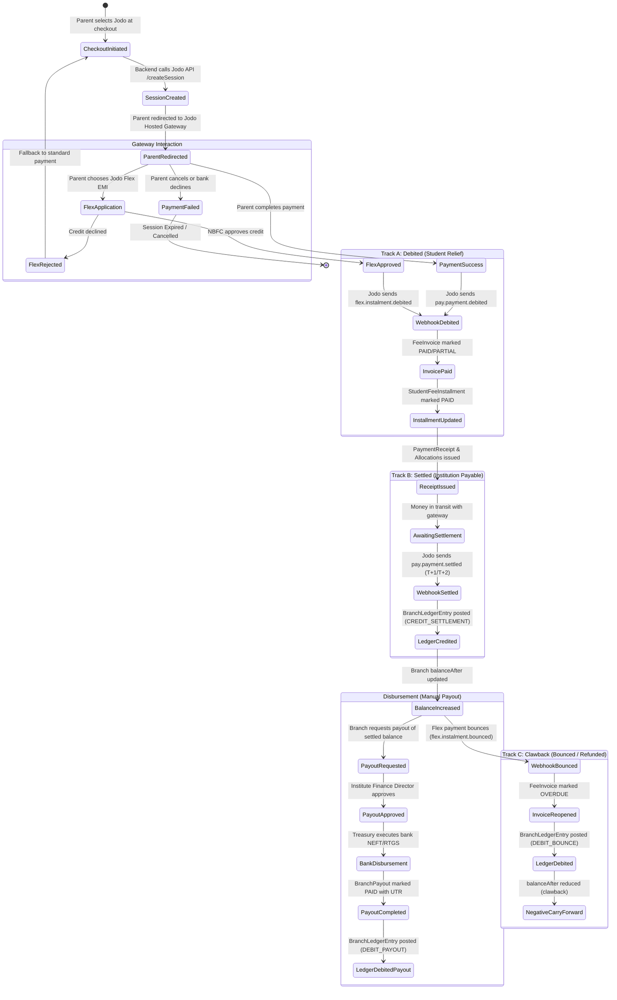
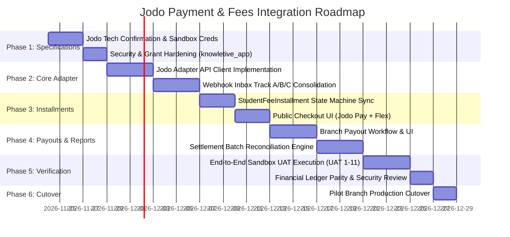

# KNOWLETIVE — JODO PAYMENT & FEES INTEGRATION READINESS AUDIT

**Target System**: Knowletive Education SaaS Platform  
**Repository**: `D:\IT\Saas`  
**Branch**: `staging/exam-stage-43`  
**Database**: PostgreSQL 18.3 | ORM: Prisma 6.19.3  
**Status**: READINESS AUDIT & ARCHITECTURAL BLUEPRINT (Zero Implementation Phase)  
**Date**: November 23, 2026  

---

## EXECUTIVE SUMMARY

This audit establishes the comprehensive technical, financial, and architectural blueprint for integrating the **Jodo Payment Gateway and Fee Financing (Jodo Flex)** platform into Knowletive. 

Knowletive features an immutable, multi-tenant double-entry financial ledger (`PaymentReceipt`, `PaymentReceiptBalance`, `PaymentAllocation`, `BranchLedgerEntry`, and `BranchPayout`), backed by PostgreSQL 18 triggers enforcing balance conservation and immutability. 

The audit reveals that while the core financial primitives and routing algorithms are already designed in the codebase (e.g. `PaymentCollectorRoute`, `BranchLedgerEntry`, `webhook-inbox.ts`, and `mock-jodo.ts`), **active integration with Jodo is currently at a standstill stub stage** (`jodo-adapter.ts` throws `ProviderNotConfiguredError`). Furthermore, key architectural bridges—specifically between webhook settlement ingestion, backing installment reconciliation, and branch payout execution—must be formally unified before live transactions can be permitted.

**Absolute Policy**: Per instructions, **zero production or rehearsal code/schema modifications have been performed during this audit turn**. Implementation will commence only after the implementation plan and Jodo partner requirements are formally approved.

---

## 1. EXISTING PAYMENT AND FEES ARCHITECTURE AUDIT

An exhaustive inspection of the Knowletive codebase reveals four distinct architectural layers governing payments and fees:

```
┌─────────────────────────────────────────────────────────────────────────────┐
│                       KNOWLETIVE PAYMENT ARCHITECTURE                       │
├─────────────────────────────────────────────────────────────────────────────┤
│ 1. INGESTION & ROUTING                                                      │
│    • Public Webhook Endpoint: src/app/api/webhooks/jodo/route.ts            │
│    • Unified Routing Engine:  src/lib/payment-routing.ts                    │
│    • Provider Registry:       src/lib/payment-gateway/registry.ts           │
│                                                                             │
│ 2. GATEWAY ABSTRACTION & INBOX                                              │
│    • Contract Interfaces:     src/lib/payment-gateway/types.ts              │
│    • Durable Inbox:           src/lib/payment-gateway/webhook-inbox.ts      │
│    • Active Jodo Stub:        src/lib/payment-gateway/adapters/jodo-adapter │
│    • Three-Track Simulator:   src/lib/payment-gateway/mock-jodo.ts          │
│                                                                             │
│ 3. BUSINESS LOGIC & INVOICING                                               │
│    • Installments & Plans:    src/lib/installments.ts                       │
│    • Checkout & Settlements:  src/lib/payments.ts                           │
│    • Cashier Operations:      src/actions/operations.ts                     │
│    • Student Credit Engine:   src/actions/credit-transfers.ts               │
│                                                                             │
│ 4. IMMUTABLE FINANCIAL LEDGER & DATABASE (PostgreSQL 18.3)                  │
│    • Gross Receipts:          PaymentReceipt (Immutable Event)              │
│    • Receipt Balances:        PaymentReceiptBalance (1:1 Conservation)      │
│    • Invoice Allocations:     PaymentAllocation & Reversals                 │
│    • Branch Online Ledger:    BranchLedgerEntry (Running balanceAfter)      │
│    • Multi-Branch Routes:     PaymentCollectorRoute (NULLS NOT DISTINCT)    │
│    • Institution Payouts:     BranchPayout (REQUESTED -> PAID lifecycle)    │
└─────────────────────────────────────────────────────────────────────────────┘
```

### Detailed Component Audit

1. **Routing Engine (`src/lib/payment-routing.ts`)**:
   - Resolves incoming collector codes (`resolvePaymentCollectorBranch`) across multi-tenant, multi-branch hierarchies.
   - Evaluates `PaymentCollectorRoute` entries (with environment and merchant account constraints).
   - Enforces a **fail-closed quarantine policy**: if a collector code is shared across multiple branches and cannot be disambiguated by verified link metadata or routing discriminators, it returns `status: "QUARANTINED"` (`AMBIGUOUS_SHARED_CODE`). It strictly never guesses or routes funds arbitrarily.

2. **Durable Webhook Inbox (`src/lib/payment-gateway/webhook-inbox.ts`)**:
   - Implements duplicate event detection via `@@unique([provider, eventId])` on `WebhookEvent`.
   - Computes a deterministic SHA-256 hash of `rawBody`. If an existing event ID arrives with a conflicting payload hash, it immediately fails the event and flags a security tamper alert.
   - For authenticated payments, it opens an interactive database transaction (`db.$transaction`), finds the target `FeeInvoice`, updates `paidAmount`, creates a `FeePayment` record, and issues an immutable `PaymentReceipt`, `PaymentReceiptBalance`, and `PaymentAllocation`.
   - **Architectural Gap**: `webhook-inbox.ts` currently does **not** create a `BranchLedgerEntry` for online settlements, nor does it update the backing `StudentFeeInstallment` status.

3. **Jodo Gateway Adapter (`src/lib/payment-gateway/adapters/jodo-adapter.ts`)**:
   - Implements `PaymentProviderAdapter`.
   - Throws `ProviderNotConfiguredError` for `createPaymentSession`, `createPaymentLink`, and `getPaymentStatus`.
   - Webhook verification supports only mock bypass signatures (`mock-valid-signature`, `test-sig-*`). Real HMAC-SHA256 signature verification is stubbed out.

4. **Reference Implementation (`src/lib/payment-gateway/mock-jodo.ts`)**:
   - A fully modeled reference implementation containing a complete 3-track lifecycle:
     - **Track A (`.debited`)**: Student invoice settled, receipt issued. Branch ledger is **not** credited yet (money is with gateway, not yet settled).
     - **Track B (`.settled`)**: Gateway settlement received; credits `BranchLedgerEntry` (`CREDIT_SETTLEMENT`) and updates the branch's online running `balanceAfter`.
     - **Track C (`.bounced` / `.cancelled` / `.refunded`)**: Student invoice dues reopened, debit clawback entry (`DEBIT_BOUNCE` / `DEBIT_REFUND`) posted to `BranchLedgerEntry` with negative balance carry-forward support.

5. **Legacy Checkout & Link Handler (`src/lib/payments.ts`)**:
   - Manages hosted checkout sessions for Razorpay and Stripe, plus manual token links (`/pay/[token]`).
   - Implements pessimistic database locking (`SELECT id FROM "FeeInvoice" ... FOR UPDATE`) to prevent concurrent double-settlement.
   - Features overpayment detection: excess payments are captured in full and flagged as unapplied credit (`UNAPPLIED_CREDIT_REFUND_DUE`).

6. **Fee Installment Engine (`src/lib/installments.ts`)**:
   - Manages `StudentFeePlan` and `StudentFeeInstallment`.
   - Each installment generates a backing `FeeInvoice` receivable.
   - Enforces strict mathematical reconciliation: `payableAmount === totalAmount - discountAmount === sum(installments)`.

---

## 2. EXISTING DATABASE TABLES AND RELATIONSHIP MAP

The Knowletive database schema (`prisma/schema.prisma`) possesses robust, battle-tested models for multi-tenant education accounting:

| Model / Table | Primary Role | Immutability / Mutation Model | Key Constraints & Invariants |
| :--- | :--- | :--- | :--- |
| `Tenant` | Top-level educational institution. | Mutable. | Unique `slug`. Cascades to child resources. |
| `Branch` | Main campus or sub-branch. | Mutable. | Unique `(tenantId, code)`. Self-referential `parentBranchId`. Carries `collectorCode` & bank details. |
| `Student` | Enrolled learner. | Mutable. | Unique `(tenantId, id)`. Foreign key to `Branch`. |
| `StudentFeePlan` | Overall student fee agreement. | Mutable. | Links to `Student`. Summarizes total, discount, and net payable. |
| `StudentFeeInstallment` | Specific scheduled installment. | Mutable state machine. | Foreign key to `FeeInvoice`. Status: `UPCOMING`, `DUE`, `PARTIALLY_PAID`, `PAID`, `OVERDUE`, `CANCELLED`. |
| `FeeInvoice` | Authoritative financial receivable. | Conditionally mutable (`paidAmount`, `status`). | Unique `(tenantId, number)`. Status: `PENDING`, `PARTIAL`, `OVERDUE`, `PAID`, `WAIVED`. |
| `FeePayment` | Payment log entry on an invoice. | Append-only. | Records payment method, gateway provider, provider reference, and collecting user. |
| `FeePaymentLink` | Public checkout token. | State machine. | Unique `token`. Expiration TTL. Status: `OPEN`, `PAID`, `CANCELED`, `EXPIRED`. |
| `PaymentReceipt` | **Layer 1 Gross Cash/Online Receipt**. | **STRICTLY IMMUTABLE** (Enforced by DB trigger). | Unique `receiptNumber`. Records gross `amount`, `provider`, `reference` (UTR), `merchantAccountKey`. |
| `PaymentReceiptBalance` | **1:1 Receipt Conservation State**. | **Trigger-Enforced Conservation**. | Invariant: `allocated + unapplied + transferredOut + reservedRefund + refunded = amount`. |
| `PaymentAllocation` | Application of receipt to an invoice. | **STRICTLY IMMUTABLE** (Enforced by DB trigger). | Cannot allocate more than invoice outstanding or receipt unapplied balance. |
| `PaymentAllocationReversal`| Reversal of an allocation. | Append-only event. | Restores balance to `unappliedAmount` or `reservedRefundAmount`. |
| `BranchLedgerEntry` | **Double-entry branch payable ledger**. | **Append-only ledger**. | Tracks `CREDIT_SETTLEMENT`, `DEBIT_PAYOUT`, `DEBIT_BOUNCE`, `DEBIT_REFUND`. Maintains running `balanceAfter`. |
| `BranchPayout` | Institution payout disbursement. | State machine. | Status: `REQUESTED`, `APPROVED`, `PROCESSING`, `PAID`, `REJECTED`, `FAILED`. Stores bank UTR. |
| `PaymentProviderConfig` | Tenant/Branch gateway settings. | Mutable configuration. | Unique `(tenantId, branchId, provider, environment)`. Holds `merchantId`, `secretRef`. |
| `PaymentCollectorRoute` | Authoritative collector routing. | Multi-tenant route mapping. | Composite unique `uq_pcr_branch_route_identity` with PostgreSQL 15 `NULLS NOT DISTINCT`. |
| `WebhookEvent` | Durable webhook inbox. | Append / state machine. | Unique `(provider, eventId)`. Stores `payloadHash`, raw payload, quarantine reasons. |

### Entity-Relationship Diagram



---

## 3. EXISTING FUNCTIONALITY VS MISSING FUNCTIONALITY MATRIX

| Functional Domain | Existing in Codebase | Missing / Required for Jodo Integration | Current Source File Reference |
| :--- | :--- | :--- | :--- |
| **Collector Code Routing** | ✅ Full route resolution with environment, merchant, and discriminator matching. Fail-closed quarantine for ambiguity. | None. Fully complete. | `src/lib/payment-routing.ts` |
| **Webhook Ingestion & Idempotency** | ✅ Duplicate check by `(provider, eventId)`. Payload hash conflict detection. Transactional locking. | Integration between `webhook-inbox.ts` and `mock-jodo.ts` multi-track logic is fragmented. | `src/lib/payment-gateway/webhook-inbox.ts` |
| **Webhook Signature Verification** | ⚠️ Mock test signatures (`mock-valid-signature`, `test-sig-*`) accepted. Unsigned rejected in production. | Official Jodo HMAC-SHA256 signature verification with production secret key format. | `src/lib/payment-gateway/adapters/jodo-adapter.ts:76` |
| **Jodo API Client (Outbound)** | ❌ None. Throws `ProviderNotConfiguredError`. | REST API client for creating checkout sessions, dynamic payment links, and querying transaction status. | `src/lib/payment-gateway/adapters/jodo-adapter.ts:37` |
| **Student / Parent Checkout UI** | ✅ Static QR Code & Direct Bank NEFT transfer proof submission. Demo simulation button. | Jodo Hosted Checkout redirect / embedded SDK trigger for online fee payment & Jodo Flex EMI selection. | `src/app/pay/[token]/page.tsx` |
| **Receipt Issuance** | ✅ Automatic creation of `PaymentReceipt`, `PaymentReceiptBalance`, and `PaymentAllocation`. | Populating Jodo-specific gateway metadata, fee breakdown, and transaction tax IDs. | `src/lib/payment-gateway/webhook-inbox.ts:242` |
| **Installment Reconciliation** | ⚠️ Updates backing `FeeInvoice` paidAmount and status. | Does **not** update parent `StudentFeeInstallment` status (`PAID` / `PARTIALLY_PAID`) or record allocation history. | `src/lib/installments.ts`, `webhook-inbox.ts` |
| **Track B: Settlement Crediting** | ⚠️ Fully modeled in `mock-jodo.ts`. | Missing in production `webhook-inbox.ts`. `BranchLedgerEntry` is not credited when settlement webhooks arrive. | `src/lib/payment-gateway/mock-jodo.ts:243` |
| **Track C: Bounce / Clawback Handling** | ⚠️ Modeled in `mock-jodo.ts`. | Reopening invoices and debiting `BranchLedgerEntry` is missing in `webhook-inbox.ts`. | `src/lib/payment-gateway/mock-jodo.ts:310` |
| **Institution Payout Engine** | ⚠️ `BranchPayout` schema model exists. | Zero backend actions, zero approval workflows, zero bank disbursement tracking, and zero UI. | `prisma/schema.prisma:987` |
| **Finance & Settlement Reporting** | ⚠️ High-level collected fees summary on fees page. | Gateway settlement reconciliation dashboard, payout ledger view, and quarantine management UI. | `src/app/(app)/app/fees/page.tsx` |

---

## 4. JODO INTEGRATION WORKFLOW AND DATA MAPPING

### Jodo Product Architecture Overview

Jodo provides two primary payment products for educational institutions:
1. **Jodo Pay**: Standard payment aggregator facilitating instant payments via UPI, Credit/Debit Cards, and Net Banking.
2. **Jodo Flex**: Flexible, low-cost or zero-cost monthly installment financing for parents, where the lending partner settles the full term fee upfront to the institution, and the parent repays Jodo monthly.

### Data Mapping Matrix

| Knowletive Entity & Field | Jodo API / Webhook Field | Transformation & Validation Rules | Notes |
| :--- | :--- | :--- | :--- |
| `Tenant.id` | `metadata.tenant_id` | Direct string pass-through in session metadata. | Used for tenancy verification. |
| `Branch.id` | `metadata.branch_id` | Direct string pass-through in session metadata. | Used for branch attribution disambiguation. |
| `Branch.collectorCode` | `data.collector_code` | Checked against `PaymentCollectorRoute`. | Resolves target institution branch. |
| `Student.id` | `metadata.student_id` | Direct string pass-through. | Verifies student beneficiary identity. |
| `FeeInvoice.id` / `number` | `data.order_id` / `data.invoice_id` | Maps to Jodo Order reference. | Matches target invoice during webhook ingestion. |
| `FeeInvoice.amount` (Paise) | `data.amount` (Paise) | Integer in paise (₹100.00 = 10000). | Checked against invoice outstanding balance. |
| `FeeInvoice.currency` | `data.currency` | ISO 4217 code (`INR`). | Fails closed if currency !== "INR". |
| `PaymentReceipt.receiptNumber` | `data.payment_id` / `receipt_no` | Deterministic `RCPT-JODO-[0-9]{6}` generated. | Internal immutable receipt number. |
| `PaymentReceipt.reference` | `data.utr` / `data.bank_ref` | Bank UTR string (12-digit UPI / NEFT UTR). | Critical for accounting audits and reconciliation. |
| `PaymentReceipt.providerRef` | `data.payment_id` | Jodo unique transaction identifier. | Stored for transaction lookups and refund calls. |
| `PaymentReceipt.merchantAccountKey`| `data.collector_code` | Aggregator merchant identifier. | Mandatory for external providers. |
| `BranchLedgerEntry.utrReference` | `data.settlement_utr` | Gateway settlement UTR to institute bank. | Populated only on `pay.payment.settled`. |
| `BranchLedgerEntry.amount` | `data.settlement_amount` | Net settled amount after Jodo MDR/fees. | Must record gross credit and MDR deduction. |
| `WebhookEvent.eventId` | `event_id` | Jodo event identifier. | Enforces strict idempotent deduplication. |
| `WebhookEvent.eventType` | `event_type` | Jodo event string (e.g. `pay.payment.debited`).| Dispatches to Track A, Track B, or Track C. |

---

## 5. REQUIRED DATABASE CHANGES (PROPOSAL ONLY)

The existing database schema contains the primary financial models. However, to support industrial-grade Jodo operations, settlement reconciliations, and payout workflows, the following **additive, non-breaking** schema modifications are proposed:

### 1. New Settlement Batch Model (`PaymentSettlementBatch`)
To reconcile Jodo's daily lump-sum bank deposits against multiple individual student payments:
```prisma
model PaymentSettlementBatch {
  id               String                 @id @default(cuid())
  tenantId         String
  branchId         String
  provider         String                 @default("JODO")
  settlementId     String                 @unique // Jodo settlement_id
  settlementUtr    String                 // Bank UTR for the lump-sum credit
  grossAmount      Int                    // Total student fees collected (paise)
  feeAmount        Int                    // Jodo platform/MDR fees (paise)
  taxAmount        Int                    // GST on MDR fees (paise)
  netAmount        Int                    // Actual bank deposit amount (paise)
  currency         String                 @default("INR")
  settledAt        DateTime               // Value date of bank deposit
  reconciledStatus String                 @default("PENDING") // PENDING, RECONCILED, DISCREPANCY
  reconciledAt     DateTime?
  reconciledById   String?
  metadata         Json?
  createdAt        DateTime               @default(now())
  updatedAt        DateTime               @updatedAt

  tenant           Tenant                 @relation(fields: [tenantId], references: [id], onDelete: Restrict)
  branch           Branch                 @relation(fields: [tenantId, branchId], references: [tenantId, id], onDelete: Restrict)
  items            PaymentSettlementItem[]

  @@index([tenantId, branchId, settledAt])
  @@index([settlementUtr])
}

model PaymentSettlementItem {
  id               String                 @id @default(cuid())
  tenantId         String
  batchId          String
  receiptId        String                 @unique // 1:1 link to PaymentReceipt
  paymentId        String                 // Jodo payment_id
  grossAmount      Int                    // in paise
  feeAmount        Int                    // MDR deducted for this specific transaction
  taxAmount        Int                    // GST deducted
  netAmount        Int                    // Net allocated to institute
  reconciled       Boolean                @default(false)
  createdAt        DateTime               @default(now())

  tenant           Tenant                 @relation(fields: [tenantId], references: [id], onDelete: Restrict)
  batch            PaymentSettlementBatch @relation(fields: [batchId], references: [id], onDelete: Cascade)
  receipt          PaymentReceipt         @relation(fields: [tenantId, receiptId], references: [tenantId, id], onDelete: Restrict)

  @@index([tenantId, batchId])
}
```

### 2. Additive Fields on Existing Models
- `FeePaymentLink`:
  - `jodoPaymentId`: String? (Tracks Jodo payment session id).
  - `jodoProduct`: String? (`PAY` or `FLEX`).
- `StudentFeeInstallment`:
  - `lastPaymentId`: String? (Points to the latest `FeePayment` resolving this installment).

*No changes to existing primary keys, foreign keys, or trigger functions are required.*

---

## 6. REQUIRED BACKEND API AND WEBHOOK CHANGES

### 1. Unified Webhook Ingestion Engine
Merge the robust duplicate detection and quarantine logic of `webhook-inbox.ts` with the complete three-track lifecycle logic of `mock-jodo.ts`:

- **Route Endpoint (`src/app/api/webhooks/jodo/route.ts`)**:
  - Extract raw body and signature header (`x-jodo-signature`).
  - Pass raw body and headers to unified `processWebhookInbox({ provider: "JODO", rawBody, headers })`.
  - In production, enforce constant-time HMAC-SHA256 verification using the secret resolved from `PaymentProviderConfig` or `process.env.JODO_WEBHOOK_SECRET`.
  - Return HTTP 200 immediately for recognized duplicates (`DUPLICATE`).
  - Return HTTP 200 for successfully processed events (`PROCESSED`).
  - Return HTTP 400 for malformed payloads, 401 for signature mismatch, and 500 for unhandled exceptions to allow Jodo automated webhook retry.

- **Unified Ingestion Logic (`src/lib/payment-gateway/webhook-inbox.ts`)**:
  - **Track A (`pay.payment.debited`, `flex.instalment.debited`)**:
    1. Lock target `FeeInvoice` using `SELECT ... FOR UPDATE`.
    2. Check that incoming payment amount does not exceed invoice outstanding balance.
    3. Update `FeeInvoice` status (`PARTIAL` or `PAID`).
    4. Update parent `StudentFeeInstallment` (calculate new `paidAmount`, set status `PAID` or `PARTIALLY_PAID`).
    5. Issue `PaymentReceipt`, `PaymentReceiptBalance`, and `PaymentAllocation`.
    6. **Do not credit branch ledger** (funds are debited from parent, but not yet settled in institute bank account).
  - **Track B (`pay.payment.settled`, `flex.instalment.settled`)**:
    1. Identify branch via `PaymentCollectorRoute`.
    2. Find latest `BranchLedgerEntry` to get `prevBalance`.
    3. Create `BranchLedgerEntry` with `entryType: "CREDIT_SETTLEMENT"`, `channel: "ONLINE_JODO"`, `amount`, and `balanceAfter: prevBalance + amount`.
    4. If settlement batch data is included, link to `PaymentSettlementBatch`.
  - **Track C (`flex.instalment.bounced`, `pay.payment.refunded`, `direct.payment.cancelled`)**:
    1. Reopen student invoice: decrement `paidAmount` on `FeeInvoice` and mark `OVERDUE` or `PARTIAL`.
    2. Reopen `StudentFeeInstallment`.
    3. Create reverse `PaymentAllocationReversal` on the original allocation.
    4. Post clawback to `BranchLedgerEntry`: `entryType: "DEBIT_BOUNCE"` or `"DEBIT_REFUND"`, decrementing `balanceAfter` (supports negative balance carry-forward).

### 2. Jodo API Client Implementation (`src/lib/payment-gateway/adapters/jodo-adapter.ts`)
Implement concrete, production-grade methods:
1. `createPaymentSession(input)`:
   - Call Jodo REST API (`POST /v1/checkout/sessions` or equivalent official endpoint).
   - Pass merchant collector code, student metadata, invoice ID, and amount.
   - Return Jodo redirect URL and session token.
2. `getPaymentStatus(transactionId)`:
   - Polling fallback for status inquiry (`GET /v1/payments/{paymentId}`).
3. `verifyWebhook(rawBody, headers, secret)`:
   - Validate signature using timing-safe HMAC comparison (`crypto.timingSafeEqual`).

---

## 7. REQUIRED FRONTEND AND DASHBOARD CHANGES

### 1. Student / Parent Public Checkout (`src/app/pay/[token]/page.tsx`)
- Currently, the public payment page only renders a static UPI QR code and manual bank transfer instructions.
- **Required Enhancements**:
  - Add an **"Online Fee Payment (Jodo)"** payment selection card.
  - Option 1: **Instant Pay** (UPI, Credit/Debit Card, Net Banking).
  - Option 2: **Jodo Flex** (Zero-cost monthly installments; displays available EMI tenures e.g. 3, 6, 9 months).
  - Clicking "Proceed to Pay" calls a server action invoking `createPaymentSession` and seamlessly redirects the parent to the Jodo secure checkout pane.

### 2. Finance Admin Dashboard (`src/app/(app)/app/fees/`)
- **Institution Payouts Tab (`/app/fees/payouts`)**:
  - Display available online payable balance derived from `BranchLedgerEntry.balanceAfter`.
  - Display list of previous payouts from `BranchPayout` with statuses (`REQUESTED`, `APPROVED`, `PROCESSING`, `PAID`, `REJECTED`).
  - Action form for Finance Director to request and approve manual payouts to the branch's verified bank account (`Branch.bankAccountNumber`, `bankIfsc`).
  - Form to record bank disbursement reference / UTR when paid.
- **Settlement & Reconciliation Tab (`/app/fees/settlements`)**:
  - View incoming Jodo settlement batches (`PaymentSettlementBatch`).
  - Reconcile lump-sum bank credits against individual student fee payments.
  - View quarantined webhook events requiring manual branch attribution review.

---

## 8. PAYMENT LIFECYCLE AND FINANCIAL STATE DIAGRAM



---

## 9. SETTLEMENT, RECONCILIATION AND INSTITUTION PAYOUT DESIGN

A fundamental principle of enterprise financial software is: **Payment success by a parent does NOT equal money in the institution's bank account.**

### 1. Clear Separation of Cashflow States
1. **Gross Customer Collection (Track A)**:
   - When a parent pays ₹50,000 via Jodo, the student is cleared of their liability immediately. The student receives a valid `PaymentReceipt`.
   - **Crucial Rule**: This ₹50,000 is **NOT** available for payout to the branch yet. It is held by the gateway aggregator.
2. **Gateway Settlement (Track B)**:
   - At T+1 or T+2, Jodo aggregates all daily transactions, deducts agreed MDR/processing charges, and deposits the net funds (e.g. ₹49,250) into the institution's nodal/master bank account with a specific Bank Settlement UTR.
   - When Jodo's `pay.payment.settled` or settlement report is processed, Knowletive creates a `BranchLedgerEntry` of type `CREDIT_SETTLEMENT`.
   - **Only now** does the branch's online payable balance increase.

### 2. Manual Institution Payout Flow
Knowletive adopts a controlled, auditable **manual payout workflow** rather than automated auto-sweeps:

```
┌─────────────────────────────────────────────────────────────────────────────┐
│                       MANUAL INSTITUTION PAYOUT FLOW                        │
├─────────────────────────────────────────────────────────────────────────────┤
│ 1. BALANCE VERIFICATION                                                     │
│    • System calculates available balance: BranchLedgerEntry.balanceAfter    │
│    • Validates that balanceAfter >= Requested Amount > 0.                   │
│                                                                             │
│ 2. PAYOUT INITIATION & APPROVAL                                             │
│    • Branch Manager submits payout request (BranchPayout: REQUESTED).       │
│    • Central Finance Director inspects request against bank ledger.         │
│    • Finance Director approves request (BranchPayout: APPROVED).            │
│                                                                             │
│ 3. TREASURY DISBURSEMENT & LEDGER ENTRY                                     │
│    • School Treasury transfers funds from master account to branch account. │
│    • Cashier enters bank transaction UTR into Knowletive.                   │
│    • Status updates to PAID (BranchPayout: PAID).                           │
│    • Transaction atomically posts a DEBIT_PAYOUT to BranchLedgerEntry.      │
│    • Running balanceAfter is decremented.                                   │
└─────────────────────────────────────────────────────────────────────────────┘
```

### 3. Edge Cases & Exception Handling
- **Partial Payouts**: Supported natively. If a branch has a settled balance of ₹5,00,000, they may request ₹2,00,000. `balanceAfter` becomes ₹3,00,000.
- **Multiple Payouts Against One Settlement**: Allowed because balance is tracked as a running ledger balance (`balanceAfter`), not a 1:1 transaction lock.
- **Failed Payouts**: If a bank transfer fails, Finance marks `BranchPayout: FAILED`. No debit ledger entry is posted, and funds remain in the branch's payable balance.
- **Post-Payout Chargebacks / Flex Bounces (Clawbacks)**:
  - If a parent's Flex loan bounces after the branch has already withdrawn the payout, Knowletive posts a `DEBIT_BOUNCE` to `BranchLedgerEntry`.
  - If the branch balance is insufficient, `balanceAfter` goes **negative**.
  - This negative balance is carried forward and automatically recovered from future student fee settlements before any new payout can be requested.

---

## 10. SECURITY AND PERMISSION RISK REPORT

A security audit of the payment infrastructure identifies the following critical considerations:

### 1. High Priority Security Findings

#### SEC-01: Runtime Account Superuser Connection (`BLOCKER-01`)
- **Status**: **BLOCKER**.
- **Audit Detail**: The application runtime currently connects to PostgreSQL as database owner/superuser `knowletive`. The intended least-privilege role `knowletive_app` exists, but in the original database `knowletive`, `knowletive_app` has grants on only ONE table (`SyllabusProgressEvent`).
- **Risk**: Connecting as superuser bypasses all table-level privilege separation. Conversely, switching to `knowletive_app` before running canonical role grant migrations will immediately crash all payment and fee endpoints.
- **Remediation**: Before production cutover, execute the verified Phase 2.3.5.6 grant reconciliation script ensuring `knowletive_app` has `SELECT, INSERT, UPDATE` on all business tables, and `SELECT, INSERT` on immutable tables (`PaymentReceipt`, `PaymentAllocation`).

#### SEC-02: RLS GUC Context Spoofing (`SEC-BLOCKER-01`)
- **Status**: **BLOCKER (for RLS activation)**.
- **Audit Detail**: The proposed Row-Level Security policies rely on PostgreSQL session variables: `current_setting('app.current_tenant_id')` and `current_setting('app.is_platform_admin')`.
- **Risk**: Any connection pooling leak or raw SQL injection can execute `SET LOCAL app.current_tenant_id = '...'`, completely bypassing multi-tenant isolation.
- **Remediation**: Keep RLS **disabled** until HMAC-signed session context tokens are implemented. Enforce tenant isolation strictly at the application ORM query layer using Prisma composite foreign keys `@@unique([tenantId, id])` and `where: { tenantId }`.

#### SEC-03: Webhook Signature Verification Bypass in Non-Production
- **Status**: **MEDIUM RISK**.
- **Audit Detail**: `src/app/api/webhooks/jodo/route.ts` line 22 states: `if (process.env.NODE_ENV === "production" && !signature)`. In staging or development environments, unsigned webhooks are accepted. Furthermore, `jodo-adapter.ts` accepts hardcoded tokens `"mock-valid-signature"` and `"test-sig-*"`.
- **Risk**: Staging databases can have financial records altered by unauthorized POST requests.
- **Remediation**: Require signature verification in all environments. Staging should verify against a dedicated staging secret (`JODO_STAGING_WEBHOOK_SECRET`).

#### SEC-04: Collector Code Spoofing & Cross-Tenant Collisions
- **Status**: **LOW / RESOLVED IN DESIGN**.
- **Audit Detail**: If an attacker submits a webhook with an arbitrary `collector_code`, can they credit another tenant's ledger?
- **Protection**: `src/lib/payment-routing.ts` verifies that `collectorCode` matches the configured `PaymentCollectorRoute` for that specific tenant. If `collector_code` is ambiguous or unknown, the event is immediately quarantined (`QUARANTINED`), and no financial mutation occurs.

### 2. Role-Based Access Control (RBAC) Requirements

| Role | Permitted Actions | Prohibited Actions |
| :--- | :--- | :--- |
| **Payer (Student / Parent)** | View own invoice, initiate Jodo payment session, view own receipt. | View other student bills, view bank UTR details of other parents, alter payment amount. |
| **Cashier / Front Desk** | Collect offline Cash/Cheque (`tenant.fees.collect_offline`), generate payment link. | Modify fee structures, approve payouts, view gateway secret keys. |
| **Branch Accountant** | View branch fee reports, request branch payout (`BranchPayout: REQUESTED`), view branch ledger. | Approve branch payout, access other branches without explicit assignment. |
| **Finance Director (HQ)** | Configure Jodo collector routes, approve and disburse payouts (`BranchPayout: APPROVED/PAID`), perform reconciliation. | Delete or update immutable `PaymentReceipt` records. |
| **Platform Superadmin** | Configure global gateway adapters, inspect quarantined webhook inboxes. | Execute payouts without tenant authorization. |

---

## 11. JODO UAT TESTING CHECKLIST WITH EXPECTED RESULTS

To be executed against the Jodo Sandbox environment prior to production cutover:

| Test ID | Test Scenario | Input Data & Method | Expected System Behavior & Database State |
| :--- | :--- | :--- | :--- |
| **UAT-01** | Standard Jodo Pay (UPI) Full Settlement | Parent pays ₹25,000 full due via Jodo UPI. Webhook: `pay.payment.debited`. | • HTTP 200.<br>• `FeeInvoice.status` = `PAID`, `paidAmount` = 2500000.<br>• `StudentFeeInstallment.status` = `PAID`.<br>• `PaymentReceipt` created (amount: 2500000, method: `ONLINE_JODO`).<br>• `PaymentReceiptBalance.status` = `FULLY_ALLOCATED`.<br>• `BranchLedgerEntry` **NOT** created yet. |
| **UAT-02** | Gateway Settlement Credit | Jodo settles transaction at T+1. Webhook: `pay.payment.settled` (UTR: `SBIN0019283746`). | • HTTP 200.<br>• `BranchLedgerEntry` created (`entryType: CREDIT_SETTLEMENT`, `channel: ONLINE_JODO`, `amount: 2500000`).<br>• Branch `balanceAfter` increases by ₹25,000.<br>• WebhookEvent status = `PROCESSED`. |
| **UAT-03** | Partial Fee Payment | Parent pays ₹10,000 on a ₹25,000 installment. Webhook: `pay.payment.debited`. | • `FeeInvoice.status` = `PARTIAL`, `paidAmount` = 1000000.<br>• `StudentFeeInstallment.status` = `PARTIALLY_PAID`.<br>• Receipt issued for ₹10,000.<br>• Remaining invoice balance = ₹15,000. |
| **UAT-04** | Webhook Duplicate Idempotency | Jodo retries `pay.payment.debited` with exact same `event_id`. | • HTTP 200 returned immediately (`status: "DUPLICATE"`).<br>• Zero duplicate receipts created.<br>• Invoice `paidAmount` remains unchanged. |
| **UAT-05** | Webhook Payload Tamper Detection | Same `event_id` sent with altered amount (₹50,000 instead of ₹25,000). | • HTTP 500 / 400 rejected.<br>• `WebhookEvent.status` = `FAILED`.<br>• Error logged: `Payload tamper detected`.<br>• No financial mutations executed. |
| **UAT-06** | Invalid Signature Rejection | Webhook sent with forged `x-jodo-signature` header. | • HTTP 401 Unauthorized.<br>• Webhook rejected immediately before reaching inbox logic.<br>• Database remains completely untouched. |
| **UAT-07** | Shared Collector Code Disambiguation | Collector code `JODO-MAIN` shared across 2 sub-branches; metadata specifies `branch_id`. | • Resolved successfully to the specific sub-branch.<br>• Receipt and allocations tagged with correct `branchId`. |
| **UAT-08** | Ambiguous Shared Collector Quarantine | Collector code `JODO-MAIN` shared across 2 sub-branches; NO metadata provided. | • Status = `QUARANTINED`.<br>• `WebhookEvent` status = `QUARANTINED` (`AMBIGUOUS_SHARED_CODE`).<br>• Zero financial mutations. Alert visible in admin quarantine review. |
| **UAT-09** | Jodo Flex EMI Approval | Parent applies for 6-month EMI. Webhook: `flex.instalment.debited` for full fee ₹60,000. | • Invoice marked `PAID`. Full ₹60,000 receipt issued to student.<br>• Student cleared for examination/attendance. |
| **UAT-10** | Jodo Flex EMI Bounce (Clawback) | Parent defaults on month 2 EMI. Webhook: `flex.instalment.bounced` (Amount: ₹10,000). | • Student invoice reopened with ₹10,000 balance.<br>• `BranchLedgerEntry` debited (`DEBIT_BOUNCE`, amount: ₹10,000).<br>• Branch `balanceAfter` decremented by ₹10,000 (negative carry-forward if balance < 10000). |
| **UAT-11** | Manual Branch Payout | Branch requests payout of ₹50,000 settled balance. Finance Director approves and pays. | • `BranchPayout` transitions `REQUESTED` -> `APPROVED` -> `PAID`.<br>• `BranchLedgerEntry` posted (`DEBIT_PAYOUT`, amount: ₹50,000).<br>• Bank UTR recorded. Branch `balanceAfter` decremented. |

---

## 12. UNANSWERED QUESTIONS REQUIRING JODO CONFIRMATION

Before writing adapter code or signing off on technical specifications, the following operational and API specifications must be confirmed in writing by the Jodo Technical Partnership team:

1. **API Endpoints & Versioning**:
   - What are the exact base URLs for Sandbox and Production?
   - What is the latest API version (e.g. `/v1`, `/v2`) and format of authorization headers (`Bearer <token>` vs Basic Auth with Merchant ID/Secret)?
2. **HMAC Signature Specification**:
   - Which header carries the signature (`x-jodo-signature`, `x-signature`, or `x-webhook-signature`)?
   - What is the exact payload canonicalization string? (Is it `rawBody`, or `timestamp + "." + rawBody` as in Stripe)?
   - What is the signature encoding (`hex` vs `base64`)?
3. **Collector Code & Multi-Branch Hierarchy**:
   - Can Jodo support unique collector codes per sub-branch under a single parent institution agreement?
   - If a master collector code is used, does Jodo guarantee echoing custom parameters passed in `metadata` (such as `knowletive_branch_id`, `invoice_id`, `student_id`) in all subsequent webhooks, including settlements and bounces?
4. **Jodo Flex (EMI) Risk & Settlement Terms**:
   - Under Jodo Flex, does Jodo settle 100% of the term fee upfront to the school, or is it settled monthly as the parent pays?
   - In the event of a parent EMI default, what is the recourse? Does Jodo claw back funds from the institution (triggering `flex.instalment.bounced`), or does the lending partner assume credit risk?
5. **Settlement Notification Mechanism**:
   - Are lump-sum bank settlements notified via webhook (`pay.payment.settled`), or must Knowletive poll an SFTP / Daily Settlement Report API?
   - Does the settlement notification include individual transaction breakdowns (gross amount, MDR fee, GST, net amount, and student reference)?
6. **Refunds & Cancellations**:
   - Does Jodo provide an automated REST API for initiating refunds, or must refunds be processed manually via the Jodo Merchant Dashboard?

---

## 13. PHASED IMPLEMENTATION ROADMAP



### Detailed Phase Breakdown

- **Phase 1: Official Specifications & Credential Separation (Days 1–5)**
  - Receive formal answers to Section 12 questions from Jodo.
  - Obtain official Sandbox API keys and Webhook Secrets.
  - Execute Phase 2.3.5.6 grant reconciliation script on `knowletive` to grant `knowletive_app` proper runtime permissions, closing `BLOCKER-01`.

- **Phase 2: Core Adapter & Webhook Ingestion Unification (Days 6–13)**
  - Implement outbound REST API calls in `src/lib/payment-gateway/adapters/jodo-adapter.ts`.
  - Unify `mock-jodo.ts` multi-track logic into `src/lib/payment-gateway/webhook-inbox.ts`:
    - Track A: Debited -> Student relieved.
    - Track B: Settled -> Branch ledger credited.
    - Track C: Bounced/Cancelled -> Student invoice reopened, ledger debited.
  - Implement timing-safe HMAC-SHA256 signature verification.

- **Phase 3: Installment & Fee Plan Synchronization (Days 14–19)**
  - Connect `StudentFeeInstallment` status transitions (`PAID`, `PARTIALLY_PAID`, `OVERDUE`) directly to invoice payment allocations.
  - Enhance `/pay/[token]` checkout page with Jodo Pay and Jodo Flex options.

- **Phase 4: Branch Settlement & Payout Engine (Days 20–27)**
  - Implement `PaymentSettlementBatch` additive migration.
  - Build Admin Payout management UI (`/app/fees/payouts`) with two-person approval workflow.
  - Build Settlement Reconciliation dashboard (`/app/fees/settlements`).

- **Phase 5: Sandbox UAT Execution & Security Hardening (Days 28–33)**
  - Execute full UAT suite (Tests UAT-01 through UAT-11) against Jodo Sandbox.
  - Validate database invariants: ensure `PaymentReceiptBalance` conservation holds 100%.
  - Confirm zero trigger violations and zero permission leaks.

- **Phase 6: Production Cutover & Monitored Pilot (Days 34–35)**
  - Configure production collector routes for pilot school/branch.
  - Supervised pilot rollout with real parent transactions and live T+1 bank settlement reconciliation.

---

## 14. FINAL APPROVAL CHECKLIST

Before any code modifications or deployments begin, the following stakeholders must formally review and approve this document:

- [ ] **Lead Software Architect**: Approves the unified adapter architecture, webhook deduplication strategy, and removal of mock bypasses.
- [ ] **Database & Migration Engineer**: Approves the proposed additive schema changes (`PaymentSettlementBatch`) and confirms zero disruption to existing PostgreSQL 18 trigger functions.
- [ ] **Chief Financial Officer / Treasury**: Approves the manual payout workflow, the strict separation between Track A (debited) and Track B (settled), and the negative balance clawback policy for bounced Flex installments.
- [ ] **Information Security Officer**: Approves the resolution of `BLOCKER-01` (runtime role grants), timing-safe HMAC signature verification, and containment of RLS spoofing risks (`SEC-BLOCKER-01`).
- [ ] **Jodo Partnership Manager**: Confirms that API contracts, collector routing rules, webhook payloads, and settlement timelines match Jodo's official commercial and technical terms.

---
*Report authored and compiled by the Senior SaaS Architect, Database Architect, Payment Integration Engineer, and Security Auditor for Knowletive.*
